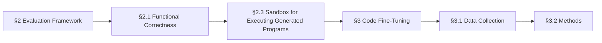
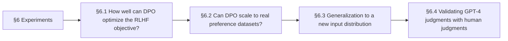
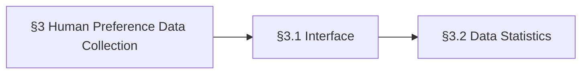

# Library: r2-score-noise

Built from arXiv HTML bodies on 2026-11-25. 12 work(s).

| work | year | mechanism points | figure | cited by | summary |
| --- | --- | --- | --- | --- | --- |
| [Training language models to follow instructions with human feedback](https://arxiv.org/abs/2203.02155) | 2022 | 12 | yes | 1 | yes |
| [Evaluating Large Language Models Trained on Code](https://arxiv.org/abs/2107.03374) | 2021 | 6 | yes | 3 | yes |
| [Proximal Policy Optimization Algorithms](https://arxiv.org/abs/1707.06347) | 2017 | 0 | no | 4 | yes |
| [Direct Preference Optimization: Your Language Model is Secretly a Reward Model](https://arxiv.org/abs/2305.18290) | 2023 | 5 | yes | 0 | yes |
| [Chatbot Arena: An Open Platform for Evaluating LLMs by Human Preference](https://arxiv.org/abs/2403.04132) | 2024 | 2 | yes | 2 | yes |
| [DeepSeekMath: Pushing the Limits of Mathematical Reasoning in Open Language Models](https://arxiv.org/abs/2402.03300) | 2024 | 11 | yes | 2 | yes |
| [Training Verifiers to Solve Math Word Problems](https://arxiv.org/abs/2110.14168) | 2021 | 3 | yes | 4 | yes |
| [LoRA: Low-Rank Adaptation of Large Language Models](https://arxiv.org/abs/2106.09685) | 2022 | 7 | yes | 0 | yes |
| [τ \tau -bench: A Benchmark for T ool- A gent- U ser Interaction in Real-World Domains](https://arxiv.org/abs/2406.12045) | 2025 | 1 | yes | 0 | yes |
| [DeepSeek-R1: Incentivizing Reasoning Capability in LLMs via Reinforcement Learning](https://arxiv.org/abs/2501.12948) | 2025 | 6 | yes | 1 | yes |
| [Qwen3 Technical Report](https://arxiv.org/abs/2505.09388) | 2025 | 17 | yes | 0 | yes |
| [The Llama 3 Herd of Models](https://arxiv.org/abs/2407.21783) | 2024 | 13 | yes | 0 | yes |

Summaries written: 12 of 12

---

# Training language models to follow instructions with human feedback

arXiv:2203.02155 · 2022 · [source](https://arxiv.org/html/2203.02155)

> Written by an agent that read the body (DeepSeek Harness, 2026-11-24) after reading the paper; the mechanism quotes are the paper’s own words.

## 出发点
Large language models (LMs) can be “prompted” to perform a range of natural language processing (NLP) tasks, given some examples of the task as input. However, these models often express unintended behaviors such as making up facts, generating biased or toxic text, or simply not following user instructions ( Bender et al.,, 2021 ; Bommasani et al.,, 2021 ; Kenton et al.,, 2021 ; Weidinger et al.,, 2021 ; Tamkin et al.,, 2021 ; Gehman et al.,, 2020 ) . This is because the language modeling objective used for many recent large LMs—predicting the next token on a webpage from the internet—is different from the objective “follow the user’s instructions helpfully and safely” ( Radford et al.,, 2019 ; Brown et al.,, 2020 ; Fedus et al.,, 2021 ; Rae et al.,, 2021 ; Thoppilan et al.,, 2022 ) . Thus, we say that the language modeling objective is misaligned . Averting these unintended behaviors is especially important for language models that are deployed and used in hundreds of applications.

§1 Introduction

## Pipeline

*Preference results of our models, measured by winrate against the 175B SFT model. Left: results on prompts submitted to GPT models on the API; Right: results on prompts submitted to InstructGPT models on the API; Top: results from held-out labelers; Bottom: results from training labelers. We omit GPT (prompted) from the evals on prompts submitted to GPT-3 models (left) as these prompts are already designed to perform well for GPT-3, as opposed to prompts submitted to InstructGPT models (right).*

figure: `2203.02155v1/pref-facetted.svg`

## 机制
### 1. Methods and experimental details

Plain: We simply ask the labelers to come up with an arbitrary task, while ensuring the tasks had sufficient diversity. Few-shot: We ask the labelers to come up with an instruction, and multiple query/response pairs for that instruction. User-based: We had a number of use-cases stated in waitlist applications to the OpenAI API. We asked labelers to come up with prompts corresponding to these use cases.

§3 Methods and experimental details

### 2. High-level methodology

Our methodology follows that of Ziegler et al., (2019) and Stiennon et al., (2020) , who applied it in the stylistic continuation and summarization domains. We start with a pretrained language model ( Radford et al.,, 2019 ; Brown et al.,, 2020 ; Fedus et al.,, 2021 ; Rae et al.,, 2021 ; Thoppilan et al.,, 2022 ) , a distribution of prompts on which we want our model to produce aligned outputs, and a team of trained human labelers (see Sections 3.4 for details). We then apply the following three steps (Figure 2 ).

§3.1 High-level methodology

### 3. Step 1: Collect demonstration data, and train a supervised policy.

Our labelers provide demonstrations of the desired behavior on the input prompt distribution (see Section 3.2 for details on this distribution). We then fine-tune a pretrained GPT-3 model on this data using supervised learning.

§Step 1: Collect demonstration data, and train a supervised policy.

### 4. Step 3: Optimize a policy against the reward model using PPO.

We use the output of the RM as a scalar reward. We fine-tune the supervised policy to optimize this reward using the PPO algorithm ( Schulman et al.,, 2017 ) . Steps 2 and 3 can be iterated continuously; more comparison data is collected on the current best policy, which is used to train a new RM and then a new policy. In practice, most of our comparison data comes from our supervised policies, with some coming from our PPO policies.

§Step 3: Optimize a policy against the reward model using PPO.

### 5. Dataset

Our prompt dataset consists primarily of text prompts submitted to the OpenAI API, specifically those using an earlier version of the InstructGPT models (trained via supervised learning on a subset of our demonstration data) on the Playground interface. 2 2 2 This is an interface hosted by OpenAI to interact directly with models on our API; see https://beta.openai.com/playground . Customers using the Playground were informed that their data could be used to train further models via a recurring notification any time InstructGPT models were used. In this paper we do not use data from customers using the API in production. We heuristically deduplicate prompts by checking for prompts that share a long common prefix, and we limit the number of prompts to 200 per user ID. We also create our train, validation, and test splits based on user ID, so that the validation and test sets contain no data from users whose data is in the training set. To avoid the models learning potentially sensitive customer details, we filter all prompts in the training split for personally identifiable information (PII). To train the very first InstructGPT models, we asked labelers to write prompts themselves. This is because we needed an initial source of instruction-like prompts to bootstrap the process, and these kinds of prompts weren’t often submitted to the regular GPT-3 models on the API. We asked labelers to write three kinds of prompts: From these prompts, we produce three different datasets used in our fine-tuning procedure: (1) our SFT dataset, with labeler demonstrations used to train our SFT models, (2) our RM dataset, with labeler rankings of model outputs used to train our RMs, and (3) our PPO dataset, without any human labels, which are used as inputs for RLHF fine-tuning. The SFT dataset contains about 13k training prompts (from the API and labeler-written), the RM dataset has 33k training prompts (from the API and labeler-written), and the PPO dataset has 31k training prompts (only from the API). More details on dataset sizes are provided in Table 6 . To give a sense of the composition of our dataset, in Table 2 we show the distribution of use-case categories for our API prompts (specifically the RM dataset) as labeled by our contractors. Most of the use-cases have are generative, rather than classification or QA. We also show some illustrative prompts (written by researchers to mimic the kinds of prompts submitted to InstructGPT models) in Table 2 ; more prompts submitted to InstructGPT models are shown in Appendix A.2.1 , and prompts submitted to GPT-3 models are shown in Appendix A.2.2 . We provide more details about our dataset in Appendix A .

§3.2 Dataset

### 6. Tasks

Our training tasks are from two sources: (1) a dataset of prompts written by our labelers and (2) a dataset of prompts submitted to early InstructGPT models on our API (see Table 6 ). These prompts are very diverse and include generation, question answering, dialog, summarization, extractions, and other natural language tasks (see Table 2 ). Our dataset is over 96% English, however in Section 4.3 we also probe our model’s ability to respond to instructions in other languages and complete coding tasks. For each natural language prompt, the task is most often specified directly through a natural language instruction (e.g. “Write a story about a wise frog”), but could also be indirectly through either few-shot examples (e.g. giving two examples of frog stories, and prompting the model to generate a new one) or implicit continuation (e.g. providing the start of a story about a frog). In each case, we ask our labelers to do their best to infer the intent of the user who wrote the prompt, and ask them to skip inputs where the task is very unclear. Moreover, our labelers also take into account the implicit intentions such as truthfulness of the response, and potentially harmful outputs such as biased or toxic language, guided by the instructions we provide them (see Appendix B ) and their best judgment.

§3.3 Tasks

### 7. Human data collection

To produce our demonstration and comparison data, and to conduct our main evaluations, we hired a team of about 40 contractors on Upwork and through ScaleAI. Compared to earlier work that collects human preference data on the task of summarization ( Ziegler et al.,, 2019 ; Stiennon et al.,, 2020 ; Wu et al.,, 2021 ) , our inputs span a much broader range of tasks, and can occasionally include controversial and sensitive topics. Our aim was to select a group of labelers who were sensitive to the preferences of different demographic groups, and who were good at identifying outputs that were potentially harmful. Thus, we conducted a screening test designed to measure labeler performance on these axes. We selected labelers who performed well on this test; for more information about our selection procedure and labeler demographics, see Appendix B.1 . During training and evaluation, our alignment criteria may come into conflict: for example, when a user requests a potentially harmful response. During training we prioritize helpfulness to the user (not doing so requires making some difficult design decisions that we leave to future work; see Section 5.4 for more discussion). However, in our final evaluations we asked labelers prioritize truthfulness and harmlessness (since this is what we really care about). As in Stiennon et al., (2020) , we collaborate closely with labelers over the course of the project. We have an onboarding process to train labelers on the project, write detailed instructions for each task (see Appendix B.2 ), and answer labeler questions in a shared chat room. As an initial study to see how well our model generalizes to the preferences of other labelers, we hire a separate set of labelers who do not produce any of the training data. These labelers are sourced from the same vendors, but do not undergo a screening test. Despite the complexity of the task, we find that inter-annotator agreement rates are quite high: training labelers agree with each-other 72.6 ± 1.5 % 72.6\pm 1.5\% of the time, while for held-out labelers this number is 77.3 ± 1.3 % 77.3\pm 1.3\% . For comparison, in the summarization work of Stiennon et al., (2020) researcher-researcher agreement was 73 ± 4 % 73\pm 4\% .

§3.4 Human data collection

### 8. Models

We start with the GPT-3 pretrained language models from Brown et al., (2020) . These models are trained on a broad distribution of Internet data and are adaptable to a wide range of downstream tasks, but have poorly characterized behavior. Starting from these models, we then train models with three different techniques:

§3.5 Models

### 9. Supervised fine-tuning (SFT).

We fine-tune GPT-3 on our labeler demonstrations using supervised learning. We trained for 16 epochs, using a cosine learning rate decay, and residual dropout of 0.2. We do our final SFT model selection based on the RM score on the validation set. Similarly to Wu et al., (2021) , we find that our SFT models overfit on validation loss after 1 epoch; however, we find that training for more epochs helps both the RM score and human preference ratings, despite this overfitting.

§Supervised fine-tuning (SFT).

### 10. Reward modeling (RM).

Starting from the SFT model with the final unembedding layer removed, we trained a model to take in a prompt and response, and output a scalar reward. In this paper we only use 6B RMs, as this saves a lot of compute, and we found that 175B RM training could be unstable and thus was less suitable to be used as the value function during RL (see Appendix C for more details). In Stiennon et al., (2020) , the RM is trained on a dataset of comparisons between two model outputs on the same input. They use a cross-entropy loss, with the comparisons as labels—the difference in rewards represents the log odds that one response will be preferred to the other by a human labeler. In order to speed up comparison collection, we present labelers with anywhere between K = 4 K=4 and K = 9 K=9 responses to rank. This produces ( K 2 ) {K\choose 2} comparisons for each prompt shown to a labeler. Since comparisons are very correlated within each labeling task, we found that if we simply shuffle the comparisons into one dataset, a single pass over the dataset caused the reward model to overfit. 3 3 3 That is, if each of the possible ( K 2 ) {K\choose 2} comparisons is treated as a separate data point, then each completion will potentially be used for K − 1 K-1 separate gradient updates. The model tends to overfit after a single epoch, so repeating data within an epoch also causes it to overfit. Instead, we train on all ( K 2 ) {K\choose 2} comparisons from each prompt as a single batch element. This is much more computationally efficient because it only requires a single forward pass of the RM for each completion (rather than ( K 2 ) {K\choose 2} forward passes for K K completions) and, because it no longer overfits, it achieves much improved validation accuracy and log loss. Specifically, the loss function for the reward model is: where r θ ​ ( x , y ) r_{\theta}(x,y) is the scalar output of the reward model for prompt x x and completion y y with parameters θ \theta , y w y_{w} is the preferred completion out of the pair of y w y_{w} and y l y_{l} , and D D is the dataset of human comparisons. Finally, since the RM loss is invariant to shifts in reward, we normalize the reward model using a bias so that the labeler demonstrations achieve a mean score of 0 before doing RL.

§Reward modeling (RM).

### 11. Reinforcement learning (RL).

Once again following Stiennon et al., (2020) , we fine-tuned the SFT model on our environment using PPO ( Schulman et al.,, 2017 ) . The environment is a bandit environment which presents a random customer prompt and expects a response to the prompt. Given the prompt and response, it produces a reward determined by the reward model and ends the episode. In addition, we add a per-token KL penalty from the SFT model at each token to mitigate over-optimization of the reward model. The value function is initialized from the RM. We call these models “PPO.” We also experiment with mixing the pretraining gradients into the PPO gradients, in order to fix the performance regressions on public NLP datasets. We call these models “PPO-ptx.” We maximize the following combined objective function in RL training: where π ϕ RL \pi_{\phi}^{\mathrm{RL}} is the learned RL policy, π SFT \pi^{\mathrm{SFT}} is the supervised trained model, and D pretrain D_{\textrm{pretrain}} is the pretraining distribution. The KL reward coefficient, β \beta , and the pretraining loss coefficient, γ \gamma , control the strength of the KL penalty and pretraining gradients respectively. For "PPO" models, γ \gamma is set to 0. Unless otherwise specified, in this paper InstructGPT refers to the PPO-ptx models.

§Reinforcement learning (RL).

### 12. Baselines.

We compare the performance of our PPO models to our SFT models and GPT-3. We also compare to GPT-3 when it is provided a few-shot prefix to ‘prompt’ it into an instruction-following mode (GPT-3-prompted). This prefix is prepended to the user-specified instruction. 4 4 4 To obtain this prefix, authors RL and DA held a prefix-finding competition: each spent an hour interacting with GPT-3 to come up with their two best prefixes. The winning prefix was the one that led GPT-3 to attain the highest RM score on the prompt validation set. DA won. We additionally compare InstructGPT to fine-tuning 175B GPT-3 on the FLAN ( Wei et al.,, 2021 ) and T0 ( Sanh et al.,, 2021 ) datasets, which both consist of a variety of NLP tasks, combined with natural language instructions for each task (the datasets differ in the NLP datasets included, and the style of instructions used). We fine-tune them on approximately 1 million examples respectively and choose the checkpoint which obtains the highest reward model score on the validation set. See Appendix C for more training details.

§Baselines.

## 总结与展望
InstructGPT 的奖励来自 40 人标注的成对比较，论文自己报告标注者之间的一致率约三分之二、6B 奖励模型在 175B 策略上训练不稳定。它对「评分噪声」这一方向的意义不是 RLHF 有效，而是：代理奖励的噪声只要小于分布差距，方向仍然对——这正是我们那套 killRate 的处境。

**It connects to**

- `2306.05685` — 人与人之间的一致率与人与 judge 之间的一致率是同一件事的两端；我们只有一端。

## 不足之处
**The authors say:** The cost of increasing model alignment is modest relative to pretraining. The cost of collecting our data and the compute for training runs, including experimental runs is a fraction of what was spent to train GPT-3: training our 175B SFT model requires 4.9 petaflops/s-days and training our 175B PPO-ptx model requires 60 petaflops/s-days, compared to 3,640 petaflops/s-days for GPT-3 ( Brown et al.,, 2020 ) . At the same time, our results show that RLHF is very effective at making language models more helpful to users, more so than a 100x model size increase. This suggests that right now increasing investments in alignment of existing language models is more cost-effective than training larger models—at least for our customers’ natural language task distribution.

**What a reader should still not conclude**

- 69.6 ± 0.9% 是奖励模型在留出标注上的准确率，不是策略表现，也不是单次判定的稳定性。
- 论文没有报告同一 prompt 多次采样的分数方差，所以不能从它推出「我们的分数要重复几次」。

§5 Discussion

---

# Evaluating Large Language Models Trained on Code

arXiv:2107.03374 · 2021 · [source](https://arxiv.org/html/2107.03374)

> Written by an agent that read the body (DeepSeek Harness, 2026-11-24) after reading the paper; the mechanism quotes are the paper’s own words.

## 出发点
Scalable sequence prediction models ( Graves, 2014 ; Vaswani et al., 2017 ; Child et al., 2019 ) have become a general-purpose method for generation and representation learning in many domains, including natural language processing ( Mikolov et al., 2013 ; Sutskever et al., 2014 ; Dai & Le, 2015 ; Peters et al., 2018 ; Radford et al., 2018 ; Devlin et al., 2018 ) , computer vision ( Van Oord et al., 2016 ; Menick & Kalchbrenner, 2018 ; Chen et al., 2020 ; Bao et al., 2021 ) , audio and speech processing ( Oord et al., 2016 ; Oord et al., 2018 ; Dhariwal et al., 2020 ; Baevski et al., 2020 ) , biology ( Alley et al., 2019 ; Rives et al., 2021 ) , and even across multiple modalities ( Das et al., 2017 ; Lu et al., 2019 ; Ramesh et al., 2021 ; Zellers et al., 2021 ) . More recently, language models have also fueled progress towards the longstanding challenge of program synthesis ( Simon, 1963 ; Manna & Waldinger, 1971 ) , spurred by the presence of code in large datasets ( Husain et al., 2019 ; Gao et al., 2020 ) and the resulting programming capabilities of language models trained on these datasets ( Wang & Komatsuzaki, 2021 ) . Popular language modeling objectives like masked language modeling ( Devlin et al., 2018 ) and span prediction ( Raffel et al., 2020 ) have also been adapted to train their programming counterparts CodeBERT ( Feng et al., 2020 ) and PyMT5 ( Clement et al., 2020 ) .

§1 Introduction

## Pipeline

![Pass rates of our models on the HumanEval dataset as a function of model size. When a single sample is generated for each problem, GPT-12B solves no problems, but Codex (fine-tuned on code) solves 28.8% of the problems, and Codex-S (further fine-tuned on correctly implemented standalone functions) solves 37.7% of the problems. From here, further gains can be realized by generating 100 samples per problem and selecting the sample with the highest mean log-probability (44.5% solved) or by selecting the sample that passes the unit tests (77.5% solved). All samples are generated with temperature 0.8.](https://arxiv.org/html/2107.03374/2107.03374v2/figs/codex-main.png)

*Pass rates of our models on the HumanEval dataset as a function of model size. When a single sample is generated for each problem, GPT-12B solves no problems, but Codex (fine-tuned on code) solves 28.8% of the problems, and Codex-S (further fine-tuned on correctly implemented standalone functions) solves 37.7% of the problems. From here, further gains can be realized by generating 100 samples per problem and selecting the sample with the highest mean log-probability (44.5% solved) or by selecting the sample that passes the unit tests (77.5% solved). All samples are generated with temperature 0.8.*

figure: `2107.03374v2/figs/codex-main.png`

## 机制
### 1. Evaluation Framework

In this section, we discuss the details of our evaluation framework. We begin by defining the pass@ k k metric, and explain its advantages over standard match-based metrics. Next, we describe the dataset of hand-written problems, called “HumanEval,” which we created in order to benchmark our models. Finally, we discuss the sandbox environment we used to safely execute model-generated code.

§2 Evaluation Framework

### 2. Functional Correctness

Generative models for code are predominantly benchmarked by matching samples against a reference solution, where the match can be exact or fuzzy (as in BLEU score). However, recent work has surfaced deficiencies in match-based metrics for code. For instance, Ren et al. (2020) finds that BLEU has problems capturing semantic features specific to code, and suggests several semantic modifications to the score. More fundamentally, match-based metrics are unable to account for the large and complex space of programs functionally equivalent to a reference solution. As a consequence, recent works in unsupervised code translation ( Lachaux et al., 2020 ) and pseudocode-to-code translation ( Kulal et al., 2019 ) have turned to functional correctness instead, where a sample is considered correct if it passes a set of unit tests. We argue that this metric should be applied to docstring-conditional code generation as well. Perhaps the most convincing reason to evaluate functional correctness is that it is used by human developers to judge code. A framework known as test-driven development dictates that software requirements be converted into test cases before any implementation begins, and success is defined by a program that passes these tests. While few organizations employ full test-driven development, integration of new code is usually dependent on creating and passing unit tests. Kulal et al. (2019) evaluate functional correctness using the pass@ k k metric, where k k code samples are generated per problem, a problem is considered solved if any sample passes the unit tests, and the total fraction of problems solved is reported. However, computing pass@ k k in this way can have high variance. Instead, to evaluate pass@ k k , we generate n ≥ k n\geq k samples per task (in this paper, we use n = 200 n=200 and k ≤ 100 k\leq 100 ), count the number of correct samples c ≤ n c\leq n which pass unit tests, and calculate the unbiased estimator Calculating this estimator directly results in very large numbers and numerical instability. In Figure 3 , we include a numerically stable numpy implementation that simplifies the expression and evaluates the product term-by-term. One may be tempted to estimate pass@ k k with 1 − ( 1 − p ^ ) k 1-(1-\hat{p})^{k} where p ^ \hat{p} is the empirical estimate of pass@1, but we show that it is biased in Appendix A . Later, we provide evidence that BLEU score may not be a reliable indicator of functional correctness by showing that functionally inequivalent programs generated by our model (which are guaranteed to disagree with the reference solution on some input) often have higher BLEU scores than functionally equivalent ones.

§2.1 Functional Correctness

### 3. Sandbox for Executing Generated Programs

Since publicly available programs have unknown intent and generated programs are often incorrect, executing these programs poses a security risk. Indeed, GitHub is known to contain malicious programs that alter or change their environments ( Rokon et al., 2020 ) . Therefore, we developed a sandbox environment to safely run untrusted programs against unit tests. Our goals were to prevent these programs from modifying, gaining persistence on, accessing sensitive resources on, or exfiltrating data from a host or network. Since OpenAI’s training infrastructure is built on Kubernetes and cloud services, we designed our sandbox to address the limitations of these environments while remaining idiomatic with their patterns of use. We selected the gVisor container runtime ( Lacasse, 2018 ) as the main host protection component. Since container runtimes like Docker can share host resources with containers, a malicious container could potentially compromise a host. gVisor protects the host by emulating its resources to introduce a security boundary between the host and its containers. Network-adjacent hosts and services are protected by eBPF-based firewall rules that prevent inbound and outbound connections except for those required for experiment control.

§2.3 Sandbox for Executing Generated Programs

### 4. Code Fine-Tuning

We fine-tune GPT models containing up to 12B parameters on code to produce Codex. In contrast with GPT, Codex displays non-trivial performance on the HumanEval dataset. In fact, Codex is able to solve the majority of the problems in HumanEval if we generate and evaluate 100 samples per problem, and pick one that passes unit tests. When limited to a budget of one evaluation per problem, producing multiple samples with Codex and choosing the one with the highest mean log-probability provides significant gains. In coding competitions and in the APPS datasets, tasks are provided with 3 input/output examples included in the task description. We utilize this by sampling 1000 solutions from the model and filtering out only those that pass these 3 unit tests (if such solutions exist). We then calculate pass rates in this filtered set, and call it filtered pass@ k k . Results without filtering are presented as raw pass@ k k . It is often the case both in coding competitions and in the results from Codex that a correct solution is found, but it is not algorithmically efficient enough to be considered passing. While this is not acceptable in the competitions, we also report the number of solutions that Codex produces that do not fail on any unit test, but that do time-out on some of them. We use a timeout of 3 seconds in our evaluation.

§3 Code Fine-Tuning

### 5. Data Collection

Our training dataset was collected in May 2020 from 54 million public software repositories hosted on GitHub, containing 179 GB of unique Python files under 1 MB. We filtered out files which were likely auto-generated, had average line length greater than 100, had maximum line length greater than 1000, or contained a small percentage of alphanumeric characters. After filtering, our final dataset totaled 159 GB.

§3.1 Data Collection

### 6. Methods

Since Codex is evaluated on natural language prompts, we hypothesized that it would be beneficial to fine-tune from the GPT-3 ( Brown et al., 2020 ) model family, which already contains strong natural language representations. Surprisingly, we did not observe improvements when starting from a pre-trained language model, possibly because the fine-tuning dataset is so large. Nevertheless, models fine-tuned from GPT converge more quickly, so we apply this strategy for all subsequent experiments. We train Codex using the same learning rate as the corresponding GPT model, with a 175 step linear warmup and cosine learning rate decay. We train for a total of 100 billion tokens, using the Adam optimizer with β 1 = 0.9 \beta_{1}=0.9 , β 2 = 0.95 \beta_{2}=0.95 , ϵ = 10 − 8 \epsilon=10^{-8} , and a weight decay coefficient of 0.1 0.1 . In order to maximally leverage text representations from GPT, we base our code lexer on the GPT-3 text tokenizer. Since the distribution of words in GitHub code differs from that of natural text, this tokenizer is not very effective for representing code. The largest source of inefficiency arises from encoding whitespace, so we add an additional set of tokens for representing whitespace runs of different lengths. This allows us to represent code using approximately 30% fewer tokens. To compute pass@ k k , we assemble each HumanEval problem into a prompt consisting of a header, a signature, and a docstring, which is illustrated in Figure 2 . We sample tokens from Codex until we encounter one of the following stop sequences: ‘ \nclass ’, ‘ \ndef ’, ‘ \n# ’, ‘ \nif ’, or ‘ \nprint ’, since the model will continue generating additional functions or statements otherwise. We use nucleus sampling ( Holtzman et al., 2020 ) with top p = 0.95 p=0.95 for all sampling evaluation in this work.

§3.2 Methods

## 总结与展望
Codex 论文里那段关于 pass@k 的讨论是这一方向最常被引的方差警告：朴素估计（同一批采样里取是否通过）方差很大，论文给出无偏估计并说明温度对 pass@1 与 pass@100 的作用方向相反。一句话：用一次采样的通过率当分数，测到的主要是采样运气。

**It connects to**

- `2403.04132` — 这篇给「估计量要无偏」，那篇给「两个配置的比较要有区间」；我们两件都缺。

## 不足之处
**The authors say:** While Codex is able to sample correct solutions for the majority of HumanEval problems, we find that it has a number of limitations.

**What a reader should still not conclude**

- 无偏估计解决的是「同一个模型内多次采样」的方差，不解决「两次运行之间环境漂移」的方差，后者是 R2 另一批文献的主题。
- 论文的最优温度结论建立在 pass@1 与 pass@100 同时报告的协议上；我们只有一个数，温度与预算的取舍没法从它推出。

§6 Limitations

---

# Proximal Policy Optimization Algorithms

arXiv:1707.06347 · 2017 · [source](https://arxiv.org/html/1707.06347)

> Written by an agent that read the body (DeepSeek Harness, 2026-11-24) after reading the paper; the mechanism quotes are the paper’s own words.

## 出发点
*The paper does not say in one paragraph what is wrong; see the abstract.*

## Pipeline
*no method section was found, so there is no pipeline to draw and no mechanism to list*

## 机制
*No method section was found, so there is no mechanism to quote.*

## 总结与展望
PPO 本身与评分无关，它在这份语料里出现是因为几乎每个 RL 训练循环都用它。放在这一页是为了记住一件事：训练侧的方差来自策略梯度估计（优势函数、裁剪范围），推理侧的方差来自采样温度——两者都叫「噪声」，但一个改一次权重就变、一个改一次种子就变。

**It connects to**

- `2203.02155` — RLHF 的 PPO 实现是这两条线的交点是它；奖励模型的噪声在这里变成梯度噪声。

## 不足之处
**What a reader should still not conclude**

- arXiv 只提供 PDF 指针，没有 HTML 正文，所以这一页的机制引用来自其他论文对它的描述，不是原文段落。

---

# Direct Preference Optimization: Your Language Model is Secretly a Reward Model

arXiv:2305.18290 · 2023 · [source](https://arxiv.org/html/2305.18290)

> Written by an agent that read the body (DeepSeek Harness, 2026-11-24) after reading the paper; the mechanism quotes are the paper’s own words.

## 出发点
Large unsupervised language models (LMs) trained on very large datasets acquire surprising capabilities [ 11 , 7 , 42 , 8 ] . However, these models are trained on data generated by humans with a wide variety of goals, priorities, and skillsets. Some of these goals and skillsets may not be desirable to imitate; for example, while we may want our AI coding assistant to understand common programming mistakes in order to correct them, nevertheless, when generating code, we would like to bias our model toward the (potentially rare) high-quality coding ability present in its training data. Similarly, we might want our language model to be aware of a common misconception believed by 50% of people, but we certainly do not want the model to claim this misconception to be true in 50% of queries about it! In other words, selecting the model’s desired responses and behavior from its very wide knowledge and abilities is crucial to building AI systems that are safe, performant, and controllable [ 28 ] . While existing methods typically steer LMs to match human preferences using reinforcement learning (RL), we will show that the RL-based objective used by existing methods can be optimized exactly with a simple binary cross-entropy objective, greatly simplifying the preference learning pipeline.

§1 Introduction

## Pipeline

![DPO optimizes for human preferences while avoiding reinforcement learning. Existing methods for fine-tuning language models with human feedback first fit a reward model to a dataset of prompts and human preferences over pairs of responses, and then use RL to find a policy that maximizes the learned reward. In contrast, DPO directly optimizes for the policy best satisfying the preferences with a simple classification objective, fitting an implicit reward model whose corresponding optimal policy can be extracted in closed form.](https://arxiv.org/html/2305.18290/2305.18290v3/figures/diagrams/teaser.png)

*DPO optimizes for human preferences while avoiding reinforcement learning. Existing methods for fine-tuning language models with human feedback first fit a reward model to a dataset of prompts and human preferences over pairs of responses, and then use RL to find a policy that maximizes the learned reward. In contrast, DPO directly optimizes for the policy best satisfying the preferences with a simple classification objective, fitting an implicit reward model whose corresponding optimal policy can be extracted in closed form.*

figure: `2305.18290v3/figures/diagrams/teaser.png`

## 机制
### 1. Experiments

In this section, we empirically evaluate DPO’s ability to train policies directly from preferences. First, in a well-controlled text-generation setting, we ask: how efficiently does DPO trade off maximizing reward and minimizing KL-divergence with the reference policy, compared to common preference learning algorithms such as PPO? Next, we evaluate DPO’s performance on larger models and more difficult RLHF tasks, including summarization and dialogue. We find that with almost no tuning of hyperparameters, DPO tends to perform as well or better than strong baselines like RLHF with PPO as well as returning the best of N N sampled trajectories under a learned reward function. Before presenting these results, we describe the experimental set-up; additional details are in Appendix C . Tasks. Our experiments explore three different open-ended text generation tasks. For all experiments, algorithms learn a policy from a dataset of preferences 𝒟 = { x ( i ) , y w ( i ) , y l ( i ) } i = 1 N \mathcal{D}=\bigl\{x^{(i)},y_{w}^{(i)},y_{l}^{(i)}\bigr\}_{i=1}^{N} . In controlled sentiment generation , x x is a prefix of a movie review from the IMDb dataset [ 24 ] , and the policy must generate y y with positive sentiment. In order to perform a controlled evaluation, for this experiment we generate preference pairs over generations using a pre-trained sentiment classifier, where p ⁡ ( positive ∣ x , y w ) > p ⁡ ( positive ∣ x , y l ) p(\text{positive}\mid x,y_{w})>p(\text{positive}\mid x,y_{l}) . For SFT, we fine-tune GPT-2-large until convergence on reviews from the train split of the IMDB dataset (further details in App C.1 ). In summarization , x x is a forum post from Reddit; the policy must generate a summary y y of the main points in the post. Following prior work, we use the Reddit TL;DR summarization dataset [ 43 ] along with human preferences gathered by Stiennon et al. . We use an SFT model fine-tuned on human-written forum post summaries 1 1 1 https://huggingface.co/CarperAI/openai_summarize_tldr_sft with the TRLX [ 44 ] framework for RLHF. The human preference dataset was gathered by Stiennon et al. on samples from a different, but similarly-trained, SFT model. Finally, in single-turn dialogue , x x is a human query, which may be anything from a question about astrophysics to a request for relationship advice. A policy must produce an engaging and helpful response y y to a user’s query; we use the Anthropic Helpful and Harmless dialogue dataset [ 1 ] , containing 170k dialogues between a human and an automated assistant. Each transcript ends with a pair of responses generated by a large (although unknown) language model along with a preference label denoting the human-preferred response. In this setting, no pre-trained SFT model is available; we therefore fine-tune an off-the-shelf language model on only the preferred completions to form the SFT model. Evaluation. Our experiments use two different approaches to evaluation. In order to analyze the effectiveness of each algorithm in optimizing the constrained reward maximization objective, in the controlled sentiment generation setting we evaluate each algorithm by its frontier of achieved reward and KL-divergence from the reference policy; this frontier is computable because we have acccess to the ground-truth reward function (a sentiment classifier). However, in the real world, the ground truth reward function is not known; therefore, we evaluate algorithms with their win rate against a baseline policy, using GPT-4 as a proxy for human evaluation of summary quality and response helpfulness in the summarization and single-turn dialogue settings, respectively. For summarization, we use reference summaries in the test set as the baseline; for dialogue, we use the preferred response in the test dataset as the baseline. While existing studies suggest LMs can be better automated evaluators than existing metrics [ 10 ] , we conduct a human study to justify our usage of GPT-4 for evaluation in Sec. 6.4 . We find GPT-4 judgments correlate strongly with humans, with human agreement with GPT-4 typically similar or higher than inter-human annotator agreement. Methods. In addition to DPO, we evaluate several existing approaches to training language models to adhere to human preferences. Most simply, we explore zero-shot prompting with GPT-J [ 45 ] in the summarization task and 2-shot prompting with Pythia-2.8B [ 3 ] in the dialogue task. In addition, we evaluate the SFT model as well as Preferred-FT , which is a model fine-tuned with supervised learning on the chosen completion y w y_{w} from either the SFT model (in controlled sentiment and summarization) or a generic LM (in single-turn dialogue). Another pseudo-supervised method is Unlikelihood [ 46 ] , which simply optimizes the policy to maximize the probability assigned to y w y_{w} and minimize the probability assigned to y l y_{l} ; we use an optional coefficient α ∈ [ 0 , 1 ] \alpha\in[0,1] on the ‘unlikelihood’ term. We also consider PPO [ 39 ] using a reward function learned from the preference data and PPO-GT , which is an oracle that learns from the ground truth reward function available in the controlled sentiment setting. In our sentiment experiments, we use two implementations of PPO-GT, one of-the-shelf version [ 44 ] as well as a modified version that normalizes rewards and further tunes hyperparameters to improve performance (we also use these modifications when running ‘normal’ PPO with learned rewards). Finally, we consider the Best of N N baseline, sampling N N responses from the SFT model (or Preferred-FT in dialogue) and returning the highest-scoring response according to a reward function learned from the preference dataset. This high-performing method decouples the quality of the reward model from the PPO optimization, but is computationally impractical even for moderate N N as it requires sampling N N completions for every query at test time.

§6 Experiments

### 2. How well can DPO optimize the RLHF objective?

The KL-constrained reward maximization objective used in typical RLHF algorithms balances exploitation of reward while restricting the policy from deviating far from the reference policy. Therefore, when comparing algorithms, we must take into account both reward achieved as well as the KL discrepancy; achieving slightly higher reward but with much higher KL is not necessarily desirable. Figure 2 shows the reward-KL frontier for various algorithms in the sentiment setting. We execute multiple training runs for each algorithm, using a different hyperparameter for policy conservativeness in each run (target KL ∈ { 3 , 6 , 9 , 12 } \in\{3,6,9,12\} for PPO, β ∈ { 0.05 , 0.1 , 1 , 5 } \beta\in\{0.05,0.1,1,5\} , α ∈ { 0.05 , 0.1 , 0.5 , 1 } \alpha\in\{0.05,0.1,0.5,1\} for unlikelihood, random seeds for preferred-FT). This sweep includes 22 runs in total. After each 100 training steps until convergence, we evaluate each policy on a set of test prompts, computing the average reward under the true reward function as well as the average sequence-level KL 2 2 2 That is, the sum of the per-timestep KL-divergences. with the reference policy KL ( π ∣ ∣ π ref ) \text{KL}\left(\pi\mid\mid\pi_{\text{ref}}\right) . We find that DPO produces by far the most efficient frontier, achieving the highest reward while still achieving low KL. This result is particularly notable for multiple reasons. First, DPO and PPO optimize the same objective, but DPO is notably more efficient; DPO’s reward/KL tradeoff strictly dominates PPO. Second, DPO achieves a better frontier than PPO, even when PPO can access ground truth rewards (PPO-GT).

§6.1 How well can DPO optimize the RLHF objective?

### 3. Can DPO scale to real preference datasets?

Next, we evaluate fine-tuning performance of DPO on summarization and single-turn dialogue. For summarization, automatic evaluation metrics such as ROUGE can be poorly correlated with human preferences [ 40 ] , and prior work has found that fine-tuning LMs using PPO on human preferences to provide more effective summaries. We evaluate different methods by sampling completions on the test split of TL;DR summarization dataset, and computing the average win rate against reference completions in the test set. The completions for all methods are sampled at temperatures varying from 0.0 to 1.0, and the win rates are shown in Figure 2 (right). DPO, PPO and Preferred-FT all fine-tune the same GPT-J SFT model 3 3 3 https://huggingface.co/CarperAI/openai_summarize_tldr_sft . We find that DPO has a win rate of approximately 61% at a temperature of 0.0, exceeding the performance of PPO at 57% at its optimal sampling temperature of 0.0. DPO also achieves a higher maximum win rate compared to the best of N N baseline. We note that we did not meaningfully tune DPO’s β \beta hyperparameter, so these results may underestimate DPO’s potential. Moreover, we find DPO to be much more robust to the sampling temperature than PPO, the performance of which can degrade to that of the base GPT-J model at high temperatures. Preferred-FT does not improve significantly over the SFT model. We also compare DPO and PPO head-to-head in human evaluations in Section 6.4 , where DPO samples at temperature 0.25 were preferred 58% times over PPO samples at temperature 0. On single-turn dialogue, we evaluate the different methods on the subset of the test split of the Anthropic HH dataset [ 1 ] with one step of human-assistant interaction. GPT-4 evaluations use the preferred completions on the test as the reference to compute the win rate for different methods. As there is no standard SFT model for this task, we start with a pre-trained Pythia-2.8B, use Preferred-FT to train a reference model on the chosen completions such that completions are within distribution of the model, and then train using DPO. We also compare against the best of 128 Preferred-FT completions (we found the Best of N N baseline plateaus at 128 completions for this task; see Appendix Figure 4 ) and a 2-shot prompted version of the Pythia-2.8B base model, finding DPO performs as well or better for the best-performing temperatures for each method. We also evaluate an RLHF model trained with PPO on the Anthropic HH dataset 4 4 4 https://huggingface.co/reciprocate/ppo_hh_pythia-6B from a well-known source 5 5 5 https://github.com/CarperAI/trlx/tree/main/examples/hh , but are unable to find a prompt or sampling temperature that gives performance better than the base Pythia-2.8B model. Based on our results from TL;DR and the fact that both methods optimize the same reward function, we consider Best of 128 a rough proxy for PPO-level performance. Overall, DPO is the only computationally efficient method that improves over the preferred completions in the Anthropic HH dataset, and provides similar or better performance to the computationally demanding Best of 128 baseline. Finally, Figure 3 shows that DPO converges to its best performance relatively quickly.

§6.2 Can DPO scale to real preference datasets?

### 4. Generalization to a new input distribution

To further compare the performance of PPO and DPO under distribution shifts, we evaluate the PPO and DPO policies from our Reddit TL;DR summarization experiment on a different distribution, news articles in the test split of the CNN/DailyMail dataset [ 26 ] , using the best sampling temperatures from TL;DR (0 and 0.25). The results are presented in Table 1 . We computed the GPT-4 win rate against the ground-truth summaries in the datasets, using the same GPT-4 (C) prompt we used for Reddit TL;DR, but replacing the words “forum post” with “news article”. For this new distribution, DPO continues to outperform the PPO policy by a significant margin. This experiment provides initial evidence that DPO policies can generalize similarly well to PPO policies, even though DPO does not use the additional unlabeled Reddit TL;DR prompts that PPO uses.

§6.3 Generalization to a new input distribution

### 5. Validating GPT-4 judgments with human judgments

We conduct a human study to verify the reliability of GPT-4’s judgments, using the results of the TL;DR summarization experiment and two different GPT-4 prompts. The GPT-4 (S) (simple) prompt simply asks for which summary better-summarizes the important information in the post. The GPT-4 (C) (concise) prompt also asks for which summary is more concise; we evaluate this prompt because we find that GPT-4 prefers longer, more repetitive summaries than humans do with the GPT-4 (S) prompt. See Appendix C.2 for the complete prompts. We perform three comparisons, using the highest (DPO, temp. 0.25), the lowest (PPO, temp. 1.0), and a middle-performing (SFT, temp. 0.25) method with the aim of covering a diversity of sample qualities; all three methods are compared against greedily-sampled PPO (its best-performing temperature). We find that with both prompts, GPT-4 tends to agree with humans about as often as humans agree with each other, suggesting that GPT-4 is a reasonable proxy for human evaluations (due to limited human raters, we only collect multiple human judgments for the DPO and PPO-1 comparisons). Overall, the GPT-4 (C) prompt generally provides win rates more representative of humans; we therefore use this prompt for the main results in Section 6.2 . For additional details about the human study, including the web interface presented to raters and the list of human volunteers, see Appendix D.3 .

§6.4 Validating GPT-4 judgments with human judgments

## 总结与展望
DPO 把 RLHF 的两阶段（奖励模型 + PPO）压成一次分类损失，并在 §6.1 明确提醒：只看奖励高一点是不够的，KL 距离差别很大时比较不公平。这句提醒对我们的意义是「分数要连着改动距离一起读」，而不是「DPO 更好」。

**It connects to**

- `2210.10760` — 两者都在说「离 incumbent 多远」与「分数多高」是两个数；DPO 用 KL，overoptimization 用代理-真实距离。

## 不足之处
**The authors say:** Learning from preferences is a powerful, scalable framework for training capable, aligned language models. We have introduced DPO, a simple training paradigm for training language models from preferences without reinforcement learning. Rather than coercing the preference learning problem into a standard RL setting in order to use off-the-shelf RL algorithms, DPO identifies a mapping between language model policies and reward functions that enables training a language model to satisfy human preferences directly , with a simple cross-entropy loss, without reinforcement learning or loss of generality. With virtually no tuning of hyperparameters, DPO performs similarly or better than existing RLHF algorithms, including those based on PPO; DPO thus meaningfully reduces the barrier to training more language models from human preferences.

**What a reader should still not conclude**

- 论文的比较是受控实验（同一批偏好数据），我们的补丁空间没有可比的距离度量。
- 机制段讲的是损失推导，不是方差分析；引用它不能说清噪声来源。

§7 Discussion

---

# Chatbot Arena: An Open Platform for Evaluating LLMs by Human Preference

arXiv:2403.04132 · 2024 · [source](https://arxiv.org/html/2403.04132)

> Written by an agent that read the body (DeepSeek Harness, 2026-11-24) after reading the paper; the mechanism quotes are the paper’s own words.

## 出发点
Recent advancements in large language models (LLMs) have significantly expanded their capabilities beyond traditional natural language processing boundaries, addressing a broad array of general tasks ( OpenAI, 2023 ; Gemini et al., 2023 ; Touvron et al., 2023 ) . These developments underscore the potential of LLMs but also have raised concerns with respect to performance evaluation. Current benchmarks often fail to capture the nuanced and diverse aspects of these models, particularly in assessing their alignment with human preferences in real-world, open-ended tasks.

§1 Introduction

## Pipeline

![Classification of LLM benchmarks: We categorize along two dimensions: whether the questions are from a static dataset or a live, fresh source, and whether the evaluation metric relies on ground truth or (approximated) human preferences. MMLU ( Hendrycks et al., 2020 ) , HellaSwag ( Zellers et al., 2019 ) , GSM-8K ( Cobbe et al., 2021 ) , MT-Bench ( Zheng et al., 2023b ) , and AlpacaEval ( Li et al., 2023 ) are common examples of static benchmarks. Chatbot Arena is the platform introduced in this paper.](https://arxiv.org/html/2403.04132/2403.04132v1/eval_classification_arena.svg)

*Classification of LLM benchmarks: We categorize along two dimensions: whether the questions are from a static dataset or a live, fresh source, and whether the evaluation metric relies on ground truth or (approximated) human preferences. MMLU ( Hendrycks et al., 2020 ) , HellaSwag ( Zellers et al., 2019 ) , GSM-8K ( Cobbe et al., 2021 ) , MT-Bench ( Zheng et al., 2023b ) , and AlpacaEval ( Li et al., 2023 ) are common examples of static benchmarks. Chatbot Arena is the platform introduced in this paper.*

figure: `2403.04132v1/eval_classification_arena.svg`

## 机制
### 1. Human Preference Data Collection / Interface

In this section, we discuss our interface design to collect human preferences and present summary statistics. Chatbot Arena crowd-sources feedback from users for model evaluation. Our goal is to design an ease-of-use interface to reduce friction for users to contribute data. Since we collect feedback from many users, it is difficult to set a consistent grading rubric across different people. Hence, we adopt a pairwise comparison mechanism where users only need to compare two model responses and vote for the better one, instead of requiring users to provide an absolute score. In each battle, two anonymous models are sampled. To encourage data diversity, we do not preset any input prompt on the website. Users are free to input any prompt to the two models. We believe this creates incentives for user engagement, particularly given that we offer a free service. It also helps us collect a diverse set of inputs representing real-world usage. After models provide their answers, user compare them side-by-side and vote for the preferred answer. If a user cannot choose in the first turn, the user can continue chatting until identifying a winner. For those who are unsure, we also present two buttons, “tie” or “both are bad.” Figure 8 shows a screenshot of our interface. Before using our service, users are required to accept terms of use, which gives us their consent to release the data publicly.

§3 Human Preference Data Collection · §3.1 Interface

### 2. Data Statistics

We began collecting data in April 2023. As of Jan 2024, we have received around 240K votes from over 90K users. Our data involves more than 50 models, including both proprietary models like GPT-4, Claude, and Gemini, as well as open models such as LLaMA and Mistral. These conversations cover more than 100 languages, with 77% being in English, 5% in Chinese, and the remaining languages, such as Russian, German, Spanish, French, and Japanese, each representing less than 2% of the total. Each data point includes multi-turn conversations between the user and two LLMs, and a vote to indicate which model the user prefers. We summarize statistics in Table 1 along with other existing human preference datasets. Figure 10 in the Appendix shows the vote count per model. On average, 8K votes are collected for each model. In Figure 2 , we select a set of representative models and present their win rate and the number of battles. Note that we employ non-uniform sampling to concentrate votes on model pairs that have similar performance due to higher uncertainty. This helps us reduce the number of votes required to reach stable results. We later develop an adaptive sampling method and demonstrate its effectiveness against random sampling. See Section 5 for further analysis. To ensure anonymity, we use keywords to filter out conversations containing model identity such as model name (e.g., GPT, Claude) or companies (e.g., OpenAI, Anthropic). To avoid misuse, we adopt OpenAI moderation API to flag conversations that contain unsafe content. The flagged user requests account for 3% of the total requests. Figure 9 in the Appendix shows the number of valid user votes over time, where we get 1-2K votes per day in recent months and spikes as we introduce new models or leaderboard updates.

§3.2 Data Statistics

## 总结与展望
把「两个模型谁更好」重述为区间是否分离：用 pivot bootstrap 与稳健标准误给 Elo 型系数算置信区间，只有当两个区间不重叠时才敢报名次。它的贡献是把排行榜从「点估计排序」变成「可证伪的比较」，这正是我们 gate 需要的形式。

**It connects to**

- `2107.03374` — 一个要求估计量无偏，一个要求比较有区间；先无偏再区间才是完整的。

## 不足之处
**The authors say:** Limitations. Although our user base is extensive, we anticipate that it will primarily consist of LLM hobbyists and researchers who are eager to experiment with and evaluate the latest LLMs. This inclination may result in a biased distribution of users. Additionally, despite the wide array of topics encompassed by the prompts discussed in previous sections, the data predominantly comes from our online chat interface. This source might not accurately reflect the real-world usage of LLMs in production environments or specialized domains, potentially leading to a skewed prompt distribution. Moreover, our study concentrates on assessing the helpfulness of LLMs but overlooks their safety aspects. We recognize the possibility and necessity of a parallel mechanism to evaluate the safety of these models.

**What a reader should still not conclude**

- 区间方法假设样本独立同分布，同一批次里同一 prompt 的多次采样并不独立；论文对此的处理在附录，正文没有展开。
- 它解决的是离线比较，不解决在线决策（每轮都要决定留不留），后者需要序贯方法。

§8 Discussion

---

# DeepSeekMath: Pushing the Limits of Mathematical Reasoning in Open Language Models

arXiv:2402.03300 · 2024 · [source](https://arxiv.org/html/2402.03300)

> Written by an agent that read the body (DeepSeek Harness, 2026-11-24) after reading the paper; the mechanism quotes are the paper’s own words.

## 出发点
Large language models (LLM) have revolutionized the approach to mathematical reasoning in artificial intelligence, spurring significant advancements in both the quantitative reasoning benchmark ( Hendrycks et al., 2021 ) and the geometry reasoning benchmark ( Trinh et al., 2024 ) . Moreover, these models have proven instrumental in assisting humans in solving complex mathematical problems ( Tao, 2023 ) . However, cutting-edge models such as GPT-4 ( OpenAI, 2023 ) and Gemini-Ultra ( Anil et al., 2023 ) are not publicly available, and the currently accessible open-source models considerably trail behind in performance.

§1 Introduction

## Pipeline

*Top1 accuracy of open-source models on the competition-level MATH benchmark ( Hendrycks et al., 2021 ) without the use of external toolkits and voting techniques.*

figure: `2402.03300v3/figures/Math.png`

## 机制
### 1. Math Pre-Training

MathPile ( Wang et al., 2023c ) : a multi-source corpus (8.9B tokens) aggregated from textbooks, Wikipedia, ProofWiki, CommonCrawl, StackExchange, and arXiv, with the majority (over 85%) sourced from arXiv; OpenWebMath ( Paster et al., 2023 ) : CommonCrawl data filtered for mathematical content, totaling 13.6B tokens; Proof-Pile-2 ( Azerbayev et al., 2023 ) : a mathematical corpus consisting of OpenWebMath, AlgebraicStack (10.3B tokens of mathematical code), and arXiv papers (28.0B tokens). When experimenting on Proof-Pile-2, we follow Azerbayev et al. (2023) to use an arXiv:Web:Code ratio of 2:4:1. Math Corpus Size English Benchmarks Chinese Benchmarks GSM8K MATH OCW SAT MMLU STEM CMATH Gaokao MathCloze Gaokao MathQA No Math Training N/A 2.9% 3.0% 2.9% 15.6% 19.5% 12.3% 0.8% 17.9% MathPile 8.9B 2.7% 3.3% 2.2% 12.5% 15.7% 1.2% 0.0% 2.8% OpenWebMath 13.6B 11.5% 8.9% 3.7% 31.3% 29.6% 16.8% 0.0% 14.2% Proof-Pile-2 51.9B 14.3% 11.2% 3.7% 43.8% 29.2% 19.9% 5.1% 11.7% DeepSeekMath Corpus 120.2B 23.8% 13.6% 4.8% 56.3% 33.1% 41.5% 5.9% 23.6% High-quality : We evaluate downstream performance on 8 mathematical benchmarks using few-shot chain-of-thought prompting Wei et al. (2022) . As shown in Table 1 , there is a clear performance lead of the model trained on the DeepSeekMath Corpus. Figure 3 shows that the model trained on the DeepSeekMath Corpus demonstrates better performance than Proof-Pile-2 at 50B tokens (1 full epoch of Proof-Pile-2), indicating the average quality of DeepSeekMath Corpus is higher. Multilingual : The DeepSeekMath Corpus encompasses data in multiple languages, predominantly featuring English and Chinese as the two most represented languages. As shown in Table 1 , training on the DeepSeekMath Corpus enhances mathematical reasoning performance in both English and Chinese. In contrast, existing mathematical corpora, which are primarily English-centric, show limited improvement and may even hinder performance in Chinese mathematical reasoning. Large-scale : The DeepSeekMath Corpus is several times larger than existing mathematical corpora. As depicted in Figure 3 , DeepSeek-LLM 1.3B, when trained on the DeepSeekMath Corpus, shows a steeper learning curve along with more lasting improvements. In contrast, the baseline corpora are much smaller, and have already been repeated multiple rounds during training, with the resulting model performance quickly reaching a plateau. Model Size English Benchmarks Chinese Benchmarks GSM8K MATH OCW SAT MMLU STEM CMATH Gaokao MathCloze Gaokao MathQA Closed-Source Base Model Minerva 7B 16.2% 14.1% 7.7% - 35.6% - - - Minerva 62B 52.4% 27.6% 12.0% - 53.9% - - - Minerva 540B 58.8% 33.6% 17.6% - 63.9% - - - Open-Source Base Model Mistral 7B 40.3% 14.3% 9.2% 71.9% 51.1% 44.9% 5.1% 23.4% Llemma 7B 37.4% 18.1% 6.3% 59.4% 43.1% 43.4% 11.9% 23.6% Llemma 34B 54.0% 25.3% 10.3% 71.9% 52.9% 56.1% 11.9% 26.2% DeepSeekMath-Base 7B 64.2% 36.2% 15.4% 84.4% 56.5% 71.7% 20.3% 35.3%

§2 Math Pre-Training

### 2. Data Collection and Decontamination

In this section, we will outline the process of constructing the DeepSeekMath Corpus from Common Crawl. As depicted in Figure 2 , we present an iterative pipeline that demonstrates how to systematically gather a large-scale mathematical corpus from Common Crawl, starting with a seed corpus (e.g., a small but high-quality collection of math-related dataset). It’s worth noting that this approach is also applicable to other domains, such as coding. First, we choose OpenWebMath ( Paster et al., 2023 ) , a collection of high-quality mathematical web texts, as our initial seed corpus. Using this corpus, we train a fastText model ( Joulin et al., 2016 ) to recall more OpenWebMath-like mathematical web pages. Specifically, we randomly select 500,000 data points from the seed corpus as positive training examples and another 500,000 web pages from Common Crawl as negative ones. We employ an open-source library 1 1 1 https://fasttext.cc for training, configuring the vector dimension to 256, learning rate to 0.1, the maximum length of word n-gram to 3, the minimum number of word occurrences to 3, and the number of training epochs to 3. To reduce the size of the original Common Crawl, we employ URL-based deduplication and near-deduplication techniques, resulting in 40B HTML web pages. We then recall mathematical web pages from deduplicated Common Crawl with the fastText model. To filter out low-quality mathematical content, we rank the collected pages according to their scores predicted by the fastText model, and only preserve the top-ranking ones. The volume of data preserved is assessed through pre-training experiments on the top 40B, 80B, 120B, and 160B tokens. In the first iteration, we choose to keep the top 40B tokens. After the first iteration of data collection, numerous mathematical web pages remain uncollected, mainly because the fastText model is trained on a set of positive examples that lacks sufficient diversity. We therefore identify additional mathematical web sources to enrich the seed corpus, so that we can optimize the fastText model. Specifically, we first organize the entire Common Crawl into disjoint domains; a domain is defined as web pages sharing the same base URL. For each domain, we calculate the percentage of web pages that are collected in the first iteration. Domains where over 10% of the web pages have been collected are classified as math-related (e.g., mathoverflow.net ). Subsequently, we manually annotate the URLs associated with mathematical content within these identified domains (e.g., mathoverflow.net/questions ). Web pages linked to these URLs, yet uncollected, will be added to the seed corpus. This approach enables us to gather more positive examples, thereby training an improved fastText model capable of recalling more mathematical data in the subsequent iteration. After four iterations of data collection, we end up with 35.5M mathematical web pages, totaling 120B tokens. In the fourth iteration, we notice that nearly 98% of the data has already been collected in the third iteration, so we decide to cease data collection. To avoid benchmark contamination, we follow Guo et al. (2024) to filter out web pages containing questions or answers from English mathematical benchmarks such as GSM8K ( Cobbe et al., 2021 ) and MATH ( Hendrycks et al., 2021 ) and Chinese benchmarks such as CMATH ( Wei et al., 2023 ) and AGIEval ( Zhong et al., 2023 ) . The filtering criteria are as follows: any text segment containing a 10-gram string that matches exactly with any sub-string from the evaluation benchmarks is removed from our math training corpus. For benchmark texts that are shorter than 10 grams but have at least 3 grams, we employ exact matching to filter out contaminated web pages.

§2.1 Data Collection and Decontamination

### 3. Validating the Quality of the DeepSeekMath Corpus / Training Setting

We run pre-training experiments to investigate how the DeepSeekMath Corpus is compared with the recently released math-training corpora: We apply math training to a general pre-trained language model with 1.3B parameters, which shares the same framework as the DeepSeek LLMs ( DeepSeek-AI, 2024 ) , denoted as DeepSeek-LLM 1.3B. We separately train a model on each mathematical corpus for 150B tokens. All experiments are conducted using the efficient and light-weight HAI-LLM ( High-flyer, 2023 ) training framework. Following the training practice of DeepSeek LLMs, we use the AdamW optimizer ( Loshchilov and Hutter, 2017 ) with β 1 = 0.9 \beta_{1}=0.9 , β 2 = 0.95 \beta_{2}=0.95 , and weight ​ _ ​ decay = 0.1 \mathrm{weight\_decay}=0.1 , along with a multi-step learning rate schedule where the learning rate reaches the peak after 2,000 warmup steps, decreases to its 31.6% after 80% of the training process, and further decreases to 10.0% of the peak after 90% of the training process. We set the maximum value of learning rate to 5.3e-4, and use a batch size of 4M tokens with a 4K context length.

§2.2 Validating the Quality of the DeepSeekMath Corpus · §2.2.1 Training Setting

### 4. Training and Evaluating DeepSeekMath-Base 7B

In this section, we introduce DeepSeekMath-Base 7B, a base model with strong reasoning abilities, especially in mathematics. Our model is initialized with DeepSeek-Coder-Base-v1.5 7B ( Guo et al., 2024 ) and trained for 500B tokens. The distribution of the data is as follows: 56% is from the DeepSeekMath Corpus, 4% from AlgebraicStack, 10% from arXiv, 20% is Github code, and the remaining 10% is natural language data from Common Crawl in both English and Chinese. We mainly adopt the training setting specified in Section 2.2.1 , except that we set the maximum value of the learning rate to 4.2e-4 and use a batch size of 10M tokens. We conduct a comprehensive assessment of the mathematical capabilities of DeepSeekMath-Base 7B, focusing on its ability to produce self-contained mathematical solutions without relying on external tools, solve mathematical problems using tools, and conduct formal theorem proving. Beyond mathematics, we also provide a more general profile of the base model, including its performance of natural language understanding, reasoning, and programming skills.

§2.3 Training and Evaluating DeepSeekMath-Base 7B

### 5. Mathematical Problem Solving with Step-by-Step Reasoning

We evaluate DeepSeekMath-Base’s performance of solving mathematical problems using few-shot chain-of-thought prompting ( Wei et al., 2022 ) , across eight benchmarks in English and Chinese. These benchmarks encompass quantitative reasoning (e.g., GSM8K ( Cobbe et al., 2021 ) , MATH ( Hendrycks et al., 2021 ) , and CMATH ( Wei et al., 2023 ) ) and multiple-choice problems (e.g., MMLU-STEM ( Hendrycks et al., 2020 ) and Gaokao-MathQA ( Zhong et al., 2023 ) ), covering diverse fields of mathematics from elementary to college-level complexity. As shown in Table 2 , DeepSeekMath-Base 7B leads in performance across all eight benchmarks among the open-source base models (including the widely-used general model Mistral 7B ( Jiang et al., 2023 ) and the recently released Llemma 34B ( Azerbayev et al., 2023 ) which underwent math training on Proof-Pile-2 ( Azerbayev et al., 2023 ) ). Notably, on the competition-level MATH dataset, DeepSeekMath-Base surpasses existing open-source base models by over 10% absolute, and outperforms Minerva 540B ( Lewkowycz et al., 2022a ) , a closed-source base model 77 times larger which builds on PaLM ( Lewkowycz et al., 2022b ) and is further trained on mathematical texts.

§Mathematical Problem Solving with Step-by-Step Reasoning

### 6. Mathematical Problem Solving with Tool Use

We evaluate program-aided mathematical reasoning on GSM8K and MATH using few-shot program-of-thought prompting ( Chen et al., 2022 ; Gao et al., 2023 ) . Models are prompted to solve each problem by writing a Python program where libraries such as math and sympy can be utilized for intricate computations. The execution result of the program is evaluated as the answer. As shown in Table 3 , DeepSeekMath-Base 7B outperforms the prior state-of-the-art Llemma 34B.

§Mathematical Problem Solving with Tool Use

### 7. Formal Mathematics

Formal proof automation is beneficial to ensure the accuracy and reliability of mathematical proofs and enhance efficiency, with increasing attention in recent years. We evaluate DeepSeekMath-Base 7B on the task of informal-to-formal proving from ( Jiang et al., 2022 ) which is to generate a formal proof based on an informal statement, a formal counterpart of the statement, and an informal proof. We evaluate on miniF2F ( Zheng et al., 2021 ) , a benchmark for formal Olympiad-level mathematics, and generate a formal proof in Isabelle for each problem with few-shot prompting. Following Jiang et al. (2022) , we leverage models to generate proof sketches, and execute the off-the-shelf automated prover Sledgehammer ( Paulson, 2010 ) to fill in the missing details. As shown in Table 3 , DeepSeekMath-Base 7B demonstrates strong performance in proof autoformalization.

§Formal Mathematics

### 8. Natural Language Understanding, Reasoning, and Code

We evaluate model performance of natural language understanding on MMLU ( Hendrycks et al., 2020 ) , reasoning on BBH ( Suzgun et al., 2022 ) , and coding capabilities on HumanEval ( Chen et al., 2021 ) and MBPP ( Austin et al., 2021 ) . As shown in Table 4 , DeepSeekMath-Base 7B exhibits significant enhancements in performance on MMLU and BBH over its precursor, DeepSeek-Coder-Base-v1.5 ( Guo et al., 2024 ) , illustrating the positive impact of math training on language understanding and reasoning. Additionally, by including code tokens for continual training, DeepSeekMath-Base 7B effectively maintains the performance of DeepSeek-Coder-Base-v1.5 on the two coding benchmarks. Overall, DeepSeekMath-Base 7B significantly outperforms the general model Mistral 7B ( Jiang et al., 2023 ) on the three reasoning and coding benchmarks.

§Natural Language Understanding, Reasoning, and Code

### 9. Supervised Fine-Tuning

English mathematical datasets : We annotate GSM8K and MATH problems with tool-integrated solutions, and adopt a subset of MathInstruct ( Yue et al., 2023 ) along with the training set of Lila-OOD ( Mishra et al., 2022 ) where problems are solved with CoT or PoT. Our English collection covers diverse fields of mathematics, e.g., algebra, probability, number theory, calculus, and geometry. Chinese mathematical datasets : We collect Chinese K-12 mathematical problems spanning 76 sub-topics such as linear equations, with solutions annotated in both CoT and tool-integrated reasoning format. Closed-source models include: (1) the GPT family among which GPT-4 ( OpenAI, 2023 ) and GPT-4 Code Interpreter 2 2 2 https://openai.com/blog/chatgpt-plugins##code-interpreter are the most capable ones, (2) Gemini Ultra and Pro ( Anil et al., 2023 ) , (3) Inflection-2 ( Inflection AI, 2023 ) , (4) Grok-1 3 3 3 https://x.ai/model-card , as well as models recently released by Chinese companies including (5) Baichuan-3 4 4 4 https://www.baichuan-ai.com , (6) the latest GLM-4 5 5 5 https://open.bigmodel.cn/dev/api#glm-4 from the GLM family ( Du et al., 2022 ) . These models are for general purposes, most of which have undergone a series of alignment procedures. Open-source models include: general models like (1) DeepSeek-LLM-Chat 67B ( DeepSeek-AI, 2024 ) , (2) Qwen 72B ( Bai et al., 2023 ) , (3) SeaLLM-v2 7B ( Nguyen et al., 2023 ) , and (4) ChatGLM3 6B ( ChatGLM3 Team, 2023 ) , as well as models with enhancements in mathematics including (5) InternLM2-Math 20B 6 6 6 https://github.com/InternLM/InternLM-Math which builds on InternLM2 and underwent math training followed by instruction tuning, (6) Math-Shepherd-Mistral 7B which applys PPO training ( Schulman et al., 2017 ) to Mistral 7B ( Jiang et al., 2023 ) with a process-supervised reward model, (7) the WizardMath series ( Luo et al., 2023 ) which improves mathematical reasoning in Mistral 7B and Llama-2 70B ( Touvron et al., 2023 ) using evolve-instruct (i.e., a version of instruction tuning that uses AI-evolved instructions) and PPO training with training problems primarily sourced from GSM8K and MATH, (8) MetaMath 70B ( Yu et al., 2023 ) which is Llama-2 70B fine-tuned on an augmented version of GSM8K and MATH, (9) ToRA 34B Gou et al. (2023) which is CodeLlama 34B fine-tuned to do tool-integrated mathematical reasoning, (10) MAmmoTH 70B ( Yue et al., 2023 ) which is Llama-2 70B instruction-tuned on MathInstruct. Model Size English Benchmarks Chinese Benchmarks GSM8K MATH MGSM-zh CMATH Chain-of-Thought Reasoning Closed-Source Model Gemini Ultra - 94.4% 53.2% - - GPT-4 - 92.0% 52.9% - 86.0% Inflection-2 - 81.4% 34.8% - - GPT-3.5 - 80.8% 34.1% - 73.8% Gemini Pro - 86.5% 32.6% - - Grok-1 - 62.9% 23.9% - - Baichuan-3 - 88.2% 49.2% - - GLM-4 - 87.6% 47.9% - - Open-Source Model InternLM2-Math 20B 82.6% 37.7% - - Qwen 72B 78.9% 35.2% - - Math-Shepherd-Mistral 7B 84.1% 33.0% - - WizardMath-v1.1 7B 83.2% 33.0% - - DeepSeek-LLM-Chat 67B 84.1% 32.6% 74.0% 80.3% MetaMath 70B 82.3% 26.6% 66.4% 70.9% SeaLLM-v2 7B 78.2% 27.5% 64.8% - ChatGLM3 6B 72.3% 25.7% - - WizardMath-v1.0 70B 81.6% 22.7% 64.8% 65.4% DeepSeekMath-Instruct 7B 82.9% 46.8% 73.2% 84.6% DeepSeekMath-RL 7B 88.2% 51.7% 79.6% 88.8% Tool-Integrated Reasoning Closed-Source Model GPT-4 Code Interpreter - 97.0% 69.7% - - Open-Source Model InternLM2-Math 20B 80.7% 54.3% - - DeepSeek-LLM-Chat 67B 86.7% 51.1% 76.4% 85.4% ToRA 34B 80.7% 50.8% 41.2% 53.4% MAmmoTH 70B 76.9% 41.8% - - DeepSeekMath-Instruct 7B 83.7% 57.4% 72.0% 84.3% DeepSeekMath-RL 7B 86.7% 58.8% 78.4% 87.6%

§3 Supervised Fine-Tuning

### 10. SFT Data Curation

We construct a mathematical instruction-tuning dataset covering English and Chinese problems from different mathematical fields and of varying complexity levels: problems are paired with solutions in chain-of-thought (CoT) ( Wei et al., 2022 ) , program-of-thought (PoT) ( Chen et al., 2022 ; Gao et al., 2023 ) , and tool-integrated reasoning format ( Gou et al., 2023 ) . The total number of training examples is 776K.

§3.1 SFT Data Curation

### 11. Training and Evaluating DeepSeekMath-Instruct 7B

In this section, we introduce DeepSeekMath-Instruct 7B which undergoes mathematical instruction tuning based on DeepSeekMath-Base. Training examples are randomly concatenated until reaching a maximum context length of 4K tokens. We train the model for 500 steps with a batch size of 256 and a constant learning rate of 5e-5. We evaluate models’ mathematical performance both without and with tool use, on 4 quantitative reasoning benchmarks in English and Chinese. We benchmark our model against the leading models of the time: As shown in Table 5 , under the evaluation setting where tool use is disallowed, DeepSeekMath-Instruct 7B demonstrates strong performance of step-by-step reasoning. Notably, on the competition-level MATH dataset, our model surpasses all open-source models and the majority of proprietary models (e.g., Inflection-2 and Gemini Pro) by at least 9% absolute. This is true even for models that are substantially larger (e.g., Qwen 72B) or have been specifically enhanced through math-focused reinforcement learning (e.g., WizardMath-v1.1 7B). While DeepSeekMath-Instruct rivals the Chinese proprietary models GLM-4 and Baichuan-3 on MATH, it still underperforms GPT-4 and Gemini Ultra. Under the evaluation setting where models are allowed to integrate natural language reasoning and program-based tool use for problem solving, DeepSeekMath-Instruct 7B approaches an accuracy of 60% on MATH, surpassing all existing open-source models. On the other benchmarks, our model is competitive with DeepSeek-LLM-Chat 67B, the prior state-of-the-art that is 10 times larger.

§3.2 Training and Evaluating DeepSeekMath-Instruct 7B

## 总结与展望
GRPO 用组内相对奖励替代价值网络，顺带让一件事变得可见：同一 prompt 的采样奖励如果挤在一起，优势估计就是噪声。这一页在这里的作用是把「评分方差」从统计问题拉回训练动力学：组内方差小不是好消息，它可能意味着这道题已经饱和。

**It connects to**

- `2107.03374` — 组内方差与 pass@k 的方差是同一个量的两种用法：一个当信号，一个当噪声。

## 不足之处
**The authors say:** We present DeepSeekMath, which outperforms all open-source models on the competition-level MATH benchmark and approaches the performance of closed models. DeepSeekMath is initialized with DeepSeek-Coder-v1.5 7B and undergoes continual training for 500B tokens, with a significant component of the training data being 120B math tokens sourced from Common Crawl. Our extensive ablation study shows web pages offer significant potential for high-quality mathematical data, while arXiv may not as beneficial as we expected. We introduce Group Relative Policy Optimization (GRPO), a variant of Proximal Policy Optimization (PPO), which can notably improve mathematical reasoning capabilities with less memory consumption. The experiment results show that GRPO is effective even if DeepSeekMath-Instruct 7B has reached a high score on benchmarks. We also provide a unified paradigm to understand a series of methods and summarize several potential directions for more effective reinforcement learning.

**What a reader should still not conclude**

- 论文没有报告组内方差的分布，只报告了最终分数；「方差小等于饱和」是推论不是结论。

§6 Conclusion, Limitation, and Future Work

---

# Training Verifiers to Solve Math Word Problems

arXiv:2110.14168 · 2021 · [source](https://arxiv.org/html/2110.14168)

> Written by an agent that read the body (DeepSeek Harness, 2026-11-24) after reading the paper; the mechanism quotes are the paper’s own words.

## 出发点
In recent years, large language models have demonstrated impressive skills across many diverse tasks ( Wang et al., 2019 , Brown et al., 2020 ) . Kaplan et al. (2020) describe the consistent benefits of increasing model size, characterizing scaling trends that hold across many orders of magnitude. However, even the largest models falter when required to perform multi-step mathematical reasoning ( Hendrycks et al., 2021 ) . Model samples frequently contain catastrophic mistakes, even after the model has been appropriately finetuned. Mathematical reasoning thus reveals a critical weakness in modern language models.

§1 Introduction

## Pipeline

*A comparison between finetuning and verification using 6B and 175B model sizes. Verification considers 100 solutions per problem. Mean and standard deviation is shown across 3 runs, except for 175B verification which shows only a single run.*

figure: `2110.14168v2/full_completion_vf_6b.svg`

## 机制
### 1. Methods

We investigate two methods to solve problems in GSM8K: finetuning and verification. Finetuning, our baseline method, uses the same language modeling objective as the generative pretraining in GPT-3 ( Brown et al., 2020 ) . At test time, we judge performance by autoregressively sampling a single low temperature solution and checking whether the final answer is correct. In contrast, verification consists of sampling multiple high temperature solutions, assigning each solution a score, and outputting the highest ranked solution. Verifiers are trained to judge the correctness of solutions, with the training signal determined solely by whether or not the solution reached the correct final answer. For both methods, we use models from the GPT-3 family as our initialization, primarily focusing on the 175B and 6B model sizes. The 175B model is the largest and produces the most impressive results, while the 6B model is significantly more convenient for research purposes. We discuss hyperparameter choices in Appendix B . Our models frequently fail to accurately perform calculations. Although larger models make fewer arithmetic mistakes than smaller models, this remains a common source of errors. To mitigate this issue, we train all models to use a calculator by injecting calculation annotations into the training set. At test time, a calculator will override sampling when the model chooses to use these annotations. Details can be found in Appendix C . Finetune a model (the “generator”) for 2 epochs on the training set. Sample 100 completions from the generator for each training problem and label each solution as correct or incorrect. Train a verifier for a single epoch on this dataset.

§4 Methods

### 2. Finetuning

We perform finetuning by updating model parameters to minimize the cross-entropy loss over all training tokens. Figure 2 shows test performance after finetuning on training sets of varying sizes for 20 epochs. We visualize the same data both as a function of training set size and as a function of model size. Test performance is determined by a single low temperature ( T = 0 T=0 ) sample for each test problem. Unsurprisingly, we see that the 175B model significantly outperforms the smaller models. Assuming a log-linear trend, we can naively extrapolate these results to estimate that a model with 10 16 10^{16} parameters would be required to reach an 80 % 80\% solve rate, when using the full GSM8K training set. It is even harder to extrapolate along the data dimension, since performance does not appear to follow a log-linear trend. Nevertheless, it appears likely that the 175B model would require at least two additional orders of magnitude of training data to reach an 80 % 80\% solve rate. In Figure 3 , we show how 6B test performance varies over the course of 100 training epochs. We use test@N to denote the percentage of problems solved correctly at least once when allowing the model to make N separate guesses for each problem. We use a low temperature ( T = 0 T=0 ) to generate test@1 samples and we use a higher temperature ( T = 0.7 T=0.7 ) to generate test@100 samples. Both temperature values were chosen empirically to produce the best results. Test@1 performance improves approximately monotonically, even though we quickly begin overfitting on test loss. Unfortunately, test@100 performance degrades much more sharply than test@1 as we increase the number of epochs. This is to be expected: as the model repeatedly encounters the same data, it becomes increasingly uncalibrated and overconfident in its predictions. At test time, this overconfidence leads to poor coverage of the solution space, an effect which only becomes noticeable when we are considering multiple samples at test time. Choosing a model with good coverage is critical to successfully train verifiers. Empirically, we see that test@100 performance peaks within the first few epochs. For this reason, we use models trained for 2 epochs to generate samples for training verifiers. We provide several example solutions from 6B and 175B models in Appendix D . We also note that it is important to allow the model to generate the full natural language solution before outputting a final answer. If we instead finetune a 6B model to directly output the final answer without any intermediate steps, performance drops drastically from 20.6% to 5.2%.

§4.1 Finetuning

### 3. Verification

To improve upon the finetuning baseline, we train verifiers to judge the correctness of model-generated solutions and search against these verifiers at test time. Conditioned on the problem and a candidate solution, the verifier outputs the probability that the solution is correct. Training solutions are labeled as correct or incorrect based solely on whether they reach the correct final answer. In practice, some solutions will reach the correct final answer using flawed reasoning, leading to false positives. As shown in Figure 4 , we train the verifier as follows: Training for 2 epochs is enough for the generator to learn basic skills in this domain. We choose not to train for longer, since the diversity of generated solutions begins to collapse after this point, as shown in Figure 3 . We train separate generator and verifier models to limit the generator’s training and prevent overfitting, but in principle, it should be possible to combine these models. Unless otherwise specified, we use the same model size for the generator and the verifier. In addition to predicting solution correctness, we also train the verifier with the same language modeling objective as the generator. This serves as a valuable auxiliary objective for the verifier. We discuss additional verifier training details in Appendix E . At test time, we sample 100 completions to each test problem, rank them with the verifier, and then return the one with the highest verifier score. A comparison between verification and finetuning is shown in Figure 5 for both the 6B and 175B model sizes. We find that it is not beneficial to use verification at low dataset sizes. We believe this is due to the pressure to overfit to the correct answer: with small datasets, overfitting to the correct answer happens faster than learning more generalizable properties of correct reasoning. However, once we use a sufficiently large dataset, we see a strong boost from verifiers. It’s interesting to note that the 175B verifiers “take off” earlier than the 6B verifiers, requiring fewer training problems to surpass the finetuning baseline. See Appendix D for example solutions found by verifiers and Appendix F for a visualization of verifier confidence.

§4.2 Verification

## 总结与展望
训练验证器（verifier）让模型在推理时按打分挑答案，是「评审即奖励」这条路线的起点之一。它对本方向的意义是：一旦用分数做选择，分数本身的校准就变成了系统性能的上限——而校准误差恰恰是单次采样测不出来的。

**It connects to**

- `2306.05685` — 验证器与 judge 是同一件事的两种形态：一个打分给答案，一个打分给回复。

## 不足之处
**What a reader should still not conclude**

- 论文的验证器是在 GSM8K 上训练的专用模型，不是通用 judge；分布外表现没有系统报告。

---

# LoRA: Low-Rank Adaptation of Large Language Models

arXiv:2106.09685 · 2022 · [source](https://arxiv.org/html/2106.09685)

> Written by an agent that read the body (DeepSeek Harness, 2026-11-24) after reading the paper; the mechanism quotes are the paper’s own words.

## 出发点
Many applications in natural language processing rely on adapting one large-scale, pre-trained language model to multiple downstream applications. Such adaptation is usually done via fine-tuning , which updates all the parameters of the pre-trained model. The major downside of fine-tuning is that the new model contains as many parameters as in the original model. As larger models are trained every few months, this changes from a mere “inconvenience” for GPT-2 ( Radford et al., b ) or RoBERTa large ( Liu et al., 2019 ) to a critical deployment challenge for GPT-3 ( Brown et al., 2020 ) with 175 billion trainable parameters. 1 1 1 While GPT-3 175B achieves non-trivial performance with few-shot learning, fine-tuning boosts its performance significantly as shown in Appendix A .

§1 Introduction

## Pipeline

*Our reparametrization. We only train A A and B B .*

figure: `2106.09685v2/figure1.svg`

## 机制
### 1. Our Method

We describe the simple design of LoRA and its practical benefits. The principles outlined here apply to any dense layers in deep learning models, though we only focus on certain weights in Transformer language models in our experiments as the motivating use case.

§4 Our Method

### 2. Low-Rank-Parametrized Update Matrices

A neural network contains many dense layers which perform matrix multiplication. The weight matrices in these layers typically have full-rank. When adapting to a specific task, Aghajanyan et al. (2020) shows that the pre-trained language models have a low “instrisic dimension” and can still learn efficiently despite a random projection to a smaller subspace. Inspired by this, we hypothesize the updates to the weights also have a low “intrinsic rank” during adaptation. For a pre-trained weight matrix W 0 ∈ ℝ d × k W_{0}\in\mathbb{R}^{d\times k} , we constrain its update by representing the latter with a low-rank decomposition W 0 + Δ ​ W = W 0 + B ​ A W_{0}+\Delta W=W_{0}+BA , where B ∈ ℝ d × r , A ∈ ℝ r × k B\in\mathbb{R}^{d\times r},A\in\mathbb{R}^{r\times k} , and the rank r ≪ min ⁡ ( d , k ) r\ll\min(d,k) . During training, W 0 W_{0} is frozen and does not receive gradient updates, while A A and B B contain trainable parameters. Note both W 0 W_{0} and Δ ​ W = B ​ A \Delta W=BA are multiplied with the same input, and their respective output vectors are summed coordinate-wise. For h = W 0 ​ x h=W_{0}x , our modified forward pass yields: We illustrate our reparametrization in Figure 1 . We use a random Gaussian initialization for A A and zero for B B , so Δ ​ W = B ​ A \Delta W=BA is zero at the beginning of training. We then scale Δ ​ W ​ x \Delta Wx by α r \frac{\alpha}{r} , where α \alpha is a constant in r r . When optimizing with Adam, tuning α \alpha is roughly the same as tuning the learning rate if we scale the initialization appropriately. As a result, we simply set α \alpha to the first r r we try and do not tune it. This scaling helps to reduce the need to retune hyperparameters when we vary r r ( Yang & Hu, 2021 ) . A Generalization of Full Fine-tuning. A more general form of fine-tuning allows the training of a subset of the pre-trained parameters. LoRA takes a step further and does not require the accumulated gradient update to weight matrices to have full-rank during adaptation. This means that when applying LoRA to all weight matrices and training all biases 2 2 2 They represent a negligible number of parameters compared to weights. , we roughly recover the expressiveness of full fine-tuning by setting the LoRA rank r r to the rank of the pre-trained weight matrices. In other words, as we increase the number of trainable parameters 3 3 3 An inevitability when adapting to hard tasks. , training LoRA roughly converges to training the original model, while adapter-based methods converges to an MLP and prefix-based methods to a model that cannot take long input sequences. No Additional Inference Latency. When deployed in production, we can explicitly compute and store W = W 0 + B ​ A W=W_{0}+BA and perform inference as usual. Note that both W 0 W_{0} and B ​ A BA are in ℝ d × k \mathbb{R}^{d\times k} . When we need to switch to another downstream task, we can recover W 0 W_{0} by subtracting B ​ A BA and then adding a different B ′ ​ A ′ B^{\prime}A^{\prime} , a quick operation with very little memory overhead. Critically, this guarantees that we do not introduce any additional latency during inference compared to a fine-tuned model by construction.

§4.1 Low-Rank-Parametrized Update Matrices

### 3. Applying LoRA to Transformer

In principle, we can apply LoRA to any subset of weight matrices in a neural network to reduce the number of trainable parameters. In the Transformer architecture, there are four weight matrices in the self-attention module ( W q , W k , W v , W o W_{q},W_{k},W_{v},W_{o} ) and two in the MLP module. We treat W q W_{q} (or W k W_{k} , W v W_{v} ) as a single matrix of dimension d m ​ o ​ d ​ e ​ l × d m ​ o ​ d ​ e ​ l d_{model}\times d_{model} , even though the output dimension is usually sliced into attention heads. We limit our study to only adapting the attention weights for downstream tasks and freeze the MLP modules (so they are not trained in downstream tasks) both for simplicity and parameter-efficiency.We further study the effect on adapting different types of attention weight matrices in a Transformer in Section 7.1 . We leave the empirical investigation of adapting the MLP layers, LayerNorm layers, and biases to a future work. Practical Benefits and Limitations. The most significant benefit comes from the reduction in memory and storage usage. For a large Transformer trained with Adam, we reduce that VRAM usage by up to 2 / 3 2/3 if r ≪ d m ​ o ​ d ​ e ​ l r\ll d_{model} as we do not need to store the optimizer states for the frozen parameters. On GPT-3 175B, we reduce the VRAM consumption during training from 1.2TB to 350GB. With r = 4 r=4 and only the query and value projection matrices being adapted, the checkpoint size is reduced by roughly 10,000 × \times (from 350GB to 35MB) 4 4 4 We still need the 350GB model during deployment; however, storing 100 adapted models only requires 350GB + 35MB * 100 ≈ \approx 354GB as opposed to 100 * 350GB ≈ \approx 35TB. . This allows us to train with significantly fewer GPUs and avoid I/O bottlenecks. Another benefit is that we can switch between tasks while deployed at a much lower cost by only swapping the LoRA weights as opposed to all the parameters. This allows for the creation of many customized models that can be swapped in and out on the fly on machines that store the pre-trained weights in VRAM. We also observe a 25% speedup during training on GPT-3 175B compared to full fine-tuning 5 5 5 For GPT-3 175B, the training throughput for full fine-tuning is 32.5 tokens/s per V100 GPU; with the same number of weight shards for model parallelism, the throughput is 43.1 tokens/s per V100 GPU for LoRA. as we do not need to calculate the gradient for the vast majority of the parameters. LoRA also has its limitations. For example, it is not straightforward to batch inputs to different tasks with different A A and B B in a single forward pass, if one chooses to absorb A A and B B into W W to eliminate additional inference latency. Though it is possible to not merge the weights and dynamically choose the LoRA modules to use for samples in a batch for scenarios where latency is not critical.

§4.2 Applying LoRA to Transformer

### 4. Understanding the Low-Rank Updates

Given the empirical advantage of LoRA, we hope to further explain the properties of the low-rank adaptation learned from downstream tasks. Note that the low-rank structure not only lowers the hardware barrier to entry which allows us to run multiple experiments in parallel, but also gives better interpretability of how the update weights are correlated with the pre-trained weights. We focus our study on GPT-3 175B, where we achieved the largest reduction of trainable parameters (up to 10,000 × \times ) without adversely affecting task performances. We perform a sequence of empirical studies to answer the following questions: 1) Given a parameter budget constraint, which subset of weight matrices in a pre-trained Transformer should we adapt to maximize downstream performance? 2) Is the “optimal” adaptation matrix Δ ​ W \Delta W really rank-deficient ? If so, what is a good rank to use in practice? 3) What is the connection between Δ ​ W \Delta W and W W ? Does Δ ​ W \Delta W highly correlate with W W ? How large is Δ ​ W \Delta W comparing to W W ? We believe that our answers to question (2) and (3) shed light on the fundamental principles of using pre-trained language models for downstream tasks, which is a critical topic in NLP.

§7 Understanding the Low-Rank Updates

### 5. Which Weight Matrices in Transformer Should We Apply LoRA to?

Given a limited parameter budget, which types of weights should we adapt with LoRA to obtain the best performance on downstream tasks? As mentioned in Section 4.2 , we only consider weight matrices in the self-attention module. We set a parameter budget of 18M (roughly 35MB if stored in FP16) on GPT-3 175B, which corresponds to r = 8 r=8 if we adapt one type of attention weights or r = 4 r=4 if we adapt two types, for all 96 layers. The result is presented in Table 5 . Note that putting all the parameters in Δ ​ W q \Delta W_{q} or Δ ​ W k \Delta W_{k} results in significantly lower performance, while adapting both W q W_{q} and W v W_{v} yields the best result. This suggests that even a rank of four captures enough information in Δ ​ W \Delta W such that it is preferable to adapt more weight matrices than adapting a single type of weights with a larger rank.

§7.1 Which Weight Matrices in Transformer Should We Apply LoRA to?

### 6. What is the Optimal Rank r r for LoRA?

We turn our attention to the effect of rank r r on model performance. We adapt { W q , W v } \{W_{q},W_{v}\} , { W q , W k , W v , W c } \{W_{q},W_{k},W_{v},W_{c}\} , and just W q W_{q} for a comparison. Table 6 shows that, surprisingly, LoRA already performs competitively with a very small r r (more so for { W q , W v } \{W_{q},W_{v}\} than just W q W_{q} ). This suggests the update matrix Δ ​ W \Delta W could have a very small ‘‘intrinsic rank”. 6 6 6 However, we do not expect a small r r to work for every task or dataset. Consider the following thought experiment: if the downstream task were in a different language than the one used for pre-training, retraining the entire model (similar to LoRA with r = d m ​ o ​ d ​ e ​ l r=d_{model} ) could certainly outperform LoRA with a small r r . To further support this finding, we check the overlap of the subspaces learned by different choices of r r and by different random seeds. We argue that increasing r r does not cover a more meaningful subspace, which suggests that a low-rank adaptation matrix is sufficient. Subspace similarity between different r r . Given A r = 8 A_{r=8} and A r = 64 A_{r=64} which are the learned adaptation matrices with rank r = 8 r=8 and 64 64 using the same pre-trained model , we perform singular value decomposition and obtain the right-singular unitary matrices U A r = 8 U_{A_{r=8}} and U A r = 64 U_{A_{r=64}} . 7 7 7 Note that a similar analysis can be carried out with B B and the left-singular unitary matrices – we stick with A A for our experiments. We hope to answer: how much of the subspace spanned by the top i i singular vectors in U A r = 8 U_{A_{r=8}} (for 1 ≤ i ≤ 8 1\leq i\leq 8 ) is contained in the subspace spanned by top j j singular vectors of U A r = 64 U_{A_{r=64}} (for 1 ≤ j ≤ 64 1\leq j\leq 64 )? We measure this quantity with a normalized subspace similarity based on the Grassmann distance (See Appendix G for a more formal discussion) where U A r = 8 i U_{A_{r=8}}^{i} represents the columns of U A r = 8 U_{A_{r=8}} corresponding to the top- i i singular vectors. ϕ ⁡ ( ⋅ ) \phi(\cdot) has a range of [ 0 , 1 ] [0,1] , where 1 1 represents a complete overlap of subspaces and 0 0 a complete separation. See Figure 3 for how ϕ \phi changes as we vary i i and j j . We only look at the 48th layer (out of 96) due to space constraint, but the conclusion holds for other layers as well, as shown in Section H.1 . We make an important observation from Figure 3 . Directions corresponding to the top singular vector overlap significantly between A r = 8 A_{r=8} and A r = 64 A_{r=64} , while others do not. Specifically, Δ ​ W v \Delta W_{v} (resp. Δ ​ W q \Delta W_{q} ) of A r = 8 A_{r=8} and Δ ​ W v \Delta W_{v} (resp. Δ ​ W q \Delta W_{q} ) of A r = 64 A_{r=64} share a subspace of dimension 1 with normalized similarity > 0.5 >0.5 , providing an explanation of why r = 1 r=1 performs quite well in our downstream tasks for GPT-3. Since both A r = 8 A_{r=8} and A r = 64 A_{r=64} are learned using the same pre-trained model, Figure 3 indicates that the top singular-vector directions of A r = 8 A_{r=8} and A r = 64 A_{r=64} are the most useful, while other directions potentially contain mostly random noises accumulated during training. Hence, the adaptation matrix can indeed have a very low rank. Subspace similarity between different random seeds. We further confirm this by plotting the normalized subspace similarity between two randomly seeded runs with r = 64 r=64 , shown in Figure 4 . Δ ​ W q \Delta W_{q} appears to have a higher “intrinsic rank” than Δ ​ W v \Delta W_{v} , since more common singular value directions are learned by both runs for Δ ​ W q \Delta W_{q} , which is in line with our empirical observation in Table 6 . As a comparison, we also plot two random Gaussian matrices, which do not share any common singular value directions with each other.

§7.2 What is the Optimal Rank r r for LoRA?

### 7. How Does the Adaptation Matrix Δ ​ W \Delta W Compare to W W ?

We further investigate the relationship between Δ ​ W \Delta W and W W . In particular, does Δ ​ W \Delta W highly correlate with W W ? (Or mathematically, is Δ ​ W \Delta W mostly contained in the top singular directions of W W ?) Also, how “large” is Δ ​ W \Delta W comparing to its corresponding directions in W W ? This can shed light on the underlying mechanism for adapting pre-trained language models. To answer these questions, we project W W onto the r r -dimensional subspace of Δ ​ W \Delta W by computing U ⊤ ​ W ​ V ⊤ U^{\top}WV^{\top} , with U U / V V being the left/right singular-vector matrix of Δ ​ W \Delta W . Then, we compare the Frobenius norm between ‖ U ⊤ ​ W ​ V ⊤ ‖ F \|U^{\top}WV^{\top}\|_{F} and ‖ W ‖ F \|W\|_{F} . As a comparison, we also compute ‖ U ⊤ ​ W ​ V ⊤ ‖ F \|U^{\top}WV^{\top}\|_{F} by replacing U , V U,V with the top r r singular vectors of W W or a random matrix. We draw several conclusions from Table 7 . First, Δ ​ W \Delta W has a stronger correlation with W W compared to a random matrix, indicating that Δ ​ W \Delta W amplifies some features that are already in W W . Second, instead of repeating the top singular directions of W W , Δ ​ W \Delta W only amplifies directions that are not emphasized in W W . Third, the amplification factor is rather huge: 21.5 ≈ 6.91 / 0.32 21.5\approx 6.91/0.32 for r = 4 r=4 . See Section H.4 for why r = 64 r=64 has a smaller amplification factor. We also provide a visualization in Section H.3 for how the correlation changes as we include more top singular directions from W q W_{q} . This suggests that the low-rank adaptation matrix potentially amplifies the important features for specific downstream tasks that were learned but not emphasized in the general pre-training model .

§7.3 How Does the Adaptation Matrix Δ ​ W \Delta W Compare to W W ?

## 总结与展望
LoRA 论文的 §5.5 报告的是「随机种子带来的标准差典型值」，一句带过。把它放进这一页是因为它代表了这一方向的普遍做法：方差被报告成一个数，而不是被用来决定要不要相信一个结论。我们的 gate 需要的是后者。

**It connects to**

- `2403.04132` — 同一个数据（种子间标准差）在一种写法里是脚注，在另一种写法里是判决依据。

## 不足之处
**What a reader should still not conclude**

- 论文的方差是微调实验的，不是评测协议的；数值不可搬。
- 一句话的脚注没有给出计算方式，无法复算。

---

# τ \tau -bench: A Benchmark for T ool- A gent- U ser Interaction in Real-World Domains

arXiv:2406.12045 · 2025 · [source](https://arxiv.org/html/2406.12045)

> Written by an agent that read the body (DeepSeek Harness, 2026-11-24) after reading the paper; the mechanism quotes are the paper’s own words.

## 出发点
There is increasing excitement around the potential of language agents [ 20 , 24 , 18 , 1 ] to enable new levels of automation across various industries. However, their deployment in real-world systems requires several key desiderata to be satisfied. Agents must (1) interact seamlessly with both humans and programmatic APIs over long horizons to incrementally gather information and resolve intents, (2) accurately adhere to complex policies and rules specific to a task or domain, and (3) maintain consistency and reliability at scale, across millions of interactions. For instance, consider the case of an airline booking agent (Figure 1 ). When a user wants to change their flight reservation to a different destination airport, the agent needs to gather the required information by interacting with the user, check the airline policies using the guidelines provided, and find new flights and (if possible) rebook the user using complex reservation APIs. In addition, the agent should be consistent in its behavior across different kinds of users with the same request, and robust to small changes in the conversation flow that should not affect the end outcome.

§1 Introduction

## Pipeline

![(a) In τ \tau -bench, an agent interacts with database API tools and an LM-simulated user to complete tasks. The benchmark tests an agent’s ability to collate and convey all required information from/to users through multiple interactions, and solve complex issues on the fly while ensuring it follows guidelines laid out in a domain-specific policy document. (b) An example trajectory in τ \tau -airline, where an agent needs to reject the user request (change a basic economy flight) following domain policies and propose a new solution (cancel and rebook). This challenges the agent in long-context zero-shot reasoning over complex databases, rules, and user intents.](https://arxiv.org/html/2406.12045/2406.12045v1/teaser.svg)

*(a) In τ \tau -bench, an agent interacts with database API tools and an LM-simulated user to complete tasks. The benchmark tests an agent’s ability to collate and convey all required information from/to users through multiple interactions, and solve complex issues on the fly while ensuring it follows guidelines laid out in a domain-specific policy document. (b) An example trajectory in τ \tau -airline, where an agent needs to reject the user request (change a basic economy flight) following domain policies and propose a new solution (cancel and rebook). This challenges the agent in long-context zero-shot reasoning over complex databases, rules, and user intents.*

figure: `2406.12045v1/teaser.svg`

## 机制
### 1. Experiments

Models. We test various state-of-the-art proprietary and open language models for agents through their APIs: OpenAI GPT API ( gpt-4o , gpt-4-turbo , gpt-4-32k , gpt-3.5-turbo ), Anthropic Claude API ( claude-3-opus , claude-3-sonnet , claude-3-haiku ), Google Gemini API ( gemini-1.5-pro-latest , gemini-1.5-flash-latest ), Mistral API ( mistral-large , open-mixtral-8x22b ), AnyScale API ( meta-llama-3-70B-instruct ). Only the last two models openly release weights. We do not test small models (7/13B) due to the difficulty of the benchmark. Methods. Our main method for building the agent is through the use of function calling (FC), which is natively supported by all tested LMs except Llama-3. In FC mode, the model’s system prompt is set to be the domain policy, and at each turn, the model autonomously decides to generate a user response message or a tool call. We also test text-formatted ReAct [ 26 ] and its Act-only ablation, where the model is instructed to zero-shot generate “Thought: {some reasoning} Action: {some JSON format action argument}” or only the action part. Notably, some agent methods are not suitable for a user-in-the-loop setup, e.g., self-reflection [ 19 ] is unrealistic as real-world agents only have one chance to serve the user, and planning approaches [ 25 ] might be too slow to help a user in real time. We limit each task to at most 30 agent actions (either tool calls or user responses). For main results (Table 2 ), we run at least 3 trials per task. The LM temperature is 0.0 for agent and 1.0 for user.

§5 Experiments

## 总结与展望
τ-bench 把「同一个任务重复跑」的结果差异做成正式报告项：它报告 pass^k（k 次全对）而不是 pass@1，因为单次成功率高不代表稳定。这正好是 R2 论点在 agent 工具使用场景里的实证：同一个模型、同一个任务集，重复运行会翻车。

**It connects to**

- `2107.03374` — pass@k 与 pass^k 是一对镜像：一个问「至少一次对」，一个问「每次都対」；我们只测了前者。
- `2403.04132` — 重复运行的方差与区间分离是同一个问题的两种处理。

## 不足之处
**The authors say:** We have presented τ \tau -bench, a novel benchmark for evaluating the reliability of agents in interacting with humans and tools in dynamic and realistic settings. The benchmark leverages the latest advances in LMs to simulate users, allows for automated testing of agents and provides an assessment of an agent’s ability to follow domain-specific rules in a consistent manner. Our results show that even SOTA LMs are far from being reliable for use in real-world settings.

**What a reader should still not conclude**

- pass^k 的 k 通常很小（4–8），估计本身噪声很大，论文没有给区间。
- 它测的是同一模型同一提示的稳定性，不涉及「环境或评分器变化」。

§6 Discussion

---

# DeepSeek-R1: Incentivizing Reasoning Capability in LLMs via Reinforcement Learning

arXiv:2501.12948 · 2025 · [source](https://arxiv.org/html/2501.12948)

> Written by an agent that read the body (DeepSeek Harness, 2026-11-24) after reading the paper; the mechanism quotes are the paper’s own words.

## 出发点
Reasoning capability, the cornerstone of human intelligence, enables complex cognitive tasks ranging from mathematical problem-solving to logical deduction and programming. Recent advances in artificial intelligence have demonstrated that large language models (LLMs) can exhibit emergent behaviors, including reasoning abilities, when scaled to a sufficient size ( Wei et al., 2022a ; Kaplan et al., 2020 ) . However, achieving such capabilities in pre-training typically demands substantial computational resources. In parallel, a complementary line of research has demonstrated that large language models can be effectively augmented through chain-of-thought (CoT) prompting. This technique, which involves either providing carefully designed few-shot examples or using minimalistic prompts such as “Let’s think step by step” ( Wei et al., 2022b ; Kojima et al., 2022 ) , enables models to produce intermediate reasoning steps, thereby substantially enhancing their performance on complex tasks. Similarly, further performance gains have been observed when models learn high-quality, multi-step reasoning trajectories during the post-training phase ( OpenAI, 2023 ; Chung et al., 2024 ) . Despite their effectiveness, these approaches exhibit notable limitations. Their dependence on human-annotated reasoning traces hinders scalability and introduces cognitive biases. Furthermore, by constraining models to replicate human thought processes, their performance is inherently capped by the human-provided exemplars, which prevents the exploration of superior, non-human-like reasoning pathways.

§1 Introduction

## Pipeline

![(a) AIME accuracy of DeepSeek-R1-Zero during training. AIME takes a mathematical problem as input and a number as output, illustrated in Table 32 . Pass@1 and Cons@16 are described in Supplementary D.1 . The baseline is the average score achieved by human participants in the AIME competition. (b) The average response length of DeepSeek-R1-Zero on the training set during the RL process. DeepSeek-R1-Zero naturally learns to solve reasoning tasks with more thinking time. Note that a training step refers to a single policy update operation.](https://arxiv.org/html/2501.12948/2501.12948v2/plot_aime_with_maj.svg)

*(a) AIME accuracy of DeepSeek-R1-Zero during training. AIME takes a mathematical problem as input and a number as output, illustrated in Table 32 . Pass@1 and Cons@16 are described in Supplementary D.1 . The baseline is the average score achieved by human participants in the AIME competition. (b) The average response length of DeepSeek-R1-Zero on the training set during the RL process. DeepSeek-R1-Zero naturally learns to solve reasoning tasks with more thinking time. Note that a training step refers to a single policy update operation.*

figure: `2501.12948v2/plot_aime_with_maj.svg`

## 机制
### 1. DeepSeek-R1

Although DeepSeek-R1-Zero exhibits strong reasoning capabilities, it faces several issues. DeepSeek-R1-Zero struggles with challenges like poor readability, and language mixing, as DeepSeek-V3-Base is trained on multiple languages, especially English and Chinese. To address these issues, we develop DeepSeek-R1, whose pipeline is illustrated in Figure 2 . In the initial stage, we collect thousands of cold-start data that exhibits a conversational, human-aligned thinking process. RL training is then applied to improve the model performance with the conversational thinking process and language consistency. Subsequently, we apply rejection sampling and SFT once more. This stage incorporates both reasoning and non-reasoning datasets into the SFT process, enabling the model to not only excel in reasoning tasks but also demonstrate advanced writing capabilities. To further align the model with human preferences, we implement a secondary RL stage designed to enhance the model’s helpfulness and harmlessness while simultaneously refining its reasoning capabilities. The remainder of this section details the key components of this pipeline: Section 3.1 introduces the Reward Model utilized in our RL stages, and Section 3.2 elaborates on the specific training methodologies and implementation details. Data we used in this stage is detailed in Supplementary B.3 .

§3 DeepSeek-R1

### 2. Model-based Rewards

For general data, we resort to reward models to capture human preferences in complex and nuanced scenarios. We build upon the DeepSeek-V3 pipeline and adopt a similar distribution of preference pairs and training prompts. For helpfulness, we focus exclusively on the final summary, ensuring that the assessment emphasizes the utility and relevance of the response to the user while minimizing interference with the underlying reasoning process. For harmlessness, we evaluate the entire response of the model, including both the reasoning process and the summary, to identify and mitigate any potential risks, biases, or harmful content that may arise during the generation process.

§3.1 Model-based Rewards

### 3. Helpful Reward Model

Regarding helpful reward model training, we first generate preference pairs by prompting DeepSeek-V3 using the arena-hard prompt format, listed in Supplementary B.2 , where each pair consists of a user query along with two candidate responses. For each preference pair, we query DeepSeek-V3 four times, randomly assigning the responses as either Response A or Response B to mitigate positional bias. The final preference score is determined by averaging the four independent judgments, retaining only those pairs where the score difference ( Δ \Delta ) exceeds 1 to ensure meaningful distinctions. Additionally, to minimize length-related biases, we ensure that the chosen and rejected responses of the whole dataset have comparable lengths. In total, we curated 66,000 data pairs for training the reward model. The prompts used in this dataset are all non-reasoning questions and are sourced either from publicly available open-source datasets or from users who have explicitly consented to share their data for the purpose of model improvement. The architecture of our reward model is consistent with that of DeepSeek-R1, with the addition of a reward head designed to predict scalar preference scores. The helpful reward models were trained with a batch size of 256, a learning rate of 6e-6, and for a single epoch over the training dataset. The maximum sequence length during training is set to 8192 tokens, whereas no explicit limit is imposed during reward model inference.

§Helpful Reward Model

### 4. Safety Reward Model

To assess and improve model safety, we curated a dataset of 106,000 prompts with model-generated responses annotated as “safe" or “unsafe" according to predefined safety guidelines. Unlike the pairwise loss employed in the helpfulness reward model, the safety reward model was trained using a point-wise methodology to distinguish between safe and unsafe responses. The training hyperparameters are the same as the helpful reward model. For general queries, each instance is categorized as belonging to either the safety dataset or the helpfulness dataset. The general reward, R ​ e ​ w ​ a ​ r ​ d G ​ e ​ n ​ e ​ r ​ a ​ l Reward_{General} , assigned to each query corresponds to the respective reward defined within the associated dataset.

§Safety Reward Model

### 5. Training Details of the First RL Stage

In the first stage of RL, we set the learning rate to 3e-6, the KL coefficient to 0.001, the GRPO clip ratio ε \varepsilon to 10, and the sampling temperature to 1 for rollout. For each question, we sample 16 outputs with a maximum length of 32,768. Each training step consists of 32 unique questions, resulting in a training batch size of 512 per step. Every 400 steps, we replace the reference model with the latest policy model. To accelerate training, each rollout generates 8,192 outputs, which are randomly split into 16 minibatches and trained for only a single inner epoch. However, to mitigate the issue of language mixing, we introduce a language consistency reward during RL training, which is calculated as the proportion of target language words in the CoT. Although ablation experiments in Supplementary B.6 show that such alignment results in a slight degradation in the model’s performance, this reward aligns with human preferences, making it more readable. We apply the language consistency reward to both reasoning and non-reasoning data by directly adding it to the final reward. Note that the clip ratio plays a crucial role in training. A lower value can lead to the truncation of gradients for a significant number of tokens, thereby degrading the model’s performance, while a higher value may cause instability during training.

§3.2.1 Training Details of the First RL Stage

### 6. Training Details of the Second RL Stage

Specifically, we train the model using a combination of reward signals and diverse prompt distributions. For reasoning data, we follow the methodology outlined in DeepSeek-R1-Zero, which employs rule-based rewards to guide learning in mathematical, coding, and logical reasoning domains. During the training process, we observe that CoT often exhibits language mixing, particularly when RL prompts involve multiple languages. For general data, we utilize reward models to guide training. Ultimately, the integration of reward signals with diverse data distributions enables us to develop a model that not only excels in reasoning but also prioritizes helpfulness and harmlessness. Given a batch of data, the reward can be formulated as The second stage of RL retains most of the parameters from the first stage, with the key difference being a reduced temperature of 0.7, as we find that higher temperatures in this stage lead to incoherent generation. The stage comprises a total of 1,700 training steps, during which general instruction data and preference-based rewards are incorporated exclusively in the final 400 steps. We find that more training steps with the model based preference reward signal may lead to reward hacking, which is documented in Supplementary B.5 . The total training cost is listed in Supplementary B.4.4 .

§3.2.2 Training Details of the Second RL Stage

## 总结与展望
DeepSeek-R1 报告里的评测协议值得单独看：它明确区分「单次贪心」与「多次采样取多数」两种报告方式，并说明不同任务用不同设置。这对我们的含义是，没有说明采样协议的分数不可比——而我们账本里的分数至今没有记采样协议。

**It connects to**

- `2203.11171` — 多数投票正是它采用的稳定化手段，自一致性那篇是方法来源。
- `2106.09685` — 两者都报告了种子间差异，但都只作为脚注。

## 不足之处
**The authors say:** We present DeepSeek-R1-Zero and DeepSeek-R1, which rely on large-scale RL to incentivize model reasoning behaviors. Our results demonstrate that pre-trained checkpoints inherently possess substantial potential for complex reasoning tasks. We believe that the key to unlocking this potential lies not in large-scale human annotation but in the provision of hard reasoning questions, a reliable verifier, and sufficient computational resources for reinforcement learning. Sophisticated reasoning behaviors, such as self-verification and reflection, appeared to emerge organically during the reinforcement learning process.

**What a reader should still not conclude**

- 报告没有给出「贪心」与「多次采样」两种设置下的分数差，只说各自使用。
- 技术报告不讨论评分噪声，只讨论分数本身。

§6 Conclusion, Limitation, and Future Work

---

# Qwen3 Technical Report

arXiv:2505.09388 · 2025 · [source](https://arxiv.org/html/2505.09388)

> Written by an agent that read the body (DeepSeek Harness, 2026-11-24) after reading the paper; the mechanism quotes are the paper’s own words.

## 出发点
The pursuit of artificial general intelligence (AGI) or artificial super intelligence (ASI) has long been a goal for humanity. Recent advancements in large foundation models, e.g., GPT-4o ( OpenAI, 2024 ) , Claude 3.7 ( Anthropic, 2025 ) , Gemini 2.5 ( DeepMind, 2025 ) , DeepSeek-V3 ( Liu et al., 2024a ) , Llama-4 ( Meta-AI, 2025 ) , and Qwen2.5 ( Yang et al., 2024b ) , have demonstrated significant progress toward this objective. These models are trained on vast datasets spanning trillions of tokens across diverse domains and tasks, effectively distilling human knowledge and capabilities into their parameters. Furthermore, recent developments in reasoning models, optimized through reinforcement learning, highlight the potential for foundation models to enhance inference-time scaling and achieve higher levels of intelligence, e.g., o3 ( OpenAI, 2025 ) , DeepSeek-R1 ( Guo et al., 2025 ) . While most state-of-the-art models remain proprietary, the rapid growth of open-source communities has substantially reduced the performance gap between open-weight and closed-source models. Notably, an increasing number of top-tier models ( Meta-AI, 2025 ; Liu et al., 2024a ; Guo et al., 2025 ; Yang et al., 2024b ) are now being released as open-source, fostering broader research and innovation in artificial intelligence.

§1 Introduction

## Pipeline

*Post-training pipeline of the Qwen3 series models.*

figure: `2505.09388v1/posttrain_pipeline.svg`

## 机制
### 1. Architecture

The Qwen3 series includes 6 dense models, namely Qwen3-0.6B, Qwen3-1.7B, Qwen3-4B, Qwen3-8B, Qwen3-14B, and Qwen3-32B, and 2 MoE models, Qwen3-30B-A3B and Qwen3-235B-A22B. The flagship model, Qwen3-235B-A22B, has a total of 235B parameters with 22B activated ones. Below, we elaborate on the architecture of the Qwen3 models. The architecture of the Qwen3 dense models is similar to Qwen2.5 ( Yang et al., 2024b ) , including using Grouped Query Attention (GQA, Ainslie et al., 2023 ), SwiGLU ( Dauphin et al., 2017 ) , Rotary Positional Embeddings (RoPE, Su et al., 2024 ), and RMSNorm ( Jiang et al., 2023 ) with pre-normalization. Besides, we remove QKV-bias used in Qwen2 ( Yang et al., 2024a ) and introduce QK-Norm ( Dehghani et al., 2023 ) to the attention mechanism to ensure stable training for Qwen3. Key information on model architecture is provided in Table 1 . The Qwen3 MoE models share the same fundamental architecture as the Qwen3 dense models. Key information on model architecture is provided in Table 2 . We follow Qwen2.5-MoE ( Yang et al., 2024b ) and implement fine-grained expert segmentation ( Dai et al., 2024 ) . The Qwen3 MoE models have 128 total experts with 8 activated experts per token. Unlike Qwen2.5-MoE, the Qwen3-MoE design excludes shared experts. Furthermore, we adopt the global-batch load balancing loss ( Qiu et al., 2025 ) to encourage expert specialization. These architectural and training innovations have yielded substantial improvements in model performance across downstream tasks. Qwen3 models utilize Qwen’s tokenizer ( Bai et al., 2023 ) , which implements byte-level byte-pair encoding (BBPE, Brown et al., 2020 ; Wang et al., 2020 ; Sennrich et al., 2016 ) with a vocabulary size of 151,669.

§2 Architecture

### 2. Post-training

The post-training pipeline of Qwen3 is strategically designed with two core objectives: Thinking Control : This involves the integration of two distinct modes, namely the “non-thinking” and “thinking” modes, providing users with the flexibility to choose whether the model should engage in reasoning or not, and to control the depth of thinking by specifying a token budget for the thinking process. Strong-to-Weak Distillation : This aims to streamline and optimize the post-training process for lightweight models. By leveraging the knowledge from large-scale models, we substantially reduce both the computational costs and the development efforts required for building smaller-scale models. As illustrated in Figure 1 , the flagship models in the Qwen3 series follow a sophisticated four-stage training process. The first two stages focus on developing the models’ “thinking” abilities. The next two stages aim to integrate strong “non-thinking” functionalities into the models. Preliminary experiments suggest that directly distilling the output logits from teacher models into lightweight student models can effectively enhance their performance while maintaining fine-grained control over their reasoning processes. This approach eliminates the necessity of performing an exhaustive four-stage training process individually for every small-scale model. It leads to better immediate performance, as indicated by higher Pass@1 scores, and also improves the model’s ability of exploration, as reflected in improved Pass@64 results. In addition, it achieves these gains with much greater training efficiency, requiring only 1/10 of the GPU hours compared to the four-stage training method. In the following sections, we present the four-stage training process and provide a detailed explanation of the Strong-to-Weak Distillation approach. Thinking Mode Non-Thinking Mode <|im_start|>user {query} /think <|im_end|> <|im_start|>assistant <think> {thinking_content} </think> {response} <|im_end|> <|im_start|>user {query} /no_think <|im_end|> <|im_start|>assistant <think> </think> {response} <|im_end|> Instruction Following : This capability ensures that models accurately interpret and follow user instructions, including requirements related to content, format, length, and the use of structured output, delivering responses that align with user expectations. Format Following : In addition to explicit instructions, we expect the model to adhere to specific formatting conventions. For instance, it should respond appropriately to the /think and /no_think flags by switching between thinking and non-thinking modes, and consistently use designated tokens (e.g., <think> and </think> ) to separate the thinking and response parts in the final output. Preference Alignment : For open-ended queries, preference alignment focuses on improving the model’s helpfulness, engagement, and style, ultimately delivering a more natural and satisfying user experience. Agent Ability : This involves training the model to correctly invoke tools via designated interfaces. During the RL rollout, the model is allowed to perform complete multi-turn interaction cycles with real environment execution feedback, thereby improving its performance and stability in long-horizon decision-making tasks. Abilities for Specialized Scenarios : In more specialized scenarios, we design tasks tailored to the specific context. For example, in Retrieval-Augmented Generation (RAG) tasks, we incorporate reward signals to guide the model toward generating accurate and contextually appropriate responses, thereby minimizing the risk of hallucination. Rule-based Reward : The rule-based reward has been widely used in the reasoning RL stage, and is also useful for general tasks such as instruction following ( Lambert et al., 2024 ) and format adherence. Well-designed rule-based rewards can assess the correctness of model outputs with high precision, preventing issues like reward hacking. Model-based Reward with Reference Answer : In this approach, we provide a reference answer for each query and prompt Qwen2.5-72B-Instruct to score the model’s response based on this reference. This method allows for more flexible handling of diverse tasks without requiring strict formatting, avoiding false negatives that can occur with purely rule-based rewards. Model-based Reward without Reference Answer : Leveraging human preference data, we train a reward model to assign scalar scores to model responses. This approach, which does not depend on a reference answer, can handle a broader range of queries while effectively enhancing the model’s engagement and helpfulness. Off-policy Distillation : At this initial phase, we combine the outputs of teacher models generated with both /think and /no_think modes for response distillation. This helps lightweight student models develop basic reasoning skills and the ability to switch between different modes of thinking, laying a solid foundation for the next on-policy training phase. On-policy Distillation : In this phase, the student model generates on-policy sequences for fine-tuning. Specifically, prompts are sampled, and the student model produces responses in either /think or /no_think mode. The student model is then fine-tuned by aligning its logits with those of a teacher model (Qwen3-32B or Qwen3-235B-A22B) to minimize the KL divergence. General Tasks : We utilize benchmarks including MMLU-Redux ( Gema et al., 2024 ) , GPQA-Diamond ( Rein et al., 2023 ) , C-Eval ( Huang et al., 2023 ) , and LiveBench (2024-11-25) ( White et al., 2024 ) . For GPQA-Diamond, we sample 10 times for each query and report the averaged accuracy. Alignment Tasks : To evaluate how well the model aligns with human preferences, we employ a suite of specialized benchmarks. For instruction-following performance, we report the strict-prompt accuracy of IFEval ( Zhou et al., 2023 ) . To assess alignment with human preferences on general topics, we utilize Arena-Hard ( Li et al., 2024 ) and AlignBench v1.1 ( Liu et al., 2023b ) . For writing tasks, we rely on Creative Writing V3 ( Paech, 2024 ) and WritingBench ( Wu et al., 2025 ) to evaluate the model’s proficiency and creativity. Math & Text Reasoning : For evaluating mathematical and logical reasoning skills, we employ high-level math benchmarks including MATH-500 ( Lightman et al., 2023 ) , AIME’24 and AIME’25 ( AIME, 2025 ) , and text reasoning tasks including ZebraLogic ( Lin et al., 2025 ) and AutoLogi ( Zhu et al., 2025 ) . For AIME problems, each year’s questions include Part I and Part II, totaling 30 questions. For each question, we sample 64 times and take the average accuracy as the final score. Agent & Coding : To test the model’s proficiency in coding and agent-based tasks, we use BFCL v3 ( Yan et al., 2024 ) , LiveCodeBench (v5, 2024.10-2025.02) ( Jain et al., 2024 ) , and Codeforces Ratings from CodeElo ( Quan et al., 2025 ) . For BFCL, all Qwen3 models are evaluated using the FC format, and yarn was used to deploy the models to a context length of 64k for Multi-Turn evaluation. Some baselines are derived from the BFCL leaderboard, taking the higher scores between FC and Prompt formats. For models not reported on the leaderboard, the Prompt formats are evaluated. For LiveCodeBench, for the non-thinking mode, we use the officially recommended prompt, while for the thinking mode, we adjust the prompt template to allow the model to think more freely, by removing the restriction You will not return anything except for the program . To evaluate the performance gap between models and competitive programming experts, we use CodeForces to calculate Elo ratings. In our benchmark, each problem is solved by generating up to eight independent reasoning attempts. Multilingual Tasks : For multilingual capabilities, we evaluate four kinds of tasks: instruction following, knowledge, mathematics, and logical reasoning. Instruction following is assessed using Multi-IF ( He et al., 2024 ) , which focuses on 8 key languages. Knowledge assessment consisted of two types: regional knowledge evaluated through INCLUDE ( Romanou et al., 2024 ) , covering 44 languages, and general knowledge assessed with MMMLU ( OpenAI, 2024 ) across 14 languages, excluding the unoptimized Yoruba language; for these two benchmarks, we sample only 10% of the original data to improve evaluation efficiency. The mathematics task employ MT-AIME2024 ( Son et al., 2025 ) , encompassing 55 languages, and PolyMath ( Wang et al., 2025 ) , which includes 18 languages. Logical reasoning is evaluated using MlogiQA, covering 10 languages, sourced from Zhang et al. (2024) . OpenAI-o1 DeepSeek-R1 Grok-3-Beta (Think) Gemini2.5-Pro Qwen3-235B-A22B Architecture - MoE - - MoE # Activated Params - 37B - - 22B # Total Params - 671B - - 235B General Tasks MMLU-Redux 92.8 92.9 - 93.7 92.7 GPQA-Diamond 78.0 71.5 80.2 84.0 71.1 C-Eval 85.5 91.8 - 82.9 89.6 LiveBench 2024-11-25 75.7 71.6 - 82.4 77.1 Alignment Tasks IFEval strict prompt 92.6 83.3 - 89.5 83.4 Arena-Hard 92.1 92.3 - 96.4 95.6 AlignBench v1.1 8.86 8.76 - 9.03 8.94 Creative Writing v3 81.7 85.5 - 86.0 84.6 WritingBench 7.69 7.71 - 8.09 8.03 Math & Text Reasoning MATH-500 96.4 97.3 98.8 98.0 AIME’24 74.3 79.8 83.9 92.0 85.7 AIME’25 79.2 70.0 77.3 86.7 81.5 ZebraLogic 81.0 78.7 - 87.4 80.3 AutoLogi 79.8 86.1 - 85.4 89.0 Agent & Coding BFCL v3 67.8 56.9 - 62.9 70.8 LiveCodeBench v5 63.9 64.3 70.6 70.4 70.7 CodeForces (Rating / Percentile) 1891 / 96.7% 2029 / 98.1% - 2001 / 97.9% 2056 / 98.2% Multilingual Tasks Multi-IF 48.8 67.7 - 77.8 71.9 INCLUDE 84.6 82.7 - 85.1 78.7 MMMLU 14 languages 88.4 86.4 - 86.9 84.3 MT-AIME2024 67.4 73.5 - 76.9 80.8 PolyMath 38.9 47.1 - 52.2 54.7 MLogiQA 75.5 73.8 - 75.6 77.1 GPT-4o -2024-11-20 DeepSeek-V3 Qwen2.5-72B -Instruct LLaMA-4 -Maverick Qwen3-235B-A22B Architecture - MoE Dense MoE MoE # Activated Params - 37B 72B 17B 22B # Total Params - 671B 72B 402B 235B General Tasks MMLU-Redux 87.0 89.1 86.8 91.8 89.2 GPQA-Diamond 46.0 59.1 49.0 69.8 62.9 C-Eval 75.5 86.5 84.7 83.5 86.1 LiveBench 2024-11-25 52.2 60.5 51.4 59.5 62.5 Alignment Tasks IFEval strict prompt 86.5 86.1 84.1 86.7 83.2 Arena-Hard 85.3 85.5 81.2 82.7 96.1 AlignBench v1.1 8.42 8.64 7.89 7.97 8.91 Creative Writing v3 81.1 74.0 61.8 61.3 80.4 WritingBench 7.11 6.49 7.06 5.46 7.70 Math & Text Reasoning MATH-500 77.2 90.2 83.6 90.6 91.2 AIME’24 11.1 39.2 18.9 38.5 40.1 AIME’25 7.6 28.8 15.0 15.9 24.7 ZebraLogic 27.4 42.1 26.6 40.0 37.7 AutoLogi 65.9 76.1 66.1 75.2 83.3 Agent & Coding BFCL v3 72.5 57.6 63.4 52.9 68.0 LiveCodeBench v5 32.7 33.1 30.7 37.2 35.3 CodeForces (Rating / Percentile) 864 / 35.4% 1134 / 54.1% 859 / 35.0% 712 / 24.3% 1387 / 75.7% Multilingual Tasks Multi-IF 65.6 55.6 65.3 75.5 70.2 INCLUDE 78.8 76.7 69.6 80.9 75.6 MMMLU 14 languages 80.3 81.1 76.9 82.5 79.8 MT-AIME2024 9.2 20.9 12.7 27.0 32.4 PolyMath 13.7 20.4 16.9 26.1 27.0 MLogiQA 57.4 58.9 59.3 59.9 67.6 Our flagship model, Qwen3-235B-A22B, demonstrates the state-of-the-art overall performance among open-source models in both the thinking and non-thinking modes, surpassing strong baselines such as DeepSeek-R1 and DeepSeek-V3. Qwen3-235B-A22B is also highly competitive to closed-source leading models, such as OpenAI-o1, Gemini2.5-Pro, and GPT-4o, showcasing its profound reasoning capabilities and comprehensive general abilities. Our flagship dense model, Qwen3-32B, outperforms our previous strongest reasoning model, QwQ-32B, in most of the benchmarks, and performs comparably to the closed-source OpenAI-o3-mini, indicating its compelling reasoning capabilities. Qwen3-32B is also remarkably performant in the non-thinking mode and surpasses our previous flagship non-reasoning dense model, Qwen2.5-72B-Instruct. Our lightweight models, including Qwen3-30B-A3B, Qwen3-14B, and other smaller dense ones, possess consistently superior performance to the open-source models with a close or larger amount of parameters, proving the success of our Strong-to-Weak Distillation approach. From Table 11 , with only 60% activated and 35% total parameters, Qwen3-235B-A22B (Thinking) outperforms DeepSeek-R1 on 17/23 the benchmarks, particularly on the reasoning-demanded tasks (e.g., mathematics, agent, and coding), demonstrating the state-of-the-art reasoning capabilities of Qwen3-235B-A22B among open-source models. Moreover, Qwen3-235B-A22B (Thinking) is also highly competitive to the closed-source OpenAI-o1, Grok-3-Beta (Think), and Gemini2.5-Pro, substantially narrowing the gap in the reasoning capabilities between open-source and close-source models. From Table 12 , Qwen3-235B-A22B (Non-thinking) exceeds the other leading open-source models, including DeepSeek-V3, LLaMA-4-Maverick, and our previous flagship model Qwen2.5-72B-Instruct, and also surpasses the closed-source GPT-4o-2024-11-20 in 18/23 the benchmarks, indicating its inherent strong capabilities even when not enhanced with the deliberate thinking process. From Table 13 , Qwen3-32B (Thinking) outperforms QwQ-32B on 17/23 the benchmarks, making it the new state-of-the-art reasoning model at the sweet size of 32B. Moreover, Qwen3-32B (Thinking) also competes with the closed-source OpenAI-o3-mini (medium) with better alignment and multilingual performance. From Table 14 , Qwen3-32B (Non-thinking) exhibits superior performance to all the baselines on almost all the benchmarks. Particularly, Qwen3-32B (Non-thinking) performs on par with Qwen2.5-72B-Instruct on the general tasks with significant advantages on the alignment, multilingual, and reasoning-related tasks, again proving the fundamental improvements of Qwen3 over our previous Qwen2.5 series models. DeepSeek-R1 -Distill-Llama-70B QwQ-32B OpenAI-o3-mini (medium) Qwen3-32B Architecture Dense Dense - Dense # Activated Params 70B 32B - 32B # Total Params 70B 32B - 32B General Tasks MMLU-Redux 89.3 90.0 90.0 90.9 GPQA-Diamond 65.2 65.6 76.8 68.4 C-Eval 71.8 88.4 75.1 87.3 LiveBench 2024-11-25 54.5 72.0 70.0 74.9 Alignment Tasks IFEval strict prompt 79.3 83.9 91.5 85.0 Arena-Hard 60.6 89.5 89.0 93.8 AlignBench v1.1 6.74 8.70 8.38 8.72 Creative Writing v3 62.1 82.4 74.8 81.0 WritingBench 6.08 7.86 7.52 7.90 Math & Text Reasoning MATH-500 94.5 98.0 98.0 97.2 AIME’24 70.0 79.5 79.6 81.4 AIME’25 56.3 69.5 74.8 72.9 ZebraLogic 71.3 76.8 88.9 88.8 AutoLogi 83.5 88.1 86.3 87.3 Agent & Coding BFCL v3 49.3 66.4 64.6 70.3 LiveCodeBench v5 54.5 62.7 66.3 65.7 CodeForces (Rating / Percentile) 1633 / 91.4% 1982 / 97.7% 2036 / 98.1% 1977 / 97.7% Multilingual Tasks Multi-IF 57.6 68.3 48.4 73.0 INCLUDE 62.1 69.7 73.1 73.7 MMMLU 14 languages 69.6 80.9 79.3 80.6 MT-AIME2024 29.3 68.0 73.9 75.0 PolyMath 29.4 45.9 38.6 47.4 MLogiQA 60.3 75.5 71.1 76.3 GPT-4o-mini -2024-07-18 LLaMA-4 -Scout Qwen2.5-72B -Instruct Qwen3-32B Architecture - MoE Dense Dense # Activated Params - 17B 72B 32B # Total Params - 109B 72B 32B General Tasks MMLU-Redux 81.5 86.3 86.8 85.7 GPQA-Diamond 40.2 57.2 49.0 54.6 C-Eval 66.3 78.2 84.7 83.3 LiveBench 2024-11-25 41.3 47.6 51.4 59.8 Alignment Tasks IFEval strict prompt 80.4 84.7 84.1 83.2 Arena-Hard 74.9 70.5 81.2 92.8 AlignBench v1.1 7.81 7.49 7.89 8.58 Creative Writing v3 70.3 55.0 61.8 78.3 WritingBench 5.98 5.49 7.06 7.54 Math & Text Reasoning MATH-500 78.2 82.6 83.6 88.6 AIME’24 8.1 28.6 18.9 31.0 AIME’25 8.8 10.0 15.0 20.2 ZebraLogic 20.1 24.2 26.6 29.2 AutoLogi 52.6 56.8 66.1 78.5 Agent & Coding BFCL v3 64.0 45.4 63.4 63.0 LiveCodeBench v5 27.9 29.8 30.7 31.3 CodeForces (Rating / Percentile) 1113 / 52.6% 981 / 43.7% 859 / 35.0% 1353 / 71.0% Multilingual Tasks Multi-IF 62.4 64.2 65.3 70.7 INCLUDE 66.0 74.1 69.6 70.9 MMMLU 14 languages 72.1 77.5 76.9 76.5 MT-AIME2024 6.0 19.1 12.7 24.1 PolyMath 12.0 20.9 16.9 22.5 MLogiQA 42.6 53.9 59.3 62.9 DeepSeek-R1 -Distill-Qwen-32B QwQ-32B Qwen3-14B Qwen3-30B-A3B Architecture Dense Dense Dense MoE # Activated Params 32B 32B 14B 3B # Total Params 32B 32B 14B 30B General Tasks MMLU-Redux 88.2 90.0 88.6 89.5 GPQA-Diamond 62.1 65.6 64.0 65.8 C-Eval 82.2 88.4 86.2 86.6 LiveBench 2024-11-25 45.6 72.0 71.3 74.3 Alignment Tasks IFEval strict prompt 72.5 83.9 85.4 86.5 Arena-Hard 60.8 89.5 91.7 91.0 AlignBench v1.1 7.25 8.70 8.56 8.70 Creative Writing v3 55.0 82.4 80.3 79.1 WritingBench 6.13 7.86 7.80 7.70 Math & Text Reasoning MATH-500 94.3 98.0 96.8 98.0 AIME’24 72.6 79.5 79.3 80.4 AIME’25 49.6 69.5 70.4 70.9 ZebraLogic 69.6 76.8 88.5 89.5 AutoLogi 74.6 88.1 89.2 88.7 Agent & Coding BFCL v3 53.5 66.4 70.4 69.1 LiveCodeBench v5 54.5 62.7 63.5 62.6 CodeForces (Rating / Percentile) 1691 / 93.4% 1982 / 97.7% 1766 / 95.3% 1974 / 97.7% Multilingual Tasks Multi-IF 31.3 68.3 74.8 72.2 INCLUDE 68.0 69.7 71.7 71.9 MMMLU 14 languages 78.6 80.9 77.9 78.4 MT-AIME2024 44.6 68.0 73.3 73.9 PolyMath 35.1 45.9 45.8 46.1 MLogiQA 63.3 75.5 71.1 70.1 Phi-4 Gemma-3 -27B-IT Qwen2.5-32B -Instruct Qwen3-14B Qwen3-30B-A3B Architecture Dense Dense Dense Dense MoE # Activated Params 14B 27B 32B 14B 3B # Total Params 14B 27B 32B 14B 30B General Tasks MMLU-Redux 85.3 82.6 83.9 82.0 84.1 GPQA-Diamond 56.1 42.4 49.5 54.8 54.8 C-Eval 66.9 66.6 80.6 81.0 82.9 LiveBench 2024-11-25 41.6 49.2 50.0 59.6 59.4 Alignment Tasks IFEval strict prompt 62.1 80.6 79.5 84.8 83.7 Arena-Hard 75.4 86.8 74.5 86.3 88.0 AlignBench v1.1 7.61 7.80 7.71 8.52 8.55 Creative Writing v3 51.2 82.0 54.6 73.1 68.1 WritingBench 5.73 7.22 5.90 7.24 7.22 Math & Text Reasoning MATH-500 80.8 90.0 84.6 90.0 89.8 AIME’24 22.9 32.6 18.8 31.7 32.8 AIME’25 17.3 24.0 12.8 23.3 21.6 ZebraLogic 32.3 24.6 26.1 33.0 33.2 AutoLogi 66.2 64.2 65.5 82.0 81.5 Agent & Coding BFCL v3 47.0 59.1 62.8 61.5 58.6 LiveCodeBench v5 25.2 26.9 26.4 29.0 29.8 CodeForces (Rating / Percentile) 1280 / 65.3% 1063 / 49.3% 903 / 38.2% 1200 / 58.6% 1267 / 64.1% Multilingual Tasks Multi-IF 49.5 69.8 63.2 72.9 70.8 INCLUDE 65.3 71.4 67.5 67.8 67.8 MMMLU 14 languages 74.7 76.1 74.2 72.6 73.8 MT-AIME2024 13.1 23.0 15.3 23.2 24.6 PolyMath 17.4 20.3 18.3 22.0 23.3 MLogiQA 53.1 58.5 58.0 58.9 53.3 DeepSeek-R1 -Distill-Qwen-14B DeepSeek-R1 -Distill-Qwen-32B Qwen3-4B Qwen3-8B Architecture Dense Dense Dense Dense # Activated Params 14B 32B 4B 8B # Total Params 14B 32B 4B 8B General Tasks MMLU-Redux 84.1 88.2 83.7 87.5 GPQA-Diamond 59.1 62.1 55.9 62.0 C-Eval 78.1 82.2 77.5 83.4 LiveBench 2024-11-25 52.3 45.6 63.6 67.1 Alignment Tasks IFEval strict prompt 72.6 72.5 81.9 85.0 Arena-Hard 48.0 60.8 76.6 85.8 AlignBench v1.1 7.43 7.25 8.30 8.46 Creative Writing v3 54.2 55.0 61.1 75.0 WritingBench 6.03 6.13 7.35 7.59 Math & Text Reasoning MATH-500 93.9 94.3 97.0 97.4 AIME’24 69.7 72.6 73.8 76.0 AIME’25 44.5 49.6 65.6 67.3 ZebraLogic 59.1 69.6 81.0 84.8 AutoLogi 78.6 74.6 87.9 89.1 Agent & Coding BFCL v3 49.5 53.5 65.9 68.1 LiveCodeBench v5 45.5 54.5 54.2 57.5 CodeForces (Rating / Percentile) 1574 / 89.1% 1691 / 93.4% 1671 / 92.8% 1785 / 95.6% Multilingual Tasks Multi-IF 29.8 31.3 66.3 71.2 INCLUDE 59.7 68.0 61.8 67.8 MMMLU 14 languages 73.8 78.6 69.8 74.4 MT-AIME2024 33.7 44.6 60.7 65.4 PolyMath 28.6 35.1 40.0 42.7 MLogiQA 53.6 63.3 65.9 69.0 LLaMA-3.1-8B -Instruct Gemma-3 -12B-IT Qwen2.5-7B -Instruct Qwen2.5-14B -Instruct Qwen3-4B Qwen3-8B Architecture Dense Dense Dense Dense Dense Dense # Activated Params 8B 12B 7B 14B 4B 8B # Total Params 8B 12B 7B 14B 4B 8B General Tasks MMLU-Redux 61.7 77.8 75.4 80.0 77.3 79.5 GPQA-Diamond 32.8 40.9 36.4 45.5 41.7 39.3 C-Eval 52.0 61.1 76.2 78.0 72.2 77.9 LiveBench 2024-11-25 26.0 43.7 34.9 42.2 48.4 53.5 Alignment Tasks IFEval strict prompt 75.0 80.2 71.2 81.0 81.2 83.0 Arena-Hard 30.1 82.6 52.0 68.3 66.2 79.6 AlignBench v1.1 6.01 7.77 7.27 7.67 8.10 8.38 Creative Writing v3 52.8 79.9 49.8 55.8 53.6 64.5 WritingBench 4.57 7.05 5.82 5.93 6.85 7.15 Math & Text Reasoning MATH-500 54.8 85.6 77.6 83.4 84.8 87.4 AIME’24 6.3 22.4 9.1 15.2 25.0 29.1 AIME’25 2.7 18.8 12.1 13.6 19.1 20.9 ZebraLogic 12.8 17.8 12.0 19.7 35.2 26.7 AutoLogi 30.9 58.9 42.9 57.4 76.3 76.5 Agent & Coding BFCL v3 49.6 50.6 55.8 58.7 57.6 60.2 LiveCodeBench v5 10.8 25.7 14.4 21.9 21.3 22.8 CodeForces (Rating / Percentile) 473 / 14.9% 462 / 14.7% 191 / 0.0% 904 / 38.3% 842 / 33.7% 1110 / 52.4% Multilingual Tasks Multi-IF 52.1 65.6 47.7 55.5 61.3 69.2 INCLUDE 34.0 65.3 53.6 63.5 53.8 62.5 MMMLU 14 languages 44.4 70.0 61.4 70.3 61.7 66.9 MT-AIME2024 0.4 16.7 5.5 8.5 13.9 16.6 PolyMath 5.8 17.6 11.9 15.0 16.6 18.8 MLogiQA 41.9 54.5 49.5 51.3 49.9 51.4 DeepSeek-R1 -Distill-Qwen-1.5B DeepSeek-R1 -Distill-Llama-8B Qwen3-0.6B Qwen3-1.7B Architecture Dense Dense Dense Dense # Activated Params 1.5B 8B 0.6B 1.7B # Total Params 1.5B 8B 0.6B 1.7B General Tasks MMLU-Redux 45.4 66.4 55.6 73.9 GPQA-Diamond 33.8 49.0 27.9 40.1 C-Eval 27.1 50.4 50.4 68.1 LiveBench 2024-11-25 24.9 40.6 30.3 51.1 Alignment Tasks IFEval strict prompt 39.9 59.0 59.2 72.5 Arena-Hard 4.5 17.6 8.5 43.1 AlignBench v1.1 5.00 6.24 6.10 7.60 Creative Writing v3 16.4 51.1 30.6 48.0 WritingBench 4.03 5.42 5.61 7.02 Math & Text Reasoning MATH-500 83.9 89.1 77.6 93.4 AIME’24 28.9 50.4 10.7 48.3 AIME’25 22.8 27.8 15.1 36.8 ZebraLogic 4.9 37.1 30.3 63.2 AutoLogi 19.1 63.4 61.6 83.2 Agent & Coding BFCL v3 14.0 21.5 46.4 56.6 LiveCodeBench v5 13.2 42.5 12.3 33.2 Multilingual Tasks Multi-IF 13.3 27.0 36.1 51.2 INCLUDE 21.9 34.5 35.9 51.8 MMMLU 14 languages 27.3 40.1 43.1 59.1 MT-AIME2024 12.4 13.2 7.8 36.1 PolyMath 14.5 10.8 11.4 25.2 MLogiQA 29.0 32.8 40.9 56.0 Gemma-3 -1B-IT Phi-4-mini Qwen2.5-1.5B -Instruct Qwen2.5-3B -Instruct Qwen3-0.6B Qwen3-1.7B Architecture Dense Dense Dense Dense Dense Dense # Activated Params 1.0B 3.8B 1.5B 3.1B 0.6B 1.7B # Total Params 1.0B 3.8B 1.5B 3.1B 0.6B 1.7B General Tasks MMLU-Redux 33.3 67.9 50.7 64.4 44.6 64.4 GPQA-Diamond 19.2 25.2 29.8 30.3 22.9 28.6 C-Eval 28.5 40.0 53.3 68.2 42.6 61.0 LiveBench 2024-11-25 14.4 25.3 18.0 23.8 21.8 35.6 Alignment Tasks IFEval strict prompt 54.5 68.6 42.5 58.2 54.5 68.2 Arena-Hard 17.8 32.8 9.0 23.7 6.5 36.9 AlignBench v1.1 5.3 6.00 5.60 6.49 5.60 7.20 Creative Writing v3 52.8 10.3 31.5 42.8 28.4 43.6 WritingBench 5.18 4.05 4.67 5.55 5.13 6.54 Math & Text Reasoning MATH-500 46.4 67.6 55.0 67.2 55.2 73.0 AIME’24 0.9 8.1 0.9 6.7 3.4 13.4 AIME’25 0.8 5.3 0.4 4.2 2.6 9.8 ZebraLogic 1.9 2.7 3.4 4.8 4.2 12.8 AutoLogi 16.4 28.8 22.5 29.9 37.4 59.8 Agent & Coding BFCL v3 16.3 31.3 47.8 50.4 44.1 52.2 LiveCodeBench v5 1.8 10.4 5.3 9.2 3.6 11.6 Multilingual Tasks Multi-IF 32.8 40.5 20.2 32.3 33.3 44.7 INCLUDE 32.7 43.8 33.1 43.8 34.4 42.6 MMMLU 14 languages 32.5 51.4 40.4 51.8 37.1 48.3 MT-AIME2024 0.2 0.9 0.7 1.6 1.5 4.9 PolyMath 3.5 6.7 5.0 7.3 4.6 10.3 MLogiQA 31.8 39.5 40.9 39.5 37.3 41.1 From Table 15 , Qwen3-30B-A3B and Qwen3-14B (Thinking) are both highly competitive to QwQ-32B, especially on the reasoning-related benchmarks. It is noteworthy that Qwen3-30B-A3B achieves comparable performance to QwQ-32B with a smaller model size and less than 1/10 activated parameters, demonstrating the effectiveness of our Strong-to-Weak Distillation approach in endowing lightweight models with profound reasoning capabilities. From Table 16 , Qwen3-30B-A3B and Qwen3-14B (Non-thinking) surpass the non-reasoning baselines in most of the benchmarks. They exceed our previous Qwen2.5-32B-Instruct model with significantly fewer activated and total parameters, allowing for more efficient and cost-effective performance. CounterFactQA : Contains counterfactual questions where the model needs to identify that the questions are not factual and avoid generating hallucinatory answers. LengthCtrl : Includes creative writing tasks with length requirements; the final score is based on the difference between the generated content length and the target length. ThinkFollow : Involves multi-turn dialogues with randomly inserted /think and /no_think flags to test whether the model can correctly switch thinking modes based on user queries. ToolUse : Evaluates the stability of the model in single-turn, multi-turn, and multi-step tool calling processes. The score includes accuracy in intent recognition, format accuracy, and parameter accuracy during the tool calling process. Stage 3 integrates the non-thinking mode into the model, which already possesses thinking capabilities after the first two stages of training. The ThinkFollow benchmark score of 88.7 indicates that the model has developed an initial ability to switch between modes, though it still occasionally makes errors. Stage 3 also enhances the model’s general and instruction-following capabilities in thinking mode, with CounterFactQA improving by 10.9 points and LengthCtrl by 8.0 points. Stage 4 further strengthens the model’s general, instruction-following, and agent capabilities in both thinking and non-thinking modes. Notably, the ThinkFollow score improves to 98.9, ensuring accurate mode switching. For Knowledge, STEM, Math, and Coding tasks, Thinking Mode Fusion and General RL do not bring significant improvements. In contrast, for challenging tasks like AIME’24 and LiveCodeBench, the performance in thinking mode actually decreases after these two training stages. We conjecture this degradation is due to the model being trained on a broader range of general tasks, which may compromise its specialized capabilities in handling complex problems. During the development of Qwen3, we choose to accept this performance trade-off to enhance the model’s overall versatility.

§4 Post-training

### 3. Long-CoT Cold Start

We begin by curating a comprehensive dataset that spans a wide range of categories, including math, code, logical reasoning, and general STEM problems. Each problem in the dataset is paired with verified reference answers or code-based test cases. This dataset serves as the foundation for the “cold start” phase of long Chain-of-Thought (long-CoT) training. The dataset construction involves a rigorous two-phase filtering process: query filtering and response filtering. In the query filtering phase, we use Qwen2.5-72B-Instruct to identify and remove queries that are not easily verifiable. This includes queries containing multiple sub-questions or those asking for general text generation. Furthermore, we exclude queries that Qwen2.5-72B-Instruct can answer correctly without using CoT reasoning. This helps prevent the model from relying on superficial guessing and ensures that only complex problems requiring deeper reasoning are included. Additionally, we annotate each query’s domain using Qwen2.5-72B-Instruct to maintain balanced domain representation across the dataset. After reserving a validation query set, we generate N N candidate responses for each remaining query using QwQ-32B ( Qwen Team, 2025 ) . When QwQ-32B consistently fails to generate correct solutions, human annotators manually assess the accuracy of the responses. For queries with positive Pass@ N N , further stringent filtering criteria are applied to remove responses that (1) yield incorrect final answers, (2) contain substantial repetition, (3) clearly indicate guesswork without adequate reasoning, (4) exhibit inconsistencies between the thinking and summary contents, (5) involve inappropriate language mixing or stylistic shifts, or (6) are suspected of being overly similar to potential validation set items. Subsequently, a carefully selected subset of the refined dataset is used for the initial cold-start training of the reasoning patterns. The objective at this stage is to instill foundational reasoning patterns in the model without overly emphasizing immediate reasoning performance. This approach ensures that the model’s potential is not limited, allowing for greater flexibility and improvement during the subsequent reinforcement learning (RL) phase. To achieve this objective effectively, it is preferable to minimize both the number of training samples and the training steps during this preparatory phase.

§4.1 Long-CoT Cold Start

### 4. Reasoning RL

The query-verifier pairs used in the Reasoning RL stage must satisfy the following four criteria: (1) They were not used during the cold-start phase. (2) They are learnable for the cold-start model. (3) They are as challenging as possible. (4) They cover a broad range of sub-domains. We ultimately collect a total of 3,995 query-verifier pairs, and employed GRPO ( Shao et al., 2024 ) to update the model parameters. We observe that using a large batch size and a high number of rollouts per query, along with off-policy training to improve sample efficiency, is beneficial to the training process. We have also addressed how to balance exploration and exploitation by controlling the model’s entropy to increase steadily or remain stable, which is crucial for maintaining stable training. As a result, we achieve consistent improvements in both training reward and validation performance over the course of a single RL run, without any manual intervention on hyperparameters. For instance, the AIME’24 score of the Qwen3-235B-A22B model increases from 70.1 to 85.1 over a total of 170 RL training steps.

§4.2 Reasoning RL

### 5. Thinking Mode Fusion

The goal of the Thinking Mode Fusion stage is to integrate the “non-thinking” capabilities into the previously developed “thinking” model. This approach allows developers to manage and control reasoning behaviors, while also reducing the cost and complexity of deploying separate models for thinking and non-thinking tasks. To achieve this, we conduct continual supervised fine-tuning (SFT) on the Reasoning RL model and design a chat template to fuse the two modes. Moreover, we find that models capable of handling both modes proficiently perform consistently well under different thinking budgets.

§4.3 Thinking Mode Fusion

### 6. Construction of SFT data.

The SFT dataset combines both the “thinking” and “non-thinking” data. To ensure that the performance of the Stage 2 model is not compromised by the additional SFT, the “thinking” data is generated via rejection sampling on Stage 1 queries using the Stage 2 model itself. The “non-thinking” data, on the other hand, is carefully curated to cover a diverse range of tasks, including coding, mathematics, instruction-following, multilingual tasks, creative writing, question answering, and role-playing. Additionally, we employ automatically generated checklists for assessing the response quality of “non-thinking” data. To enhance the performance on tasks with low-resource languages, we particularly increase the proportion of translation tasks.

§Construction of SFT data.

### 7. Chat Template Design.

To better integrate the two modes and enable users to dynamically switch the model’s thinking process, we design chat templates for Qwen3, as shown in Table 9 . Specifically, for samples in thinking mode and non-thinking mode, we introduce /think and /no_think flags in the user query or system message, respectively. This allows the model to follow the user’s input and select the appropriate thinking mode accordingly. For non-thinking mode samples, we retain an empty thinking block in the assistant’s response. This design ensures internal format consistency within the model and allows developers to prevent the model from engaging in thinking behavior by concatenating an empty think block in the chat template. By default, the model operates in thinking mode; therefore, we add some thinking mode training samples where the user queries do not include /think flags. For more complex multi-turn dialogs, we randomly insert multiple /think and /no_think flags into users’ queries, with the model response adhering to the last flag encountered.

§Chat Template Design.

### 8. Thinking Budget.

An additional advantage of Thinking Mode Fusion is that, once the model learns to respond in both non-thinking and thinking modes, it naturally develops the ability to handle intermediate cases—generating responses based on incomplete thinking. This capability lays the foundation for implementing budget control over the model’s thinking process. Specifically, when the length of the model’s thinking reaches a user-defined threshold, we manually halt the thinking process and insert the stop-thinking instruction: “ Considering the limited time by the user, I have to give the solution based on the thinking directly now.\n</think>.\n\n ”. After this instruction is inserted, the model proceeds to generate a final response based on its accumulated reasoning up to that point. It is worth noting that this ability is not explicitly trained but emerges naturally as a result of applying Thinking Mode Fusion.

§Thinking Budget.

### 9. General RL

The General RL stage aims to broadly enhance the models’ capabilities and stability across diverse scenarios. To facilitate this, we have established a sophisticated reward system covering over 20 distinct tasks , each with customized scoring criteria. These tasks specifically target enhancements in the following core capabilities: To provide feedback for the aforementioned tasks, we utilized three distinct types of rewards:

§4.4 General RL

### 10. Strong-to-Weak Distillation

The Strong-to-Weak Distillation pipeline is specifically designed to optimize lightweight models, encompassing 5 dense models (Qwen3-0.6B, 1.7B, 4B, 8B, and 14B) and one MoE model (Qwen3-30B-A3B). This approach enhances model performance while effectively imparting robust mode-switching capabilities. The distillation process is divided into two primary phases:

§4.5 Strong-to-Weak Distillation

### 11. Qwen3-235B-A22B

For our flagship model Qwen3-235B-A22B, we compare it with the leading reasoning and non-reasoning models. For the thinking mode, we take OpenAI-o1 ( OpenAI, 2024 ) , DeepSeek-R1 ( Guo et al., 2025 ) , Grok-3-Beta (Think) ( xAI, 2025 ) , and Gemini2.5-Pro ( DeepMind, 2025 ) as the reasoning baselines. For the non-thinking mode, we take GPT-4o-2024-11-20 ( OpenAI, 2024 ) , DeepSeek-V3 ( Liu et al., 2024a ) , Qwen2.5-72B-Instruct ( Yang et al., 2024b ) , and LLaMA-4-Maverick ( Meta-AI, 2025 ) as the non-reasoning baselines. We present the evaluation results in Table 11 and 12 .

§Qwen3-235B-A22B

### 12. Qwen3-32B

For our flagship dense model, Qwen3-32B, we take DeepSeek-R1-Distill-Llama-70B, OpenAI-o3-mini (medium), and our previous strongest reasoning model, QwQ-32B ( Qwen Team, 2025 ) , as the baselines in the thinking mode. We also take GPT-4o-mini-2024-07-18, LLaMA-4-Scout, and our previous flagship model, Qwen2.5-72B-Instruct, as the baselines in the non-thinking mode. We present the evaluation results in Table 13 and 14 .

§Qwen3-32B

### 13. Qwen3-30B-A3B & Qwen3-14B

For Qwen3-30B-A3B and Qwen3-14B, we compare them with DeepSeek-R1-Distill-Qwen-32B and QwQ-32B in the thinking mode, and Phi-4 ( Abdin et al., 2024 ) , Gemma-3-27B-IT ( Team et al., 2025 ) , and Qwen2.5-32B-Instruct in the non-thinking mode, respectively. We present the evaluation results in Table 15 and 16 .

§Qwen3-30B-A3B & Qwen3-14B

### 14. Qwen3-8B / 4B / 1.7B / 0.6B

For Qwen3-8B and Qwen3-4B, we compare them with DeepSeek-R1-Distill-Qwen-14B and DeepSeek-R1-Distill-Qwen-32B in the thinking mode, and LLaMA-3.1-8B-Instruct ( Dubey et al., 2024 ) , Gemma-3-12B-IT ( Team et al., 2025 ) , Qwen2.5-7B-Instruct, and Qwen2.5-14B-Instruct in the non-thinking mode, respectively. For Qwen3-1.7B and Qwen3-0.6B, we compare them with DeepSeek-R1-Distill-Qwen-1.5B and DeepSeek-R1-Distill-Llama-8B in the thinking mode, and Gemma-3-1B-IT, Phi-4-mini, Qwen2.5-1.5B-Instruct, and Qwen2.5-3B-Instruct in the non-thinking mode, respectively. We present the evaluation results of Qwen3-8B and Qwen3-4B in Table 17 and 18 and those of Qwen3-1.7B and Qwen3-0.6B in Table 19 and 20 , respectively. Overall, these edge-side models exhibit impressive performance and outperform baselines even with more parameters, including our previous Qwen2.5 models, in either the thinking or the non-thinking mode. These results, once again, demonstrate the efficacy of our Strong-to-Weak Distillation approach, making it possible for us to build the lightweight Qwen3 models with remarkably reduced costs and efforts.

§Qwen3-8B / 4B / 1.7B / 0.6B

### 15. The Effectiveness of Thinking Budget

To verify that Qwen3 can enhance its intelligence level by leveraging an increased thinking budget, we adjust the allocated thinking budget on four benchmarks across Mathematics, Coding, and STEM domains. The resulting scaling curves are presented in Figure 2 , Qwen3 demonstrates scalable and smooth performance improvements correlated to the allocated thinking budget. Moreover, we observe that if we further extend the output length beyond 32K, the model’s performance is expected to improve further in the future. We leave this exploration as future work.

§The Effectiveness of Thinking Budget

### 16. The Effectiveness and Efficiency of On-Policy Distillation

We evaluate the effectiveness and efficiency of on-policy distillation by comparing the performance and computational cost—measured in GPU hours—after undergoing distillation versus direct reinforcement learning, both starting from the same off-policy distilled 8B checkpoint. For simplicity, we focus solely on math and code-related queries in this comparison. The results, summarized in Table 21 , show that distillation achieves significantly better performance than reinforcement learning while requiring approximately only 1 / 10 1/10 of the GPU hours. Furthermore, distillation from teacher logits enables the student model to expand its exploration space and enhance its reasoning potential, as evidenced by the improved pass@64 scores on the AIME’24 and AIME’25 benchmarks after distillation, compared to the initial checkpoint. In contrast, reinforcement learning does not lead to any improvement in pass@64 scores. These observations highlight the advantages of leveraging a stronger teacher model in guiding student model learning.

§The Effectiveness and Efficiency of On-Policy Distillation

### 17. The Effects of Thinking Mode Fusion and General RL

To evaluate the effectiveness of Thinking Mode Fusion and General Reinforcement Learning (RL) during the post-training, we conduct evaluations on various stages of the Qwen-32B model. In addition to the datasets mentioned earlier, we introduce several in-house benchmarks to monitor other capabilities. These benchmarks include: The results are shown in Table 22 , where we can draw the following conclusions:

§The Effects of Thinking Mode Fusion and General RL

## 总结与展望
Qwen3 报告里的评估部分给了这一方向的工程反面：它报告的是多次采样后的稳定分数，却没有报告同一配置重复运行的漂移。这份文档在此提醒「报告了稳定性」与「报告了漂移」不是同一件事，而我们的账本记的正是后者。

**It connects to**

- `2107.03374` — 一个是采样内方差，一个是运行间漂移；我们的 holdout 池只能测后者。

## 不足之处
**What a reader should still not conclude**

- 技术报告的评估协议是产品级而不是研究级，缺少消融，无法分离「模型变好」与「协议变松」。

---

# The Llama 3 Herd of Models

arXiv:2407.21783 · 2024 · [source](https://arxiv.org/html/2407.21783)

> Written by an agent that read the body (DeepSeek Harness, 2026-11-24) after reading the paper; the mechanism quotes are the paper’s own words.

## 出发点
Foundation models are general models of language, vision, speech, and/or other modalities that are designed to support a large variety of AI tasks. They form the basis of many modern AI systems.

§1 Introduction

## Pipeline

*Illustration of the overall architecture and training of Llama 3. Llama 3 is a Transformer language model trained to predict the next token of a textual sequence. See text for details.*

figure: `2407.21783v3/llama3_language_architecture.svg`

## 机制
### 1. Results

We performed an extensive series of evaluations of Llama 3, investigating the performance of: (1) the pre-trained language model, (2) the post-trained language model, and (3) the safety characteristics of Llama 3. We present the results of these evaluations in separate subsections below. Few-shot label bias. Following Zheng et al. (2023) and Weber et al. (2023a) , we investigate the impact of the distribution of labels in four-shot examples. Specifically, we consider settings in which: (1) all few-shot examples have the same label ( A A A A ); (2) all examples have a different label ( A B C D ); and (3) there are only two labels present ( A A B B and C C D D ). Label variants. We also study model response to different choice token sets. We consider the two sets proposed by Alzahrani et al. (2024) : namely, a set of common language independent tokens ( $ & # @ ) and a of rare tokens ( œ § russianз ü ) that do not have any implicit relative order. We also consider two versions of the canonical labels ( A. B. C. D. and A) B) C) D) ) and a numerical list ( 1. 2. 3. 4. ). Answer order. Following Wang et al. (2024a) , we compute how stable the results are across different answer orders. To compute this, we remap all the answers in the dataset according to a fixed permutation. For example, for the permutation A B C D , all answer options with label A and B keep their label, and all answer options with label C get label D , and vice versa. Prompt format. We evaluate variance in performance across five task prompts that differ in the level of information provided: one prompt simply asks the model to answer the question, whereas other prompts assert the expertise of the model or that the best answer should be chosen. GRE : Official GRE Practice Test 1 and 2 (from the Educational Testing Services); LSAT : Official Preptest 71, 73, 80 and 93; SAT : 8 exams from The Official SAT Study guide edition 2018; AP : One official practice exam per subject; Needle-in-a-Haystack ( Kamradt, 2023 ) measures a model’s ability to retrieve a hidden information inserted in random parts of the long document. Our Llama 3 models demonstrate perfect needle retrieval performance, successfully retrieving 100% of needles at all document depths and context lengths. We also measure performance on Multi-needle (Table 21 ), a variation of Needle-in-a-Haystack, where we insert four needles in the context and test if a model can retrieve two of them. Our Llama 3 models achieve near perfect retrieval results. ZeroSCROLLS ( Shaham et al., 2023 ) is a zero-shot benchmark for natural language understanding over long texts. We report numbers on the validation set, as the ground truth answers are not publicly available. Our Llama 3 405B and 70B models either match or surpass other models on various tasks in this benchmark. InfiniteBench ( Zhang et al., 2024 ) requires models to understand long dependencies in the context window. We evaluate Llama 3 on En.QA (QA over novels) and En.MC (multiple-choice QA over novels), where our 405B model outperforms all others. The gains are particularly significant on En.QA. Insecure coding testing framework: Evaluating Llama 3 8B, 70B, and 405B against the insecure coding testing framework, we continue to observe that larger models both generate more insecure code and also generate code with a higher average BLEU score ( Bhatt et al., 2023 ) . Code interpreter abuse prompt corpus: We identify that Llama 3 models are susceptible to executing malicious code under certain prompts, with Llama 3 405B being particularly susceptible by complying with malicious prompts 10.4% of the time. Llama 3 70B complied at a rate of 3.8%. Text-based prompt injection benchmark: When evaluated against prompt injection benchmarks, prompt injection attacks against Llama 3 405B were successful 21.7% of the time. Figure 23 provides text-based prompt injection success rates across Llama 3, GPT-4 Turbo, Gemini Pro, and Mixtral models. Vulnerability identification challenges: In assessing Llama 3’s ability to identify and exploit vulnerabilities using CyberSecEval 2’s capture-the-flag test challenges, Llama 3 does not outperform commonly used, traditional non-LLM tools and techniques. Spear phishing benchmark: We evaluate model persuasiveness and success rate in carrying out personalized conversations designed to deceive a target into unwittingly participating in security compromises. Randomized detailed victim profiles were generated by an LLM to serve as spear phishing targets. A judge LLM (Llama 3 70B) scored the performance of Llama 3 70B and 405B in interacting with a victim model (Llama 3 70B) and evaluated the success of the attempt. Llama 3 70B and Llama 3 405B were evaluated by the judge LLM to be moderately persuasive. Llama 3 70B was judged by an LLM to have been successful in 24% of spear phishing attempts while Llama 3 405B was judged to be successful in 14% of attempts. Figure 23 presents judge LLM-evaluated persuasiveness scores across models and phishing objectives. Attack automation framework: We assess Llama 3 70B’s and 405B’s potential to function as an autonomous agent across four critical phases of a ransomware attack – network reconnaissance, vulnerability identification, exploit execution, and post exploitation actions. We enable the models to behave autonomously by configuring the models to iteratively generate and execute new Linux commands in response to output from their prior commands on a Kali Linux virtual machine as they targeted another virtual machine with known vulnerabilities. Although Llama 3 70B and 405B efficiently identify network services and open ports in their network reconnaissance, the models fail to effectively use this information to gain initial access to the vulnerable machine across 20 and 23 test runs respectively. In identifying vulnerabilities, Llama 3 70B and 405B are moderately effective but struggle with selecting and applying successful exploitation techniques. Attempts to execute exploits were entirely unsuccessful as were post-exploit attempts to maintain access or impact hosts within a network. Short and long-context English. We employed a mix of well known, published and unpublished techniques across single and multi-turn conversations. We also leveraged advanced, adversarial multi-turn automation similar to PAIR ( Chao et al., 2023 ) across some techniques and risk categories. Largely, multi-turn conversations lead to more harmful outputs. Several attacks were pervasive across model checkpoints, particularly when used together. Multi-turn refusal suppression to specify the model response to follow a particular format or include/exclude particular information related to the refusal as specific phrases. Hypothetical scenarios wrap violating prompts as hypothetical/theoretical tasks or fictional scenarios. Prompts can be as simple as adding the word “hypothetically” or crafting an elaborate layered scenario. Personas and role play gives the model a violating persona with specific violating response characteristics ( e.g. “You are X, your goal is Y”) or yourself as the user adapting a specific benign character that obfuscates the context of the prompt. Adding disclaimers and warnings works as a form of response priming and we assume a method to allow for the model a path to helpful compliance that intersects with generalized safety training. Asking for disclaimers, trigger warnings and more to be added in multi-turn conversations in concert with other attacks mentioned contributed to increased violation rates. Gradually escalating violation is a multi-turn attack where the conversation starts out with a more or less benign request and then through direct prompting for more exaggerated content can gradually lead the model into generating a very violating response. Once the model has started outputting violating content, it can be difficult for the model to recover (or another attack can be used if a refusal is encountered). With longer context models, this will be an increasingly seen issue. Multilingual. We identify a number of unique risks when considering multiple languages. Mixing multiple languages in one prompt or conversation can easily lead to more violating outputs than if a single language was used. Lower resource languages can lead to violating outputs given a lack of related safety fine tuning data, weak model generalization of safety or prioritization of testing or benchmarks. However, this attack often result in poor quality generally, limiting real adversarial use. Slang, specific context or cultural-specific references can confuse or appear to be violating at first glance, only to see the model does not comprehend a given reference correctly to make an output truly harmful or prevent it from being a violating output. Tool use. During testing, apart from English-text level adversarial prompting techniques being successful in generating violating outputs, several tool specific attacks were also discovered. This included but was not limited to: Unsafe tool chaining such as asking for multiple tools at once with one being violating could, in early checkpoints, lead to all of the tools being called with a mix of benign and violating inputs. Forcing tool use often with specific input strings, fragmented or encoded text can trigger a tool input to be potentially violating, leading to a more violating output. Other techniques can then be used to access the tool results, even if the model would normally refuse to perform the search or assist with the results. Modifying tool use parameters such as swapping words in queries, retrying, or obfuscating some of the initial request in a multi-turn conversation lead to violations in many early checkpoints as a form of forcing tool use.

§5 Results

### 2. Pre-trained Language Model

In this section, we report evaluation results for our pre-trained Llama 3 (Section 3 ), comparing with various other models of comparable sizes. We reproduce results of competitor models whenever possible. For non-Llama models, we report the best score across results that are publicly reported or (where possible) that we reproduced ourselves. The specifics of these evaluations, including configurations such as the number of shots, metrics, and other pertinent hyperparameters and settings, can be accessed on our Github repository here. Additionally, we are releasing the data generated as part of evaluations with publicly available benchmarks which can be found on Huggingface here . We evaluate the quality of our models on standard benchmarks (Section 5.1.1 ), for robustness to changes in multiple-choice question setups (Section 5.1.2 ), and on adversarial evaluations (Section 5.1.3 ). We also conduct a contamination analysis to estimate the extent to which our evaluations are impacted by contamination of training data (Section 5.1.4 ).

§5.1 Pre-trained Language Model

### 3. Model Robustness

In addition to performance on benchmarks, robustness is an important factor in the quality of pre-trained language models. We investigate the robustness of our pre-trained language models to design choices in multiple-choice question (MCQ) setups. Prior work has reported that model performance can be sensitive to seemingly arbitrary design choices in such setups, for example, model scores and even rankings may change with the order and labels of the in-context examples ( Lu et al., 2022 ; Zhao et al., 2021 ; Robinson and Wingate, 2023 ; Liang et al., 2022 ; Gupta et al., 2024 ) , the exact format of the prompt ( Weber et al., 2023b ; Mishra et al., 2022 ) , or the answer choice format and order ( Alzahrani et al., 2024 ; Wang et al., 2024a ; Zheng et al., 2023 ) . Motivated by this work, we use the MMLU benchmark to evaluate the robustness of our pre-trained models to: (1) few-shot label bias, (2) label variants, (3) answer order, and (4) prompt format: Figure 13 presents the results of our experiments studying robustness of model performance to label variants (left) and few-shot label bias (right). The results show that our pre-trained language models are very robust to changes in MCQ labels and to the structure of the few-shot prompt labels. This robustness is particularly pronounced for the 405B parameter model. Figure 14 presents the results of our study of robustness to answer order and prompt format. The results in the figure further underscore the robustness of the performance of our pre-trained language models, in particular, of Llama 3 405B.

§5.1.2 Model Robustness

### 4. Post-trained Language Model

We present results for our Llama 3 post-trained models on benchmarks across different capabilities. Similar to pre-training we are releasing the data generated as part of evaluations with publicly available benchmarks which can be found on Huggingface here . Additional details on our eval setup can be found here . Benchmarks and metrics. Table 16 contains an overview of all the benchmarks, organized by the capability. We apply decontamination of the post-training data by running exact match with the prompts from each benchmark. In addition to the standard academic benchmarks, we also performed extensive human evaluation of different capabilities. Details are provided in Section 5.3 . Experimental setup. We employ a similar experimental setup to the pre-training phase and conduct a comparative analysis of Llama 3 alongside other models of comparable size and capability. To the extent possible, we evaluate the performance of other models ourselves and compare the results with the reported numbers, selecting the best score. You can find additional details on our evaluation setup here .

§5.2 Post-trained Language Model

### 5. Proficiency Exams

Next, we evaluate our models on a wide variety of proficiency exams originally designed to test humans. We source these exams from publicly available official sources; for some exams, we report average scores across different exam sets per proficiency exam. Specifically, we average: Questions in these exams contain both MCQ style and generation questions. We exclude the questions that are accompanied with images. For the GRE exams that contain questions with multiple correct options, we qualify the outputs as correct only if all the correct options are selected by the model. The evaluations are run using few shot prompting wherever we have more than 1 exam set per exam. We scale the scores to be in the range 130-170 for GRE and report accuracy for all other exams. Our results can be found in Table 17 . We observe that the performance of our Llama 3 405B model is very similar to Claude 3.5 Sonnet and GPT-4 4o. Our 70B model has an even more impressive performance. It is significantly better than GPT-3.5 Turbo and beats Nemotron 4 340B on many tests.

§5.2.2 Proficiency Exams

### 6. Tool Use Performance

We evaluate our models on a range of benchmarks for zero-shot tool use ( i.e. function calling): Nexus ( Srinivasan et al., 2023 ) , API-Bank ( Li et al., 2023b ) , Gorilla API-Bench ( Patil et al., 2023 ) , and the Berkeley Function Calling Leaderboard (BFCL) ( Yan et al., 2024 ) . Results are shown in Table 22 . On Nexus, our Llama 3 variants perform the best compared to their counterparts. On the API-Bank, our Llama 3 8B and 70B models outperform other models in their category by a significant margin. The 405B model is behind Claude 3.5 Sonnet by only 0.6%. Finally, our 405B and 70B models perform competitively on BFCL and are close second in their respective size class. Llama 3 8B performs the best in its category. Human evaluations. We also conduct human evaluations to test the tool use capabilities of the model, with a focus on code execution tasks. We collect 2000 user prompts related to code execution (without plotting or file uploads), plot generation, and file uploads. These prompts are collected from the LMSys dataset ( Chiang et al., 2024 ) , GAIA benchmark ( Mialon et al., 2023b ) , human annotators, and synthetic generation. We compare Llama 3 405B to GPT-4o using OpenAI’s Assistants API 10 10 10 https://platform.openai.com/docs/assistants/overview . The results are provided in Figure 16 . On text-only code execution tasks and plots generation, Llama 3 405B significantly beats GPT-4o. However, it lags behind on the file upload use case.

§5.2.7 Tool Use Performance

### 7. Safety

We focus our study on assessing Llama 3’s ability to generate content in a safe and responsible way, while still maximizing helpful information. Our safety work begins in the pre-training stage, primarily in the form of data cleaning and filtering. We then describe our approach to safety finetuning, focusing on how to train the model to align to specific safety policies while still retaining helpfulness. We analyze each of the Llama 3 capabilities, including multilingual, long context, tool usage, and various multimodal capabilities, to measure the effectiveness of our safety mitigations. Subsequently, we describe our assessment of uplift for cybersecurity and chemical and biological weapons risks. Uplift refers to the additional risk introduced by new technological developments compared to using existing available technologies (such as web search). We then describe how we leverage Red Teaming to iteratively identify and combat various safety risks across capabilities and perform a residual risk assessment. Finally, we describe system-level safety , or the development and orchestration of classifiers around the input and output of the model itself to further enhance safety and make it easier for developers to both customize safety to various usecases and deploy generative AI in more responsible ways.

§5.4 Safety

### 8. Safety Pre-training

We believe responsible development must be considered from an end-to-end perspective and incorporated at every stage of model development and deployment. During pre-training, we apply a variety of filters, such as filters to identify websites that likely contain personally identifiable information (see Section 3.1 ). We also focus heavily on discoverable memorization ( Nasr et al., 2023 ) . Similar to Carlini et al. (2022) , we sample prompts and ground truths at different frequencies of occurrence in the training data using an efficient rolling hash index of all n-grams in the corpus. We construct different test scenarios by varying the length of prompt and ground truth, the detected language of target data, and the domain. We then measure how often the model generates the ground truth sequence verbatim, and analyze the relative rates of memorization in the specified scenarios. We define verbatim memorization as the inclusion rate – the proportion of model generations that include the ground truth continuation exactly – and report averages weighted by the prevalence of given characteristics in the data, as shown in Table 24 . We find low memorization rates of training data (1.13% and 3.91% on average for the 405B with n = 50 n=50 and n = 1000 n=1000 respectively). Memorization rates are roughly on par with Llama 2 at equivalent size and using the same methodology applied to its data mix. 12 12 12 Note there are limitations with our analysis — for example, recent work advocates for metrics beyond exact match ( Ippolito et al., 2023 ) and alternative prompt search strategies ( Kassem et al., 2024 ) . Nonetheless, we find the results of the evaluations to be encouraging.

§5.4.2 Safety Pre-training

### 9. Safety Finetuning

We describe our approach to safety finetuning to mitigate risks across many capabilities, which encompasses two key aspects: (1) safety training data and (2) risk mitigation techniques. Our safety finetuning process builds upon our general finetuning methodology with modifications tailored to address specific safety concerns. We optimize for two primary metrics: Violation Rate (VR), a metric that captures when the model produces a response that violates a safety policy, and False Refusal Rate (FRR), a metric that captures when the model incorrectly refuses to respond to a harmless prompt. In parallel, we evaluate model performance on helpfulness benchmarks to ensure that safety improvements do not compromise overall helpfulness. Finetuning data. The quality and design of safety training data has a profound impact on performance. Through extensive ablations, we find that the quality is more critical than the quantity. We mainly use human-generated data collected from our data vendors, but find that it can be prone to errors and inconsistencies — particularly for nuanced safety policies. To ensure the highest quality data, we developed AI-assisted annotation tools to support our rigorous quality assurance processes. In addition to collecting adversarial prompts, we also gather a set of similar prompts, which we refer to as borderline prompts . These are closely related to the adversarial prompts but with a goal to teach the model to learn to provide helpful responses, thereby reducing the false refusal rate (FRR). Beyond human annotation, we also leverage synthetic data to improve the quality and coverage of our training datasets. We utilize a range of techniques to generate additional adversarial examples, including in-context learning with carefully crafted system prompts, guided mutation of seed prompts based on new attack vectors, and advanced algorithms including Rainbow Teaming ( Samvelyan et al., 2024 ) , based on MAP-Elites ( Mouret and Clune, 2015 ) , which generate prompts constrained across multiple dimensions of diversity. We further address the model’s tone when producing safe responses, which has an impact on downstream user experience. We developed a refusal tone guideline for Llama 3 and ensured that all new safety data adhered to it through rigorous quality assurance process. We also refine existing safety data to align with the guideline, using a combination of zero-shot rewriting and human-in-the-loop editing to produce high-quality data. By employing these methods, along with a tone classifier to assess tone quality for safety responses, we are able to significantly improve the model’s verbiage. Safety supervised finetuning. Following our Llama 2 recipe ( Touvron et al., 2023b ) , we combine all helpfulness data and safety data during the model alignment stage. Additionally, we introduce a borderline dataset to help the model discern the subtle distinctions between safe and unsafe requests. Our annotation teams are instructed to meticulously craft responses to safety prompts based on our guidelines. We have found that SFT is highly effective in aligning the model when we strategically balance the ratio of adversarial to borderline examples. We put the focus on more challenging risk areas, with a higher ratio of borderline examples. This plays a crucial role in our successful safety mitigation efforts while keeping false refusal to a minimum. Further, we examine the impact of model size on the trade-off between FRR and VR in Figure 18 . Our results show that it varies — with smaller models requiring a larger proportion of safety data relative to helpfulness, and that it is more challenging to efficiently balance VR and FRR compared to larger models. Safety DPO. To reinforce safety learning, we incorporate adversarial and borderline examples into our preference datasets in DPO. We discover that crafting response pairs to be nearly orthogonal in an embedding space is particularly effective in teaching the model to distinguish between good and bad responses for a given prompt. We conduct multiple experiments to determine the optimal ratio of adversarial, borderline, and helpfulness examples, aiming to optimize the trade-off between FRR and VR. We also find that the model size influences the learning outcomes — as a result, we tailor different safety mixes for various model sizes.

§5.4.3 Safety Finetuning

### 10. Cybersecurity and Chemical/Biological Weapons Safety

CyberSecurity evaluation results. To evaluate cybersecurity risk, we leverage the CyberSecEval benchmark framework ( Bhatt et al., 2023 ; Bhatt et al., 2024 ) , which contains tasks that measure safety across domains such as generating insecure code, generating malicious code, textual prompt injection, and vulnerability identification. We developed and applied Llama 3 to new benchmarks on spear phishing and autonomous cyberattacks. Overall, we find that Llama 3 does not have significant susceptibilities in generating malicious code or exploiting vulnerabilities. We describe brief results on specific tasks: Uplift testing for cyber attacks. We conduct an uplift study which measures the extent a virtual assistant improved the cyberattack rates of both novice and expert cyberattackers between two simulated offensive cybersecurity challenges. A two-stage study was conducted with 62 internal volunteers. Volunteers were categorized into “expert” (31 subjects) and “novice” (31 subjects) cohorts based on their offensive security experience. For the first stage, subjects were asked to complete the challenge without any LLM assistance but with access to the open internet. For the second stage, subjects retained access to the internet but were also provided with Llama 3 405B to complete a different offensive cybersecurity challenge of similar difficulty to the first. An analysis of the completion rates of challenge attack phases by subjects indicates that both novices and experts using the 405B model demonstrated insignificant uplift over having open access to the internet without an LLM. Uplift testing for chemical and biological weapons. To assess risks related to proliferation of chemical and biological weapons, we perform uplift testing designed to assess whether use of Llama 3 could meaningfully increase the capabilities of actors to plan such attacks. The study consists of six-hour scenarios where teams of two participants were asked to generate fictitious operational plans for either a biological or chemical attack. The scenarios cover the major planning stages of a CBRNE attack (agent acquisition, production, weaponization, and delivery) and are designed to elicit detailed plans that would address challenges related to procurement of restricted materials, real-world laboratory protocols, and operational security. Participants are recruited based on previous experience in relevant areas of scientific or operational expertise, and assigned to teams consisting of two low-skill actors (no formal training) or two moderate-skill actors (some formal training and practical experience in science or operations). The study was generated in collaboration with a set of CBRNE experts, and designed to maximize the generality, validity, and robustness of both quantitative and qualitative outcomes. A preliminary study was also performed in order to validate the study design, including a robust power analysis ensuring that our sample size was sufficient for statistical analysis. Each team is assigned to a “control” or “LLM” condition. The control team has access to internet-based resources only, while the LLM-enabled team had internet access as well as access to Llama 3 models enabled with web search (including PDF ingestion), information retrieval capabilities (RAG), and code execution (Python and Wolfram Alpha). To enable testing of RAG capabilities, a keyword search is used to generate a dataset of hundreds of relevant scientific papers and pre-loaded into the Llama 3 model inference system. At the conclusion of the exercise, the operational plans generated by each team are evaluated by subject matter experts with domain expertise in biology, chemistry, and operational planning. Each plan is evaluated across four stages of potential attacks, generating scores for metrics such as scientific accuracy, detail, detection avoidance, and probability of success in scientific and operational execution. After a robust Delphi process to mitigate bias and variability in subject matter expert (SME) evaluations, final scores are generated by pooling stage-level metrics into a comprehensive score. Quantitative analysis of these results of this study show no significant uplift in performance related to usage of the Llama 3 model. This result holds true when performing an aggregate analysis (comparing all LLM conditions to the web-only control condition) as well as for breakdowns by subgroups (e.g., separate evaluation of the Llama 3 70B and Llama 3 405B models, or separate evaluation of scenarios related to chemical or biological weapons). After validating these results with CBRNE SMEs, we assess that there is a low risk that release of Llama 3 models will increase ecosystem risk related to biological or chemical weapon attacks.

§5.4.5 Cybersecurity and Chemical/Biological Weapons Safety

### 11. Red Teaming

We utilize Red Teaming to discover risks and use the findings to improve our benchmarks and safety tuning datasets. We conduct recurring red teaming exercises to continuously iterate and discover new risks, which guides our model development and mitigation process. Our red team consists of experts in cybersecurity, adversarial machine learning, responsible AI, and integrity, in addition to multilingual content specialists with backgrounds in integrity issues for specific geographic markets. We also partner with internal and external subject-matter experts in critical risk areas to help build risk taxonomies and aid in more focused adversarial assessment. Adversarial testing on specific model capabilities. We began initial red teaming by focusing on individual model capabilities in a risk discovery process, in context of specific high-risk categories then testing capabilities together. The red team focused on prompt-level attacks to emulate more likely more real world scenarios — we find that models often deviate from expected behavior, particularly in cases when the prompt’s intention is being obfuscated or when prompts layer multiple abstractions. These risks get more complex with additional capabilities, and we describe several of our red teaming discoveries in detail below. We utilize these red team discoveries in concert with our results on internal safety benchmarks to develop focused mitigations to continuously and iteratively improve model safety. Child safety risks. Child Safety risk assessments were conducted using a team of experts, to assess the model’s capability to produce outputs that could result in Child Safety risks and inform on any necessary and appropriate risk mitigations via fine tuning. We leveraged those expert red teaming sessions to expand the coverage of our evaluation benchmarks through model development. For Llama 3, we conducted new in-depth sessions using objective based methodologies to assess model risks along multiple attack vectors. We also partnered with content specialists to perform red teaming exercises assessing potentially violating content while taking account of market specific nuances or experiences.

§5.4.6 Red Teaming

### 12. System Level Safety

In various real-world applications of large language models, models are not used in isolation but are integrated into broader systems. In this section, we describe our system level safety implementation, which supplements model-level mitigations by providing more flexibility and control. To enable this, we develop and release a new classifier, Llama Guard 3, which is a Llama 3 8B model fine-tuned for safety classification. Similar to Llama Guard 2 ( Llama-Team, 2024 ) , this classifier is used to detect whether input prompts and/or output responses generated by language models violate safety policies on specific categories of harm. It is designed to support Llama’s growing capabilities, and can be used for English and multilingual text. It is also optimized to be used in the context of tool-calls such as search-tools and preventing code interpreter abuse. Finally, we also provide quantized variants to reduce memory requirements. We encourage developers to use our release of system safety components as a foundation and configure them for their own use cases. Taxonomy. We train on the 13 hazard categories listed in the AI Safety taxonomy ( Vidgen et al., 2024 ) : Child Sexual Exploitation, Defamation, Elections, Hate, Indiscriminate Weapons, Intellectual Property, Non-Violent Crimes, Privacy, Sex-Related Crimes, Sexual Content, Specialized Advice, Suicide & Self-Harm, and Violent Crimes. We also train on Code Interpreter Abuse category to support tool-calls use cases. Training data. We start with the English data used by Llama Guard ( Inan et al., 2023 ) and expand this dataset to incorporate new capabilities. For new capabilities such as multilingual and tool use, we collect prompt and response classification data, as well as utilize the data collected for safety finetuning. We increase the number of unsafe responses in the training set by doing prompt engineering to get the LLM to not refuse responding to adversarial prompts. We use Llama 3 to obtain response labels on such generated data. To improve the performance of Llama Guard 3, we do extensive cleaning of the collected samples using human annotation as well as LLM annotation by Llama 3. Obtaining labels for user prompts is a much harder task for both humans and LLMs, and we find that the human labels are slightly better, especially for borderline prompts, though our full iterative system is able to reduce the noise and produce more accurate labels. Results. Llama Guard 3 is able to significantly reduce violations across capabilities (-65% violations on average across our benchmarks). Note that adding system safeguards (and any safety mitigations in general) comes at the cost of increased refusals to benign prompts. In Table 25 we report reductions in violation rate and increases in false refusal rate increase compared to the base model to highlight this tradeoff. This effect is also visible in Figures 19 , 20 , and 21 . System safety also offers more flexibility. Llama Guard 3 can be deployed for specific harms only enabling control over the violations and false refusals trade-off at the harm category level. Table 26 presents violations reduction per category to inform which category should be turned on/off based on the developer use case. To make it easier to deploy safety systems, we provide a quantized version of Llama Guard 3 using the commonly used int8 quantization technique, reducing its size by more than 40%. Table 27 illustrates that quantization has negligible impact on the performance of the model. Prompt-based system guards. System-level safety components enable developers to customize and control how LLM systems respond to user requests. As part of our work on improving the overall safety of the model system and enable developers to deploy responsibly, we describe and release the creation of two prompt-based filtering mechanisms: Prompt Guard and Code Shield . We open-source these for the community to leverage as-is or take as inspiration and adapt for their usecases. Prompt Guard is a model-based filter designed to detect prompt attacks , which are input strings designed to subvert the intended behavior of an LLM functioning as part of an application. The model is a multi-label classifier that detects two classes of prompt attack risk - direct jailbreaks (techniques that explicitly try to override a model’s safety conditioning or system prompt) and indirect prompt injections (instances where third-party data included in a model’s context window includes instructions inadvertently executed as user commands by an LLM). The model is fine-tuned from mDeBERTa-v3-base , a small (86M) parameter model suitable for filtering inputs into an LLM. We evaluate the performance on several evaluation datasets shown in Table 28 . We evaluate on two datasets (jailbreaks and injections) drawn from the same distribution as the training data, as well as an out-of-distribution dataset in English, a multilingual jailbreak set built from machine translation, and a dataset of indirect injections drawn from CyberSecEval (both English and multilingual). Overall, we find that the model generalizes well to new distributions and has strong performance. Code Shield is an example of a class of system-level protections based on providing inference-time filtering. In particular, it focuses on detecting the generation of insecure code before it might enter a downstream usecase such as a production system. It does so by leveraging a static analysis library, the Insecure Code Detector (ICD), to identify insecure code. ICD uses a suite of static analysis tools to perform the analysis across 7 programming languages. These kinds of guardrails are generally useful for developers, who can deploy multi-layered protections in various applications.

§5.4.7 System Level Safety

### 13. Limitations

We conducted extensive measurement and mitigation on a wide variety of risks to safe usage of Llama 3. However, no testing can be guaranteed to be exhaustive in identifying every possible risk. Llama 3 may still generate harmful content due to training on various datasets, particularly for languages beyond English and when prompt engineered by skilled adversarial red teamers. Malicious developers or adversarial users may find new ways to jailbreak our models and use them for various nefarious usecases. We will continue to proactively identify risks, conduct research on mitigation methods, and we encourage developers to consider responsibility in every aspect — from model development to deployment to users. We hope developers will leverage and contribute to the tools we release in our open-source system-level safety suite.

§5.4.8 Limitations

## 总结与展望
Llama 3 报告在这条线上的位置是反面样本：它报告的是固定采样设置下的一次评测，既没有区间也没有重复运行之间的漂移。这不是疏忽，而是当前工程惯例——分数被当成一个确定数在传，而我们账本里也是这么记的。

**It connects to**

- `2501.12948` — 同为技术报告，一个说明采样协议，一个不说明；差别本身就是可测量的。
- `2106.09685` — 都在同一件事上留白：分数的不确定度。

## 不足之处
**The authors say:** We conducted extensive measurement and mitigation on a wide variety of risks to safe usage of Llama 3. However, no testing can be guaranteed to be exhaustive in identifying every possible risk. Llama 3 may still generate harmful content due to training on various datasets, particularly for languages beyond English and when prompt engineered by skilled adversarial red teamers. Malicious developers or adversarial users may find new ways to jailbreak our models and use them for various nefarious usecases. We will continue to proactively identify risks, conduct research on mitigation methods, and we encourage developers to consider responsibility in every aspect — from model development to deployment to users. We hope developers will leverage and contribute to the tools we release in our open-source system-level safety suite.

**What a reader should still not conclude**

- 技术报告的评测部分篇幅很短，可能省略了协议细节而非没有协议。
- 从「没报告」推「没做」是假设，这里只把它当证据缺失。

§5.4.8 Limitations
