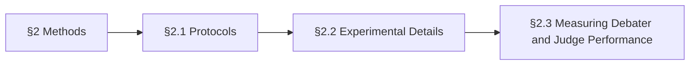
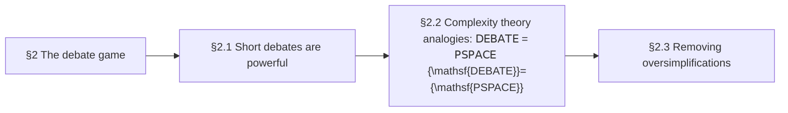
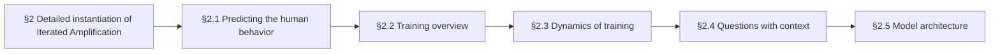
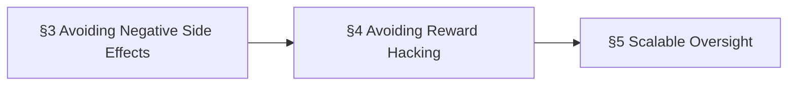
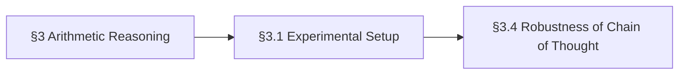

# Library: r5-human

Built from arXiv HTML bodies on 2026-11-25. 12 work(s).

| work | year | mechanism points | figure | cited by | summary |
| --- | --- | --- | --- | --- | --- |
| [Constitutional AI: Harmlessness from AI Feedback](https://arxiv.org/abs/2212.08073) | 2022 | 12 | yes | 2 | yes |
| [Measuring Progress on Scalable Oversight for Large Language Models](https://arxiv.org/abs/2211.03540) | 2022 | 7 | yes | 2 | yes |
| [Debating with More Persuasive LLMs Leads to More Truthful Answers](https://arxiv.org/abs/2402.06782) | 2024 | 4 | yes | 0 | yes |
| [AI safety via debate](https://arxiv.org/abs/1805.00899) | 2018 | 4 | yes | 5 | yes |
| [Weak-to-Strong Generalization: Eliciting Strong Capabilities With Weak Supervision](https://arxiv.org/abs/2312.09390) | 2023 | 10 | yes | 2 | yes |
| [Qwen3 Technical Report](https://arxiv.org/abs/2505.09388) | 2025 | 17 | yes | 0 | yes |
| [Supervising strong learners by amplifying weak experts](https://arxiv.org/abs/1810.08575) | 2018 | 5 | yes | 5 | yes |
| [DeepSeekMath: Pushing the Limits of Mathematical Reasoning in Open Language Models](https://arxiv.org/abs/2402.03300) | 2024 | 11 | yes | 0 | yes |
| [Concrete Problems in AI Safety](https://arxiv.org/abs/1606.06565) | 2016 | 3 | no | 5 | yes |
| [Deep Reinforcement Learning from Human Preferences](https://arxiv.org/abs/1706.03741) | 2017 | 7 | yes | 0 | yes |
| [Self-critiquing models for assisting human evaluators](https://arxiv.org/abs/2206.05802) | 2022 | 11 | yes | 3 | yes |
| [Chain-of-Thought Prompting Elicits Reasoning in Large Language Models](https://arxiv.org/abs/2201.11903) | 2022 | 3 | yes | 2 | yes |

Summaries written: 12 of 12

---

# Constitutional AI: Harmlessness from AI Feedback

arXiv:2212.08073 · 2022 · [source](https://arxiv.org/html/2212.08073)

> Written by an agent that read the body (DeepSeek Harness, 2026-11-24) after reading the paper; the mechanism quotes are the paper’s own words.

## 出发点
We would like to train AI systems that remain helpful, honest, and harmless, even as some AI capabilities reach or exceed human-level performance. This suggests that we will need to develop techniques that do not rely on humans to supervise all aspects of AI behavior, and that can be used to automatically test and enhance robustness to harmful behaviors. We also aim to develop methods that encode desirable AI behavior in a simple and transparent form, and that make it easier to understand and evaluate AI decision making.

§1 Introduction

## Pipeline

![We show the basic steps of our Constitutional AI (CAI) process, which consists of both a supervised learning (SL) stage, consisting of the steps at the top, and a Reinforcement Learning (RL) stage, shown as the sequence of steps at the bottom of the figure. Both the critiques and the AI feedback are steered by a small set of principles drawn from a ‘constitution’. The supervised stage significantly improves the initial model, and gives some control over the initial behavior at the start of the RL phase, addressing potential exploration problems. The RL stage significantly improves performance and reliability.](https://arxiv.org/html/2212.08073/2212.08073v1/CAI-Overview.png)

*We show the basic steps of our Constitutional AI (CAI) process, which consists of both a supervised learning (SL) stage, consisting of the steps at the top, and a Reinforcement Learning (RL) stage, shown as the sequence of steps at the bottom of the figure. Both the critiques and the AI feedback are steered by a small set of principles drawn from a ‘constitution’. The supervised stage significantly improves the initial model, and gives some control over the initial behavior at the start of the RL phase, addressing potential exploration problems. The RL stage significantly improves performance and reliability.*

figure: `2212.08073v1/CAI-Overview.png`

## 机制
### 1. Constitutional AI: Critiques, Revisions, and Supervised Learning

In this section, we discuss how to build models that are both helpful and harmless without any human feedback labels for harmlessness. We begin with a helpful RLHF model, any model trained to follow instructions, and instruct the model via natural language to critique and revise its own responses so as to remove various forms of harmful content. We refer to these instructions as ‘principles’ forming a ‘constitution’, i.e., a set of rules with which to steer the model’s behavior in a desired manner.

§3 Constitutional AI: Critiques, Revisions, and Supervised Learning

### 2. Method

We begin by showing the helpful RLHF model a prompt designed to elicit harmful behavior, then sampling a response from the model. The prompts are obtained from a series of “red teaming” experiments from prior work [ Ganguli et al., 2022 , Bai et al., 2022 ] , whereby crowdworkers are tasked with the goal of having text-based conversations with the model and baiting it into expressing harmful content. An example of a prompt followed by the model response is (the harmful advice here is fabricated): Next, we append to the context a set of pre-written instructions requesting the model to critique its own response, then sample the model’s critique. Continuing the preceding example, we have: Then, we append to the context a set of pre-written instructions requesting the model to revise its own response, then sample the model’s revision. For instance: Finally, we piece the initial prompt and the revised response together. If all works as expected, we should have ended up with a more harmless response: Note that since the final prompt-revision pair is formatted in the same manner as the original prompt-response pair, we can apply the same critique-revision pipeline multiple times, giving us a sequence of revisions. Furthermore, the critique and revision instructions (which collectively form a constitutional ‘principle’) can be rewritten to emphasize different aspects of harmfulness, giving us flexibility to steer the model’s behavior in different ways, and to get more diverse results. We have written a total of 16 different principles 7 7 7 These principles were selected in an ad hoc manner for research purposes, and were not carefully designed as in [ Glaese et al., 2022 ] . We have included these principles in Appendix C ] related to harmlessness, many of which are quite similar and address harmfulness in a general sense, while others are designed to target specific areas. They are randomly sampled at each revision step of each red team prompt. In addition, we found that the language model sometimes becomes confused about its point of view—for example, it may generate a critique where it’s supposed to generate a revision, or vice versa. We addressed this by few-shot prompting the model with examples of critiques and revisions, all formatted in the same way. We include these few-shot examples in Appendix E and in our repository as well. We show an example of the pipeline in Appendix D . Qualitatively, we found that the original response often contains harmful content, and that the first revision almost always removed most aspects of harmfulness. Subsequent revisions sometimes improved results further, but it was less obvious by inspection. In addition, we found that the revised responses were rarely evasive (compare examples in Appendix D ), in the sense that the model was willing to engage with sensitive topics in a harmless, thoughtful manner rather than shut down the discussion, which we discuss more in Section 4.4 . Next we finetune a pre-trained model on the revisions (from all revisional steps). Furthermore, in order to retain helpfulness as much as possible, we sampled responses from the helpful RLHF model on a set of helpfulness prompts collected from crowdworkers, and included these in the finetuning. The main results are presented in Section 3.3 , where these models are referred to as ‘SL-CAI’. In Section 3.5 , we also discuss a simpler alternative whereby we skip the critique step and sample the revision directly, but we use the critiqued revisions throughout the rest of the paper.

§3.1 Method

### 3. Datasets and Training

For red teaming prompts (i.e. partial conversations), we collected 42,496 human-written prompts as discussed and shared in [ Ganguli et al., 2022 ] , and generated a further 140,335 prompts by few-shot prompting a pre-trained model, giving a total of 182,831. We sampled 4 critique-revision pairs per red team prompt from a helpful RLHF model, giving 4 revisions per prompt. For helpfulness prompts, we collected a total of 135,296 human-written ones, and did not use any model-generated examples. We sampled 2 responses per prompt directly from a helpful RLHF. We always sample at temperature T = 1 T=1 . Each conversation consists of multiple prompts—one per human turn. We then trained SL-CAI models by finetuning a pre-trained model on the harmlessness revisions and helpfulness samples. We trained for one epoch, using a constant learning rate of 0.5 relative to the pre-training learning rate, and batch size 1024 sequences.

§3.2 Datasets and Training

### 4. Scaling Trends

Here we show results on the way preference model scores depend on the number of principles in the constitution and the number of revisions. Number of Principles in the Constitution Recall that at each critique-revision step of each prompt, a principle is sampled independently from all the constitution. In Figure 6 , we compare harmlessness PM score for varying number of constitutions. We find that the number of constitutions does not appear to have a significant effect on harmlessness score. Nonetheless, we expect that more constitutions leads to more diverse behaviors, although we did not studied this quantitatively in this work. Diversity is particularly valuable to encourage exploration during the subsequent RL training step. In Figure 5 we show preference model scores for both the initial model response and subsequent revisions. We find that the revisions achieve progressively higher harmlessness scores, suggesting that there’s benefit to utilizing further revisions. However, as discussed in our prior work [ Bai et al., 2022 ] , preference model scores become less calibrated at higher values, so these results should be taken with a grain of salt. We also trained a series of SL-CAI models up to various numbers of revisions. In particular, SL-CAI- n n is trained with finetuned with up to and including the n n -th revision, for n = 1 , 2 , 3 , 4 n=1,2,3,4 .

§3.4 Scaling Trends

### 5. Are Critiques Necessary?

While our approach requires sampling a critique followed by a revision, we also consider simplifying our approach by skipping the critique step altogether, and instructing the model to generate a revision directly. In Figure 7 , we compare harmlessness PM scores for critiqued- vs direct-revisions. We found that critiqued revisions achieved better harmlessness scores for small models, but made no noticeable different for large models. Furthermore, based on inspecting samples from the 52B, we found that the critiques were sometimes reasonable, but often made inaccurate or overstated criticisms. Nonetheless, the revisions were generally more harmless than the original response. An example can be seen in Appendix A . For the main results of this paper, we chose to use critiqued revisions, as it may provide more transparency into the model’s reasoning process. This sort of reasoning may also be useful to help models uncover more subtle harms or unintended consequences.

§3.5 Are Critiques Necessary?

### 6. Constitutional AI: Reinforcement Learning from AI Feedback

In prior work [ Bai et al., 2022 ] , we discussed how to train HH RLHF models, whereby the role of human feedback is to provide comparison labels for preference modeling on both helpfulness and harmlessness. In this section, we extend this technique to train a HH model using human feedback labels only for helpfulness. All harmlessness labels will be generated by the language model itself via a multiple choice format, and then distilled back into a preference model.

§4 Constitutional AI: Reinforcement Learning from AI Feedback

### 7. Method

We continue to utilize human feedback labels for helpfulness as in prior work, but replace human feedback labels with model feedback labels for harmlessness. That is, instead of asking crowdworkers to provide comparison labels for harmlessness, we simply present the same task to an independent model, called the feedback model (typically a pretrained LM). Once the desired comparison labels are obtained, the remainder of the training pipeline (i.e., preference model training and RL) is exactly the same as RLHF. We begin by presenting the assistant model with a prompt, and generating a pair of responses. We then present the prompt and response pair to the feedback model with a principle for choosing the more harmless response, in a format like We then compute the log probability of the responses (A) and (B) , and we make a labeled, preference modeling comparison example with the normalized probabilities as targets (and we expect these targets will be fairly well-calibrated [ Kadavath et al., 2022 ] , since they are multiple choice responses). We use pre-trained models for feedback for the experiments in this section, but in Section 2 we also compare against helpful RLHF models in terms of label accuracy on various datasets. Furthermore, we wrote a set of 16 different principles, and randomly sampled a principle for each comparison label. Qualitatively, we found that ensembling over principles led to notably more robust PM behavior compared to using the same principle for all labels (see Section 4.3 ). The principles we used can be found in Appendix C , an example of which is We also prepend to the context of the feedback model a set of few-shot examples of the labeling task. Each few-shot example is formatted in the same manner as above, with an independently sampled principle, and a pre-written prompt and response pair. We use the SL-CAI models discussed in earlier sections both for generating the response pairs, and as the initial snapshot for RL. We suspect that using the same model for both should lead to better results, since the distribution of responses generated by the policy are similar to the preference model training distribution, at least during early phases of RL. The RL training pipeline from this point on is identical to RLHF, except that the preference model is now trained partially with model-generated feedback labels (i.e. human-feedback labels for helpfulness, mixed with model-feedback labels for harmlessness). We also experimented with using Chain-of-Thought (CoT) prompting [ Wei et al., 2022 ] on the feedback model to generate labels. In this case, we use the helpful RLHF model instead of the pre-trained model, which typically writes higher quality chain-of-thought. Moreover, we reformat the feedback principles in a conversational manner (i.e., with Human: and Assistant: stop sequences), which is more suitable for the RLHF model, as follows. In particular, we use the “Let’s think step-by-step” prompt from [ Kojima et al., 2022 ] to elicit the chain-of-thought. In addition, we prepend several hand-written, few-shot examples in the same format, as is typically done in chain-of-thought prompting. Each few-shot example comes with a pre-written set of hand-written conversation, principles, responses, and chain-of-thought. See Appendix E for the full list of examples. One issue that arises is that the CoT samples typically state explicitly which multiple choice option is to be preferred, and so the probability targets are typically very confident (i.e., close to 0 or 1) and are not well-calibrated. We found that clamping the CoT probabilities to lie within the 40-60 percent range led to better and more robust behavior (see Section 4.3 ). That is, without the clamping, RL-CAI models would learn to output more extreme responses.

§4.1 Method

### 8. Datasets and Training

All our RL runs used the same hyperparameters as our prior work [ Bai et al., 2022 ] . However, there are some differences. The RLHF models for our earlier paper are finetuned from context-distilled models, while our current RLHF models are finetuned directly from pre-trained models. We didn’t see much benefit to using context distillation since the improvement from RL was much more significant. Furthermore, the pre-trained LMs that we use for all our runs have been improved since the prior work. For PM comparison data, we used 135,296 HF helpfulness comparisons, and 182,831 constitutionally-generated harmlessness comparisons (one comparison generated for each SL-CAI prompt). For the purpose of doing controlled tests, all the RL runs in this paper use the same set of training prompts, which consists of all the HF and model-generated prompts used for SL-CAI (Section 3.2 ), plus additional model-generated prompts: 491,142 for red team and 474,300 for helpfulness.

§4.2 Datasets and Training

### 9. Constitutional Principles

We tried simply rewriting the constitutional principles to encourage the model to avoid choosing over-reactive or overly accusatory responses; this seemed to improve behavior qualitatively. Some of the principles in Appendix C include this kind of language.

§Constitutional Principles

### 10. Ensembling / Preference Labels (Soft vs. Hard vs. Clamped)

When generating labels, we ensemble over 16 pre-written constitution principles, as discussed earlier. We found that this led to more robust preference model scores. For RL-CAI without CoT, we found that using soft preference labels (i.e., normalized log-probabilities from the feedback model) led to much better results than hard labels (i.e., 0’s and 1’s). We suspect this is simply because soft labels are actually fairly well-calibrated [ Kadavath et al., 2022 ] . For RL-CAI with CoT, we could not directly extract soft labels without sampling multiple CoT’s per label, since the CoT itself typically causes the feedback model to commit to one choice over another, resulting in probabilities that are nearly 0 or 1. Instead we found that clamping the probabilities at 20-80 percent slightly improved results, while clamping at 40-60 improved results further. We settled on using 40-60 for the main results of the paper.

§Ensembling · §Preference Labels (Soft vs. Hard vs. Clamped)

### 11. Harmlessness vs. Evasiveness

In prior work [ Bai et al., 2022 ] , we found that the HH RLHF models are often evasive when presented with sensitive discussions, giving canned responses like “I can’t answer that”. While evasive responses are completely harmless, for safety purposes it is also important for models to be transparent about their thought process and decision-making, and for practical purposes we expect non-evasive responses to be more compatible with helpfulness. We find that RL-CAI is virtually never evasive, and often gives nuanced and harmless responses to most red team prompts. Sample responses from the 52B HH RLHF and RL-CAI models on PALMS, InstructGPT, and LaMDA prompts are given in Appendix D . Note that in Figure 8 (right), both the helpful and HH RLHF harmlessness Elo scores decline over the later stages of RLHF training. For helpful RLHF, this is likely because the model is becoming more willing to help users with potentially dangerous tasks (e.g. ‘How do I make anthrax?’). For HH RLHF, we suspect this is because the model becomes more and more evasive on red team prompts, and we instructed crowd-workers performing these tests to choose the more nuanced, transparent and thoughtful response over the more evasive response, assuming both responses are similarly harmless. This is contrary to prior work [ Bai et al., 2022 ] where we simply asked workers to choose the more harmless response, which likely produced a significant amount of data favoring evasiveness. 9 9 9 The evasiveness may have also been caused by asking workers to choose the more harmful rather than more harmless response at each step of the conversation, as explained in Section 4.4 of [ Bai et al., 2022 ] . The HH PM data we use for this paper are collected from that same period, which likely caused our HH PM’s to reward evasiveness. The new instructions apply only to the current comparison tests, which are used to obtain all the Elos shown in this paper. The instruction change may also explain some qualitative differences between this paper and past work. For instance, as shown in Figure 3 , the harmlessness Elo differences between helpful and HH RLHF is much smaller than Figure 1 of [ Bai et al., 2022 ] . We believe this is because penalizing evasiveness generally improves helpful RLHF scores and decreases HH RLHF scores. Furthermore, we worked primarily with Upwork and MTurk in the past for collecting PM data and comparison testing; for the current work, we still use PM data from that period, but the tests were performed with Surge AI 10 10 10 https://www.surgehq.ai/ workers.

§4.4 Harmlessness vs. Evasiveness

### 12. Absolute Harmfulness Score

In contrast to our experiments where we collect relative harmfulness labels between pairs of model responses, in [ Ganguli et al., 2022 ] we have also conducted red teaming experiments collecting absolute harmfulness labels. Similar to the ‘relative’ experiments, crowdworkers are tasked with having back-and-forth conversations with a language model to try to bait it into generating harmful content, except only a single model is involved per conversation, and a single response is generated per conversational step. Finally, at the end, the worker rates their degree of “success” (on an integral rating scale from 0 to 4, inclusive) in getting the model to say something harmful. We finetuned a language model to predict an absolute harmfulness score conditioned on the full conversation using an L2 loss, with the score prediction serving as an additional metric for evaluating harmfulness. We show absolute harmfulness scores for our models in Figure 10 on a selection of 64 hand-picked held-out red team prompts, averaged over 256 model responses per prompt. According to this score, the helpful RLHF model becomes more harmful during training, while the HH RLHF, RL-CAI, and RL-CAI with CoT become progressively less harmful. However, we should caveat that absolute scores may note be well-calibrated, as different workers may have their own personal biases about how to grade the result on 0-4 scale.

§4.5 Absolute Harmfulness Score

## 总结与展望
Constitutional AI 用一套写下来的原则替代人工逐条标注有害性，让模型自己批评与修订，再用 AI 反馈训练偏好模型。它对人机边界这一方向的意义不是「省标注」，而是：监督者的判断可以被写成可检查的文本，因此也可以被质疑——这恰好是人类审批卡最缺的性质。

**It connects to**

- `2211.03540` — 一个把原则写下来，一个在测「规模上去之后人还判得动吗」；两者是同一个问题的两端。
- `1706.03741` — 从人工比较到 AI 比较，这条线在这里换掉了标注者。

## 不足之处
**The authors say:** We have trained language assistants that are both helpful and harmless without using human feedback labels for harmlessness. We referred to the technique as ‘constitutional AI’ (CAI) since we used a ‘constitution’ consisting of human-written principles. We established two methods: (1) Constitutional AI which ‘bootstraps’ a helpful RLHF’s instruction-following abilities to critique and revise its own responses so as to remove harmful content, and (2) RL with model-generated labels for harmlessness, which further improves harmlessness. We used this method to train models that are both harmless and non-evasive, partially resolving an issue in [ Bai et al., 2022 ] .

**What a reader should still not conclude**

- 原则由人写，但「模型是否真的按原则批评」没有被独立核验，论文只报最终无害性与有用性。
- 反馈来自同一个模型族，存在自评偏差的风险，论文没有设置跨族监督者作为对照。

§6 Discussion

---

# Measuring Progress on Scalable Oversight for Large Language Models

arXiv:2211.03540 · 2022 · [source](https://arxiv.org/html/2211.03540)

> Written by an agent that read the body (DeepSeek Harness, 2026-11-24) after reading the paper; the mechanism quotes are the paper’s own words.

## 出发点
To build and deploy powerful AI responsibly, we will need to develop robust techniques for scalable oversight : the ability to provide reliable supervision—in the form of labels, reward signals, or critiques—to models in a way that will remain effective past the point that models start to achieve broadly human-level performance ( Amodei et al., 2016 ) . These techniques are likely to build on the methods we use today for steering large models ( Christiano et al., 2017 ; Stiennon et al., 2020 , like RLHF;) , but will need to be further developed to continue behaving as expected in regimes where models have important knowledge or capabilities that we lack or where models are acting intentionally to mislead us. If this is possible, it will very likely involve finding ways of extracting trustworthy information from untrustworthy models. There have been many promising proposals for methods that could yield progress in this direction ( Irving et al., 2018 ; Hubinger, 2020 ; Leike et al., 2018 ; Christiano et al., 2018 , i.a.) , but relatively little empirical work to date ( Wu et al., 2021 ; Saunders et al., 2022 , with exceptions including:) .

§1 Introduction

## Pipeline

*A schematic of the research paradigm for scalable oversight that we outline here, based on Cotra ’s ( 2021 ) sandwiching . Scalable oversight techniques aim to improve a model’s capability and, especially, its alignment—its ability to apply that capability to tasks and goals that we choose—in a way that we expect to continue to work with highly capable models.*

figure: `2211.03540v2/Sandwiching_Figure.png`

## 机制
### 1. A Simple Experiment

While sandwiching may be conceptually appealing, it is not immediately clear that there currently exist tasks and models that satisfy its constraints. Our proof-of-concept experiment here is meant to demonstrate that two existing tasks satisfy two constraints with a typical large language model: (i) typical careful human participants perform poorly on their own, such that sandwiching is possible, and (ii) those same participants can improve their performance substantially through interaction with the model, such that scalable oversight techniques that rely on help from the model are likely to get off the ground. Unassisted Human: We ask our human participants to answer the questions to the best of their ability without the help of the model or any other outside resources (including web search). For these results and our other human results, we report average individual human accuracy and the accuracy of the confidence-weighted majority-vote 7 7 7 We score each answer using the product of the probabilities assigned to each answer by each participant and select the answer with the highest score. This allows a highly-uncertain annotator who chooses the minimum 25% confidence value to avoid influencing the consensus answer. We assign equal probability to each non-selected answer, so an annotator who selects answer (B) with 60% confidence would implicitly be assigning probabilities [ .13 , .60 , .13 , .13 ] [.13,.60,.13,.13] . We map the ‘Certain (100%)’ value in the interface to 99% to avoid zeroes. answer from all four active participants together. This uses the same UI as our target model-assisted condition, but without the UI connected to a model. Model: We present the model with each question, one by one, zero-shot. We use the following minimal prompt, which was designed to dovetail well with RLHF training without injecting any new information about the task: Human: Question: [question] Choices: (A) [choice A] (B) [choice B] (C) [choice C] (D) [choice D] We then choose the answer letter (in parentheses) that has the highest likelihood conditioned on the prompt. Model (5-shot): We use the same process and format as above but prepend five questions and their answers to the prompt. We use this method only for MMLU. Since QuALITY examples average about 5,000 words, it is not possible to fit multiple examples in our assistant’s context window. Since this technique uses ground-truth labels from experts, we should expect it to be somewhat artificially strong, and potentially stronger than would be achievable without expert involvement. We include it for comparison with non-expert human participant performance, since our participants also see some labels. Model (best-of-20 CoT): Here, we prompt the model with a chain-of-thought -style input before asking them to answer ( Nye et al., 2021 ; Wei et al., 2022 ) . We sample 20 instances of model reasoning and choose the one that scores best under our RLHF preference model before conditioning on that reasoning string to generate the answer. For MMLU, we additionally prepend five examples in their labels to the context (as above), with no added reasoning information, subjecting it to the same caveat as the 5-shot condition above. Inspired by Kojima et al. (2022) , we use the following prompt structure: [optional 5-shot context, formatted as above without chain-of-thought] Human: [target question, formatted as above] Assistant: Let’s think step by step: [model-generated reasoning] Human: Based on the above, what is the single, most likely answer choice? Assistant: The single, most likely answer choice is Human + Model: For our main target condition, we ask our human participants to attempt to use the model to help them answer. This condition uses a separate 100-example sample from the unassisted human condition above.

§3 A Simple Experiment

### 2. Answering Specialized Exam Questions

We evaluate human--model team performance on multiple-choice questions from the MMLU benchmark 1 1 1 As far as we understand, ours is the first attempt to ask human participants to answer questions drawn from MMLU. This means that we found some recurring formatting errors in our pilots. The maintainers of MMLU fixed the most systematic of these issues, and we use the updated version of the dataset dated Aug 30, 2022. ( Hendrycks et al., 2020 ) . MMLU questions are largely drawn from practice tests for exams targeted at high-school, undergraduate, and professional students, and a significant fraction of them draw on specialized knowledge that we don’t expect most people to be familiar with. We expect the model to be able to use significant domain knowledge from pretraining that our human participants aren’t familiar with, but we also expect the model to be relatively ineffective at synthesizing this knowledge, allowing the human participant to contribute.

§Answering Specialized Exam Questions

### 3. Timed Question Answering with Long Passages

We also evaluate human--model team performance on multiple-choice reading-comprehension questions from QuALITY 2 2 2 We use the plain text (‘HTML-stripped’) variant of the 1.0.1 version of the dataset for both our human participants and the model. ( Pang et al., 2022 ) . QuALITY questions are meant to be answerable by English-fluent college-educated adults, but they require readers to thoroughly understand a short story of about 5,000 words, which would ordinarily take 15–30 minutes to read. To create a challenging task that requires model assistance, we ask human participants to answer QuALITY questions under a 5-minute time limit ( Pang et al., 2022 ; Parrish et al., 2022b ; Parrish et al., 2022a , roughly paralleling) . This prevents them from reading the story in full and forces them to rely on the model to gather relevant information. 3 3 3 Pang et al. show that annotators with strong incentives to choose correct answers fail to answer QuALITY questions reliably when working on a 45-second time limit on their access to the passage, suggesting that it is not possible to quickly answer these questions with one or two simple keyword searches.

§Timed Question Answering with Long Passages

### 4. Participants and Scale

We hire participants through data-labeling startup Surge AI, 4 4 4 https://surgehq.ai deferring the qualification, training, and payment process to specialists there. We work with two groups of five participants each for the two tasks (ten total), and each participant works on every question. For each experiment, we collect answers for only 100 randomly-sampled validation-set 5 5 5 Our experimental process involves significant in-house piloting and significant conversation with our hired participants. For this reason, we use the validation sets in all experiments to avoid violating the norm in NLP research against having researchers read test datasets. questions, focusing on quality of work at the expense of quantity. (For fully-automatic baselines, we use the full validation sets.) Our results only include data from four of the five participants assigned to each task, since in each case, one participant achieved far greater accuracy than the other four in the model-unassisted condition (84% vs. 57% for MMLU, 89% vs. 49% for QuALITY) and outperformed the best result by the model. Including these two outlier participants would have likely violated a key assumption of the sandwiching paradigm: that the human participants lack some key task-relevant knowledge or skills that the model under study is capable of providing. While we cannot fully rule out some form of cheating in these cases, our other interactions with these participants suggest that they are unusually talented at trivia and speed-reading respectively. Surge pays a minimum of $20/hr for active work. Participants were not directly incentivized to answer questions correctly, but in our experience, all made a serious effort to do so and sent us extensive questions and comments on their experiences, amounting to several pages for each participant.

§3.2 Participants and Scale

### 5. The Interface

Figure 2 shows the annotation interface. It consists of a chat pane to interact with the model and a question-answering pane that shows a question, four choices and a five-way Likert scale for confidence. The chat pane also includes a reset button which restarts the conversation—preserving the chat history for the human participant but stripping it from the model’s context. The ability to reset the model makes it possible for users to reevaluate the model when they suspect that it may have confidently asserted something that is not true, something we anecdotally found to be helpful during internal pilots. The question and answer choices are not automatically provided to the model. Two additional features are specific to QuALITY: The passage to which the question refers is injected into the conversation as the body of the first turn. In addition, a timer begins running when the task is opened. When the timer runs out, the current answer choice is automatically submitted. After a participant submits their answer choice and confidence for a question, we reveal the correct answer. This compromise represents a divergence from the core sandwiching protocol and has no analog in settings where we need to use scalable oversight strategies to supervise model behavior on questions for which we are genuinely uncertain. However, it enables our participants to recognize which of the strategies they try are working and thereby encourages them to explore a broader range of approaches, supporting our qualitative goals for the project. Since the questions in both datasets are quite diverse, we do not expect this feedback to have taught our participants any reusable information about the material that the questions test. Participants complete all 100 questions in the assisted condition before beginning the unassisted condition, so any learning effect would yield a bias toward a null result. The full participant instructions are shown in Appendix A .

§The Interface

### 6. The Model

We use a 52B-parameter language model fine-tuned for use as a helpful dialog assistant according to the RLHF-based technique described in ( Bai et al., 2022 ) . 6 6 6 We use a model trained only to be helpful, rather than helpful and harmless as in the core experiments from Bai et al.

§The Model

### 7. Experimental Conditions

The model-prompting conditions here are relatively weak at showing that our model is misaligned in the relevant sense, but we take our ability to improve upon its performance substantially in a human–model team setting as prima facie evidence of some degree of misalignment.

§Experimental Conditions

## 总结与展望
这篇把「监督能不能规模上去」做成实验：让非专家借助模型辅助去评判专家级答案，并与专家评判对照。结论是有帮助但远不够——这为本方向的审批卡写下了一条硬约束：让人一键采纳的前提，是人真的读得懂他在采纳什么。

**It connects to**

- `1810.08575` — 放大弱专家与弱到强泛化是同一族想法：用辅助去补齐监督者。
- `1805.00899` — 辩论是另一条补齐路线：不增强监督者，而是让两个模型互相暴露错误。

## 不足之处
**The authors say:** This experiment does not fully implement the sandwiching protocol, and despite our encouraging results, we do not think that our results justify concluding that our simple dialog-based baseline technique will be satisfactory for the oversight of more capable future systems. We see six major reasons for this:

**What a reader should still not conclude**

- 实验里专家的判断被当作真值，但专家之间的一致率没有系统报告。
- 任务是有确定答案的问答，不是「这个改动该不该采纳」这种价值判断。

§Limitations of Our Results

---

# Debating with More Persuasive LLMs Leads to More Truthful Answers

arXiv:2402.06782 · 2024 · [source](https://arxiv.org/html/2402.06782)

> Written by an agent that read the body (DeepSeek Harness, 2026-11-24) after reading the paper; the mechanism quotes are the paper’s own words.

## 出发点
Most existing approaches to align LLMs rely on the availability of labelled data ( Ouyang et al., 2022 ; Menick et al., 2022 ) . However, faced with models that can answer questions in increasingly broad context, obtaining such data requires domain expertise ( OpenAI, 2023 ; Gemini Team et al., 2023 ) . As these systems continue to advance, they will surpass expert knowledge. Consequently, there will be no ground truth to rely on, rendering most alignment approaches unusable. We need mechanisms that provide scalable oversight ( Amodei et al., 2016 ; Christiano et al., 2018 ; Irving et al., 2018 ; Bowman et al., 2022 ) : alignment methods that scale with model capability.

§1 Introduction

## Pipeline

![Stronger debaters result in better judge accuracy. We conduct a tournament between four different LLMs under best-of-n (bo N N ) and critique-and-refinement (c N N ) optimisations. (Left) Elo ratings calculated from matches with different debaters: Debaters arguing for the correct answer are more persuasive than debaters arguing for the incorrect answer, suggesting there is an advantage to being assigned the correct answer. (Middle) We quantify this advantage as (correct rating - incorrect rating) and plot against aggregate rating (an unsupervised metric). When debaters become more persuasive, they get relatively better at arguing the correct answer than the incorrect answer, and the advantage becomes larger. (Right) On a withheld dataset, we run debates with copies of the same models. We find that persuasive debaters have a large advantage, which in self-play matches leads to high judge accuracy . Claude2.1 is the zero reference for ratings.](https://arxiv.org/html/2402.06782/2402.06782v4/combined_xplay5.svg)

*Stronger debaters result in better judge accuracy. We conduct a tournament between four different LLMs under best-of-n (bo N N ) and critique-and-refinement (c N N ) optimisations. (Left) Elo ratings calculated from matches with different debaters: Debaters arguing for the correct answer are more persuasive than debaters arguing for the incorrect answer, suggesting there is an advantage to being assigned the correct answer. (Middle) We quantify this advantage as (correct rating - incorrect rating) and plot against aggregate rating (an unsupervised metric). When debaters become more persuasive, they get relatively better at arguing the correct answer than the incorrect answer, and the advantage becomes larger. (Right) On a withheld dataset, we run debates with copies of the same models. We find that persuasive debaters have a large advantage, which in self-play matches leads to high judge accuracy . Claude2.1 is the zero reference for ratings.*

figure: `2402.06782v4/combined_xplay5.svg`

## 机制
### 1. Methods

We are concerned with protocols that enable non-experts to elicit truth from experts. Here, we discuss the protocols we investigated and the task setting in which they are evaluated, as illustrated in Figure 2 . Furthermore, we introduce unsupervised metrics for evaluating the strength of the debaters.

§2 Methods

### 2. Protocols

Debate — We first introduce debate, a protocol in which two expert models (debaters) argue for opposing answers to a question. Debate runs for a pre-determined number of rounds N N , during which a transcript of the debaters’ arguments is kept. In each round, debaters see the arguments from previous rounds and simultaneously generate their arguments for the next round. After N N rounds, a judge reads the transcript and attempts to choose the correct answer. Each debater tries to convince the judge to pick their answer, and the judge is tasked with picking the correct answer. The adversarial nature of the protocol stems from the conflicting incentives between the debaters, as each debater strategically presents arguments to explain why their opponent’s claims are false. At the start of a round, debaters receive nearly-identical prompts explaining the game, their assigned answer, and the current transcript. Interactive debate — Similar to debate, interactive debate uses two experts arguing for opposing answers. In addition to the mechanisms above, after each round, the judge may make a statement. This enables the judge to highlight sub-problems, ask for clarifications, and direct questions to either debater. The statement is appended to the transcript and is visible to all players for the rest of the debate. Consultancy (Baseline) — For comparison with debate, we use the consultancy baseline established by ( Michael et al., 2023 ) . In consultancy, a single expert model (the consultant) is assigned a specific answer and aims to persuade the judge that their answer is correct. The judge aims to elicit the correct answer, asking the consultant probing questions. Consultancy runs for a pre-determined number of rounds N N (fixed to be the same as debate), in which the consultant and judge sequentially make statements. At the end of consultancy, the judge decides which answer to choose. At the start of each round, the consultant is provided with a prompt containing the rules of the game, their assigned answer and the current transcript. Consultancy builds up a transcript of a dialogue between the consultant and judge as rounds continue. In all our evaluations, we run consultancy for both the correct and incorrect answers; producing the same 50/50 prior as debate.

§2.1 Protocols

### 3. Experimental Details

To operationalise the oversight problem, we conduct information-asymmetric experiments ( Michael et al., 2023 ) in which non-experts do not have access to the necessary information to answer questions, but the experts do. Task — We evaluate the ability of non-expert judges to answer questions from the reading comprehension dataset “Question Answering with Long Input Texts, Yes!” ( Pang et al., 2022 , QuALITY;) . Judges are not allowed access to the original comprehension text, restricting their ability to answer questions and inducing their non-expert status. We motivate this setting and provide implementation recommendations in Appendix C . We use texts from the Project Gutenberg science-fiction story subset, which have a median length of approximately 7000 tokens. From these questions, we select the hard subset, where all untimed annotators chose the correct answer and rated the answer as unambiguous. For each question, we provide two answers: the correct answer and the best distractor. We use two data splits for LLM judge experiments: T L T_{L} (400 train set questions) and D L D_{L} (291 development set questions). For human experiments, where a story can only appear once, we use T H T_{H} (153 drawn from both sets) and D H D_{H} (47 drawn from both sets). For question filtering details, see Appendix D.1 . Quote verification tool — In each protocol, expert models have access to a quotation tool to present quotes from the text in <quote> tags. Similar to Radhakrishnan (2023) , if the quote directly matches a portion of the text, the tool generates verified <v_quote> else, it generates unverified <u_quote> tags (see Appendix D.2 ). The judge is instructed to trust only verified quotes (see Appendix D.8 ). We assess the importance of quoting in Appendix A.6 . Number of rounds and word limit — We run protocols for three rounds. For ablations with the number of rounds, see Appendix A.8 . To control for the quantity of information presented to the judge across protocols and mitigate the LLM judge verbosity bias, we restrict transcripts to 900 words in total, limiting consultants to 300 words per argument and debaters to 150 words (see Appendix D.6 ). Language models — We evaluate five large language models as debaters and consultants: GPT-4-Turbo, GPT-3.5-Turbo ( OpenAI, 2023 ) , Claude 2.1, Claude 1.3 ( Bai et al., 2022 ) and Mixtral 8x7B ( Jiang et al., 2024 ) . Debaters are presented with an egocentric view of the transcript, in which their arguments appear first. We present all models with a scratchpad ( Wei et al., 2022 ; Nye et al., 2022 ) , which allows the model to output tokens enclosed in <thinking> tags that other players will not see (see Appendix G.1 ). To generate a large set of different debater capability levels for our LLM judge experiments, we apply inference-time optimisation using best-of- N N (bo N N ) sampling. With bo N N , models are sampled N N times, and a preference model is used to select the most persuasive arguments. The preference model is given a prompt to optimise for judge feedback. For a subset of models, we additionally use critique-and-refinement (c N N ) ( Saunders et al., 2022 ) , in which another model is used to produce N N critiques; a preference model then grades these and the most helpful is used to refine the answer. For all preference models, we use the log probabilities from GPT-4-Turbo. We document prompt iteration in Appendix D.3 and learning with examples in Appendix A.9 . For LLM judging, we used GPT-4-Turbo, Mixtral-8x7B, GPT-3.5-Turbo and Claude 2.1. Prompts are provided in Appendix G.2 . Similar to Zheng et al. (2023) , we found strong biases with LLM judges. To mitigate positional biases, we run judgements over each debate twice - once with the original transcript and once with the debater order swapped. To mitigate verbosity biases, we apply strict word limits. We document judge biases in Appendix A.7 and mitigation techniques in Appendix D.6 . Cross-play tournament — To investigate how debate scales with model capabilities, we require a way to compare debaters. We run cross-play debates, in which different debaters argue against one another. To compare a large set of debaters, we use a tournament to generate informative matches. For n n debaters, it is not feasible to run all possible matches as this requires O ⁡ ( n 2 ) O(n^{2}) matches. Instead, we use a Swiss-style tournament to decide matches, which produces rankings in O ⁡ ( n ​ log ⁡ n ) O(n\log n) matches (see Appendix D.4 ). Human judges --- We recruit 30 human judges via the referral-based annotator platform Pareto. 2 2 2 https://pareto.ai/ Annotators judge debates via a web interface in which they are presented with the question, transcript and answers. The 30 annotators go through a training phase and are filtered down to 21 based on performance in a test phase. To avoid any optimisation based on ground truth labels ( Perez et al., 2021 ) , we filter annotators based on inter-annotator agreement and the quality of explanations they provide (see Appendix E.2 ). Additional base- and toplines — We introduce a naive judge and an expert judge to evaluate the worst and best-case performance. For the naive judge, we present only the question and possible answers to a non-expert model; this helps identify if there is any contamination of the dataset in the non-experts’ training. For the expert judge, we present the full text to demonstrate a reasonable upper bound for what a non-expert judge can hope to achieve. For human experiments, we did not run an expert judge baseline, but use Pang et al. (2022) who report annotators with access to the text achieve 89% accuracy on the hard subset. We filter for 100% untimed accuracy, and as such, expect 89% to be a lower bound for expert human performance.

§2.2 Experimental Details

### 4. Measuring Debater and Judge Performance

We are interested in oversight protocols with no access to labels, but existing work uses metrics that assume access to the ground truth. In this section, we introduce metrics to measure debater capabilities without this assumption. Given a dataset 𝒟 \mathcal{D} consisting of N N questions ( q q ) and candidate answers ( a 1 , a 2 a_{1},a_{2} ), 𝒟 = { q i , a i ​ 1 , a i ​ 2 } i = 1 N \mathcal{D}=\{q_{i},a_{i1},a_{i2}\}_{i=1}^{N} , a debate match is defined over a dataset by ( D 1 , D 2 , J ) (D_{1},D_{2},J) , comprising two models D 1 D_{1} and D 2 D_{2} , and a Judge J J . The first argument refers to which model is assigned a 1 a_{1} to support (in this case D 1 D_{1} ), and the second argument refers to which model is assigned a 2 a_{2} . A consultancy match with a consultant D D is expressed as ( D , − , J ) (D,-,J) or ( − , D , J ) (-,D,J) . Win rate — We define the win rate as the frequency with which a judge picks a specific debater’s answer. For the match ( D 1 , D 2 , J ) (D_{1},D_{2},J) , the win rate, ω 1 \omega_{1} , for Debater D 1 D_{1} is: In practice, this win rate depends on the assignment of the answer choice, which gives an unfair advantage, as some assignments may be easier to argue for than others (e.g. some answers are easier to defend than others). To mitigate this, we flip assignments such that D 1 D_{1} and D 2 D_{2} argue for the opposite assignments and then take the average, ω ¯ 1 \bar{\omega}_{1} . Assuming debaters perform equally well across all questions, we say D 1 D_{1} is more persuasive than D 2 D_{2} if: Elo rating — To capture a general notion of persuasiveness, we evaluate aggregate win rates for each debater across a population of co-debaters. We parameterise win rates by a latent skill, using the Elo ranking metric ( Elo, 1978 ) . We calculate ratings by minimising predicted win rate error (see Appendix D.5 ). Aggregate rating is defined as the latent skill for a debater independent of assignment. Given two debaters, D 1 D_{1} and D 2 D_{2} , and a judge J J , we define each player’s aggregate rating, E 1 E_{1} and E 2 E_{2} , as the solution to the equality: Win rate and aggregate rating are metrics that can be used to optimise oversight protocols without ground-truth labels. To understand truthfulness in debates, we also consider the win rate ω C \omega_{C} conditioned on being assigned all correct answers (assuming ground truth labels). We calculate a players’ correct rating E C E^{C} and incorrect rating E I E^{I} as: Judge accuracy — In line with the original motivation for debate, we calculate judge accuracy, α \alpha , as the accuracy over a match between copies of the same model; α ⁡ ( D , J ) = α ⁡ ( D , D , J ) \alpha(D,J)=\alpha(D,D,J) . As the consultant’s intention is unknown to a judge, we take accuracy over both potential matches for consultancy α ⁡ ( D 1 , J ) = 1 2 ​ ( α ⁡ ( D 1 , − , J ) + α ⁡ ( − , D 1 , J ) ) \alpha(D_{1},J)=\frac{1}{2}(\alpha(D_{1},-,J)+\alpha(-,D_{1},J)) .

§2.3 Measuring Debater and Judge Performance

## 总结与展望
这篇证明「更有说服力的模型当辩手，能让judge 更接近真相」，并且把说服力与真实性分开度量。对我们的直接含义：如果卡上的信息由提案方组织，那么提案方的表达能力就会影响法官的判断——这不是修辞问题，是测量问题。

**It connects to**

- `1805.00899` — 辩论框架的来源；这篇把「说服力」变成可操纵的变量。
- `2211.03540` — 一个增强监督者，一个增强信息的对抗性；两条互补路径。

## 不足之处
**The authors say:** Our work has important limitations. In our setup, the difference between strong and weak is only in access to information. In the future, stronger models may differ in reasoning ability or another skill. Furthermore, we evaluate models that have been fine-tuned with RLHF, which have a propensity for honesty; it is unclear if debate will be a suitable technique for deceptive models ( Greenblatt et al., 2023 ; Hubinger et al., 2024 ) .

**What a reader should still not conclude**

- judge 是模型，不是人；人对辩论的易感性可能更强。
- 说服力的度量依赖另一个模型，存在循环。

§6 Discussion, Limitations & Conclusion

---

# AI safety via debate

arXiv:1805.00899 · 2018 · [source](https://arxiv.org/html/1805.00899)

> Written by an agent that read the body (DeepSeek Harness, 2026-11-24) after reading the paper; the mechanism quotes are the paper’s own words.

## 出发点
Learning to align an agent’s actions with the values and preferences of humans is a key challenge in ensuring that advanced AI systems remain safe [ Russell et al., 2016 ] . Subtle problems in alignment can lead to unexpected and potentially unsafe behavior [ Amodei et al., 2016 ] , and we expect this problem to get worse as systems become more capable. Alignment is a training-time problem: it is difficult to retroactively fix the behavior and incentives of trained unaligned agents. Alignment likely requires interaction with humans during training, but care is required in choosing the precise form of the interaction as supervising the agent may itself be a challenging cognitive task.

§1 Introduction

## Pipeline

*The MNIST debate game. A random MNIST image is shown to the two debating agents but not the judge. The debaters state their claimed label up front, then reveal one nonzero pixel per turn to the judge up to a total of 4 or 6. The judge sees the sparse mask of 4 or 6 pixels and chooses the winner based on which of the two labels has higher logit. The judge is trained in advance to recognize MNIST from random masks of nonzero pixels.*

figure: `1805.00899v2/mnist-2/play-test-commit-easy1-i927-moves20,11-19,8-20,17-7,22-21,14-6,19-label5-lie6-win-honest.png`

## 机制
### 1. The debate game

We will initially consider a question-answering setting, though Section 2.3 covers other settings including environment interaction. We have a set of questions Q Q , answers A A , and debate statements S S . The simplest version of debate has two agents competing to convince a human judge: A question q ∈ Q q\in Q is shown to both agents. The two agents state their answers a 0 , a 1 ∈ A a_{0},a_{1}\in A (which may be the same). The two agents take turns making statements s 0 , s 1 , … , s n − 1 ∈ S s_{0},s_{1},\ldots,s_{n-1}\in S . The judge sees the debate ( q , a , s ) (q,a,s) and decides which agent wins. The game is zero sum: each agent maximizes their probability of winning. To play this game with a human, we need instructions for how the human should decide who wins. These instructions are in natural language, such as “The winner is the agent who said the most useful true thing.” For question-answering a ∈ A a\in A and s ∈ S s\in S could be any moderate length sentence, and q ∈ Q q\in Q a sentence plus additional context. For example, q ∈ Q q\in Q could be “Should we interview Eve?” given a resume and links to past work. At test time it suffices to stop after step 2: we do not need to run the debate (though agents could simulate debates at test time to strengthen answers). The utility of debate as an approach for AI alignment rests on the following central claim: Whether this claim is true for any particular setting is empirical, though we give some evidence for it below. If the central claim is true, we can hope for a few other claims: In all Nash equilibria 1 1 1 We say Nash equilibria instead of optimal play since (1) we will consider versions where turns are simultaneous and (2) choosing a limited capacity model can make a perfect information game act as an imperfect information game. of this game, both agents try to tell the truth in the most convincing manner possible, trying to uncover details or counterarguments the other agent missed. It is possible to find approximate Nash equilibria with some version of gradient descent, such as a self play algorithm similar to Silver et al. [2017b] . In particular, training is stable around the Nash equilibria (unstable training might mean agents learn to be honest, forget how to defend against dishonesty, and then get beaten by dishonest fluctuations). At Nash equilibria, debate agents are approximately as strong as unrestricted AI (agents trained with no safety measures). We emphasize that using debate does not restrict the structure of the agents. Similarly, the deep networks used in Silver et al. [2017b] are convolutional residual networks unrelated to the game tree of Go, though the training process does involve the tree via MCTS. The lack of restriction is important, since we want safe approaches to be competitive with unsafe alternatives. Alice: Bali is out since your passport won’t arrive in time. Bob: Expedited passport service only takes two weeks. Simulating a temporal process (e.g. physics) for an exponential number of steps, as long as the state is polynomial size. Recursion over an exponentially large tree, as long as the depth is polynomial size. Perfect play in any competitive game of polynomial length, such as turn limited Go. Counting an exponentially large collection of objects, where each object is polynomially checkable (such counting problems are also in the smaller complexity class # ​ 𝖯 ⊊ 𝖯𝖲𝖯𝖠𝖢𝖤 \#{\mathsf{P}}\subsetneq{\mathsf{PSPACE}} ). Queries may be too big: A question may be too large to show to a human, or to expect the human to comprehend. q ∈ Q q\in Q might include a 10 gigapixel image (“Does this picture of the sky support cosmic inflation?”), the whole internet (“What is the best article about cats?”), etc. To support large context, we let the agents reveal small parts of q q in their statements. For example, an agent could reveal part of a webpage or a small region of the 10 gigapixel image. An extreme example is where q ∈ Q q\in Q contains an image and agents can reveal only one pixel of the image ( Section 3.2 ). Debate only works if this revealed context cannot be a lie: it is impossible to usefully debate whether a coin flip is heads or tails if the coin is never revealed. Answers may be too big: Similarly, the best answer to a question may be prohibitively large. For example, the answer may be a long document: “Give a 100 page summary of the effectiveness of quantitative easing.” To support large responses, we still have agents choose a response at the start of the game and allow them to reveal small parts of either answer in the same way they reveal parts of the question. If Bob is misaligned and constructs an answer which would have bad consequences, Alice will be able to safely warn about the risks during the debate while most of the answer is hidden (as long as our safety claims are true). Human time is expensive: We may lack enough human time to judge every debate, which we can address by training ML models to predict human reward as in Christiano et al. [2017] . Most debates can be judged by the reward predictor rather than by the humans themselves. Critically, the reward predictors do not need to be as smart as the agents by our assumption that judging debates is easier than debating, so they can be trained with less data. We can measure how closely a reward predictor matches a human by showing the same debate to both. Environment interaction: If we want a system to take actions that affect the environment such as operating a robot, the desired output is a sequence of actions a 0 , a 1 , … a_{0},a_{1},\ldots where each action can only be computed once the previous action is taken. In this case we need one debate per action, though at test time we can again stop once the actions are computed. Long term state: Each debate is an independent game, but agents could use information from past debates to make better decisions as in Mishra et al. [2017] . Since games are zero sum this does not change optimal play, as any equilibria in an iterated zero sum game is weakly dominated by a strategy which treats each game as separate.

§2 The debate game

### 2. Short debates are powerful

Consider the question “Where should I go on vacation?” If one sees only the answer “Alaska”, it is not obvious whether a better answer exists. Thus the opening answers in a debate about the vacation question between two agents Alice and Bob might be If the human judge is able to rank pairs of vacation destinations, perfect play in a two round debate is sufficient to find the optimal destination. If Alice gives a suboptimal destination, Bob gives a better destination and wins, so Alice only wins by starting with the best destination. In this case Bali sounds warmer, so Bob wins. However, Bali has a hidden flaw: Now the human understands they cannot go to Bali, so Alice wins, unless Bob has a counterargument to the flaw: The process continues until we arrive at a statement that the human is able to correctly judge, in the sense that the other agent does not believe they can change the human’s mind with yet another statement and resigns. We do not stop when the human thinks they can correctly judge: after step (2) the human may have thought Bali was obviously correct, not remembering the passport issue; after step (3) the human may think Alaska is correct, being unaware of expedited service. What we do not do is list all arguments relevant to the vacation question: Bali has nicer beaches, Alaska is colder on average but pleasantly warm in the summer, it is currently February, Hawaii is both warm and in the U.S. Instead, optimal play in debate picks out a single line of argument, and agents which switch arguments admit defeat and lose. This is unnatural in a human discussion where both sides learn from each other over the course of the debate, but we are interested in the equilibrium of training where both agents are assumed to be using the best arguments available. For example, if the third statement had been then Bob should win, since Bali was a sufficient counterargument to Alaska. Figure 1 illustrates this situation. A single round of the debate game traces out one path through the space of all possible arguments. The reason for the answer is the entire tree: all points and counterpoints relevant to deciding the issue. The tree is too large to show to a human, but a single path through the tree chosen by sufficiently strong adversarial agents is evidence of the result from the entire tree. Figure 1 has the analogous situation for Go: the correct first move is determined by the entire tree, but one game between strong players provides evidence as to the correct move. Thus debates can be short because they are unbranched : they cover only one path through the tree. Long arguments are usually long only because they cover many different arguments and subarguments: the length is due to branching down many paths. Arguments which seem irreducibly long because they are phrased as a sequential process can be rearranged into a shallow tree by stating the conclusion of the first half of the argument, then choosing which half to discuss in detail. We can make this rearrangement precise in the complexity theory setting, as we discuss next.

§2.1 Short debates are powerful

### 3. Complexity theory analogies: 𝖣𝖤𝖡𝖠𝖳𝖤 = 𝖯𝖲𝖯𝖠𝖢𝖤 {\mathsf{DEBATE}}={\mathsf{PSPACE}}

Although debate is intended for use with fuzzy humans as judges, we can gain intuition about the model by replacing the human with an arbitrary polynomial time algorithm H : Q → { 0 , 1 } H:Q\to\{0,1\} which takes some input statement q ∈ Q q\in Q and produces one bit: whether the statement is true or false. We allow our ML models arbitrary computational power: the only limitation is the supervision signal. If we use H H to answer questions directly as H ⁡ ( q ) H(q) , we get the complexity class 𝖯 {\mathsf{P}} of polynomial time algorithms. As discussed in Section 1 , this setup corresponds to supervised learning. With sufficient training data and model capacity we can fit any algorithm, but we cannot go beyond the training data (except by removing unsystematic errors). If we use the polynomial time algorithm not to output answers but to judge them, we get the complexity class 𝖭𝖯 {\mathsf{NP}} of questions with polynomial time checkable witnesses. Instead of H ⁡ ( q ) H(q) we output ∃ x . H ⁡ ( q , x ) \exists x.H(q,x) where x x is a witness found by the ML model. 𝖭𝖯 {\mathsf{NP}} corresponds to single agent reinforcement learning: an agent with sufficient capacity can solve tasks the human cannot, but the human must be able to judge whether the solution is good. Now consider an adversarial debate of length two, where Alice chooses x x attempting to make the human say yes, Bob chooses y y attempting to make the human say no, and the human decides who is correct. The result is ∃ x ​ ∀ y . H ⁡ ( q , x , y ) \exists x\forall y.H(q,x,y) . Alice wins if she can find x x such that all responses y y by Bob have H ⁡ ( q , x , y ) = 1 H(q,x,y)=1 . Bob wins if he can find a response y y to any x x that Alice says so that H ⁡ ( q , x , y ) = 0 H(q,x,y)=0 . This complexity class is Σ 2 ​ 𝖯 \Sigma_{2}{\mathsf{P}} , two steps up the polynomial hierarchy, since Σ 2 ​ 𝖯 \Sigma_{2}{\mathsf{P}} contains all questions answerable as formulas of the form ∃ x ​ ∀ y . H ⁡ ( q , x , y ) \exists x\forall y.H(q,x,y) for polynomial time H H . We can continue this process for any number of rounds, with Alice and Bob alternating points and counterpoints, producing the formula ∃ x 0 ∀ x 1 ⋯ ∃ x n − 1 . H ( q , x 0 , … ) \exists x_{0}\forall x_{1}\cdots\exists x_{n-1}.H(q,x_{0},\ldots) for n n rounds of debate. If n n is fixed, the complexity class is Σ n ​ 𝖯 \Sigma_{n}{\mathsf{P}} : n n steps up the polynomial hierarchy 𝖯𝖧 = Σ 0 ​ 𝖯 ∪ Σ 1 ​ 𝖯 ∪ ⋯ {\mathsf{PH}}=\Sigma_{0}{\mathsf{P}}\cup\Sigma_{1}{\mathsf{P}}\cup\cdots . If the number of rounds n n is allowed to grow polynomially in the size of the question q q , the complexity class is 𝖯𝖲𝖯𝖠𝖢𝖤 {\mathsf{PSPACE}} : all questions decidable by polynomial space algorithms [ Sipser, 2013 ] . Table 1 shows the progression. To summarize, Given L L , by Theorem 8.9 of Sipser [2013] we can choose H H and n = poly ​ ( | q | ) n=\textrm{poly}(|q|) such that q ∈ L q\in L iff ∃ x 0 ∀ x 1 ⋯ ∃ x n − 1 . H ( q , x 0 , … ) \exists x_{0}\forall x_{1}\cdots\exists x_{n-1}.H(q,x_{0},\ldots) . As above, debate with H H as the judge answers q ∈ L q\in L . ∎ 𝖯𝖲𝖯𝖠𝖢𝖤 {\mathsf{PSPACE}} is a powerful complexity class. Examples of 𝖯𝖲𝖯𝖠𝖢𝖤 {\mathsf{PSPACE}} problems include For an example of the latter, consider counting the exact number of primes π ⁡ ( x ) = π ⁡ ( 2 n ) \pi(x)=\pi(2^{n}) up to n n bits. We can check individual numbers for primality in polynomial time, but there are 2 n 2^{n} numbers to check and the best known algorithm is O ⁡ ( 2 n 2 + ϵ ) O(2^{\frac{n}{2}+\epsilon}) [ Lagarias and Odlyzko, 1987 ] . The problem is in 𝖯𝖲𝖯𝖠𝖢𝖤 {\mathsf{PSPACE}} since we can loop over the exponentially many numbers and maintain the polynomial size count. To solve this problem using debate, we ask Alice to compute π ⁡ ( x ) \pi(x) and π ⁡ ( x / 2 ) \pi(x/2) . If Alice is lying about π ⁡ ( x ) \pi(x) , she must be lying about one of the half ranges [ 0 , x / 2 ) [0,x/2) and [ x / 2 , x ) [x/2,x) ; Bob can point out which range [ a , b ) [a,b) is a lie. Alice must then justify herself by computing π ⁡ ( a + b 2 ) \pi(\frac{a+b}{2}) , Bob points out which of [ a , a + b 2 ) [a,\frac{a+b}{2}) , [ a + b 2 , b ) [\frac{a+b}{2},b) is a lie, and so on until Alice is lying or not about a singleton interval { p } \{p\} . H H then checks p p for primality to determine who wins. Here the judge must perform only addition and subtraction as the steps progress, and check a single number for primality at the end. Optimal play in this game is for Alice to tell the truth about π ⁡ ( x ) \pi(x) at the start: Bob has no winning response. Similarly, if we have a polynomial time algorithm for one step of a simulation, we can use debate to evolve the simulation for an exponential number of steps n n . Alice gives the result after n n and n / 2 n/2 steps, Bob says which half interval is a lie, Alice gives the midpoint, and we iterate until Alice and Bob are making different claims about a single step of simulation. 2 2 2 Unfortunately this debate protocol for simulation works only for deterministic simulation (see Section 5.9 ). The game case is particularly natural: two agents can debate whether the game of Go is a win or a loss for the first player by playing a game of Go. The human judge checks the rules and counts the score to see who wins. Analogously, an amateur Go player can estimate which of two professional players is better by watching them play one game. The winner is likely better, even though the amateur cannot evaluate the moves directly. These complexity class arguments are analogies only: we do not expect tractable machine learning algorithms to achieve all of 𝖯𝖲𝖯𝖠𝖢𝖤 {\mathsf{PSPACE}} . Rather, the analogies show that at least in theory we can be limited only by the capacity of the ML models and our ability to train them, not the supervisory signal. This gives us hope that debate could resolve AI alignment without sacrificing model strength.

§2.2 Complexity theory analogies: 𝖣𝖤𝖡𝖠𝖳𝖤 = 𝖯𝖲𝖯𝖠𝖢𝖤 {\mathsf{DEBATE}}={\mathsf{PSPACE}}

### 4. Removing oversimplifications

The simple version of debate discussed in Section 2 does not capture many tasks we care about. There are several directions in which we can improve the model: We will use the large query case for our experiment, but leave other generalizations to future work.

§2.3 Removing oversimplifications

## 总结与展望
AI safety via debate 把「人判断不了」的问题转成「两个人辩、人只判谁赢」。这是本方向最根本的一次重构：它承认监督者的能力上限，并把负载从「判断正确」移到「判断更可信」。我们的审批卡至今只有正方陈述。

**It connects to**

- `2402.06782` — 二十年后的实验版本，验证了辩论确实随说服力提升真实性。

## 不足之处
**What a reader should still not conclude**

- 原始论文是构想的，没有实验；可操作性问题（辩论可能退化成互相攻击）是其自身提出的开放问题。

---

# Weak-to-Strong Generalization: Eliciting Strong Capabilities With Weak Supervision

arXiv:2312.09390 · 2023 · [source](https://arxiv.org/html/2312.09390)

> Written by an agent that read the body (DeepSeek Harness, 2026-11-24) after reading the paper; the mechanism quotes are the paper’s own words.

## 出发点
We mainly steer or align today’s models with reinforcement learning from human feedback (RLHF): we reinforce behaviors that human evaluators rate highly and penalize behaviors that evaluators rate poorly ( Christiano et al., 2017 ; Stiennon et al., 2020 ; Ouyang et al., 2022 ; Glaese et al., 2022 ; Bai et al., 2022a ) . This procedure is very effective when human evaluators can tell if model behavior is good or bad and is a core part of training modern language model assistants such as ChatGPT.

§1 Introduction

## Pipeline

```mermaid
flowchart LR
  N0["§3 Methodology"]
  N1["§5 Understanding Weak-to-Strong Generalization"]
  N2["§5.1 Understanding imitation"]
  N3["§5.1.1 Overfitting to Weak Supervision"]
  N4["§5.1.2 Student-supervisor agreement"]
  N5["§5.1.3 Inverse scaling for imitating the supervisor"]
  N6["§5.2 Saliency in the strong model representations"]
  N7["§5.2.1 Eliciting strong model knowledge with prompting"]
  N8["§5.2.2 Generative supervision improves RM weak-to-strong generalization"]
  N9["§5.2.3 Finetuning on weak supervision to increase concept saliency"]
  N0 --> N1
  N1 --> N2
  N2 --> N3
  N3 --> N4
  N4 --> N5
  N5 --> N6
  N6 --> N7
  N7 --> N8
  N8 --> N9
```

*An illustration of our methodology. Traditional ML focuses on the setting where humans supervise models that are weaker than humans. For the ultimate superalignment problem, humans will have to supervise models much smarter than them. We study an analogous problem today: using weak models to supervise strong models.*

figure: `2312.09390v1/figures/figure1_transparent.png`

## 机制
### 1. Methodology

A core challenge of superalignment is that humans will need to supervise models much smarter than us. This is a special case of what we call the weak-to-strong learning problem : how can a weak supervisor oversee a model much smarter than it? In this paper, we study a simple analogy, in which we replace the weak human supervisor with a weak model supervisor. For a given task of interest, consisting of a dataset and a performance metric, we: Create the weak supervisor. Throughout most of this work, we create weak supervisors by finetuning small pretrained models on ground truth labels. 3 3 3 In Appendix D and Appendix E we study other synthetic weak supervisors. Future work could test many more sources of weak supervision, such as by having 3rd grader humans provide labels. We call the performance of the weak supervisor the weak performance , and we generate weak labels by taking the weak model’s predictions on a held-out set of examples. Train a strong student model with weak supervision. We finetune a strong model with the generated weak labels. We call this model the strong student model and its resulting performance the weak-to-strong performance . Train a strong model with ground truth labels as a ceiling. Finally, for comparison, we finetune a strong model with ground truth labels. 4 4 4 For tasks solved by superhuman models that humans cannot evaluate, we will not have access to ground truth labels. However, we allow access to ground truth labels in our experimental setting today for scientific and evaluation purposes. Note that we evaluated weak-to-strong performance against ground truth many times while iterating on methods; however, we held out our largest model (GPT-4) and about half of NLP tasks throughout the project. We call this model’s resulting performance the strong ceiling performance . Intuitively, this should correspond to “everything the strong model knows,” i.e. the strong model applying its full capabilities to the task. For more details on how we train each model, see Appendix A . Typically, weak-to-strong performance will be between weak performance and strong ceiling performance. We define the performance gap recovered (PGR) as a function of the above three performances (weak, weak-to-strong, and strong ceiling) as shown in the illustration below. PGR measures the fraction of the performance gap (the difference in performance between the weak and strong ceiling models) that we can recover with weak supervision. If we achieve perfect weak-to-strong generalization, PGR is 1. If the weak-to-strong model does no better than the weak supervisor, then PGR is 0. Advantages. Our setup has a number of advantages, including: It can be studied with any pair of weak and strong models, making it easy to study scaling laws and not requiring access to expensive state-of-the-art models. Moreover, it does not require working with humans, so feedback loops are fast. It can be studied for any task of interest, making it easy to empirically test across a wide range of settings. Success will be practically useful even before we develop superhuman models: for example, if we find ways to align GPT-4 with only weak human supervision or with only GPT-3-level supervision, that would make it more convenient to align models today. Limitations. Our setup still has important disanalogies to the ultimate problem of aligning superhuman models. We view our setup as removing one of the main disanalogies in prior work, not as providing a final, perfectly analogous setup. Two remaining disanalogies include: Imitation saliency. Future superhuman models will likely have salient representations of human behaviors, but our strong models may not have learned features relevant for imitating weak model predictions; simply imitating the weak supervisor may thus be an easier failure mode to avoid in our setting than it will be in the future. More generally, the types of errors weak models make today may be different from the types of errors humans will make when attempting to supervise superhuman models. Pretraining leakage. Our pretraining data implicitly contains supervision from humans. It may thus be artificially easy to elicit strong models’ capabilities in our setting, since they were directly pretrained to observe strong (human-level) performance. Superhuman-level performance may not be directly observed in the same way—superhuman knowledge might be more latent, e.g. because it was learned from self-supervised learning—and thus might be harder to elicit from superhuman models in the future. More generally, we do not yet know how superhuman models will be built, but they could develop new inductive biases that are qualitatively different from today’s models. We view iterating on our methodology to produce even more analogous setups as a key priority for future work, as we discuss in more detail in Section 6 .

§3 Methodology

### 2. Understanding Weak-to-Strong Generalization

Strong methods will be essential for solving superalignment, but to trust those methods it is also important to understand when and why they work. A better understanding of weak-to-strong generalization could help us trust that generalization will continue working even in the future high-stakes settings we care most about, and could help us develop better methods along the way. In this section, we study two phenomena relevant to weak-to-strong generalization: imitation of supervisor mistakes and salience of the tasks to the strong student model.

§5 Understanding Weak-to-Strong Generalization

### 3. Understanding imitation

When we train a strong model with weak supervision on some task, our hope is that the strong model will perform that desired task as well as possible, leveraging the latent capabilities it learned from pretraining to significantly outperform the weak supervisor. A salient way in which we could fail to achieve that desired generalization is if the strong model instead learns to imitate the weak supervisor—predicting how the weak supervisor would have classified each example. In particular, if the weak labels contain systematic errors that are easy to learn, the strong model could learn to imitate those errors. This is also a concern raised in theoretical work on superalignment, which has argued that the human simulator failure mode could be important: naive human supervision might result in superhuman models learning to imitate what a human would say, rather outputting its best predictions ( Christiano et al., 2022 ) .

§5.1 Understanding imitation

### 4. Overfitting to Weak Supervision

The failure mode of imitating weak supervision is especially relevant to our naive baseline in Section 4.2 , which directly trains the student to imitate the supervisor. In the case of infinite training data, naively fitting the weak labels should result in perfect imitation, and a PGR of zero. In practice, we train on finite data for a small number of epochs. Unlike typical ML settings, however, we could expect to observe overfitting even when training for less than a single epoch: the strong model might overfit to the weak supervisor labels and its errors, degrading ground truth test accuracy over training even without classic overfitting to any specific training examples. Empirically, we see that the strong student indeed appears to overfit to the weak supervisor’s errors. In Figure 7 (a) we show ground truth test accuracy curves over the course of training for the ChatGPT RM task, and in Figure 7 (b) and (c) we compare the best 5 5 5 Note that our best test accuracies may slightly overstate accuracy, due to noisy evaluations. and final ground truth test accuracies (median across all weak-strong model pairs). We find overfitting for large weak-strong gaps. For small weak-strong gaps, weak-to-strong performance typically monotonically increases over the course of training. For larger gaps, weak-to-strong performance often increases initially, but then starts dropping well before a single epoch has elapsed. Ground truth early stopping, which “cheats” by evaluating against ground truth and stopping at an optimal step with respect to ground truth test labels, typically gives a PGR improvement of around 5 5 percentage points. We see the same phenomenon for NLP tasks in Figure 13 . In the NLP setting, we find that “cheating” early stopping on ground truth gives a 15 15 percentage point boost in PGR over the model at the end of training, and a 10 10 percentage point boost in PGR compared to “non-cheating” early stopping with respect to weak labels. Unfortunately, an early stopping criterion that uses ground truth labels does not constitute a valid method. Nevertheless, the results above suggest that imitating weak supervisor errors may be an important phenomenon in our setting. Moreover, these results suggest that better early stopping or regularization strategies may be able to substantially improve weak-to-strong generalization, by reducing overfitting to the weak labels and their errors. Indeed, we see in Figure 13 that the auxiliary confidence loss introduced in Section 4.3.2 reduces overfitting to weak labels on NLP tasks substantially. For large weak-strong gaps, early stopping on ground truth (compared to early stopping on weak labels) gives a 15% PGR boost when using the naive method, but only a roughly 5% PGR boost when using the confidence loss.

§5.1.1 Overfitting to Weak Supervision

### 5. Student-supervisor agreement

Another way to measure imitation is to directly measure the agreement between the student and the supervisor: the fraction of test inputs where the strong student makes the same prediction as the weak supervisor. Note that if agreement were 100%, then weak-to-strong accuracy would be equal to supervisor accuracy, and PGR would be 0. In general, we notice that for our naive finetuning baseline, student-supervisor agreement is consistently high—often noticeably higher than weak supervisor accuracy. This indicates that the student is imitating some of the supervisor’s errors. These phenomena hold across all tasks (NLP tasks, chess, and reward modeling) and all model sizes, for the naive method. The confidence loss in Section 4.3.2 reduces student-supervisor agreements significantly ( Figure 8 ), primarily by imitating supervisor mistakes less ( Figure 8 c). The loss encourages the strong student to make confident predictions, including when they contradict the weak supervisor. In a handful of the settings where it is most successful, the confidence loss reduces student-supervisor agreement below strong student test accuracy (weak-to-strong performance)—i.e., the resulting model is fitting the ground truth concept better than it is fitting the weak labels it was trained with.

§5.1.2 Student-supervisor agreement

### 6. Inverse scaling for imitating the supervisor

Next, we study student-supervisor agreement as a function strong model size (see Figure 8 and Figure 16 ). Surprisingly, we find inverse scaling ( McKenzie et al., 2023 ) : larger student models consistently agree less with the errors of the supervisor than smaller student models, despite being trained to imitate the supervisor, not using early stopping, and having larger capacity than smaller student models. This trend is especially strong if we evaluate agreement only on datapoints where the supervisor is wrong ( Figure 8 c), and the trend persists if looking at cross entropy loss instead of accuracy. These results suggest that pretrained models may have a hard time fitting errors of other (smaller) pretrained models, at least in finetuning settings with relatively limited data. Stanton et al. (2021) and Furlanello et al. (2018) report a related observation in the context of knowledge distillation: it is surprisingly hard for models to fit the predictions of other models, even when they have sufficient capacity to do so. One natural hypothesis is that the nature of (especially naive) weak-to-strong generalization depends heavily on the error structure of the weak supervisors and how easy those errors are to imitate. In Appendix E , we show initial experiments that test how different types of weak supervision errors impact what the strong student learns. Our results suggest that errors that are more difficult for the student to imitate result in stronger naive weak-to-strong generalization, but that even when they are easy to imitate, the confidence loss can help.

§5.1.3 Inverse scaling for imitating the supervisor

### 7. Saliency in the strong model representations

One intuition for when weak-to-strong generalization might be feasible is when the task or concept we want to elicit is internally “salient” to the strong model. In this section, we study several phenomena related to the saliency of the concepts we are trying to elicit from the student model.

§5.2 Saliency in the strong model representations

### 8. Eliciting strong model knowledge with prompting

One possible reason for the high PGR we observe in Section 4 could be that eliciting what the strong model knows is easy. In particular, it is possible that strong pretrained models can solve many relevant tasks zero-shot with a simple prompt. In Figure 9 a, we consider 7 7 representative NLP tasks and compare finetuning, zero-shot prompting, and 5-shot prompting; for this initial experiment, we use ground truth labels rather than weak labels for finetuning and 5-shot. For both the zero-shot and 5-shot baseline we use task-specific prompts summarized in Table 2 . We find that zero-shot and 5-shot test accuracy is poor for most model sizes but, consistent with Brown et al. (2020) , improves drastically for larger model sizes. In particular, for the largest models, 5-shot prompting becomes competitive with finetuning on many tasks, indicating that eliciting the task-relevant knowledge of these very large models is relatively straightforward. We are also interested in weak-to-strong learning in the context of few-shot prompting. To study this setting, we construct a few-shot prompt where the labels are provided by the weak supervisor. We report the results in Figure 9 b. Consistent with our findings in the finetuning setting, we get worse performance when we few-shot prompt with weak labels than we do few-shot prompting with ground truth labels. This suggests that weak-to-strong learning is a nontrivial problem in the prompting setting as well. Similar to the finetuning setting, few-shot weak-to-strong performance improves for stronger supervisors. Compared to our weak-to-strong finetuning baseline ( Figure 9 c), weak-to-strong performance of few-shot prompting is poor for smaller student models, but becomes competitive or even outperforms finetuning for the largest strong students. However, weak-to-strong finetuning with the confidence loss still generally outperforms weak-to-strong few-shot prompting. Overall, these results provide an important reference for our results on weak-to-strong generalization. They suggest that for the largest model sizes, the knowledge needed to solve many task can be elicited fairly easily with prompting. However, our current setup may be more disanalogous for prompting than for finetuning; many of our NLP tasks may have been implicitly observed during pretraining, which we conjecture benefits prompting more than finetuning. We discuss this potential disanalogy much more in Section 6.1 .

§5.2.1 Eliciting strong model knowledge with prompting

### 9. Generative supervision improves RM weak-to-strong generalization

If salient representations of the desired task is useful for weak-to-strong generalization, then we may be able to improve generalization by increasing the salience of the task to the strong model. One way to increase the salience of a task without needing ground truth labels is to perform unsupervised finetuning with the language modeling objective on data relevant to that task ( Dai & Le, 2015 ) . For example, by finetuning a language model in an unsupervised way on online reviews, sentiment becomes saliently represented to models internally ( Radford et al., 2017 ) . We test this idea in our reward modeling setting, where it is standard practice to initialize the model with a baseline finetuned on demonstrations of desired behaviors ( Stiennon et al., 2020 ) . In our case, we re-use the ChatGPT comparison data instead of introducing a new supervision dataset. Comparisons are comprised of a prefix (a single request or conversation between the user and assistant) and at least two candidate completions. We finetune the base models with a language modeling loss on all prefix-completion pairs, ignoring the human preferences between those completions. Note that these pairs include completions ranked worst by human raters, so this procedure should not in principle leak any information about the ground truth preference labels that the weak-to-strong models should not have access to. On the other hand, since the completions can come from humans or stronger models, there may be some leakage similar in kind to the pretraining leakage that we discuss as a disanalogy in Section 6.1 . Even in this setup, the reward modeling task is highly non-trivial, and we leave addressing this disanalogy (e.g. by collecting completions only from weaker models) for future work. We found that the additional generative finetuning on the RM data leads to better weak-to-strong performance. Because this procedure also improves the performance of models trained on ground truth RM data, we compare our new weak-to-strong performance to strong “ceiling” models that were also first generatively finetuned in the same way. Even with this adjusted ceiling, we find that generative supervision improves PGR by approximately 10-20%. We report the results in Figure 10 . Furthermore, the improvement from generative finetuning stacks with the improvement from ground truth early-stopping (a “cheating” method to illustrate potential performance if we could optimally early stop, see Section 5.1.1 ). When we combine these two techniques, we can achieve PGR of approximately 30-40%, which would make the results on the RM task competitive with the weak-to-strong generalization we observe on NLP and chess puzzle tasks. We can apply the idea of improving task saliency with generative finetuning on relevant data to all settings, and we believe this could be a promising direction for future work.

§5.2.2 Generative supervision improves RM weak-to-strong generalization

### 10. Finetuning on weak supervision to increase concept saliency

One possible measure of concept saliency is how linearly represented a task is. In particular, we can measure the performance of a linear probe (logistic regression classifier) trained from frozen activations of the model. If the optimal solution can be approximately recovered with a linear probe, that could simplify our problem greatly; we could focus on linear probing methods instead of finetuning methods, which could greatly reduce the search space we need to consider to elicit the desired generalization. In our work, we focus only on how linearly represented a task is in the final activations, prior to the unembedding layer. In Figure 11 , we plot average test accuracy on a subset of our NLP datasets for several different combinations of (1) finetuning or linear probing, using (2) weak or ground truth labels. First, we show linear probes trained with ground truth labels (72% accuracy on average) perform worse than finetuning with ground truth labels (82% on average), indicating that the optimal solution to most tasks is not represented completely linearly in the strong model’s final activations. For comparison, we also report the results for linear probing and finetuning using weak labels, which we verify are worse than using ground-truth labels. However, we find that we can achieve substantially better performance by first finetuning the model on the weak labels, and then linear probing using the ground truth labels. In other words, when we finetune the strong model with weak labels, the representations become more linear even with respect to ground truth labels . In fact, finetuning on weak labels then linear probing on ground truth labels results in an accuracy of 78%, closing 60% of the gap between ground truth linear probing and finetuning. This also noticeably outperforms the naive weak-to-strong finetuning baseline. This phenomenon is closely related to a recent finding reported by Kirichenko et al. (2023) in the spurious cues literature. They find that finetuning a model on biased supervision can result in models with very biased outputs, but surprisingly strong linear representations of the desired concepts. These results suggest an alternative approach to improving weak-to-strong generalization. We could first “linearize” the desired concept, e.g. by naively finetuning on weak labels. Then we could use simpler linear probe-based weak-to-strong methods to elicit the desired concept.

§5.2.3 Finetuning on weak supervision to increase concept saliency

## 总结与展望
弱到强泛化测的是「用弱监督者能不能引出强模型的能力」。它在本方向的位置是：如果监督信号本身弱，那么把决策交给它，等于是把天花板钉在弱的那一侧——审批卡设计得再好，也救不了判据本身的信息量不足。

**It connects to**

- `1810.08575` — 同一问题的早期形式：用弱专家放大出强学生。
- `2211.03540` — 都在问「监督者不够强时怎么办」。

## 不足之处
**The authors say:** Making our setup more analogous by fixing the main remaining disanalogies described in Section 6.1 . Analogous setups are essential to ensure that methods that work today will continue to work for superhuman models.

**What a reader should still not conclude**

- 实验用「小模型标注」，与人给出的弱标注不是同一种弱。
- 结论是能力可以被引出，但「引出的能力是否对齐」没有被测。

§6 Discussion

---

# Qwen3 Technical Report

arXiv:2505.09388 · 2025 · [source](https://arxiv.org/html/2505.09388)

> Written by an agent that read the body (DeepSeek Harness, 2026-11-24) after reading the paper; the mechanism quotes are the paper’s own words.

## 出发点
The pursuit of artificial general intelligence (AGI) or artificial super intelligence (ASI) has long been a goal for humanity. Recent advancements in large foundation models, e.g., GPT-4o ( OpenAI, 2024 ) , Claude 3.7 ( Anthropic, 2025 ) , Gemini 2.5 ( DeepMind, 2025 ) , DeepSeek-V3 ( Liu et al., 2024a ) , Llama-4 ( Meta-AI, 2025 ) , and Qwen2.5 ( Yang et al., 2024b ) , have demonstrated significant progress toward this objective. These models are trained on vast datasets spanning trillions of tokens across diverse domains and tasks, effectively distilling human knowledge and capabilities into their parameters. Furthermore, recent developments in reasoning models, optimized through reinforcement learning, highlight the potential for foundation models to enhance inference-time scaling and achieve higher levels of intelligence, e.g., o3 ( OpenAI, 2025 ) , DeepSeek-R1 ( Guo et al., 2025 ) . While most state-of-the-art models remain proprietary, the rapid growth of open-source communities has substantially reduced the performance gap between open-weight and closed-source models. Notably, an increasing number of top-tier models ( Meta-AI, 2025 ; Liu et al., 2024a ; Guo et al., 2025 ; Yang et al., 2024b ) are now being released as open-source, fostering broader research and innovation in artificial intelligence.

§1 Introduction

## Pipeline

*Post-training pipeline of the Qwen3 series models.*

figure: `2505.09388v1/posttrain_pipeline.svg`

## 机制
### 1. Architecture

The Qwen3 series includes 6 dense models, namely Qwen3-0.6B, Qwen3-1.7B, Qwen3-4B, Qwen3-8B, Qwen3-14B, and Qwen3-32B, and 2 MoE models, Qwen3-30B-A3B and Qwen3-235B-A22B. The flagship model, Qwen3-235B-A22B, has a total of 235B parameters with 22B activated ones. Below, we elaborate on the architecture of the Qwen3 models. The architecture of the Qwen3 dense models is similar to Qwen2.5 ( Yang et al., 2024b ) , including using Grouped Query Attention (GQA, Ainslie et al., 2023 ), SwiGLU ( Dauphin et al., 2017 ) , Rotary Positional Embeddings (RoPE, Su et al., 2024 ), and RMSNorm ( Jiang et al., 2023 ) with pre-normalization. Besides, we remove QKV-bias used in Qwen2 ( Yang et al., 2024a ) and introduce QK-Norm ( Dehghani et al., 2023 ) to the attention mechanism to ensure stable training for Qwen3. Key information on model architecture is provided in Table 1 . The Qwen3 MoE models share the same fundamental architecture as the Qwen3 dense models. Key information on model architecture is provided in Table 2 . We follow Qwen2.5-MoE ( Yang et al., 2024b ) and implement fine-grained expert segmentation ( Dai et al., 2024 ) . The Qwen3 MoE models have 128 total experts with 8 activated experts per token. Unlike Qwen2.5-MoE, the Qwen3-MoE design excludes shared experts. Furthermore, we adopt the global-batch load balancing loss ( Qiu et al., 2025 ) to encourage expert specialization. These architectural and training innovations have yielded substantial improvements in model performance across downstream tasks. Qwen3 models utilize Qwen’s tokenizer ( Bai et al., 2023 ) , which implements byte-level byte-pair encoding (BBPE, Brown et al., 2020 ; Wang et al., 2020 ; Sennrich et al., 2016 ) with a vocabulary size of 151,669.

§2 Architecture

### 2. Post-training

The post-training pipeline of Qwen3 is strategically designed with two core objectives: Thinking Control : This involves the integration of two distinct modes, namely the “non-thinking” and “thinking” modes, providing users with the flexibility to choose whether the model should engage in reasoning or not, and to control the depth of thinking by specifying a token budget for the thinking process. Strong-to-Weak Distillation : This aims to streamline and optimize the post-training process for lightweight models. By leveraging the knowledge from large-scale models, we substantially reduce both the computational costs and the development efforts required for building smaller-scale models. As illustrated in Figure 1 , the flagship models in the Qwen3 series follow a sophisticated four-stage training process. The first two stages focus on developing the models’ “thinking” abilities. The next two stages aim to integrate strong “non-thinking” functionalities into the models. Preliminary experiments suggest that directly distilling the output logits from teacher models into lightweight student models can effectively enhance their performance while maintaining fine-grained control over their reasoning processes. This approach eliminates the necessity of performing an exhaustive four-stage training process individually for every small-scale model. It leads to better immediate performance, as indicated by higher Pass@1 scores, and also improves the model’s ability of exploration, as reflected in improved Pass@64 results. In addition, it achieves these gains with much greater training efficiency, requiring only 1/10 of the GPU hours compared to the four-stage training method. In the following sections, we present the four-stage training process and provide a detailed explanation of the Strong-to-Weak Distillation approach. Thinking Mode Non-Thinking Mode <|im_start|>user {query} /think <|im_end|> <|im_start|>assistant <think> {thinking_content} </think> {response} <|im_end|> <|im_start|>user {query} /no_think <|im_end|> <|im_start|>assistant <think> </think> {response} <|im_end|> Instruction Following : This capability ensures that models accurately interpret and follow user instructions, including requirements related to content, format, length, and the use of structured output, delivering responses that align with user expectations. Format Following : In addition to explicit instructions, we expect the model to adhere to specific formatting conventions. For instance, it should respond appropriately to the /think and /no_think flags by switching between thinking and non-thinking modes, and consistently use designated tokens (e.g., <think> and </think> ) to separate the thinking and response parts in the final output. Preference Alignment : For open-ended queries, preference alignment focuses on improving the model’s helpfulness, engagement, and style, ultimately delivering a more natural and satisfying user experience. Agent Ability : This involves training the model to correctly invoke tools via designated interfaces. During the RL rollout, the model is allowed to perform complete multi-turn interaction cycles with real environment execution feedback, thereby improving its performance and stability in long-horizon decision-making tasks. Abilities for Specialized Scenarios : In more specialized scenarios, we design tasks tailored to the specific context. For example, in Retrieval-Augmented Generation (RAG) tasks, we incorporate reward signals to guide the model toward generating accurate and contextually appropriate responses, thereby minimizing the risk of hallucination. Rule-based Reward : The rule-based reward has been widely used in the reasoning RL stage, and is also useful for general tasks such as instruction following ( Lambert et al., 2024 ) and format adherence. Well-designed rule-based rewards can assess the correctness of model outputs with high precision, preventing issues like reward hacking. Model-based Reward with Reference Answer : In this approach, we provide a reference answer for each query and prompt Qwen2.5-72B-Instruct to score the model’s response based on this reference. This method allows for more flexible handling of diverse tasks without requiring strict formatting, avoiding false negatives that can occur with purely rule-based rewards. Model-based Reward without Reference Answer : Leveraging human preference data, we train a reward model to assign scalar scores to model responses. This approach, which does not depend on a reference answer, can handle a broader range of queries while effectively enhancing the model’s engagement and helpfulness. Off-policy Distillation : At this initial phase, we combine the outputs of teacher models generated with both /think and /no_think modes for response distillation. This helps lightweight student models develop basic reasoning skills and the ability to switch between different modes of thinking, laying a solid foundation for the next on-policy training phase. On-policy Distillation : In this phase, the student model generates on-policy sequences for fine-tuning. Specifically, prompts are sampled, and the student model produces responses in either /think or /no_think mode. The student model is then fine-tuned by aligning its logits with those of a teacher model (Qwen3-32B or Qwen3-235B-A22B) to minimize the KL divergence. General Tasks : We utilize benchmarks including MMLU-Redux ( Gema et al., 2024 ) , GPQA-Diamond ( Rein et al., 2023 ) , C-Eval ( Huang et al., 2023 ) , and LiveBench (2024-11-25) ( White et al., 2024 ) . For GPQA-Diamond, we sample 10 times for each query and report the averaged accuracy. Alignment Tasks : To evaluate how well the model aligns with human preferences, we employ a suite of specialized benchmarks. For instruction-following performance, we report the strict-prompt accuracy of IFEval ( Zhou et al., 2023 ) . To assess alignment with human preferences on general topics, we utilize Arena-Hard ( Li et al., 2024 ) and AlignBench v1.1 ( Liu et al., 2023b ) . For writing tasks, we rely on Creative Writing V3 ( Paech, 2024 ) and WritingBench ( Wu et al., 2025 ) to evaluate the model’s proficiency and creativity. Math & Text Reasoning : For evaluating mathematical and logical reasoning skills, we employ high-level math benchmarks including MATH-500 ( Lightman et al., 2023 ) , AIME’24 and AIME’25 ( AIME, 2025 ) , and text reasoning tasks including ZebraLogic ( Lin et al., 2025 ) and AutoLogi ( Zhu et al., 2025 ) . For AIME problems, each year’s questions include Part I and Part II, totaling 30 questions. For each question, we sample 64 times and take the average accuracy as the final score. Agent & Coding : To test the model’s proficiency in coding and agent-based tasks, we use BFCL v3 ( Yan et al., 2024 ) , LiveCodeBench (v5, 2024.10-2025.02) ( Jain et al., 2024 ) , and Codeforces Ratings from CodeElo ( Quan et al., 2025 ) . For BFCL, all Qwen3 models are evaluated using the FC format, and yarn was used to deploy the models to a context length of 64k for Multi-Turn evaluation. Some baselines are derived from the BFCL leaderboard, taking the higher scores between FC and Prompt formats. For models not reported on the leaderboard, the Prompt formats are evaluated. For LiveCodeBench, for the non-thinking mode, we use the officially recommended prompt, while for the thinking mode, we adjust the prompt template to allow the model to think more freely, by removing the restriction You will not return anything except for the program . To evaluate the performance gap between models and competitive programming experts, we use CodeForces to calculate Elo ratings. In our benchmark, each problem is solved by generating up to eight independent reasoning attempts. Multilingual Tasks : For multilingual capabilities, we evaluate four kinds of tasks: instruction following, knowledge, mathematics, and logical reasoning. Instruction following is assessed using Multi-IF ( He et al., 2024 ) , which focuses on 8 key languages. Knowledge assessment consisted of two types: regional knowledge evaluated through INCLUDE ( Romanou et al., 2024 ) , covering 44 languages, and general knowledge assessed with MMMLU ( OpenAI, 2024 ) across 14 languages, excluding the unoptimized Yoruba language; for these two benchmarks, we sample only 10% of the original data to improve evaluation efficiency. The mathematics task employ MT-AIME2024 ( Son et al., 2025 ) , encompassing 55 languages, and PolyMath ( Wang et al., 2025 ) , which includes 18 languages. Logical reasoning is evaluated using MlogiQA, covering 10 languages, sourced from Zhang et al. (2024) . OpenAI-o1 DeepSeek-R1 Grok-3-Beta (Think) Gemini2.5-Pro Qwen3-235B-A22B Architecture - MoE - - MoE # Activated Params - 37B - - 22B # Total Params - 671B - - 235B General Tasks MMLU-Redux 92.8 92.9 - 93.7 92.7 GPQA-Diamond 78.0 71.5 80.2 84.0 71.1 C-Eval 85.5 91.8 - 82.9 89.6 LiveBench 2024-11-25 75.7 71.6 - 82.4 77.1 Alignment Tasks IFEval strict prompt 92.6 83.3 - 89.5 83.4 Arena-Hard 92.1 92.3 - 96.4 95.6 AlignBench v1.1 8.86 8.76 - 9.03 8.94 Creative Writing v3 81.7 85.5 - 86.0 84.6 WritingBench 7.69 7.71 - 8.09 8.03 Math & Text Reasoning MATH-500 96.4 97.3 98.8 98.0 AIME’24 74.3 79.8 83.9 92.0 85.7 AIME’25 79.2 70.0 77.3 86.7 81.5 ZebraLogic 81.0 78.7 - 87.4 80.3 AutoLogi 79.8 86.1 - 85.4 89.0 Agent & Coding BFCL v3 67.8 56.9 - 62.9 70.8 LiveCodeBench v5 63.9 64.3 70.6 70.4 70.7 CodeForces (Rating / Percentile) 1891 / 96.7% 2029 / 98.1% - 2001 / 97.9% 2056 / 98.2% Multilingual Tasks Multi-IF 48.8 67.7 - 77.8 71.9 INCLUDE 84.6 82.7 - 85.1 78.7 MMMLU 14 languages 88.4 86.4 - 86.9 84.3 MT-AIME2024 67.4 73.5 - 76.9 80.8 PolyMath 38.9 47.1 - 52.2 54.7 MLogiQA 75.5 73.8 - 75.6 77.1 GPT-4o -2024-11-20 DeepSeek-V3 Qwen2.5-72B -Instruct LLaMA-4 -Maverick Qwen3-235B-A22B Architecture - MoE Dense MoE MoE # Activated Params - 37B 72B 17B 22B # Total Params - 671B 72B 402B 235B General Tasks MMLU-Redux 87.0 89.1 86.8 91.8 89.2 GPQA-Diamond 46.0 59.1 49.0 69.8 62.9 C-Eval 75.5 86.5 84.7 83.5 86.1 LiveBench 2024-11-25 52.2 60.5 51.4 59.5 62.5 Alignment Tasks IFEval strict prompt 86.5 86.1 84.1 86.7 83.2 Arena-Hard 85.3 85.5 81.2 82.7 96.1 AlignBench v1.1 8.42 8.64 7.89 7.97 8.91 Creative Writing v3 81.1 74.0 61.8 61.3 80.4 WritingBench 7.11 6.49 7.06 5.46 7.70 Math & Text Reasoning MATH-500 77.2 90.2 83.6 90.6 91.2 AIME’24 11.1 39.2 18.9 38.5 40.1 AIME’25 7.6 28.8 15.0 15.9 24.7 ZebraLogic 27.4 42.1 26.6 40.0 37.7 AutoLogi 65.9 76.1 66.1 75.2 83.3 Agent & Coding BFCL v3 72.5 57.6 63.4 52.9 68.0 LiveCodeBench v5 32.7 33.1 30.7 37.2 35.3 CodeForces (Rating / Percentile) 864 / 35.4% 1134 / 54.1% 859 / 35.0% 712 / 24.3% 1387 / 75.7% Multilingual Tasks Multi-IF 65.6 55.6 65.3 75.5 70.2 INCLUDE 78.8 76.7 69.6 80.9 75.6 MMMLU 14 languages 80.3 81.1 76.9 82.5 79.8 MT-AIME2024 9.2 20.9 12.7 27.0 32.4 PolyMath 13.7 20.4 16.9 26.1 27.0 MLogiQA 57.4 58.9 59.3 59.9 67.6 Our flagship model, Qwen3-235B-A22B, demonstrates the state-of-the-art overall performance among open-source models in both the thinking and non-thinking modes, surpassing strong baselines such as DeepSeek-R1 and DeepSeek-V3. Qwen3-235B-A22B is also highly competitive to closed-source leading models, such as OpenAI-o1, Gemini2.5-Pro, and GPT-4o, showcasing its profound reasoning capabilities and comprehensive general abilities. Our flagship dense model, Qwen3-32B, outperforms our previous strongest reasoning model, QwQ-32B, in most of the benchmarks, and performs comparably to the closed-source OpenAI-o3-mini, indicating its compelling reasoning capabilities. Qwen3-32B is also remarkably performant in the non-thinking mode and surpasses our previous flagship non-reasoning dense model, Qwen2.5-72B-Instruct. Our lightweight models, including Qwen3-30B-A3B, Qwen3-14B, and other smaller dense ones, possess consistently superior performance to the open-source models with a close or larger amount of parameters, proving the success of our Strong-to-Weak Distillation approach. From Table 11 , with only 60% activated and 35% total parameters, Qwen3-235B-A22B (Thinking) outperforms DeepSeek-R1 on 17/23 the benchmarks, particularly on the reasoning-demanded tasks (e.g., mathematics, agent, and coding), demonstrating the state-of-the-art reasoning capabilities of Qwen3-235B-A22B among open-source models. Moreover, Qwen3-235B-A22B (Thinking) is also highly competitive to the closed-source OpenAI-o1, Grok-3-Beta (Think), and Gemini2.5-Pro, substantially narrowing the gap in the reasoning capabilities between open-source and close-source models. From Table 12 , Qwen3-235B-A22B (Non-thinking) exceeds the other leading open-source models, including DeepSeek-V3, LLaMA-4-Maverick, and our previous flagship model Qwen2.5-72B-Instruct, and also surpasses the closed-source GPT-4o-2024-11-20 in 18/23 the benchmarks, indicating its inherent strong capabilities even when not enhanced with the deliberate thinking process. From Table 13 , Qwen3-32B (Thinking) outperforms QwQ-32B on 17/23 the benchmarks, making it the new state-of-the-art reasoning model at the sweet size of 32B. Moreover, Qwen3-32B (Thinking) also competes with the closed-source OpenAI-o3-mini (medium) with better alignment and multilingual performance. From Table 14 , Qwen3-32B (Non-thinking) exhibits superior performance to all the baselines on almost all the benchmarks. Particularly, Qwen3-32B (Non-thinking) performs on par with Qwen2.5-72B-Instruct on the general tasks with significant advantages on the alignment, multilingual, and reasoning-related tasks, again proving the fundamental improvements of Qwen3 over our previous Qwen2.5 series models. DeepSeek-R1 -Distill-Llama-70B QwQ-32B OpenAI-o3-mini (medium) Qwen3-32B Architecture Dense Dense - Dense # Activated Params 70B 32B - 32B # Total Params 70B 32B - 32B General Tasks MMLU-Redux 89.3 90.0 90.0 90.9 GPQA-Diamond 65.2 65.6 76.8 68.4 C-Eval 71.8 88.4 75.1 87.3 LiveBench 2024-11-25 54.5 72.0 70.0 74.9 Alignment Tasks IFEval strict prompt 79.3 83.9 91.5 85.0 Arena-Hard 60.6 89.5 89.0 93.8 AlignBench v1.1 6.74 8.70 8.38 8.72 Creative Writing v3 62.1 82.4 74.8 81.0 WritingBench 6.08 7.86 7.52 7.90 Math & Text Reasoning MATH-500 94.5 98.0 98.0 97.2 AIME’24 70.0 79.5 79.6 81.4 AIME’25 56.3 69.5 74.8 72.9 ZebraLogic 71.3 76.8 88.9 88.8 AutoLogi 83.5 88.1 86.3 87.3 Agent & Coding BFCL v3 49.3 66.4 64.6 70.3 LiveCodeBench v5 54.5 62.7 66.3 65.7 CodeForces (Rating / Percentile) 1633 / 91.4% 1982 / 97.7% 2036 / 98.1% 1977 / 97.7% Multilingual Tasks Multi-IF 57.6 68.3 48.4 73.0 INCLUDE 62.1 69.7 73.1 73.7 MMMLU 14 languages 69.6 80.9 79.3 80.6 MT-AIME2024 29.3 68.0 73.9 75.0 PolyMath 29.4 45.9 38.6 47.4 MLogiQA 60.3 75.5 71.1 76.3 GPT-4o-mini -2024-07-18 LLaMA-4 -Scout Qwen2.5-72B -Instruct Qwen3-32B Architecture - MoE Dense Dense # Activated Params - 17B 72B 32B # Total Params - 109B 72B 32B General Tasks MMLU-Redux 81.5 86.3 86.8 85.7 GPQA-Diamond 40.2 57.2 49.0 54.6 C-Eval 66.3 78.2 84.7 83.3 LiveBench 2024-11-25 41.3 47.6 51.4 59.8 Alignment Tasks IFEval strict prompt 80.4 84.7 84.1 83.2 Arena-Hard 74.9 70.5 81.2 92.8 AlignBench v1.1 7.81 7.49 7.89 8.58 Creative Writing v3 70.3 55.0 61.8 78.3 WritingBench 5.98 5.49 7.06 7.54 Math & Text Reasoning MATH-500 78.2 82.6 83.6 88.6 AIME’24 8.1 28.6 18.9 31.0 AIME’25 8.8 10.0 15.0 20.2 ZebraLogic 20.1 24.2 26.6 29.2 AutoLogi 52.6 56.8 66.1 78.5 Agent & Coding BFCL v3 64.0 45.4 63.4 63.0 LiveCodeBench v5 27.9 29.8 30.7 31.3 CodeForces (Rating / Percentile) 1113 / 52.6% 981 / 43.7% 859 / 35.0% 1353 / 71.0% Multilingual Tasks Multi-IF 62.4 64.2 65.3 70.7 INCLUDE 66.0 74.1 69.6 70.9 MMMLU 14 languages 72.1 77.5 76.9 76.5 MT-AIME2024 6.0 19.1 12.7 24.1 PolyMath 12.0 20.9 16.9 22.5 MLogiQA 42.6 53.9 59.3 62.9 DeepSeek-R1 -Distill-Qwen-32B QwQ-32B Qwen3-14B Qwen3-30B-A3B Architecture Dense Dense Dense MoE # Activated Params 32B 32B 14B 3B # Total Params 32B 32B 14B 30B General Tasks MMLU-Redux 88.2 90.0 88.6 89.5 GPQA-Diamond 62.1 65.6 64.0 65.8 C-Eval 82.2 88.4 86.2 86.6 LiveBench 2024-11-25 45.6 72.0 71.3 74.3 Alignment Tasks IFEval strict prompt 72.5 83.9 85.4 86.5 Arena-Hard 60.8 89.5 91.7 91.0 AlignBench v1.1 7.25 8.70 8.56 8.70 Creative Writing v3 55.0 82.4 80.3 79.1 WritingBench 6.13 7.86 7.80 7.70 Math & Text Reasoning MATH-500 94.3 98.0 96.8 98.0 AIME’24 72.6 79.5 79.3 80.4 AIME’25 49.6 69.5 70.4 70.9 ZebraLogic 69.6 76.8 88.5 89.5 AutoLogi 74.6 88.1 89.2 88.7 Agent & Coding BFCL v3 53.5 66.4 70.4 69.1 LiveCodeBench v5 54.5 62.7 63.5 62.6 CodeForces (Rating / Percentile) 1691 / 93.4% 1982 / 97.7% 1766 / 95.3% 1974 / 97.7% Multilingual Tasks Multi-IF 31.3 68.3 74.8 72.2 INCLUDE 68.0 69.7 71.7 71.9 MMMLU 14 languages 78.6 80.9 77.9 78.4 MT-AIME2024 44.6 68.0 73.3 73.9 PolyMath 35.1 45.9 45.8 46.1 MLogiQA 63.3 75.5 71.1 70.1 Phi-4 Gemma-3 -27B-IT Qwen2.5-32B -Instruct Qwen3-14B Qwen3-30B-A3B Architecture Dense Dense Dense Dense MoE # Activated Params 14B 27B 32B 14B 3B # Total Params 14B 27B 32B 14B 30B General Tasks MMLU-Redux 85.3 82.6 83.9 82.0 84.1 GPQA-Diamond 56.1 42.4 49.5 54.8 54.8 C-Eval 66.9 66.6 80.6 81.0 82.9 LiveBench 2024-11-25 41.6 49.2 50.0 59.6 59.4 Alignment Tasks IFEval strict prompt 62.1 80.6 79.5 84.8 83.7 Arena-Hard 75.4 86.8 74.5 86.3 88.0 AlignBench v1.1 7.61 7.80 7.71 8.52 8.55 Creative Writing v3 51.2 82.0 54.6 73.1 68.1 WritingBench 5.73 7.22 5.90 7.24 7.22 Math & Text Reasoning MATH-500 80.8 90.0 84.6 90.0 89.8 AIME’24 22.9 32.6 18.8 31.7 32.8 AIME’25 17.3 24.0 12.8 23.3 21.6 ZebraLogic 32.3 24.6 26.1 33.0 33.2 AutoLogi 66.2 64.2 65.5 82.0 81.5 Agent & Coding BFCL v3 47.0 59.1 62.8 61.5 58.6 LiveCodeBench v5 25.2 26.9 26.4 29.0 29.8 CodeForces (Rating / Percentile) 1280 / 65.3% 1063 / 49.3% 903 / 38.2% 1200 / 58.6% 1267 / 64.1% Multilingual Tasks Multi-IF 49.5 69.8 63.2 72.9 70.8 INCLUDE 65.3 71.4 67.5 67.8 67.8 MMMLU 14 languages 74.7 76.1 74.2 72.6 73.8 MT-AIME2024 13.1 23.0 15.3 23.2 24.6 PolyMath 17.4 20.3 18.3 22.0 23.3 MLogiQA 53.1 58.5 58.0 58.9 53.3 DeepSeek-R1 -Distill-Qwen-14B DeepSeek-R1 -Distill-Qwen-32B Qwen3-4B Qwen3-8B Architecture Dense Dense Dense Dense # Activated Params 14B 32B 4B 8B # Total Params 14B 32B 4B 8B General Tasks MMLU-Redux 84.1 88.2 83.7 87.5 GPQA-Diamond 59.1 62.1 55.9 62.0 C-Eval 78.1 82.2 77.5 83.4 LiveBench 2024-11-25 52.3 45.6 63.6 67.1 Alignment Tasks IFEval strict prompt 72.6 72.5 81.9 85.0 Arena-Hard 48.0 60.8 76.6 85.8 AlignBench v1.1 7.43 7.25 8.30 8.46 Creative Writing v3 54.2 55.0 61.1 75.0 WritingBench 6.03 6.13 7.35 7.59 Math & Text Reasoning MATH-500 93.9 94.3 97.0 97.4 AIME’24 69.7 72.6 73.8 76.0 AIME’25 44.5 49.6 65.6 67.3 ZebraLogic 59.1 69.6 81.0 84.8 AutoLogi 78.6 74.6 87.9 89.1 Agent & Coding BFCL v3 49.5 53.5 65.9 68.1 LiveCodeBench v5 45.5 54.5 54.2 57.5 CodeForces (Rating / Percentile) 1574 / 89.1% 1691 / 93.4% 1671 / 92.8% 1785 / 95.6% Multilingual Tasks Multi-IF 29.8 31.3 66.3 71.2 INCLUDE 59.7 68.0 61.8 67.8 MMMLU 14 languages 73.8 78.6 69.8 74.4 MT-AIME2024 33.7 44.6 60.7 65.4 PolyMath 28.6 35.1 40.0 42.7 MLogiQA 53.6 63.3 65.9 69.0 LLaMA-3.1-8B -Instruct Gemma-3 -12B-IT Qwen2.5-7B -Instruct Qwen2.5-14B -Instruct Qwen3-4B Qwen3-8B Architecture Dense Dense Dense Dense Dense Dense # Activated Params 8B 12B 7B 14B 4B 8B # Total Params 8B 12B 7B 14B 4B 8B General Tasks MMLU-Redux 61.7 77.8 75.4 80.0 77.3 79.5 GPQA-Diamond 32.8 40.9 36.4 45.5 41.7 39.3 C-Eval 52.0 61.1 76.2 78.0 72.2 77.9 LiveBench 2024-11-25 26.0 43.7 34.9 42.2 48.4 53.5 Alignment Tasks IFEval strict prompt 75.0 80.2 71.2 81.0 81.2 83.0 Arena-Hard 30.1 82.6 52.0 68.3 66.2 79.6 AlignBench v1.1 6.01 7.77 7.27 7.67 8.10 8.38 Creative Writing v3 52.8 79.9 49.8 55.8 53.6 64.5 WritingBench 4.57 7.05 5.82 5.93 6.85 7.15 Math & Text Reasoning MATH-500 54.8 85.6 77.6 83.4 84.8 87.4 AIME’24 6.3 22.4 9.1 15.2 25.0 29.1 AIME’25 2.7 18.8 12.1 13.6 19.1 20.9 ZebraLogic 12.8 17.8 12.0 19.7 35.2 26.7 AutoLogi 30.9 58.9 42.9 57.4 76.3 76.5 Agent & Coding BFCL v3 49.6 50.6 55.8 58.7 57.6 60.2 LiveCodeBench v5 10.8 25.7 14.4 21.9 21.3 22.8 CodeForces (Rating / Percentile) 473 / 14.9% 462 / 14.7% 191 / 0.0% 904 / 38.3% 842 / 33.7% 1110 / 52.4% Multilingual Tasks Multi-IF 52.1 65.6 47.7 55.5 61.3 69.2 INCLUDE 34.0 65.3 53.6 63.5 53.8 62.5 MMMLU 14 languages 44.4 70.0 61.4 70.3 61.7 66.9 MT-AIME2024 0.4 16.7 5.5 8.5 13.9 16.6 PolyMath 5.8 17.6 11.9 15.0 16.6 18.8 MLogiQA 41.9 54.5 49.5 51.3 49.9 51.4 DeepSeek-R1 -Distill-Qwen-1.5B DeepSeek-R1 -Distill-Llama-8B Qwen3-0.6B Qwen3-1.7B Architecture Dense Dense Dense Dense # Activated Params 1.5B 8B 0.6B 1.7B # Total Params 1.5B 8B 0.6B 1.7B General Tasks MMLU-Redux 45.4 66.4 55.6 73.9 GPQA-Diamond 33.8 49.0 27.9 40.1 C-Eval 27.1 50.4 50.4 68.1 LiveBench 2024-11-25 24.9 40.6 30.3 51.1 Alignment Tasks IFEval strict prompt 39.9 59.0 59.2 72.5 Arena-Hard 4.5 17.6 8.5 43.1 AlignBench v1.1 5.00 6.24 6.10 7.60 Creative Writing v3 16.4 51.1 30.6 48.0 WritingBench 4.03 5.42 5.61 7.02 Math & Text Reasoning MATH-500 83.9 89.1 77.6 93.4 AIME’24 28.9 50.4 10.7 48.3 AIME’25 22.8 27.8 15.1 36.8 ZebraLogic 4.9 37.1 30.3 63.2 AutoLogi 19.1 63.4 61.6 83.2 Agent & Coding BFCL v3 14.0 21.5 46.4 56.6 LiveCodeBench v5 13.2 42.5 12.3 33.2 Multilingual Tasks Multi-IF 13.3 27.0 36.1 51.2 INCLUDE 21.9 34.5 35.9 51.8 MMMLU 14 languages 27.3 40.1 43.1 59.1 MT-AIME2024 12.4 13.2 7.8 36.1 PolyMath 14.5 10.8 11.4 25.2 MLogiQA 29.0 32.8 40.9 56.0 Gemma-3 -1B-IT Phi-4-mini Qwen2.5-1.5B -Instruct Qwen2.5-3B -Instruct Qwen3-0.6B Qwen3-1.7B Architecture Dense Dense Dense Dense Dense Dense # Activated Params 1.0B 3.8B 1.5B 3.1B 0.6B 1.7B # Total Params 1.0B 3.8B 1.5B 3.1B 0.6B 1.7B General Tasks MMLU-Redux 33.3 67.9 50.7 64.4 44.6 64.4 GPQA-Diamond 19.2 25.2 29.8 30.3 22.9 28.6 C-Eval 28.5 40.0 53.3 68.2 42.6 61.0 LiveBench 2024-11-25 14.4 25.3 18.0 23.8 21.8 35.6 Alignment Tasks IFEval strict prompt 54.5 68.6 42.5 58.2 54.5 68.2 Arena-Hard 17.8 32.8 9.0 23.7 6.5 36.9 AlignBench v1.1 5.3 6.00 5.60 6.49 5.60 7.20 Creative Writing v3 52.8 10.3 31.5 42.8 28.4 43.6 WritingBench 5.18 4.05 4.67 5.55 5.13 6.54 Math & Text Reasoning MATH-500 46.4 67.6 55.0 67.2 55.2 73.0 AIME’24 0.9 8.1 0.9 6.7 3.4 13.4 AIME’25 0.8 5.3 0.4 4.2 2.6 9.8 ZebraLogic 1.9 2.7 3.4 4.8 4.2 12.8 AutoLogi 16.4 28.8 22.5 29.9 37.4 59.8 Agent & Coding BFCL v3 16.3 31.3 47.8 50.4 44.1 52.2 LiveCodeBench v5 1.8 10.4 5.3 9.2 3.6 11.6 Multilingual Tasks Multi-IF 32.8 40.5 20.2 32.3 33.3 44.7 INCLUDE 32.7 43.8 33.1 43.8 34.4 42.6 MMMLU 14 languages 32.5 51.4 40.4 51.8 37.1 48.3 MT-AIME2024 0.2 0.9 0.7 1.6 1.5 4.9 PolyMath 3.5 6.7 5.0 7.3 4.6 10.3 MLogiQA 31.8 39.5 40.9 39.5 37.3 41.1 From Table 15 , Qwen3-30B-A3B and Qwen3-14B (Thinking) are both highly competitive to QwQ-32B, especially on the reasoning-related benchmarks. It is noteworthy that Qwen3-30B-A3B achieves comparable performance to QwQ-32B with a smaller model size and less than 1/10 activated parameters, demonstrating the effectiveness of our Strong-to-Weak Distillation approach in endowing lightweight models with profound reasoning capabilities. From Table 16 , Qwen3-30B-A3B and Qwen3-14B (Non-thinking) surpass the non-reasoning baselines in most of the benchmarks. They exceed our previous Qwen2.5-32B-Instruct model with significantly fewer activated and total parameters, allowing for more efficient and cost-effective performance. CounterFactQA : Contains counterfactual questions where the model needs to identify that the questions are not factual and avoid generating hallucinatory answers. LengthCtrl : Includes creative writing tasks with length requirements; the final score is based on the difference between the generated content length and the target length. ThinkFollow : Involves multi-turn dialogues with randomly inserted /think and /no_think flags to test whether the model can correctly switch thinking modes based on user queries. ToolUse : Evaluates the stability of the model in single-turn, multi-turn, and multi-step tool calling processes. The score includes accuracy in intent recognition, format accuracy, and parameter accuracy during the tool calling process. Stage 3 integrates the non-thinking mode into the model, which already possesses thinking capabilities after the first two stages of training. The ThinkFollow benchmark score of 88.7 indicates that the model has developed an initial ability to switch between modes, though it still occasionally makes errors. Stage 3 also enhances the model’s general and instruction-following capabilities in thinking mode, with CounterFactQA improving by 10.9 points and LengthCtrl by 8.0 points. Stage 4 further strengthens the model’s general, instruction-following, and agent capabilities in both thinking and non-thinking modes. Notably, the ThinkFollow score improves to 98.9, ensuring accurate mode switching. For Knowledge, STEM, Math, and Coding tasks, Thinking Mode Fusion and General RL do not bring significant improvements. In contrast, for challenging tasks like AIME’24 and LiveCodeBench, the performance in thinking mode actually decreases after these two training stages. We conjecture this degradation is due to the model being trained on a broader range of general tasks, which may compromise its specialized capabilities in handling complex problems. During the development of Qwen3, we choose to accept this performance trade-off to enhance the model’s overall versatility.

§4 Post-training

### 3. Long-CoT Cold Start

We begin by curating a comprehensive dataset that spans a wide range of categories, including math, code, logical reasoning, and general STEM problems. Each problem in the dataset is paired with verified reference answers or code-based test cases. This dataset serves as the foundation for the “cold start” phase of long Chain-of-Thought (long-CoT) training. The dataset construction involves a rigorous two-phase filtering process: query filtering and response filtering. In the query filtering phase, we use Qwen2.5-72B-Instruct to identify and remove queries that are not easily verifiable. This includes queries containing multiple sub-questions or those asking for general text generation. Furthermore, we exclude queries that Qwen2.5-72B-Instruct can answer correctly without using CoT reasoning. This helps prevent the model from relying on superficial guessing and ensures that only complex problems requiring deeper reasoning are included. Additionally, we annotate each query’s domain using Qwen2.5-72B-Instruct to maintain balanced domain representation across the dataset. After reserving a validation query set, we generate N N candidate responses for each remaining query using QwQ-32B ( Qwen Team, 2025 ) . When QwQ-32B consistently fails to generate correct solutions, human annotators manually assess the accuracy of the responses. For queries with positive Pass@ N N , further stringent filtering criteria are applied to remove responses that (1) yield incorrect final answers, (2) contain substantial repetition, (3) clearly indicate guesswork without adequate reasoning, (4) exhibit inconsistencies between the thinking and summary contents, (5) involve inappropriate language mixing or stylistic shifts, or (6) are suspected of being overly similar to potential validation set items. Subsequently, a carefully selected subset of the refined dataset is used for the initial cold-start training of the reasoning patterns. The objective at this stage is to instill foundational reasoning patterns in the model without overly emphasizing immediate reasoning performance. This approach ensures that the model’s potential is not limited, allowing for greater flexibility and improvement during the subsequent reinforcement learning (RL) phase. To achieve this objective effectively, it is preferable to minimize both the number of training samples and the training steps during this preparatory phase.

§4.1 Long-CoT Cold Start

### 4. Reasoning RL

The query-verifier pairs used in the Reasoning RL stage must satisfy the following four criteria: (1) They were not used during the cold-start phase. (2) They are learnable for the cold-start model. (3) They are as challenging as possible. (4) They cover a broad range of sub-domains. We ultimately collect a total of 3,995 query-verifier pairs, and employed GRPO ( Shao et al., 2024 ) to update the model parameters. We observe that using a large batch size and a high number of rollouts per query, along with off-policy training to improve sample efficiency, is beneficial to the training process. We have also addressed how to balance exploration and exploitation by controlling the model’s entropy to increase steadily or remain stable, which is crucial for maintaining stable training. As a result, we achieve consistent improvements in both training reward and validation performance over the course of a single RL run, without any manual intervention on hyperparameters. For instance, the AIME’24 score of the Qwen3-235B-A22B model increases from 70.1 to 85.1 over a total of 170 RL training steps.

§4.2 Reasoning RL

### 5. Thinking Mode Fusion

The goal of the Thinking Mode Fusion stage is to integrate the “non-thinking” capabilities into the previously developed “thinking” model. This approach allows developers to manage and control reasoning behaviors, while also reducing the cost and complexity of deploying separate models for thinking and non-thinking tasks. To achieve this, we conduct continual supervised fine-tuning (SFT) on the Reasoning RL model and design a chat template to fuse the two modes. Moreover, we find that models capable of handling both modes proficiently perform consistently well under different thinking budgets.

§4.3 Thinking Mode Fusion

### 6. Construction of SFT data.

The SFT dataset combines both the “thinking” and “non-thinking” data. To ensure that the performance of the Stage 2 model is not compromised by the additional SFT, the “thinking” data is generated via rejection sampling on Stage 1 queries using the Stage 2 model itself. The “non-thinking” data, on the other hand, is carefully curated to cover a diverse range of tasks, including coding, mathematics, instruction-following, multilingual tasks, creative writing, question answering, and role-playing. Additionally, we employ automatically generated checklists for assessing the response quality of “non-thinking” data. To enhance the performance on tasks with low-resource languages, we particularly increase the proportion of translation tasks.

§Construction of SFT data.

### 7. Chat Template Design.

To better integrate the two modes and enable users to dynamically switch the model’s thinking process, we design chat templates for Qwen3, as shown in Table 9 . Specifically, for samples in thinking mode and non-thinking mode, we introduce /think and /no_think flags in the user query or system message, respectively. This allows the model to follow the user’s input and select the appropriate thinking mode accordingly. For non-thinking mode samples, we retain an empty thinking block in the assistant’s response. This design ensures internal format consistency within the model and allows developers to prevent the model from engaging in thinking behavior by concatenating an empty think block in the chat template. By default, the model operates in thinking mode; therefore, we add some thinking mode training samples where the user queries do not include /think flags. For more complex multi-turn dialogs, we randomly insert multiple /think and /no_think flags into users’ queries, with the model response adhering to the last flag encountered.

§Chat Template Design.

### 8. Thinking Budget.

An additional advantage of Thinking Mode Fusion is that, once the model learns to respond in both non-thinking and thinking modes, it naturally develops the ability to handle intermediate cases—generating responses based on incomplete thinking. This capability lays the foundation for implementing budget control over the model’s thinking process. Specifically, when the length of the model’s thinking reaches a user-defined threshold, we manually halt the thinking process and insert the stop-thinking instruction: “ Considering the limited time by the user, I have to give the solution based on the thinking directly now.\n</think>.\n\n ”. After this instruction is inserted, the model proceeds to generate a final response based on its accumulated reasoning up to that point. It is worth noting that this ability is not explicitly trained but emerges naturally as a result of applying Thinking Mode Fusion.

§Thinking Budget.

### 9. General RL

The General RL stage aims to broadly enhance the models’ capabilities and stability across diverse scenarios. To facilitate this, we have established a sophisticated reward system covering over 20 distinct tasks , each with customized scoring criteria. These tasks specifically target enhancements in the following core capabilities: To provide feedback for the aforementioned tasks, we utilized three distinct types of rewards:

§4.4 General RL

### 10. Strong-to-Weak Distillation

The Strong-to-Weak Distillation pipeline is specifically designed to optimize lightweight models, encompassing 5 dense models (Qwen3-0.6B, 1.7B, 4B, 8B, and 14B) and one MoE model (Qwen3-30B-A3B). This approach enhances model performance while effectively imparting robust mode-switching capabilities. The distillation process is divided into two primary phases:

§4.5 Strong-to-Weak Distillation

### 11. Qwen3-235B-A22B

For our flagship model Qwen3-235B-A22B, we compare it with the leading reasoning and non-reasoning models. For the thinking mode, we take OpenAI-o1 ( OpenAI, 2024 ) , DeepSeek-R1 ( Guo et al., 2025 ) , Grok-3-Beta (Think) ( xAI, 2025 ) , and Gemini2.5-Pro ( DeepMind, 2025 ) as the reasoning baselines. For the non-thinking mode, we take GPT-4o-2024-11-20 ( OpenAI, 2024 ) , DeepSeek-V3 ( Liu et al., 2024a ) , Qwen2.5-72B-Instruct ( Yang et al., 2024b ) , and LLaMA-4-Maverick ( Meta-AI, 2025 ) as the non-reasoning baselines. We present the evaluation results in Table 11 and 12 .

§Qwen3-235B-A22B

### 12. Qwen3-32B

For our flagship dense model, Qwen3-32B, we take DeepSeek-R1-Distill-Llama-70B, OpenAI-o3-mini (medium), and our previous strongest reasoning model, QwQ-32B ( Qwen Team, 2025 ) , as the baselines in the thinking mode. We also take GPT-4o-mini-2024-07-18, LLaMA-4-Scout, and our previous flagship model, Qwen2.5-72B-Instruct, as the baselines in the non-thinking mode. We present the evaluation results in Table 13 and 14 .

§Qwen3-32B

### 13. Qwen3-30B-A3B & Qwen3-14B

For Qwen3-30B-A3B and Qwen3-14B, we compare them with DeepSeek-R1-Distill-Qwen-32B and QwQ-32B in the thinking mode, and Phi-4 ( Abdin et al., 2024 ) , Gemma-3-27B-IT ( Team et al., 2025 ) , and Qwen2.5-32B-Instruct in the non-thinking mode, respectively. We present the evaluation results in Table 15 and 16 .

§Qwen3-30B-A3B & Qwen3-14B

### 14. Qwen3-8B / 4B / 1.7B / 0.6B

For Qwen3-8B and Qwen3-4B, we compare them with DeepSeek-R1-Distill-Qwen-14B and DeepSeek-R1-Distill-Qwen-32B in the thinking mode, and LLaMA-3.1-8B-Instruct ( Dubey et al., 2024 ) , Gemma-3-12B-IT ( Team et al., 2025 ) , Qwen2.5-7B-Instruct, and Qwen2.5-14B-Instruct in the non-thinking mode, respectively. For Qwen3-1.7B and Qwen3-0.6B, we compare them with DeepSeek-R1-Distill-Qwen-1.5B and DeepSeek-R1-Distill-Llama-8B in the thinking mode, and Gemma-3-1B-IT, Phi-4-mini, Qwen2.5-1.5B-Instruct, and Qwen2.5-3B-Instruct in the non-thinking mode, respectively. We present the evaluation results of Qwen3-8B and Qwen3-4B in Table 17 and 18 and those of Qwen3-1.7B and Qwen3-0.6B in Table 19 and 20 , respectively. Overall, these edge-side models exhibit impressive performance and outperform baselines even with more parameters, including our previous Qwen2.5 models, in either the thinking or the non-thinking mode. These results, once again, demonstrate the efficacy of our Strong-to-Weak Distillation approach, making it possible for us to build the lightweight Qwen3 models with remarkably reduced costs and efforts.

§Qwen3-8B / 4B / 1.7B / 0.6B

### 15. The Effectiveness of Thinking Budget

To verify that Qwen3 can enhance its intelligence level by leveraging an increased thinking budget, we adjust the allocated thinking budget on four benchmarks across Mathematics, Coding, and STEM domains. The resulting scaling curves are presented in Figure 2 , Qwen3 demonstrates scalable and smooth performance improvements correlated to the allocated thinking budget. Moreover, we observe that if we further extend the output length beyond 32K, the model’s performance is expected to improve further in the future. We leave this exploration as future work.

§The Effectiveness of Thinking Budget

### 16. The Effectiveness and Efficiency of On-Policy Distillation

We evaluate the effectiveness and efficiency of on-policy distillation by comparing the performance and computational cost—measured in GPU hours—after undergoing distillation versus direct reinforcement learning, both starting from the same off-policy distilled 8B checkpoint. For simplicity, we focus solely on math and code-related queries in this comparison. The results, summarized in Table 21 , show that distillation achieves significantly better performance than reinforcement learning while requiring approximately only 1 / 10 1/10 of the GPU hours. Furthermore, distillation from teacher logits enables the student model to expand its exploration space and enhance its reasoning potential, as evidenced by the improved pass@64 scores on the AIME’24 and AIME’25 benchmarks after distillation, compared to the initial checkpoint. In contrast, reinforcement learning does not lead to any improvement in pass@64 scores. These observations highlight the advantages of leveraging a stronger teacher model in guiding student model learning.

§The Effectiveness and Efficiency of On-Policy Distillation

### 17. The Effects of Thinking Mode Fusion and General RL

To evaluate the effectiveness of Thinking Mode Fusion and General Reinforcement Learning (RL) during the post-training, we conduct evaluations on various stages of the Qwen-32B model. In addition to the datasets mentioned earlier, we introduce several in-house benchmarks to monitor other capabilities. These benchmarks include: The results are shown in Table 22 , where we can draw the following conclusions:

§The Effects of Thinking Mode Fusion and General RL

## 总结与展望
Qwen3 报告在这里作为「当下人类审批实践」的样本：它描述的是一片流水线式的数据筛选与评估，人只出现在定义标准的位置，不出现在逐条决定的位置。这正好是我们 checkpoint 卡的现状写照。

**It connects to**

- `2212.08073` — 都把人移到「写规则」而不是「逐条判」的位置。

## 不足之处
**What a reader should still not conclude**

- 技术报告不讨论审批，只讨论训练；「人只定义标准」是从流程描述里读出来的推论。

---

# Supervising strong learners by amplifying weak experts

arXiv:1810.08575 · 2018 · [source](https://arxiv.org/html/1810.08575)

> Written by an agent that read the body (DeepSeek Harness, 2026-11-24) after reading the paper; the mechanism quotes are the paper’s own words.

## 出发点
If we want to train an ML system to perform a task, we need to be able to evaluate how well it is doing. Whether our training signal takes the form of labels, rewards, or something else entirely, we need some way to generate that signal.

§1 Introduction

## Pipeline

*Table 1: Example problems which require different kinds of training signal.*

figure: `1810.08575v1/learnedindex.png`

## 机制
### 1. Detailed instantiation of Iterated Amplification

We repeatedly sample a question Q ∼ 𝒟 Q\sim\mathcal{D} , use Amplify H ⁡ ( X ) \operatorname{Amplify^{H}}\left(X\right) to answer that question, and record every decision made by H H during the process. That is, H H finds a subquestion Q 1 Q_{1} that would help them answer Q Q , and we compute the answer A 1 = X ⁡ ( Q 1 ) A_{1}=X(Q_{1}) . We repeat this process k k times, where k k is a fixed parameter, and then H H computes an answer A A . We store the transcript τ = ( Q , Q 1 , A 1 , … , Q k , A k , A ) \tau=\left(Q,Q_{1},A_{1},\ldots,Q_{k},A_{k},A\right) . We train a model H ′ H^{\prime} to predict the decisions made by H H in each of these transcripts, i.e. to predict subquestions Q i Q_{i} and final answers A A . We repeatedly sample a question Q ∼ 𝒟 Q\sim\mathcal{D} , use Amplify H ′ ⁡ ( X ) \operatorname{Amplify^{H^{\prime}}}\left(X\right) to answer that question, and record the resulting ( Q , A ) (Q,A) pairs. X X is trained by supervised learning on these ( Q , A ) (Q,A) pairs. Initially X X answers questions randomly. When the human asks subquestions they frequently receive incoherent or useless subanswers, The human is able to answer some questions without any help from X X , and eventually X X learns to copy these simple answers. Once X X is able to provide simple answers, the human is able to provide slightly better answers by breaking them into simple pieces. Then X X learns to provide slightly better answers. This process continues, with X X gradually expanding the set of queries it can answer and gradually improving the answers it provides. At each point in training, Amplify H ⁡ ( X ) \operatorname{Amplify^{H}}\left(X\right) is modestly smarter than X working on its own, and X X chases this moving target. We represent the context as a set of facts, each of which is a sequence of tokens. We embed each token using a look-up table. We embed facts by concatenating the token embeddings and applying a linear projection. We apply the Transformer encoder to the embedded facts. Our only change to the architecture from ( Vaswani et al., 2017 ) is inserting batchnorm after each MLP. We embed questions in the same way we embed facts, then apply the Transformer decoder to a batch of questions (omitting the self-attention altogether because it would correspond to interactions amongst questions, which ought to be independent). An autoregressive MLP generates a sequence of symbols conditioned on the result of the Transformer decoder. It generates symbols either by outputting a set of logits or by choosing to copy a symbol from the context (as in pointer networks ( Vinyals et al., 2015 ) ).

§2 Detailed instantiation of Iterated Amplification

### 2. Predicting the human behavior

In order to reduce the burden on the human expert H H , we train a “human predictor” H ′ H^{\prime} , and use this predictor to generate training data rather than consulting H H directly. That is, we train H ′ H^{\prime} to imitate the role of H H when computing Amplify H ⁡ ( X ) \operatorname{Amplify^{H}}\left(X\right) , and we train X X using Amplify H ′ ⁡ ( X ) \operatorname{Amplify^{H^{\prime}}}\left(X\right) rather than using Amplify H ⁡ ( X ) \operatorname{Amplify^{H}}\left(X\right) directly. Because H ′ H^{\prime} is only learning how to identify subquestions and combine subanswers, rather than solving an entire task, we expect to train it with much less data. Note that H ′ H^{\prime} needs to predict how H H will respond to subanswers provided by X X . Because X X is changing, this distribution is non-stationary, and so we need to continuously update H ′ H^{\prime} throughout the training process.

§2.1 Predicting the human behavior

### 3. Training overview / Dynamics of training

We train an agent X X to answer questions from some distribution 𝒟 \mathcal{D} . Our training process, depicted in Fig. 1 , involves running four processes in parallel: The behavior of the agent X X develops over the course of training: If all goes well, at the end of this process we’re left with an agent that “approximates” the behavior of an exponentially large team of copies of H H . The hierarchical decomposition itself is discarded as an artifact of training, and the actual procedure learned by the agent will generally not mirror the structure used in training.

§2.2 Training overview · §2.3 Dynamics of training

### 4. Questions with context

In practice, questions often take the form of a very large context (e.g. a hundred-page design document) and a relatively small context-conditional question (e.g. “what are the largest risks when implementing this design?”). In particular, this is the case in the experiments reported in Section 4 . Answering a question requires understanding the entire context, but it may be possible to decompose a question without looking at the entire context. This allows us to apply Iterated Amplification to tasks where the context is too large for a human expert to observe directly. Instead, we can give H H the ability to look at small parts of the context as needed. Hopefully, H H can decompose a question into pieces that depend on smaller and smaller parts of the context, until arriving at questions that depend on only isolated facts from the context. Large contexts also facilitate an important trick for accelerating training. In many settings, almost all of the work of answering a question is actually about understanding the context, and it is possible to ask many different questions about a single context. We divide X X into two phases, a context-encoding phase and a question-answering phase. During training, rather than sampling a single question we sample a context together with multiple questions about that context. We reuse the work of the context-encoding phase across all of these questions. Similarly, when computing Amplify H ⁡ ( X ) \operatorname{Amplify^{H}}\left(X\right) , we reuse the context-encoding work between all of the subquestions that X X needs to answer. In our experiments, this speeds up training by an order of magnitude.

§2.4 Questions with context

### 5. Model architecture

We implement X X as an encoder-decoder architecture with self-attention, closely following the Transformer architecture ( Vaswani et al., 2017 ) : The human-predictor H ′ H^{\prime} is also a Transformer decoder augmented with the ability to copy symbols from previous steps. H ′ H^{\prime} operates on sequences of questions and answers—like H H , it never observes the entire context. Details of our model architecture are described in Appendix D .

§2.5 Model architecture

## 总结与展望
这篇提出用弱专家辅助放大出强学习者的框架，是弱到强路线的理论前身。它的关键假设是「弱专家能识别强学生的哪个答案更好」——这条假设在我们的场景里可以直接检验：人能不能分辨两个版本的差别。

**It connects to**

- `2312.09390` — 现代实验版本，假设与结论一脉相承。

## 不足之处
**The authors say:** Having successfully applied Iterated Amplification to synthetic algorithmic problems, the natural question is whether it can actually be applied to complex real-world tasks that are “beyond human scale.” We leave a convincing demonstration to future work, but we discuss here why we think this is likely.

**What a reader should still not conclude**

- 论文以理论分析为主，实验规模有限。

§5 Discussion of decomposition in realistic domains

---

# DeepSeekMath: Pushing the Limits of Mathematical Reasoning in Open Language Models

arXiv:2402.03300 · 2024 · [source](https://arxiv.org/html/2402.03300)

> Written by an agent that read the body (DeepSeek Harness, 2026-11-24) after reading the paper; the mechanism quotes are the paper’s own words.

## 出发点
Large language models (LLM) have revolutionized the approach to mathematical reasoning in artificial intelligence, spurring significant advancements in both the quantitative reasoning benchmark ( Hendrycks et al., 2021 ) and the geometry reasoning benchmark ( Trinh et al., 2024 ) . Moreover, these models have proven instrumental in assisting humans in solving complex mathematical problems ( Tao, 2023 ) . However, cutting-edge models such as GPT-4 ( OpenAI, 2023 ) and Gemini-Ultra ( Anil et al., 2023 ) are not publicly available, and the currently accessible open-source models considerably trail behind in performance.

§1 Introduction

## Pipeline

*Top1 accuracy of open-source models on the competition-level MATH benchmark ( Hendrycks et al., 2021 ) without the use of external toolkits and voting techniques.*

figure: `2402.03300v3/figures/Math.png`

## 机制
### 1. Math Pre-Training

MathPile ( Wang et al., 2023c ) : a multi-source corpus (8.9B tokens) aggregated from textbooks, Wikipedia, ProofWiki, CommonCrawl, StackExchange, and arXiv, with the majority (over 85%) sourced from arXiv; OpenWebMath ( Paster et al., 2023 ) : CommonCrawl data filtered for mathematical content, totaling 13.6B tokens; Proof-Pile-2 ( Azerbayev et al., 2023 ) : a mathematical corpus consisting of OpenWebMath, AlgebraicStack (10.3B tokens of mathematical code), and arXiv papers (28.0B tokens). When experimenting on Proof-Pile-2, we follow Azerbayev et al. (2023) to use an arXiv:Web:Code ratio of 2:4:1. Math Corpus Size English Benchmarks Chinese Benchmarks GSM8K MATH OCW SAT MMLU STEM CMATH Gaokao MathCloze Gaokao MathQA No Math Training N/A 2.9% 3.0% 2.9% 15.6% 19.5% 12.3% 0.8% 17.9% MathPile 8.9B 2.7% 3.3% 2.2% 12.5% 15.7% 1.2% 0.0% 2.8% OpenWebMath 13.6B 11.5% 8.9% 3.7% 31.3% 29.6% 16.8% 0.0% 14.2% Proof-Pile-2 51.9B 14.3% 11.2% 3.7% 43.8% 29.2% 19.9% 5.1% 11.7% DeepSeekMath Corpus 120.2B 23.8% 13.6% 4.8% 56.3% 33.1% 41.5% 5.9% 23.6% High-quality : We evaluate downstream performance on 8 mathematical benchmarks using few-shot chain-of-thought prompting Wei et al. (2022) . As shown in Table 1 , there is a clear performance lead of the model trained on the DeepSeekMath Corpus. Figure 3 shows that the model trained on the DeepSeekMath Corpus demonstrates better performance than Proof-Pile-2 at 50B tokens (1 full epoch of Proof-Pile-2), indicating the average quality of DeepSeekMath Corpus is higher. Multilingual : The DeepSeekMath Corpus encompasses data in multiple languages, predominantly featuring English and Chinese as the two most represented languages. As shown in Table 1 , training on the DeepSeekMath Corpus enhances mathematical reasoning performance in both English and Chinese. In contrast, existing mathematical corpora, which are primarily English-centric, show limited improvement and may even hinder performance in Chinese mathematical reasoning. Large-scale : The DeepSeekMath Corpus is several times larger than existing mathematical corpora. As depicted in Figure 3 , DeepSeek-LLM 1.3B, when trained on the DeepSeekMath Corpus, shows a steeper learning curve along with more lasting improvements. In contrast, the baseline corpora are much smaller, and have already been repeated multiple rounds during training, with the resulting model performance quickly reaching a plateau. Model Size English Benchmarks Chinese Benchmarks GSM8K MATH OCW SAT MMLU STEM CMATH Gaokao MathCloze Gaokao MathQA Closed-Source Base Model Minerva 7B 16.2% 14.1% 7.7% - 35.6% - - - Minerva 62B 52.4% 27.6% 12.0% - 53.9% - - - Minerva 540B 58.8% 33.6% 17.6% - 63.9% - - - Open-Source Base Model Mistral 7B 40.3% 14.3% 9.2% 71.9% 51.1% 44.9% 5.1% 23.4% Llemma 7B 37.4% 18.1% 6.3% 59.4% 43.1% 43.4% 11.9% 23.6% Llemma 34B 54.0% 25.3% 10.3% 71.9% 52.9% 56.1% 11.9% 26.2% DeepSeekMath-Base 7B 64.2% 36.2% 15.4% 84.4% 56.5% 71.7% 20.3% 35.3%

§2 Math Pre-Training

### 2. Data Collection and Decontamination

In this section, we will outline the process of constructing the DeepSeekMath Corpus from Common Crawl. As depicted in Figure 2 , we present an iterative pipeline that demonstrates how to systematically gather a large-scale mathematical corpus from Common Crawl, starting with a seed corpus (e.g., a small but high-quality collection of math-related dataset). It’s worth noting that this approach is also applicable to other domains, such as coding. First, we choose OpenWebMath ( Paster et al., 2023 ) , a collection of high-quality mathematical web texts, as our initial seed corpus. Using this corpus, we train a fastText model ( Joulin et al., 2016 ) to recall more OpenWebMath-like mathematical web pages. Specifically, we randomly select 500,000 data points from the seed corpus as positive training examples and another 500,000 web pages from Common Crawl as negative ones. We employ an open-source library 1 1 1 https://fasttext.cc for training, configuring the vector dimension to 256, learning rate to 0.1, the maximum length of word n-gram to 3, the minimum number of word occurrences to 3, and the number of training epochs to 3. To reduce the size of the original Common Crawl, we employ URL-based deduplication and near-deduplication techniques, resulting in 40B HTML web pages. We then recall mathematical web pages from deduplicated Common Crawl with the fastText model. To filter out low-quality mathematical content, we rank the collected pages according to their scores predicted by the fastText model, and only preserve the top-ranking ones. The volume of data preserved is assessed through pre-training experiments on the top 40B, 80B, 120B, and 160B tokens. In the first iteration, we choose to keep the top 40B tokens. After the first iteration of data collection, numerous mathematical web pages remain uncollected, mainly because the fastText model is trained on a set of positive examples that lacks sufficient diversity. We therefore identify additional mathematical web sources to enrich the seed corpus, so that we can optimize the fastText model. Specifically, we first organize the entire Common Crawl into disjoint domains; a domain is defined as web pages sharing the same base URL. For each domain, we calculate the percentage of web pages that are collected in the first iteration. Domains where over 10% of the web pages have been collected are classified as math-related (e.g., mathoverflow.net ). Subsequently, we manually annotate the URLs associated with mathematical content within these identified domains (e.g., mathoverflow.net/questions ). Web pages linked to these URLs, yet uncollected, will be added to the seed corpus. This approach enables us to gather more positive examples, thereby training an improved fastText model capable of recalling more mathematical data in the subsequent iteration. After four iterations of data collection, we end up with 35.5M mathematical web pages, totaling 120B tokens. In the fourth iteration, we notice that nearly 98% of the data has already been collected in the third iteration, so we decide to cease data collection. To avoid benchmark contamination, we follow Guo et al. (2024) to filter out web pages containing questions or answers from English mathematical benchmarks such as GSM8K ( Cobbe et al., 2021 ) and MATH ( Hendrycks et al., 2021 ) and Chinese benchmarks such as CMATH ( Wei et al., 2023 ) and AGIEval ( Zhong et al., 2023 ) . The filtering criteria are as follows: any text segment containing a 10-gram string that matches exactly with any sub-string from the evaluation benchmarks is removed from our math training corpus. For benchmark texts that are shorter than 10 grams but have at least 3 grams, we employ exact matching to filter out contaminated web pages.

§2.1 Data Collection and Decontamination

### 3. Validating the Quality of the DeepSeekMath Corpus / Training Setting

We run pre-training experiments to investigate how the DeepSeekMath Corpus is compared with the recently released math-training corpora: We apply math training to a general pre-trained language model with 1.3B parameters, which shares the same framework as the DeepSeek LLMs ( DeepSeek-AI, 2024 ) , denoted as DeepSeek-LLM 1.3B. We separately train a model on each mathematical corpus for 150B tokens. All experiments are conducted using the efficient and light-weight HAI-LLM ( High-flyer, 2023 ) training framework. Following the training practice of DeepSeek LLMs, we use the AdamW optimizer ( Loshchilov and Hutter, 2017 ) with β 1 = 0.9 \beta_{1}=0.9 , β 2 = 0.95 \beta_{2}=0.95 , and weight ​ _ ​ decay = 0.1 \mathrm{weight\_decay}=0.1 , along with a multi-step learning rate schedule where the learning rate reaches the peak after 2,000 warmup steps, decreases to its 31.6% after 80% of the training process, and further decreases to 10.0% of the peak after 90% of the training process. We set the maximum value of learning rate to 5.3e-4, and use a batch size of 4M tokens with a 4K context length.

§2.2 Validating the Quality of the DeepSeekMath Corpus · §2.2.1 Training Setting

### 4. Training and Evaluating DeepSeekMath-Base 7B

In this section, we introduce DeepSeekMath-Base 7B, a base model with strong reasoning abilities, especially in mathematics. Our model is initialized with DeepSeek-Coder-Base-v1.5 7B ( Guo et al., 2024 ) and trained for 500B tokens. The distribution of the data is as follows: 56% is from the DeepSeekMath Corpus, 4% from AlgebraicStack, 10% from arXiv, 20% is Github code, and the remaining 10% is natural language data from Common Crawl in both English and Chinese. We mainly adopt the training setting specified in Section 2.2.1 , except that we set the maximum value of the learning rate to 4.2e-4 and use a batch size of 10M tokens. We conduct a comprehensive assessment of the mathematical capabilities of DeepSeekMath-Base 7B, focusing on its ability to produce self-contained mathematical solutions without relying on external tools, solve mathematical problems using tools, and conduct formal theorem proving. Beyond mathematics, we also provide a more general profile of the base model, including its performance of natural language understanding, reasoning, and programming skills.

§2.3 Training and Evaluating DeepSeekMath-Base 7B

### 5. Mathematical Problem Solving with Step-by-Step Reasoning

We evaluate DeepSeekMath-Base’s performance of solving mathematical problems using few-shot chain-of-thought prompting ( Wei et al., 2022 ) , across eight benchmarks in English and Chinese. These benchmarks encompass quantitative reasoning (e.g., GSM8K ( Cobbe et al., 2021 ) , MATH ( Hendrycks et al., 2021 ) , and CMATH ( Wei et al., 2023 ) ) and multiple-choice problems (e.g., MMLU-STEM ( Hendrycks et al., 2020 ) and Gaokao-MathQA ( Zhong et al., 2023 ) ), covering diverse fields of mathematics from elementary to college-level complexity. As shown in Table 2 , DeepSeekMath-Base 7B leads in performance across all eight benchmarks among the open-source base models (including the widely-used general model Mistral 7B ( Jiang et al., 2023 ) and the recently released Llemma 34B ( Azerbayev et al., 2023 ) which underwent math training on Proof-Pile-2 ( Azerbayev et al., 2023 ) ). Notably, on the competition-level MATH dataset, DeepSeekMath-Base surpasses existing open-source base models by over 10% absolute, and outperforms Minerva 540B ( Lewkowycz et al., 2022a ) , a closed-source base model 77 times larger which builds on PaLM ( Lewkowycz et al., 2022b ) and is further trained on mathematical texts.

§Mathematical Problem Solving with Step-by-Step Reasoning

### 6. Mathematical Problem Solving with Tool Use

We evaluate program-aided mathematical reasoning on GSM8K and MATH using few-shot program-of-thought prompting ( Chen et al., 2022 ; Gao et al., 2023 ) . Models are prompted to solve each problem by writing a Python program where libraries such as math and sympy can be utilized for intricate computations. The execution result of the program is evaluated as the answer. As shown in Table 3 , DeepSeekMath-Base 7B outperforms the prior state-of-the-art Llemma 34B.

§Mathematical Problem Solving with Tool Use

### 7. Formal Mathematics

Formal proof automation is beneficial to ensure the accuracy and reliability of mathematical proofs and enhance efficiency, with increasing attention in recent years. We evaluate DeepSeekMath-Base 7B on the task of informal-to-formal proving from ( Jiang et al., 2022 ) which is to generate a formal proof based on an informal statement, a formal counterpart of the statement, and an informal proof. We evaluate on miniF2F ( Zheng et al., 2021 ) , a benchmark for formal Olympiad-level mathematics, and generate a formal proof in Isabelle for each problem with few-shot prompting. Following Jiang et al. (2022) , we leverage models to generate proof sketches, and execute the off-the-shelf automated prover Sledgehammer ( Paulson, 2010 ) to fill in the missing details. As shown in Table 3 , DeepSeekMath-Base 7B demonstrates strong performance in proof autoformalization.

§Formal Mathematics

### 8. Natural Language Understanding, Reasoning, and Code

We evaluate model performance of natural language understanding on MMLU ( Hendrycks et al., 2020 ) , reasoning on BBH ( Suzgun et al., 2022 ) , and coding capabilities on HumanEval ( Chen et al., 2021 ) and MBPP ( Austin et al., 2021 ) . As shown in Table 4 , DeepSeekMath-Base 7B exhibits significant enhancements in performance on MMLU and BBH over its precursor, DeepSeek-Coder-Base-v1.5 ( Guo et al., 2024 ) , illustrating the positive impact of math training on language understanding and reasoning. Additionally, by including code tokens for continual training, DeepSeekMath-Base 7B effectively maintains the performance of DeepSeek-Coder-Base-v1.5 on the two coding benchmarks. Overall, DeepSeekMath-Base 7B significantly outperforms the general model Mistral 7B ( Jiang et al., 2023 ) on the three reasoning and coding benchmarks.

§Natural Language Understanding, Reasoning, and Code

### 9. Supervised Fine-Tuning

English mathematical datasets : We annotate GSM8K and MATH problems with tool-integrated solutions, and adopt a subset of MathInstruct ( Yue et al., 2023 ) along with the training set of Lila-OOD ( Mishra et al., 2022 ) where problems are solved with CoT or PoT. Our English collection covers diverse fields of mathematics, e.g., algebra, probability, number theory, calculus, and geometry. Chinese mathematical datasets : We collect Chinese K-12 mathematical problems spanning 76 sub-topics such as linear equations, with solutions annotated in both CoT and tool-integrated reasoning format. Closed-source models include: (1) the GPT family among which GPT-4 ( OpenAI, 2023 ) and GPT-4 Code Interpreter 2 2 2 https://openai.com/blog/chatgpt-plugins##code-interpreter are the most capable ones, (2) Gemini Ultra and Pro ( Anil et al., 2023 ) , (3) Inflection-2 ( Inflection AI, 2023 ) , (4) Grok-1 3 3 3 https://x.ai/model-card , as well as models recently released by Chinese companies including (5) Baichuan-3 4 4 4 https://www.baichuan-ai.com , (6) the latest GLM-4 5 5 5 https://open.bigmodel.cn/dev/api#glm-4 from the GLM family ( Du et al., 2022 ) . These models are for general purposes, most of which have undergone a series of alignment procedures. Open-source models include: general models like (1) DeepSeek-LLM-Chat 67B ( DeepSeek-AI, 2024 ) , (2) Qwen 72B ( Bai et al., 2023 ) , (3) SeaLLM-v2 7B ( Nguyen et al., 2023 ) , and (4) ChatGLM3 6B ( ChatGLM3 Team, 2023 ) , as well as models with enhancements in mathematics including (5) InternLM2-Math 20B 6 6 6 https://github.com/InternLM/InternLM-Math which builds on InternLM2 and underwent math training followed by instruction tuning, (6) Math-Shepherd-Mistral 7B which applys PPO training ( Schulman et al., 2017 ) to Mistral 7B ( Jiang et al., 2023 ) with a process-supervised reward model, (7) the WizardMath series ( Luo et al., 2023 ) which improves mathematical reasoning in Mistral 7B and Llama-2 70B ( Touvron et al., 2023 ) using evolve-instruct (i.e., a version of instruction tuning that uses AI-evolved instructions) and PPO training with training problems primarily sourced from GSM8K and MATH, (8) MetaMath 70B ( Yu et al., 2023 ) which is Llama-2 70B fine-tuned on an augmented version of GSM8K and MATH, (9) ToRA 34B Gou et al. (2023) which is CodeLlama 34B fine-tuned to do tool-integrated mathematical reasoning, (10) MAmmoTH 70B ( Yue et al., 2023 ) which is Llama-2 70B instruction-tuned on MathInstruct. Model Size English Benchmarks Chinese Benchmarks GSM8K MATH MGSM-zh CMATH Chain-of-Thought Reasoning Closed-Source Model Gemini Ultra - 94.4% 53.2% - - GPT-4 - 92.0% 52.9% - 86.0% Inflection-2 - 81.4% 34.8% - - GPT-3.5 - 80.8% 34.1% - 73.8% Gemini Pro - 86.5% 32.6% - - Grok-1 - 62.9% 23.9% - - Baichuan-3 - 88.2% 49.2% - - GLM-4 - 87.6% 47.9% - - Open-Source Model InternLM2-Math 20B 82.6% 37.7% - - Qwen 72B 78.9% 35.2% - - Math-Shepherd-Mistral 7B 84.1% 33.0% - - WizardMath-v1.1 7B 83.2% 33.0% - - DeepSeek-LLM-Chat 67B 84.1% 32.6% 74.0% 80.3% MetaMath 70B 82.3% 26.6% 66.4% 70.9% SeaLLM-v2 7B 78.2% 27.5% 64.8% - ChatGLM3 6B 72.3% 25.7% - - WizardMath-v1.0 70B 81.6% 22.7% 64.8% 65.4% DeepSeekMath-Instruct 7B 82.9% 46.8% 73.2% 84.6% DeepSeekMath-RL 7B 88.2% 51.7% 79.6% 88.8% Tool-Integrated Reasoning Closed-Source Model GPT-4 Code Interpreter - 97.0% 69.7% - - Open-Source Model InternLM2-Math 20B 80.7% 54.3% - - DeepSeek-LLM-Chat 67B 86.7% 51.1% 76.4% 85.4% ToRA 34B 80.7% 50.8% 41.2% 53.4% MAmmoTH 70B 76.9% 41.8% - - DeepSeekMath-Instruct 7B 83.7% 57.4% 72.0% 84.3% DeepSeekMath-RL 7B 86.7% 58.8% 78.4% 87.6%

§3 Supervised Fine-Tuning

### 10. SFT Data Curation

We construct a mathematical instruction-tuning dataset covering English and Chinese problems from different mathematical fields and of varying complexity levels: problems are paired with solutions in chain-of-thought (CoT) ( Wei et al., 2022 ) , program-of-thought (PoT) ( Chen et al., 2022 ; Gao et al., 2023 ) , and tool-integrated reasoning format ( Gou et al., 2023 ) . The total number of training examples is 776K.

§3.1 SFT Data Curation

### 11. Training and Evaluating DeepSeekMath-Instruct 7B

In this section, we introduce DeepSeekMath-Instruct 7B which undergoes mathematical instruction tuning based on DeepSeekMath-Base. Training examples are randomly concatenated until reaching a maximum context length of 4K tokens. We train the model for 500 steps with a batch size of 256 and a constant learning rate of 5e-5. We evaluate models’ mathematical performance both without and with tool use, on 4 quantitative reasoning benchmarks in English and Chinese. We benchmark our model against the leading models of the time: As shown in Table 5 , under the evaluation setting where tool use is disallowed, DeepSeekMath-Instruct 7B demonstrates strong performance of step-by-step reasoning. Notably, on the competition-level MATH dataset, our model surpasses all open-source models and the majority of proprietary models (e.g., Inflection-2 and Gemini Pro) by at least 9% absolute. This is true even for models that are substantially larger (e.g., Qwen 72B) or have been specifically enhanced through math-focused reinforcement learning (e.g., WizardMath-v1.1 7B). While DeepSeekMath-Instruct rivals the Chinese proprietary models GLM-4 and Baichuan-3 on MATH, it still underperforms GPT-4 and Gemini Ultra. Under the evaluation setting where models are allowed to integrate natural language reasoning and program-based tool use for problem solving, DeepSeekMath-Instruct 7B approaches an accuracy of 60% on MATH, surpassing all existing open-source models. On the other benchmarks, our model is competitive with DeepSeek-LLM-Chat 67B, the prior state-of-the-art that is 10 times larger.

§3.2 Training and Evaluating DeepSeekMath-Instruct 7B

## 总结与展望
DeepSeekMath 出现在人机方向里，是因为它展示了「规则化奖励可以替代人工判断」的一个极端：数学答案对错可判定，于是监督者被彻底移出循环。它对本方向的启示是反向的——凡是我们能写成判据的，就不需要人；剩下要人判的，都是判据写不出来的。

**It connects to**

- `2505.09388` — 同族的工程报告，同样把人工判断压缩到规则可表达的部分。

## 不足之处
**The authors say:** We present DeepSeekMath, which outperforms all open-source models on the competition-level MATH benchmark and approaches the performance of closed models. DeepSeekMath is initialized with DeepSeek-Coder-v1.5 7B and undergoes continual training for 500B tokens, with a significant component of the training data being 120B math tokens sourced from Common Crawl. Our extensive ablation study shows web pages offer significant potential for high-quality mathematical data, while arXiv may not as beneficial as we expected. We introduce Group Relative Policy Optimization (GRPO), a variant of Proximal Policy Optimization (PPO), which can notably improve mathematical reasoning capabilities with less memory consumption. The experiment results show that GRPO is effective even if DeepSeekMath-Instruct 7B has reached a high score on benchmarks. We also provide a unified paradigm to understand a series of methods and summarize several potential directions for more effective reinforcement learning.

**What a reader should still not conclude**

- 数学之外的领域没有这样的判据，结论不可外推。

§6 Conclusion, Limitation, and Future Work

---

# Concrete Problems in AI Safety

arXiv:1606.06565 · 2016 · [source](https://arxiv.org/html/1606.06565)

> Written by an agent that read the body (DeepSeek Harness, 2026-11-24) after reading the paper; the mechanism quotes are the paper’s own words.

## 出发点
The last few years have seen rapid progress on long-standing, difficult problems in machine learning and artificial intelligence (AI), in areas as diverse as computer vision [ 82 ] , video game playing [ 102 ] , autonomous vehicles [ 86 ] , and Go [ 140 ] . These advances have brought excitement about the positive potential for AI to transform medicine [ 126 ] , science [ 59 ] , and transportation [ 86 ] , along with concerns about the privacy [ 76 ] , security [ 115 ] , fairness [ 3 ] , economic [ 32 ] , and military [ 16 ] implications of autonomous systems, as well as concerns about the longer-term implications of powerful AI [ 27 , 167 ] .

§1 Introduction

## Pipeline

## 机制
### 1. Avoiding Negative Side Effects

Suppose a designer wants an RL agent (for example our cleaning robot) to achieve some goal, like moving a box from one side of a room to the other. Sometimes the most effective way to achieve the goal involves doing something unrelated and destructive to the rest of the environment, like knocking over a vase of water that is in its path. If the agent is given reward only for moving the box, it will probably knock over the vase. If we’re worried in advance about the vase, we can always give the agent negative reward for knocking it over. But what if there are many different kinds of “vase”—many disruptive things the agent could do to the environment, like shorting out an electrical socket or damaging the walls of the room? It may not be feasible to identify and penalize every possible disruption. More broadly, for an agent operating in a large, multifaceted environment, an objective function that focuses on only one aspect of the environment may implicitly express indifference over other aspects of the environment 1 1 1 Intuitively, this seems related to the frame problem, an obstacle in efficient specification for knowledge representation raised by [ 95 ] . . An agent optimizing this objective function might thus engage in major disruptions of the broader environment if doing so provides even a tiny advantage for the task at hand. Put differently, objective functions that formalize “perform task X” may frequently give undesired results, because what the designer really should have formalized is closer to “perform task X subject to common-sense constraints on the environment,” or perhaps “perform task X but avoid side effects to the extent possible.” Furthermore, there is reason to expect side effects to be negative on average, since they tend to disrupt the wider environment away from a status quo state that may reflect human preferences. A version of this problem has been discussed informally by [ 13 ] under the heading of “low impact agents.” As with the other sources of mis-specified objective functions discussed later in this paper, we could choose to view side effects as idiosyncratic to each individual task—as the responsibility of each individual designer to capture as part of designing the correct objective function. However, side effects can be conceptually quite similar even across highly diverse tasks (knocking over furniture is probably bad for a wide variety of tasks), so it seems worth trying to attack the problem in generality. A successful approach might be transferable across tasks, and thus help to counteract one of the general mechanisms that produces wrong objective functions. We now discuss a few broad approaches to attacking this problem: Define an Impact Regularizer: If we don’t want side effects, it seems natural to penalize “change to the environment.” This idea wouldn’t be to stop the agent from ever having an impact, but give it a preference for ways to achieve its goals with minimal side effects, or to give the agent a limited “budget” of impact. The challenge is that we need to formalize “change to the environment.” A very naive approach would be to penalize state distance, d ⁡ ( s i , s 0 ) d(s_{i},s_{0}) , between the present state s i s_{i} and some initial state s 0 s_{0} . Unfortunately, such an agent wouldn’t just avoid changing the environment—it will resist any other source of change, including the natural evolution of the environment and the actions of any other agents! A slightly more sophisticated approach might involve comparing the future state under the agent’s current policy, to the future state (or distribution over future states) under a hypothetical policy π n ​ u ​ l ​ l \pi_{null} where the agent acted very passively (for instance, where a robot just stood in place and didn’t move any actuators). This attempts to factor out changes that occur in the natural course of the environment’s evolution, leaving only changes attributable to the agent’s intervention. However, defining the baseline policy π n ​ u ​ l ​ l \pi_{null} isn’t necessarily straightforward, since suddenly ceasing your course of action may be anything but passive, as in the case of carrying a heavy box. Thus, another approach could be to replace the null action with a known safe (e.g. low side effect) but suboptimal policy, and then seek to improve the policy from there, somewhat reminiscent of reachability analysis [ 93 , 100 ] or robust policy improvement [ 73 , 111 ] . These approaches may be very sensitive to the representation of the state and the metric being used to compute the distance. For example, the choice of representation and distance metric could determine whether a spinning fan is a constant environment or a constantly changing one. Learn an Impact Regularizer: An alternative, more flexible approach is to learn (rather than define) a generalized impact regularizer via training over many tasks. This would be an instance of transfer learning. Of course, we could attempt to just apply transfer learning directly to the tasks themselves instead of worrying about side effects, but the point is that side effects may be more similar across tasks than the main goal is. For instance, both a painting robot and a cleaning robot probably want to avoid knocking over furniture, and even something very different, like a factory control robot, will likely want to avoid knocking over very similar objects. Separating the side effect component from the task component, by training them with separate parameters, might substantially speed transfer learning in cases where it makes sense to retain one component but not the other. This would be similar to model-based RL approaches that attempt to transfer a learned dynamics model but not the value-function [ 155 ] , the novelty being the isolation of side effects rather than state dynamics as the transferrable component. As an added advantage, regularizers that were known or certified to produce safe behavior on one task might be easier to establish as safe on other tasks. Penalize Influence: In addition to not doing things that have side effects, we might also prefer the agent not get into positions where it could easily do things that have side effects, even though that might be convenient. For example, we might prefer our cleaning robot not bring a bucket of water into a room full of sensitive electronics, even if it never intends to use the water in that room. There are several information-theoretic measures that attempt to capture an agent’s potential for influence over its environment, which are often used as intrinsic rewards. Perhaps the best-known such measure is empowerment [ 131 ] , the maximum possible mutual information between the agent’s potential future actions and its potential future state (or equivalently, the Shannon capacity of the channel between the agent’s actions and the environment). Empowerment is often maximized (rather than minimized) as a source of intrinsic reward. This can cause the agent to exhibit interesting behavior in the absence of any external rewards, such as avoiding walls or picking up keys [ 103 ] . Generally, empowerment-maximizing agents put themselves in a position to have large influence over the environment. For example, an agent locked in a small room that can’t get out would have low empowerment, while an agent with a key would have higher empowerment since it can venture into and affect the outside world within a few timesteps. In the current context, the idea would be to penalize (minimize) empowerment as a regularization term, in an attempt to reduce potential impact. This idea as written would not quite work, because empowerment measures precision of control over the environment more than total impact. If an agent can press or not press a button to cut electrical power to a million houses, that only counts as one bit of empowerment (since the action space has only one bit, its mutual information with the environment is at most one bit), while obviously having a huge impact. Conversely, if there’s someone in the environment scribbling down the agent’s actions, that counts as maximum empowerment even if the impact is low. Furthermore, naively penalizing empowerment can also create perverse incentives, such as destroying a vase in order to remove the option to break it in the future. Despite these issues, the example of empowerment does show that simple measures (even purely information-theoretic ones!) are capable of capturing very general notions of influence on the environment. Exploring variants of empowerment penalization that more precisely capture the notion of avoiding influence is a potential challenge for future research. Multi-Agent Approaches: Avoiding side effects can be seen as a proxy for the thing we really care about: avoiding negative externalities. If everyone likes a side effect, there’s no need to avoid it. What we’d really like to do is understand all the other agents (including humans) and make sure our actions don’t harm their interests. One approach to this is Cooperative Inverse Reinforcement Learning [ 66 ] , where an agent and a human work together to achieve the human’s goals. This concept can be applied to situations where we want to make sure a human is not blocked by an agent from shutting the agent down if it exhibits undesired behavior [ 67 ] (this “shutdown” issue is an interesting problem in its own right, and is also studied in [ 113 ] ). However we are still a long way away from practical systems that can build a rich enough model to avoid undesired side effects in a general sense. Another idea might be a ‘‘reward autoencoder”, 2 2 2 Thanks to Greg Wayne for suggesting this idea. which tries to encourage a kind of “goal transparency” where an external observer can easily infer what the agent is trying to do. In particular, the agent’s actions are interpreted as an encoding of its reward function, and we might apply standard autoencoding techniques to ensure that this can decoded accurately. Actions that have lots of side effects might be more difficult to decode uniquely to their original goal, creating a kind of implicit regularization that penalizes side effects. Reward Uncertainty: We want to avoid unanticipated side effects because the environment is already pretty good according to our preferences—a random change is more likely to be very bad than very good. Rather than giving an agent a single reward function, it could be uncertain about the reward function, with a prior probability distribution that reflects the property that random changes are more likely to be bad than good. This could incentivize the agent to avoid having a large effect on the environment. One challenge is defining a baseline around which changes are being considered. For this, one could potentially use a conservative but reliable baseline policy, similar to the robust policy improvement and reachability analysis approaches discussed earlier [ 93 , 100 , 73 , 111 ] . The ideal outcome of these approaches to limiting side effects would be to prevent or at least bound the incidental harm an agent could do to the environment. Good approaches to side effects would certainly not be a replacement for extensive testing or for careful consideration by designers of the individual failure modes of each deployed system. However, these approaches might help to counteract what we anticipate may be a general tendency for harmful side effects to proliferate in complex environments. Below we discuss some very simple experiments that could serve as a starting point to investigate these issues. Potential Experiments: One possible experiment is to make a toy environment with some simple goal (like moving a block) and a wide variety of obstacles (like a bunch of vases), and test whether the agent can learn to avoid the obstacles even without being explicitly told to do so. To ensure we don’t overfit, we’d probably want to present a different random obstacle course every episode, while keeping the goal the same, and try to see if a regularized agent can learn to systematically avoid these obstacles. Some of the environments described in [ 103 ] , containing lava flows, rooms, and keys, might be appropriate for this sort of experiment. If we can successfully regularize agents in toy environments, the next step might be to move to real environments, where we expect complexity to be higher and bad side effects to be more varied. Ultimately, we would want the side effect regularizer (or the multi-agent policy, if we take that approach) to demonstrate successful transfer to totally new applications.

§3 Avoiding Negative Side Effects

### 2. Avoiding Reward Hacking

Imagine that an agent discovers a buffer overflow in its reward function: it may then use this to get extremely high reward in an unintended way. From the agent’s point of view, this is not a bug, but simply how the environment works, and is thus a valid strategy like any other for achieving reward. For example, if our cleaning robot is set up to earn reward for not seeing any messes, it might simply close its eyes rather than ever cleaning anything up. Or if the robot is rewarded for cleaning messes, it may intentionally create work so it can earn more reward. More broadly, formal rewards or objective functions are an attempt to capture the designer’s informal intent, and sometimes these objective functions, or their implementation, can be “gamed” by solutions that are valid in some literal sense but don’t meet the designer’s intent. Pursuit of these “reward hacks” can lead to coherent but unanticipated behavior, and has the potential for harmful impacts in real-world systems. For example, it has been shown that genetic algorithms can often output unexpected but formally correct solutions to problems [ 157 , 23 ] , such as a circuit tasked to keep time which instead developed into a radio that picked up the regular RF emissions of a nearby PC. Some versions of reward hacking have been investigated from a theoretical perspective, with a focus on variations to reinforcement learning that avoid certain types of wireheading [ 71 , 43 , 49 ] or demonstrate reward hacking in a model environment [ 127 ] . One form of the problem has also been studied in the context of feedback loops in machine learning systems (particularly ad placement) [ 29 , 135 ] , based on counterfactual learning [ 29 , 151 ] and contextual bandits [ 4 ] . The proliferation of reward hacking instances across so many different domains suggests that reward hacking may be a deep and general problem, and one that we believe is likely to become more common as agents and environments increase in complexity. Indeed, there are several ways in which the problem can occur: Partially Observed Goals: In most modern RL systems, it is assumed that reward is directly experienced, even if other aspects of the environment are only partially observed. In the real world, however, tasks often involve bringing the external world into some objective state, which the agent can only ever confirm through imperfect perceptions. For example, for our proverbial cleaning robot, the task is to achieve a clean office, but the robot’s visual perception may give only an imperfect view of part of the office. Because agents lack access to a perfect measure of task performance, designers are often forced to design rewards that represent a partial or imperfect measure. For example, the robot might be rewarded based on how many messes it sees. However, these imperfect objective functions can often be hacked—the robot may think the office is clean if it simply closes its eyes. While it can be shown that there always exists a reward function in terms of actions and observations that is equivalent to optimizing the true objective function (this involves reducing the POMDP to a belief state MDP, see [ 78 ] ), often this reward function involves complicated long-term dependencies and is prohibitively hard to use in practice. Complicated Systems: Any powerful agent will be a complicated system with the objective function being one part. Just as the probability of bugs in computer code increases greatly with the complexity of the program, the probability that there is a viable hack affecting the reward function also increases greatly with the complexity of the agent and its available strategies. For example, it is possible in principle for an agent to execute arbitrary code from within Super Mario [ 141 ] . Abstract Rewards: Sophisticated reward functions will need to refer to abstract concepts (such as assessing whether a conceptual goal has been met). These concepts concepts will possibly need to be learned by models like neural networks, which can be vulnerable to adversarial counterexamples [ 152 , 62 ] . More broadly, a learned reward function over a high-dimensional space may be vulnerable to hacking if it has pathologically high values along at least one dimension. Goodhart’s Law: Another source of reward hacking can occur if a designer chooses an objective function that is seemingly highly correlated with accomplishing the task, but that correlation breaks down when the objective function is being strongly optimized. For example, a designer might notice that under ordinary circumstances, a cleaning robot’s success in cleaning up the office is proportional to the rate at which it consumes cleaning supplies, such as bleach. However, if we base the robot’s reward on this measure, it might use more bleach than it needs, or simply pour bleach down the drain in order to give the appearance of success. In the economics literature this is known as Goodhart’s law [ 63 ] : “when a metric is used as a target, it ceases to be a good metric.” Feedback Loops: Sometimes an objective function has a component that can reinforce itself, eventually getting amplified to the point where it drowns out or severely distorts what the designer intended the objective function to represent. For instance, an ad placement algorithm that displays more popular ads in larger font will tend to further accentuate the popularity of those ads (since they will be shown more and more prominently) [ 29 ] , leading to a positive feedback loop where ads that saw a small transient burst of popularity are rocketed to permanent dominance. Here the original intent of the objective function (to use clicks to assess which ads are most useful) gets drowned out by the positive feedback inherent in the deployment strategy. This can be considered a special case of Goodhart’s law, in which the correlation breaks specifically because the object function has a self-amplifying component. Environmental Embedding: In the formalism of reinforcement learning, rewards are considered to come from the environment. This idea is typically not taken literally, but it really is true that the reward, even when it is an abstract idea like the score in a board game, must be computed somewhere, such as a sensor or a set of transistors. Sufficiently broadly acting agents could in principle tamper with their reward implementations, assigning themselves high reward “by fiat.” For example, a board-game playing agent could tamper with the sensor that counts the score. Effectively, this means that we cannot build a perfectly faithful implementation of an abstract objective function, because there are certain sequences of actions for which the objective function is physically replaced. This particular failure mode is often called “wireheading” [ 49 , 127 , 42 , 67 , 165 ] . It is particularly concerning in cases where a human may be in the reward loop, giving the agent incentive to coerce or harm them in order to get reward. It also seems like a particularly difficult form of reward hacking to avoid. In today’s relatively simple systems these problems may not occur, or can be corrected without too much harm as part of an iterative development process. For instance, ad placement systems with obviously broken feedback loops can be detected in testing or replaced when they get bad results, leading only to a temporary loss of revenue. However, the problem may become more severe with more complicated reward functions and agents that act over longer timescales. Modern RL agents already do discover and exploit bugs in their environments, such as glitches that allow them to win video games. Moreover, even for existing systems these problems can necessitate substantial additional engineering effort to achieve good performance, and can often go undetected when they occur in the context of a larger system. Finally, once an agent begins hacking its reward function and finds an easy way to get high reward, it won’t be inclined to stop, which could lead to additional challenges in agents that operate over a long timescale. It might be thought that individual instances of reward hacking have little in common and that the remedy is simply to avoid choosing the wrong objective function in each individual case—that bad objective functions reflect failures in competence by individual designers, rather than topics for machine learning research. However, the above examples suggest that a more fruitful perspective may be to think of wrong objective functions as emerging from general causes (such as partially observed goals) that make choosing the right objective challenging. If this is the case, then addressing or mitigating these causes may be a valuable contribution to safety. Here we suggest some preliminary, machine-learning based approaches to preventing reward hacking: Adversarial Reward Functions: In some sense, the problem is that the ML system has an adversarial relationship with its reward function—it would like to find any way it can of exploiting problems in how the reward was specified to get high reward, whether or not its behavior corresponds to the intent of the reward specifier. In a typical setting, the machine learning system is a potentially powerful agent while the reward function is a static object that has no way of responding to the system’s attempts to game it. If instead the reward function were its own agent and could take actions to explore the environment, it might be much more difficult to fool. For instance, the reward agent could try to find scenarios that the ML system claimed were high reward but that a human labels as low reward; this is reminiscent of generative adversarial networks [ 61 ] . Of course, we would have to ensure that the reward-checking agent is more powerful (in a somewhat subtle sense) than the agent that is trying to achieve rewards. More generally, there may be interesting setups where a system has multiple pieces trained using different objectives that are used to check each other. Model Lookahead: In model based RL, the agent plans its future actions by using a model to consider which future states a sequence of actions may lead to. In some setups, we could give reward based on anticipated future states, rather than the present one. This could be very helpful in resisting situations where the model overwrites its reward function: you can’t control the reward once it replaces the reward function, but you can give negative reward for planning to replace the reward function. (Much like how a human would probably “enjoy” taking addictive substances once they do, but not want to be an addict.) Similar ideas are explored in [ 50 , 71 ] . Adversarial Blinding: Adversarial techniques can be used to blind a model to certain variables [ 5 ] . This technique could be used to make it impossible for an agent to understand some part of its environment, or even to have mutual information with it (or at least to penalize such mutual information). In particular, it could prevent an agent from understanding how its reward is generated, making it difficult to hack. This solution could be described as “cross-validation for agents.” Careful Engineering: Some kinds of reward hacking, like the buffer overflow example, might be avoided by very careful engineering. In particular, formal verification or practical testing of parts of the system (perhaps facilitated by other machine learning systems) is likely to be valuable. Computer security approaches that attempt to isolate the agent from its reward signal through a sandbox could also be useful [ 17 ] . As with software engineering, we cannot expect this to catch every possible bug. It may be possible, however, to create some highly reliable “core” agent which could ensure reasonable behavior from the rest of the agent. Reward Capping: In some cases, simply capping the maximum possible reward may be an effective solution. However, while capping can prevent extreme low-probability, high-payoff strategies, it can’t prevent strategies like the cleaning robot closing its eyes to avoid seeing dirt. Also, the correct capping strategy could be subtle as we might need to cap total reward rather than reward per timestep. Counterexample Resistance: If we are worried, as in the case of abstract rewards, that learned components of our systems will be vulnerable to adversarial counterexamples, we can look to existing research in how to resist them, such as adversarial training [ 62 ] . Architectural decisions and weight uncertainty [ 26 ] may also help. Of course, adversarial counterexamples are just one manifestation of reward hacking, so counterexample resistance can only address a subset of these potential problems. Multiple Rewards: A combination of multiple rewards [ 41 ] may be more difficult to hack and more robust. This could be different physical implementations of the same mathematical function, or different proxies for the same informal objective. We could combine reward functions by averaging, taking the minimum, taking quantiles, or something else entirely. Of course, there may still be bad behaviors which affect all the reward functions in a correlated manner. Reward Pretraining: A possible defense against cases where the agent can influence its own reward function (e.g. feedback or environmental embedding) is to train a fixed reward function ahead of time as a supervised learning process divorced from interaction with the environment. This could involve either learning a reward function from samples of state-reward pairs, or from trajectories, as in inverse reinforcement learning [ 107 , 51 ] . However, this forfeits the ability to further learn the reward function after the pretraining is complete, which may create other vulnerabilities. Variable Indifference: Often we want an agent to optimize certain variables in the environment, without trying to optimize others. For example, we might want an agent to maximize reward, without optimizing what the reward function is or trying to manipulate human behavior. Intuitively, we imagine a way to route the optimization pressure of powerful algorithms around parts of their environment. Truly solving this would have applications throughout safety—it seems connected to avoiding side effects and also to counterfactual reasoning. Of course, a challenge here is to make sure the variables targeted for indifference are actually the variables we care about in the world, as opposed to aliased or partially observed versions of them. Trip Wires : If an agent is going to try and hack its reward function, it is preferable that we know this. We could deliberately introduce some plausible vulnerabilities (that an agent has the ability to exploit but should not exploit if its value function is correct) and monitor them, alerting us and stopping the agent immediately if it takes advantage of one. Such “trip wires” don’t solve reward hacking in itself, but may reduce the risk or at least provide diagnostics. Of course, with a sufficiently capable agent there is the risk that it could “see through” the trip wire and intentionally avoid it while still taking less obvious harmful actions. Fully solving this problem seems very difficult, but we believe the above approaches have the potential to ameliorate it, and might be scaled up or combined to yield more robust solutions. Given the predominantly theoretical focus on this problem to date, designing experiments that could induce the problem and test solutions might improve the relevance and clarity of this topic. Potential Experiments: A possible promising avenue of approach would be more realistic versions of the “delusion box” environment described by [ 127 ] , in which standard RL agents distort their own perception to appear to receive high reward, rather than optimizing the objective in the external world that the reward signal was intended to encourage. The delusion box can be easily attached to any RL environment, but even more valuable would be to create classes of environments where a delusion box is a natural and integrated part of the dynamics. For example, in sufficiently rich physics simulations it is likely possible for an agent to alter the light waves in its immediate vicinity to distort its own perceptions. The goal would be to develop generalizable learning strategies that succeed at optimizing external objectives in a wide range of environments, while avoiding being fooled by delusion boxes that arise naturally in many diverse ways.

§4 Avoiding Reward Hacking

### 3. Scalable Oversight

Consider an autonomous agent performing some complex task, such as cleaning an office in the case of our recurring robot example. We may want the agent to maximize a complex objective like “if the user spent a few hours looking at the result in detail, how happy would they be with the agent’s performance?” But we don’t have enough time to provide such oversight for every training example; in order to actually train the agent, we need to rely on cheaper approximations, like “does the user seem happy when they see the office?” or “is there any visible dirt on the floor?” These cheaper signals can be efficiently evaluated during training, but they don’t perfectly track what we care about. This divergence exacerbates problems like unintended side effects (which may be appropriately penalized by the complex objective but omitted from the cheap approximation) and reward hacking (which thorough oversight might recognize as undesirable). We may be able to ameliorate such problems by finding more efficient ways to exploit our limited oversight budget—for example by combining limited calls to the true objective function with frequent calls to an imperfect proxy that we are given or can learn. One framework for thinking about this problem is semi-supervised reinforcement learning , 3 3 3 The discussion of semi-supervised RL draws heavily on an informal essay, https://medium.com/ai-control/cf7d5375197f written by one of the authors of the present document. which resembles ordinary reinforcement learning except that the agent can only see its reward on a small fraction of the timesteps or episodes. The agent’s performance is still evaluated based on reward from all episodes but it must optimize this based only on the limited reward samples it sees. The active learning setting seems most interesting; in this setting the agent can request to see the reward on whatever episodes or timesteps would be most useful for learning, and the goal is to be economical both with number of feedback requests and total training time. We can also consider a random setting, where the reward is visible on a random subset of the timesteps or episodes, as well as intermediate possibilities. We can define a baseline performance by simply ignoring the unlabeled episodes and applying an ordinary RL algorithm to the labelled episodes. This will generally result in very slow learning. The challenge is to make use of the unlabelled episodes to accelerate learning, ideally learning almost as quickly and robustly as if all episodes had been labeled. An important subtask of semi-supervised RL is identifying proxies which predict the reward, and learning the conditions under which those proxies are valid. For example, if a cleaning robot’s real reward is given by a detailed human evaluation, then it could learn that asking the human “is the room clean?” can provide a very useful approximation to the reward function, and it could eventually learn that checking for visible dirt is an even cheaper but still-useful approximation. This could allow it to learn a good cleaning policy using an extremely small number of detailed evaluations. More broadly, use of semi-supervised RL with a reliable but sparse true approval metric may incentivize communication and transparency by the agent, since the agent will want to get as much cheap proxy feedback as it possibly can about whether its decisions will ultimately be given high reward. For example, hiding a mess under the rug simply breaks the correspondence between the user’s reaction and the real reward signal, and so would be avoided. We can imagine many possible approaches to semi-supervised RL. For example: Supervised Reward Learning: Train a model to predict the reward from the state on either a per-timestep or per-episode basis, and use it to estimate the payoff of unlabelled episodes, with some appropriate weighting or uncertainty estimate to account for lower confidence in estimated vs known reward. [ 37 ] studies a version of this with direct human feedback as the reward. Many existing RL approaches already fit estimators that closely resemble reward predictors (especially policy gradient methods with a strong baseline, see e.g. [ 134 ] ), suggesting that this approach may be eminently feasible. Semi-supervised or Active Reward Learning: Combine the above with traditional semi-supervised or active learning, to more quickly learn the reward estimator. For example, the agent could learn to identify “salient” events in the environment, and request to see the reward associated with these events. Unsupervised Value Iteration: Use the observed transitions of the unlabeled episodes to make more accurate Bellman updates. Unsupervised Model Learning: If using model-based RL, use the observed transitions of the unlabeled episodes to improve the quality of the model. As a toy example, a semi-supervised RL agent should be able to learn to play Atari games using a small number of direct reward signals, relying almost entirely on the visual display of the score. This simple example can be extended to capture other safety issues: for example, the agent might have the ability to modify the displayed score without modifying the real score, or the agent may need to take some special action (such as pausing the game) in order to see its score, or the agent may need to learn a sequence of increasingly rough-and-ready approximations (for example learning that certain sounds are associated with positive rewards and other sounds with negative rewards). Or, even without the visual display of the score, the agent might be able to learn to play from only a handful of explicit reward requests (“how many points did I get on the frame where that enemy ship blew up? How about the bigger enemy ship?”) An effective approach to semi-supervised RL might be a strong first step towards providing scalable oversight and mitigating other AI safety problems. It would also likely be useful for reinforcement learning, independent of its relevance to safety. There are other possible approaches to scalable oversight: Distant supervision. Rather than providing evaluations of some small fraction of a system’s decisions, we could provide some useful information about the system’s decisions in the aggregate or some noisy hints about the correct evaluations There has been some work in this direction within the area of semi-supervised or weakly supervised learning. For instance, generalized expectation criteria [ 94 , 45 ] ask the user to provide population-level statistics (e.g. telling the system that on average each sentence contains at least one noun); the DeepDive system [ 139 ] asks users to supply rules that each generate many weak labels; and [ 65 ] extrapolates more general patterns from an initial set of low-recall labeling rules. This general approach is often referred to as distant supervision, and has also received recent attention in the natural language processing community (see e.g. [ 60 , 99 ] as well as several of the references above). Expanding these lines of work and finding a way to apply them to the case of agents, where feedback is more interactive and i.i.d. assumptions may be violated, could provide an approach to scalable oversight that is complementary to the approach embodied in semi-supervised RL. Hierarchical reinforcement learning. Hierarchical reinforcement learning [ 40 ] offers another approach to scalable oversight. Here a top-level agent takes a relatively small number of highly abstract actions that extend over large temporal or spatial scales, and receives rewards over similarly long timescales. The agent completes actions by delegating them to sub-agents, which it incentivizes with a synthetic reward signal representing correct completion of the action, and which themselves delegate to sub-sub-agents. At the lowest level, agents directly take primitive actions in the environment. The top-level agent in hierarchical RL may be able to learn from very sparse rewards, since it does not need to learn how to implement the details of its policy; meanwhile, the sub-agents will receive a dense reward signal even if the top-level reward is very sparse, since they are optimizing synthetic reward signals defined by higher-level agents. So a successful approach to hierarchical RL might naturally facilitate scalable oversight. 4 4 4 When implementing hierarchical RL, we may find that subagents take actions that don’t serve top-level agent’s real goals, in the same way that a human may be concerned that the top-level agent’s actions don’t serve the human’s real goals. This is an intriguing analogy that suggests that there may be fruitful parallels between hierarchical RL and several aspects of the safety problem. Hierarchical RL seems a particularly promising approach to oversight, especially given the potential promise of combining ideas from hierarchical RL with neural network function approximators [ 84 ] . Potential Experiments: An extremely simple experiment would be to try semi-supervised RL in some basic control environments, such as cartpole balance or pendulum swing-up. If the reward is provided only on a random 10% of episodes, can we still learn nearly as quickly as if it were provided every episode? In such tasks the reward structure is very simple so success should be quite likely. A next step would be to try the same on Atari games. Here the active learning case could be quite interesting—perhaps it is possible to infer the reward structure from just a few carefully requested samples (for example, frames where enemy ships are blowing up in Space Invaders), and thus learn to play the games in an almost totally unsupervised fashion. The next step after this might be to try a task with much more complex reward structure, either simulated or (preferably) real-world. If learning was sufficiently data-efficient, then these rewards could be provided directly by a human. Robot locomotion or industrial control tasks might be a natural candidate for such experiments.

§5 Scalable Oversight

## 总结与展望
Concrete Problems 的第五格「scalable oversight」是这一方向的命名来源，它把「人无法逐条监督」写成五类具体问题之一，而不是一句感慨。我们那张审批卡如果能标出「这一条属于第五格」，读者就知道自己在承担什么。

**It connects to**

- `2211.03540` — 把这一格变成实验的那篇。

## 不足之处
**What a reader should still not conclude**

- 概念文章，没有实验，具体机制要另找文献。

---

# Deep Reinforcement Learning from Human Preferences

arXiv:1706.03741 · 2017 · [source](https://arxiv.org/html/1706.03741)

> Written by an agent that read the body (DeepSeek Harness, 2026-11-24) after reading the paper; the mechanism quotes are the paper’s own words.

## 出发点
Recent success in scaling reinforcement learning (RL) to large problems has been driven in domains that have a well-specified reward function ( Mnih et al., 2015 ; Mnih et al., 2016 ; Silver et al., 2016 ) . Unfortunately, many tasks involve goals that are complex, poorly-defined, or hard to specify. Overcoming this limitation would greatly expand the possible impact of deep RL and could increase the reach of machine learning more broadly.

§1 Introduction

## Pipeline

*Schematic illustration of our approach: the reward predictor is trained asynchronously from comparisons of trajectory segments, and the agent maximizes predicted reward.*

figure: `1706.03741v4/setup.svg`

## 机制
### 1. Preliminaries and Method

We say that preferences ≻ \succ are generated by a reward function 1 1 1 Here we assume here that the reward is a function of the observation and action. In our experiments in Atari environments, we instead assume the reward is a function of the preceding 4 observations. In a general partially observable environment, we could instead consider reward functions that depend on the whole sequence of observations, and model this reward function with a recurrent neural network. r : 𝒪 × 𝒜 → ℝ r:\mathcal{O}\times\mathcal{A}\rightarrow\mathbb{R} if If the human’s preferences are generated by a reward function r r , then our agent ought to receive a high total reward according to r r . So if we know the reward function r r , we can evaluate the agent quantitatively. Ideally the agent will achieve reward nearly as high as if it had been using RL to optimize r r . Sometimes we have no reward function by which we can quantitatively evaluate behavior (this is the situation where our approach would be practically useful). In these cases, all we can do is qualitatively evaluate how well the agent satisfies to the human’s preferences. In this paper, we will start from a goal expressed in natural language, ask a human to evaluate the agent’s behavior based on how well it fulfills that goal, and then present videos of agents attempting to fulfill that goal. The policy π \pi interacts with the environment to produce a set of trajectories { τ 1 , … , τ i } \{\tau^{1},\ldots,\tau^{i}\} . The parameters of π \pi are updated by a traditional reinforcement learning algorithm, in order to maximize the sum of the predicted rewards r t = r ^ ​ ( o t , a t ) r_{t}=\hat{r}\left(o_{t},a_{t}\right) . We select pairs of segments ( σ 1 , σ 2 ) \left(\sigma^{1},\sigma^{2}\right) from the trajectories { τ 1 , … , τ i } \{\tau^{1},\ldots,\tau^{i}\} produced in step 1, and send them to a human for comparison. The parameters of the mapping r ^ \hat{r} are optimized via supervised learning to fit the comparisons collected from the human so far. We fit an ensemble of predictors, each trained on | 𝒟 | \left|\mathcal{D}\right| triples sampled from 𝒟 \mathcal{D} with replacement. The estimate r ^ \hat{r} is defined by independently normalizing each of these predictors and then averaging the results. A fraction of 1 / e 1/e of the data is held out to be used as a validation set for each predictor. We use ℓ 2 \ell_{2} regularization and adjust the regularization coefficient to keep the validation loss between 1.1 1.1 and 1.5 1.5 times the training loss. In some domains we also apply dropout for regularization. Rather than applying a softmax directly as described in Equation 1 , we assume there is a 10% chance that the human responds uniformly at random. Conceptually this adjustment is needed because human raters have a constant probability of making an error, which doesn’t decay to 0 as the difference in reward difference becomes extreme.

§2 Preliminaries and Method

### 2. Setting and Goal

We consider an agent interacting with an environment over a sequence of steps; at each time t t the agent receives an observation o t ∈ 𝒪 o_{t}\in\mathcal{O} from the environment and then sends an action a t ∈ 𝒜 a_{t}\in\mathcal{A} to the environment. In traditional reinforcement learning, the environment would also supply a reward r t ∈ ℝ r_{t}\in\mathbb{R} and the agent’s goal would be to maximize the discounted sum of rewards. Instead of assuming that the environment produces a reward signal, we assume that there is a human overseer who can express preferences between trajectory segments . A trajectory segment is a sequence of observations and actions, σ = ( ( o 0 , a 0 ) , ( o 1 , a 1 ) , … , ( o k − 1 , a k − 1 ) ) ∈ ( 𝒪 × 𝒜 ) k \sigma=\left(\left(o_{0},a_{0}\right),\left(o_{1},a_{1}\right),\ldots,\left(o_{k-1},a_{k-1}\right)\right)\in\left(\mathcal{O}\times\mathcal{A}\right)^{k} . Write σ 1 ≻ σ 2 \sigma^{1}\succ\sigma^{2} to indicate that the human preferred trajectory segment σ 1 \sigma^{1} to trajectory segment σ 2 \sigma^{2} . Informally, the goal of the agent is to produce trajectories which are preferred by the human, while making as few queries as possible to the human. More precisely, we will evaluate our algorithms’ behavior in two ways: Our model based on trajectory segment comparisons is very similar to the trajectory preference queries used in Wilson et al. (2012) , except that we don’t assume that we can reset the system to an arbitrary state 2 2 2 Wilson et al. (2012) also assumes the ability to sample reasonable initial states. But we work with high dimensional state spaces for which random states will not be reachable and the intended policy inhabits a low-dimensional manifold. and so our segments generally begin from different states. This complicates the interpretation of human comparisons, but we show that our algorithm overcomes this difficulty even when the human raters have no understanding of our algorithm.

§2.1 Setting and Goal

### 3. Our Method

At each point in time our method maintains a policy π : 𝒪 → 𝒜 \pi:\mathcal{O}\rightarrow\mathcal{A} and a reward function estimate r ^ : 𝒪 × 𝒜 → ℝ \hat{r}:\mathcal{O}\times\mathcal{A}\rightarrow\mathbb{R} , each parametrized by deep neural networks. These networks are updated by three processes: These processes run asynchronously, with trajectories flowing from process (1) to process (2), human comparisons flowing from process (2) to process (3), and parameters for r ^ \hat{r} flowing from process (3) to process (1). The following subsections provide details on each of these processes.

§2.2 Our Method

### 4. Optimizing the Policy

After using r ^ \hat{r} to compute rewards, we are left with a traditional reinforcement learning problem. We can solve this problem using any RL algorithm that is appropriate for the domain. One subtlety is that the reward function r ^ \hat{r} may be non-stationary, which leads us to prefer methods which are robust to changes in the reward function. This led us to focus on policy gradient methods, which have been applied successfully for such problems ( Ho and Ermon, 2016 ) . In this paper, we use advantage actor-critic (A2C; Mnih et al., 2016 ) to play Atari games, and trust region policy optimization (TRPO; Schulman et al., 2015 ) to perform simulated robotics tasks. In each case, we used parameter settings which have been found to work well for traditional RL tasks. The only hyperparameter which we adjusted was the entropy bonus for TRPO. This is because TRPO relies on the trust region to ensure adequate exploration, which can lead to inadequate exploration if the reward function is changing. We normalized the rewards produced by r ^ \hat{r} to have zero mean and constant standard deviation. This is a typical preprocessing step which is particularly appropriate here since the position of the rewards is underdetermined by our learning problem.

§2.2.1 Optimizing the Policy

### 5. Preference Elicitation

The human overseer is given a visualization of two trajectory segments, in the form of short movie clips. In all of our experiments, these clips are between 1 and 2 seconds long. The human then indicates which segment they prefer, that the two segments are equally good, or that they are unable to compare the two segments. The human judgments are recorded in a database 𝒟 \mathcal{D} of triples ( σ 1 , σ 2 , μ ) \left(\sigma^{1},\sigma^{2},\mu\right) , where σ 1 \sigma^{1} and σ 2 \sigma^{2} are the two segments and μ \mu is a distribution over { 1 , 2 } \{1,2\} indicating which segment the user preferred. If the human selects one segment as preferable, then μ \mu puts all of its mass on that choice. If the human marks the segments as equally preferable, then μ \mu is uniform. Finally, if the human marks the segments as incomparable, then the comparison is not included in the database.

§2.2.2 Preference Elicitation

### 6. Fitting the Reward Function

We can interpret a reward function estimate r ^ \hat{r} as a preference-predictor if we view r ^ \hat{r} as a latent factor explaining the human’s judgments and assume that the human’s probability of preferring a segment σ i \sigma^{i} depends exponentially on the value of the latent reward summed over the length of the clip: 3 3 3 Equation 1 does not use discounting, which could be interpreted as modeling the human to be indifferent about when things happen in the trajectory segment. Using explicit discounting or inferring the human’s discount function would also be reasonable choices. We choose r ^ \hat{r} to minimize the cross-entropy loss between these predictions and the actual human labels: This follows the Bradley-Terry model ( Bradley and Terry, 1952 ) for estimating score functions from pairwise preferences, and is the specialization of the Luce-Shephard choice rule ( Luce, 2005 ; Shepard, 1957 ) to preferences over trajectory segments. It can be understood as equating rewards with a preference ranking scale analogous to the famous Elo ranking system developed for chess ( Elo, 1978 ) . Just as the difference in Elo points of two chess players estimates the probability of one player defeating the other in a game of chess, the difference in predicted reward of two trajectory segments estimates the probability that one is chosen over the other by the human. Our actual algorithm incorporates a number of modifications to this basic approach, which early experiments discovered to be helpful and which are analyzed in Section 3.3 :

§2.2.3 Fitting the Reward Function

### 7. Selecting Queries

We decide how to query preferences based on an approximation to the uncertainty in the reward function estimator, similar to Daniel et al. (2014) : we sample a large number of pairs of trajectory segments of length k k , use each reward predictor in our ensemble to predict which segment will be preferred from each pair, and then select those trajectories for which the predictions have the highest variance across ensemble members. This is a crude approximation and the ablation experiments in Section 3 show that in some tasks it actually impairs performance. Ideally, we would want to query based on the expected value of information of the query ( Akrour et al., 2012 ; Krueger et al., 2016 ) , but we leave it to future work to explore this direction further.

§2.2.4 Selecting Queries

## 总结与展望
这篇把「人类偏好」变成可训练的奖励信号，并给出两个今天仍然有用的观察：比较比绝对打分容易、少量比较就够。我们的审批卡目前要求人对一个提案做绝对判断（采纳/拒绝），而其实天然有成对数据（提案 vs 现行链）可以比较。

**It connects to**

- `2212.08073` — 从人比较到 AI 比较，标注者被换掉但形式保留。

## 不足之处
**The authors say:** Agent-environment interactions are often radically cheaper than human interaction. We show that by learning a separate reward model using supervised learning, it is possible to reduce the interaction complexity by roughly 3 orders of magnitude. Not only does this show that we can meaningfully train deep RL agents from human preferences, but also that we are already hitting diminishing returns on further sample-complexity improvements because the cost of compute is already comparable to the cost of non-expert feedback. 6 6 6 For the Atari experiments we are using a virtual machine with 16 CPUs and one Nvidia K80 GPU which costs ~$700/month on GCE. Training takes about a day, so the compute cost is ~$25. Training with 5k labels corresponds roughly to 5 hours of human labour, at US minimum wage this totals ~$36.

**What a reader should still not conclude**

- 比较的是一段轨迹的两段片段，不是两个系统版本；可比性靠同分布保证。

§4 Discussion and Conclusions

---

# Self-critiquing models for assisting human evaluators

arXiv:2206.05802 · 2022 · [source](https://arxiv.org/html/2206.05802)

> Written by an agent that read the body (DeepSeek Harness, 2026-11-24) after reading the paper; the mechanism quotes are the paper’s own words.

## 出发点
With increasingly capable language models, it is important to ensure models are trustworthy on difficult and high stakes tasks. For example, models are being used to write complex pieces of code [ CTJ+21 , LCC+22 ] and answer open-ended questions about the world [ NHB+21 , MTM+22 ] . We would like to be able to train models that don’t write buggy code or spread misinformation.

§1.1 Motivation

## Pipeline

*Assistance from our models reliably causes labelers to find more critiques, on answers generated from all three distributions (x-axis). Most of the critiques found in the assistance condition came directly from using model critiques. The number of used model critiques is comparable to the number of critiques found in the “no assist” condition.*

figure: `2206.05802v2/plots/assist_n_critiques_used_complex.png`

## 机制
### 1. Dataset collection and model training

At a high level, we start with collecting demonstrations of some “base task,” and use supervised fine-tuning (SFT) to train models to do that task. We then collect demonstrations of critiques of the model’s answers, and fine-tune a new model to jointly do the base task and critique task. We proceed to iterate, with many rounds of data collection for a variety of tasks, and with the models training jointly on all tasks. Evaluating critiques is easier than evaluating the base tasks. The task is difficult but possible for most models. We tweak free parameters (e.g. sentence length for the unscramble task or number of digits for addition) to achieve this. First we train on 100,000 generated base tasks with oracle demonstrations. We then add 100,000 critiqueability task demonstrations, sub-sampled such that exactly half have incorrect answers, and 50,000 critique task demonstrations on that half. Answers are sampled from the first model at temperature 0, which we find improves accuracy. (We occasionally repeat tasks when accuracy is so low or high that sub-sampling cannot guarantee uniqueness.)

§2 Dataset collection and model training

### 2. Structure of tasks

First, we assume there is some arbitrary base task . We assume no structure to the task, except that there should be some input, which we call the question , and output, the answer . The critique task then asks for a flaw in the answer to be pointed out, given the question and answer pair. We then define corresponding binary discrimination tasks, which judge the outputs to the base task (answers) and critique task (critiques). The answer discrimination task—whether the answer contains any flaws—is called critiqueability . We hope that whenever an answer is critiqueable, we would be able to generate a concrete critique. The critique discrimination task—whether a critique points out a legitimate shortcoming of the answer—is called helpfulness . Finally, we define a refinement task, in which we ask for a new answer, in light of some critique of an answer. We call this conditional refinement , to distinguish it from the variant of direct refinement —giving a better answer given an existing answer without conditioning on a critique. Of course, we can also ask for critiqueability of refinement outputs. For a summary of these tasks, see Table 1 . For an example, see Table 2 .

§2.1 Structure of tasks

### 3. Topic-based summarization

We report most of our main results on the base task of topic-based summarization [ Dan05 , ZYY+21 ] , a task similar to or interchangeable with query-based summarization and question-focused summarization. In topic-based summarization, the summary focuses on a specific aspect of a text rather than trying to summarize the whole text. See Table 2 for an example. We collected our own dataset of over 6,000 distinct topical queries and summaries, on over 2,000 distinct passages. Our distribution of passages is sampled from a dataset of short stories, Wikipedia articles, or web articles (mostly news) scraped from the internet. Most tasks were generated based on short texts with less than 2,048 tokens when encoded with the GPT-2 tokenizer [ RWC+19 ] . We also gathered some tasks based on texts with up to 4,096 tokens which were not used for training. Our labelers generated between 1 and 8 topic-based summarization questions per passage, typically also including a topic not covered by the passage (for which the answer is empty). Summaries are up to a paragraph long – we targeted between 2-10 sentences unless the topic was missing. We aimed for these topics to be non-trivial to summarize in various ways. See Appendix A for details.

§2.2 Topic-based summarization

### 4. Data collection

We collect demonstrations on all the tasks mentioned in Section 2.1 . Given a task for which we want to collect a demonstration, we can choose whether each input is generated from a model or human. We always use a human-generated question. All tasks but the base task require an answer as input, many for which we typically use outputs from our best model. For example, critique demonstrations are on model-generated answers, and helpfulness judgements are on model-generated critiques. For refinements the situation is more complex, and detailed in Appendix A.2 . Since we need model outputs for most demonstrations, we collect data in rounds. After each round, we train a model jointly on all task demonstrations collected thus far. We start with base task demonstration collection. Then with a model trained on only the base task, we collect demonstrations for critiqueability, critique, and refinement tasks using model-generated answers. Finally, we collect demonstrations for helpfulness tasks, by showing labelers model-generated critiques of model-generated answers. For more details on our data collection, see Appendix A and Table 4 . We publicly release all data used to train final models 1 1 1 We release six files, located at https://openaipublic.blob.core.windows.net/critiques/dataset/: base/train.jsonl.gz , base/test.jsonl.gz , critiques/train.jsonl.gz , critiques/test.jsonl.gz , helpfulness/train.jsonl.gz , helpfulness/test.jsonl.gz .

§2.2.1 Data collection

### 5. Models

Similarly to [ DL15 , RNSS18 , BHA+21 ] , we start with foundation models pre-trained to autoregressively predict the next token in a large text corpus. All of our models are transformer decoders [ VSP+17 ] in the style of GPT-3 [ RNSS18 , BMR+20 ] . We fine-tune pre-trained models using supervised learning to predict human labels on all of these tasks. Joint training means that there is no capability asymmetry between the base and critique models—thus we expect that any mistakes the base model “knows about” would also be “known” by the critique model. We combine critiqueability tasks with answer “Yes” and critique tasks into a single training example (see Appendix A.5 ). Otherwise we have each example corresponding to a task, and shuffle all the examples for training. Note that our examples are not i.i.d. for multiple reasons: we have multiple questions per passage, the refinement demonstrations are collected at the same time as critique demonstrations, etc. See Appendix A for details. Our models are trained for one epoch and we tune only the learning rate, with remaining hyperparameters fixed to be similar to pre-training. We mask out all tokens except those corresponding to the human demonstrations. For example, in the critique task, we mask out the passage, topic, and answer being critiqued. See Appendix A.5 for details on input format. Recall that for discrimination tasks, we collect binary yes/no labels. Rather than sampling binary labels from our models, we can look directly at logits to recover a probability. Thus we often use the terms critiqueability score and helpfulness score to refer to the quantity Pr ⁡ [ Yes ] Pr ⁡ [ Yes ] + Pr ⁡ [ No ] \frac{\Pr[\mathrm{Yes}]}{\Pr[\mathrm{Yes}]+\Pr[\mathrm{No}]} on the corresponding input. On the critique task we “force” the model to give a critique even if the answer is perfect. Separately, the critiqueability score can be used to determine whether to ask it to critique in the first place, and the helpfulness score can be used to determine whether the critique is good after the fact. We use five pre-trained models with varying capabilities. Our pre-trained models are unfortunately not directly comparable to one another (for example, due to different pre-training datasets). However, on models which are directly comparable, the number of parameters correlates strongly with supervised fine-tuning validation loss. Using loss as the natural way to compare models of different architecture is suggested by [ CCG+22 ] , though here we use loss measured on fine-tuning instead of pre-training since it is the dataset commonality. Thus throughout the paper, we use “model scale” to refer to loss, measured in nats per token, and use that instead of model size for scaling laws [ KMH+20 ] .

§2.2.2 Models

### 6. Synthetic tasks

We also report results on four “synthetic” tasks, described in Table 3 . For these tasks, we don’t require human data collection because we have binary ground truth for both answer and critique validity. We use hand-coded oracles for each of the base, critiqueability, critique, and helpfulness tasks. Our tasks are chosen based on two criteria: For our synthetic task models, we trained two rounds of models: This setup differs from the setup of topic-based summarization in two ways: (1) Each different model size is fine-tuned on a qualitatively different dataset in the second round. For topic-based summarization, different models are all trained on the same dataset. (2) We don’t do a third round of training on helpfulness tasks, although we do use the helpfulness oracle for evaluations.

§2.3 Synthetic tasks

### 7. Generator-discriminator-critique (GDC) gaps

In this section, we present results suggesting that models are not articulating all the problems they “know about.” Furthermore, despite the positive results in critique scaling from Section 4.2 , we do not see evidence that the gap between our models’ discrimination and critique writing abilities is closing with scale. D : answer discrimination (critiqueability) The different tasks can be compared on the same axis. For each pair, we will aim to measure a " XY gap" measuring the amount Y performance exceeds X performance The GC gap corresponds to effectiveness of self-critiquing. A positive gap corresponds to ability to improve or check outputs by showing humans critiques. The GD gap corresponds to the model’s ability to know when answers it produces are poor. A positive gap corresponds to ability to improve outputs using a discriminator. The CD gap corresponds to the model’s ability to give human-understandable critiques on answers it “knows” are flawed (and inability to give convincing critiques on sound answers). G : What is the average performance of a generator sample? D : What is the performance of the generator with best-of-N against the discriminator? C : What is the performance of the generator with best-of-N against the severity of a critique? Unlike accuracy, we don’t need to calibrate to the distribution. Our critiqueability models are all trained on the same dataset, but answer models have very different critiqueability (Figure 4 ). We are most interested in the ability to discriminate between answers to the same question, rather than between answers to different questions, which is conflated by the discriminator’s ability to tell whether a question is difficult. Though our work uses discriminators, this also means the definitions generalize naturally to using a preference based reward model for D . Likert : We ask labelers to rate answers qualitatively on a 1-7 Likert scale. Uncritiqueability (binary label) : We ask for the fraction of "perfect" outputs according to humans. For synthetic tasks, we use the oracle, so uncritiqueability is the same as accuracy. Win rate : We ask labelers for comparisons of the sample in question to a sample from some fixed distribution. In particular, if we use win rate against the generator (we can vary the distribution across model sizes), this makes measurements somewhat natural to compare across model sizes. This makes it so that G is always 0.5, and D and C are always at most 1 − 1 2 ​ N 1-\frac{1}{2N} . In the case where the outcome is binary, win rate is simply a linear transformation from accuracy: ( 1 + acc − acc G ) / 2 \left(1+\textsc{acc}-\text{acc}_{G}\right)/2 . We consistently observe positive GD and GC gaps, as expected, except when models are completely unable to do the task. We observe a positive CD gap for topic-based summarization and 3-SAT and negative gap for Addition and RACE. For topic-based summarization, the CD gap is approximately constant across model scale. For most synthetic tasks, CD gap may be decreasing with model size, but the opposite is true for RACE, where critiquing is close to oracle performance (and is easy relative to knowing when to critique).

§5 Generator-discriminator-critique (GDC) gaps

### 8. Setup

In this section we consider the following three tasks: In our main results from Section 4.2 , we compared tasks G and C : To what extent can a model critique its own answers when they are poor? Comparing G and D is also interesting: Can a model tell when its own outputs are good or poor? As with critique scaling, we have two competing trends: The discriminators are getting better in an absolute sense, but the critiqueable answers may also be getting harder or subtler to critique. Finally, we argue that the gap between D and C is especially interesting: if a model can tell an answer is poor, can it also point out the flaw to a human? If we could train models to always point out when they notice flaws, this could go a long way towards having trustworthy and aligned models. For more discussion, see Appendix C . This motivates us to measure these quantities in such a way that: Our hope is to ultimately use critiques for better training signal on difficult tasks. In a sense, we would like to take measurements that let us scope out how well this works without actually training our models on this task (see Appendix C.3.3 ). In this section, we present one such way of measuring and our results using it.

§5.1 Setup

### 9. Measuring gaps

We propose comparing these tasks to each other using the following methodology: For measuring C, we essentially use critiques as a discriminator: to judge an answer we generate a critique and consider the answer poor if any critique is valid and severe, according to a human. Our definition for C is not necessarily canonical, but was chosen to be convenient to measure (see Appendix C.3.2 ). With this definition, it is clear that we should generally expect a non-negative GD gap and GC gap. If not, then optimizing against the discriminator or critique training signal makes the generator actively worse. What to expect for the CD gap is less clear. For more discussion, see Appendix C.3 . On a practical level, using best-of-N to measure discrimination ability has many benefits: For our primary results, we use N = 2 N=2 . This still leaves us with choices for how to measure performance of a sample, and how to measure critique quality.

§5.2 Measuring gaps

### 10. Sample quality

We explore a number of ways to measure sample quality: A large caveat is that for topic-based summarization, these methods are all potentially flawed, as suggested by our results in Section 3.4 . This is especially problematic if labelers fail to find critiques in systematic ways (rather than, e.g. independently failing to find critiques with some probability).

§5.2.1 Sample quality

### 11. Critique severity

For critique severity measurement, the most straightforward thing is to use human-evaluated severity, with unhelpful critiques being least severe. For topic-based summarization, we again use humans for ground truth, and additionally break ties between helpful critiques using severity. For synthetic tasks, we again use binary helpfulness ground truth as if it were acting as the human being assisted. This simulates a human judgement in a setting where the humans can easily evaluate critiques, but not the base task answers. A downside of this approach is that it makes it possible for the model to find flaws by “trying out” critiques it has low confidence in. This means that C effectively gets to leverage a bit of search against ground truth, which D does not get to do. Therefore one could expect a negative CD gap. However this “search effect” should be quite small in the limit of scale with larger models – humans are doing a relatively simple task of critique validation, compared to the difficult task of finding a critique. If the effect exists, it is a genuine advantage of having a human in the loop. For more discussion, see Appendix C.3.1 .

§5.2.2 Critique severity

## 总结与展望
自我批评模型让模型给自己的输出挑毛病，并证明这些批评可以被用来辅助人类评估者。它在人机方向的价值是「把人的工作从判断变成校对」：人不需要从零判断，只需要确认模型列的疑点。

**It connects to**

- `2303.11366` — 同一族自我批评，一个用于评估辅助，一个用于重试。

## 不足之处
**The authors say:** We view our results as a proof of concept for feedback assistance as a solution to the problem of scalable oversight: Even though topic-based summarization isn’t actually a hard task for human labelers, in our experiments we still see significant gains from AI assistance in the form of critiques.

**What a reader should still not conclude**

- 批评的召回率没有被系统报告——没被列出的问题，人也就不会去看。

§7 Discussion

---

# Chain-of-Thought Prompting Elicits Reasoning in Large Language Models

arXiv:2201.11903 · 2022 · [source](https://arxiv.org/html/2201.11903)

> Written by an agent that read the body (DeepSeek Harness, 2026-11-24) after reading the paper; the mechanism quotes are the paper’s own words.

## 出发点
The NLP landscape has recently been revolutionized by language models ( Peters et al., 2018 ; Devlin et al., 2019 ; Brown et al., 2020 , inter alia ) . Scaling up the size of language models has been shown to confer a range of benefits, such as improved performance and sample efficiency ( Kaplan et al., 2020 ; Brown et al., 2020 , inter alia ) . However, scaling up model size alone has not proved sufficient for achieving high performance on challenging tasks such as arithmetic, commonsense, and symbolic reasoning ( Rae et al., 2021 ) .

§1 Introduction

## Pipeline

*Chain-of-thought prompting enables large language models to tackle complex arithmetic, commonsense, and symbolic reasoning tasks. Chain-of-thought reasoning processes are highlighted.*

figure: `2201.11903v6/new-pull-figure-landscape.png`

## 机制
### 1. Arithmetic Reasoning

We begin by considering math word problems of the form in Figure 1 , which measure the arithmetic reasoning ability of language models. Though simple for humans, arithmetic reasoning is a task where language models often struggle ( Hendrycks et al., 2021 ; Patel et al., 2021 , inter alia ) . Strikingly, chain-of-thought prompting when used with the 540B parameter language model performs comparably with task-specific finetuned models on several tasks, even achieving new state of the art on the challenging GSM8K benchmark ( Cobbe et al., 2021 ) .

§3 Arithmetic Reasoning

### 2. Experimental Setup

We explore chain-of-thought prompting for various language models on multiple benchmarks. Benchmarks. We consider the following five math word problem benchmarks: (1) the GSM8K benchmark of math word problems ( Cobbe et al., 2021 ) , (2) the SVAMP dataset of math word problems with varying structures ( Patel et al., 2021 ) , (3) the ASDiv dataset of diverse math word problems ( Miao et al., 2020 ) , (4) the AQuA dataset of algebraic word problems, and (5) the MAWPS benchmark ( Koncel-Kedziorski et al., 2016 ) . Example problems are given in Appendix Table 12 . Standard prompting. For the baseline, we consider standard few-shot prompting, popularized by Brown et al. (2020) , in which a language model is given in-context exemplars of input–output pairs before outputting a prediction for a test-time example. Exemplars are formatted as questions and answers. The model gives the answer directly, as shown in Figure 1 (left). Chain-of-thought prompting. Our proposed approach is to augment each exemplar in few-shot prompting with a chain of thought for an associated answer, as illustrated in Figure 1 (right). As most of the datasets only have an evaluation split, we manually composed a set of eight few-shot exemplars with chains of thought for prompting— Figure 1 (right) shows one chain of thought exemplar, and the full set of exemplars is given in Appendix Table 20 . (These particular exemplars did not undergo prompt engineering; robustness is studied in Section 3.4 and Section A.2 .) To investigate whether chain-of-thought prompting in this form can successfully elicit successful reasoning across a range of math word problems, we used this single set of eight chain of thought exemplars for all benchmarks except AQuA, which is multiple choice instead of free response. For AQuA, we used four exemplars and solutions from the training set, as given in Appendix Table 21 . Language models. We evaluate five large language models. The first is GPT-3 ( Brown et al., 2020 ) , for which we use text-ada-001, text-babbage-001, text-curie-001, and text-davinci-002, which presumably correspond to InstructGPT models of 350M, 1.3B, 6.7B, and 175B parameters ( Ouyang et al., 2022 ) .The second is LaMDA ( Thoppilan et al., 2022 ) , which has models of 422M, 2B, 8B, 68B, and 137B parameters. The third is PaLM , which has models of 8B, 62B, and 540B parameters. The fourth is UL2 20B ( Tay et al., 2022 ) , and the fifth is Codex ( Chen et al., 2021 , code-davinci-002 in the OpenAI API) . We sample from the models via greedy decoding (though follow-up work shows chain-of-thought prompting can be improved by taking the majority final answer over many sampled generations ( Wang et al., 2022a ) ). For LaMDA, we report averaged results over five random seeds, where each seed had a different randomly shuffled order of exemplars. As LaMDA experiments did not show large variance among different seeds, to save compute we report results for a single exemplar order for all other models.

§3.1 Experimental Setup

### 3. Robustness of Chain of Thought

Sensitivity to exemplars is a key consideration of prompting approaches—for instance, varying the permutation of few-shot exemplars can cause the accuracy of GPT-3 on SST-2 to range from near chance (54.3%) to near state of the art (93.4%) ( Zhao et al., 2021 ) . In this final subsection, we evaluate robustness to chains of thought written by different annotators. In addition to the results above, which used chains of thought written by an Annotator A, two other co-authors of this paper (Annotators B and C) independently wrote chains of thought for the same few-shot exemplars (shown in Appendix H ). Annotator A also wrote another chain of thought that was more concise than the original, following the style of solutions given in Cobbe et al. (2021) . 1 1 1 For instance, whereas original chain of thought uses several short sentences ( “’There were originally 9 computers. For each of 4 days, 5 more computers were added. So 5 * 4 = 20 computers were added. 9 + 20 is 29.” ), the concise chain of thought would read “5 * 4 = 20 new computers were added. So there are 9 + 20 = 29 new computers in the server room now” . Figure 6 shows these results for LaMDA 137B on GSM8K and MAWPS (ablation results for other datasets are given in Appendix Table 6 / Table 7 ). Although there is variance among different chain of thought annotations, as would be expected when using exemplar-based prompting ( Le Scao and Rush, 2021 ; Reynolds and McDonell, 2021 ; Zhao et al., 2021 ) , all sets of chain of thought prompts outperform the standard baseline by a large margin. This result implies that successful use of chain of thought does not depend on a particular linguistic style. To confirm that successful chain-of-thought prompting works for other sets of exemplars, we also run experiments with three sets of eight exemplars randomly sampled from the GSM8K training set, an independent source (examples in this dataset already included reasoning steps like a chain of thought). 2 2 2 We sample examples ≤ 60 \leq 60 tokens to fit into our input context window, and also limit the examples to ≤ 2 \leq 2 steps to solve for a fair comparison with the eight exemplars that we composed. Figure 6 shows that these prompts performed comparably with our manually written exemplars, also substantially outperforming standard prompting. In addition to robustness to annotators, independently-written chains of thought, different exemplars, and various language models, we also find that chain-of-thought prompting for arithmetic reasoning is robust to different exemplar orders and varying numbers of exemplars (see Section A.2 ).

§3.4 Robustness of Chain of Thought

## 总结与展望
思维链提示在做人机审批时有直接用途：它能让提案方把理由写出来，从而让人有机会在理由里发现漏洞。但论文本身也提醒，写出来的推理不等于真实的推理过程。

**It connects to**

- `2206.05802` — 一个让模型说理由，一个让模型挑自己的理由。

## 不足之处
**The authors say:** We have explored chain-of-thought prompting as a simple mechanism for eliciting multi-step reasoning behavior in large language models. We first saw that chain-of-thought prompting improves performance by a large margin on arithmetic reasoning, yielding improvements that are much stronger than ablations and robust to different annotators, exemplars, and language models ( Section 3 ). Next, experiments on commonsense reasoning underscored how the linguistic nature of chain-of-thought reasoning makes it generally applicable ( Section 4 ). Finally, we showed that for symbolic reasoning, chain-of-thought prompting facilitates OOD generalization to longer sequence lengths ( Section 5 ). In all experiments, chain-of-thought reasoning is elicited simply by prompting an off-the-shelf language model. No language models were finetuned in the process of writing this paper.

**What a reader should still not conclude**

- 论文测的是解题准确率，不是「理由是否忠实」。

§6 Discussion
