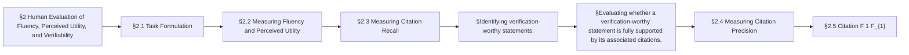

# Library: r8-research-method

Built from arXiv HTML bodies on 2026-11-25. 12 work(s).

| work | year | mechanism points | figure | cited by | summary |
| --- | --- | --- | --- | --- | --- |
| [BrowseComp: A Simple Yet Challenging Benchmark for Browsing Agents](https://arxiv.org/abs/2504.12516) | 2025 | 6 | no | 2 | yes |
| [Search-R1: Training LLMs to Reason and Leverage Search Engines with Reinforcement Learning](https://arxiv.org/abs/2503.09516) | 2025 | 4 | yes | 2 | yes |
| [Evaluating Verifiability in Generative Search Engines](https://arxiv.org/abs/2304.09848) | 2023 | 8 | yes | 0 | yes |
| [Qwen3 Technical Report](https://arxiv.org/abs/2505.09388) | 2025 | 17 | yes | 1 | yes |
| [BrowseComp-Plus: A More Fair and Transparent Evaluation Benchmark of Deep-Research Agent](https://arxiv.org/abs/2508.06600) | 2025 | 13 | yes | 0 | yes |
| [WebGPT: Browser-assisted question-answering with human feedback](https://arxiv.org/abs/2112.09332) | 2021 | 4 | yes | 2 | yes |
| [ResearchRubrics : A Benchmark of Prompts and Rubrics For Evaluating Deep Research Agents](https://arxiv.org/abs/2511.07685) | 2025 | 4 | yes | 0 | yes |
| [Search-o1: Agentic Search-Enhanced Large Reasoning Models](https://arxiv.org/abs/2501.05366) | 2025 | 7 | yes | 2 | yes |
| [Chain-of-Thought Prompting Elicits Reasoning in Large Language Models](https://arxiv.org/abs/2201.11903) | 2022 | 3 | yes | 0 | yes |
| [DeepResearcher: Scaling Deep Research via Reinforcement Learning in Real-world Environments](https://arxiv.org/abs/2504.03160) | 2025 | 11 | yes | 0 | yes |
| [The AI Scientist: Towards Fully Automated Open-Ended Scientific Discovery](https://arxiv.org/abs/2408.06292) | 2024 | 3 | yes | 0 | yes |
| [GAIA : A Benchmark for G eneral AI A ssistants](https://arxiv.org/abs/2311.12983) | 2024 | 9 | yes | 0 | yes |

Summaries written: 12 of 12

---

# BrowseComp: A Simple Yet Challenging Benchmark for Browsing Agents

arXiv:2504.12516 · 2025 · [source](https://arxiv.org/html/2504.12516)

> Written by an agent that read the body (DeepSeek Harness, 2026-11-24) after reading the paper; the mechanism quotes are the paper’s own words.

## 出发点
Although the internet has transformed the way we access information, human navigation of the internet to find information is clunky for several reasons: (1) our memory and world knowledge are limited; (2) our browsing abilities are hindered by distraction and fatigue; and (3) human brains can only attend to one thing at a time and cannot be parallelized. Machine intelligence, on the other hand, has much more extensive recall and can operate tirelessly without getting distracted. A sufficiently capable machine intelligence should be able to, in principle, retrieve any well-specified any piece of information from the open web, even if retrieving it would require browsing thousands of web pages.

§1 Introduction

## Pipeline

## 机制
### 1. Data collection and verification

The BrowseComp dataset was collected purely by human trainers. The instructions of BrowseComp largely followed those of SimpleQA ( Wei et al., 2024 ) —the human trainers created challenging, fact-seeking questions with single, indisputable, short answers that would not change over time and were supported by evidence. The key properties of BrowseComp are described below. Existing models at the time were not able to solve the question: trainers were asked to verify that GPT-4o (with and without browsing), as well as OpenAI o1 and an early version of the deep research model were not able to solve the problems. Trainers were asked to perform five simple Google searches and check that the answer was not readily available on any of the first pages of search results. Trainers were asked to create tasks that were challenging enough that another person would not be able to solve it within ten minutes. This was not strictly enforced, but for a portion of the questions a second trainer attempted finding the answer. Trainers who created tasks that were solved more than 40 % of the time were asked to revise their tasks. To identify the correct answer, models must be competent in reasoning about the factuality of content on the internet. Because answers are hard to find, doing well on BrowseComp requires persistence and depth of browsing ability. Many answers would be too time-intensive (or impossible) to find using a brute-force approach. In order to finish in a reasonable time, the model must be creative in its searches to find the correct answer.

§2 Data collection and verification

### 2. BrowseComp criteria

Challenging to answer. The most distinctive criteria for BrowseComp is that trainers created questions that were extremely challenging. We used three checks employed to motivate trainers to create questions that were challenging: Easy to verify, but hard to solve. To create challenging questions, we encouraged trainers to start with a fact, and then create an inverted question, where the answer is hard to find but easy to verify. Trainers typically started with a “seed” (could be a person, event, or artifact), found several characteristics with a large search space, and created a question from them. The exemplar question we gave them was: What’s the title of the scientific paper published in the EMNLP conference between 2018-2023 where the first author did their undergrad at Dartmouth College and the fourth author did their undergrad at University of Pennsylvania? (Answer: Frequency Effects on Syntactic Rule Learning in Transformers) In this example, it’s easy to verify the answer with just a few web searches, but it is much harder to find the answer, as a brute-force search would require examining thousands of papers, and looking into the backgrounds of the authors for each of them. Likely but not guaranteed to have all valid answers. One drawback in creating questions in an inverted fashion is that while we can be certain that the answer we provide as the reference answer is correct, we cannot be certain that there were no other answers. Using the EMNLP example above, the only way to be sure that there were no other papers fitting the above criteria would be to check every single one of them, which would be too time consuming. However, we can know that it is fairly unlikely that another answer fits the criteria, as Dartmouth College is a small school, and the person who wrote the question was familiar enough with the domain to know that no one else from Dartmouth wrote papers in EMNLP in the specified time span. To mitigate the possibility of additional answers other than the provided reference answer, we asked trainers to be comfortable enough with the content of their question that they were fairly confident that there were no additional valid answers, and to add more criteria if they were not confident. Moreover, if another trainer found valid answers within ten minutes that was not the reference answer, feedback was given to trainers for them to revise their question.

§2.1 BrowseComp criteria

### 3. Dataset diversity

In creating BrowseComp, we encouraged trainers to create questions about topics that they were personally interested in, hoping that creating data points about personal interests would lead to a more engaging experience, and higher quality data. The distribution of topics is shown below.

§2.2 Dataset diversity

### 4. Grading

As all the reference answers for BrowseComp are just a single short string, grading is done by simply using an AI model compare whether a predicted answer is semantically equivalent to the reference answer. We use the same grading prompt as Humanity’s Last Exam ( Phan et al., 2025 ) . You can view the full prompt to the grader in Appendix B .

§2.3 Grading

### 5. What BrowseComp exercises

Despite the simplicity of BrowseComp, it nonetheless measures the AI agent’s core browsing skills: BrowseComp can be seen as an incomplete but useful benchmark for agents that browse the internet. Although BrowseComp sidesteps the challenges of a true user query distribution, like generating long answers or resolving ambiguity, it measures the important core capability of exercising persistence and creativity in finding information. As a loose analogy, models that crush programming competitions like CodeForces demonstrate high coding capabilities that likely generalize well to other coding tasks, but this is not guaranteed. Similarly, to solve BrowseComp, the model must be very proficient at locating hard-to-find pieces of information, but it’s not guaranteed that this generalizes to all tasks that require browsing.

§2.4 What BrowseComp exercises

### 6. Human performance on BrowseComp

As one measure of how challenging the BrowseComp dataset is, we asked human trainers to also try to solve BrowseComp questions. These trainers were from the same group of trainers that created questions, but they could not solve the questions they created. The human trainers did not have access to the correct answer to the question, and were asked to complete the task without using an AI assistant (specifically, without using ChatGPT, Claude, Perplexity, Grok, or Gemini). Since some questions are extremely hard, we allowed trainers to label a problem as unsolvable and move on if they could solve it within 2 hours of searching. As shown in Table 2 , trainers solved 29.2% of problems, and of solved problems, the answer from the trainer matched with the original reference answer 86.4% of the time. Trainers self-reported how much time it took them to answer a question. Figure 3 below shows the distribution of times for questions that were solved versus questions where trainers gave up. For solved questions, we see a range of times—some questions were solved in less than one hour of searching, but there were also many questions that took two or three hours. When trainers gave up, they (per the rules) only did so after attempting the problem for around two hours. This data underscores the difficulty of the BrowseComp dataset—the trainers were humans experienced with the dataset and were not able to solve most questions in a few hours. On the other hand, the trainers were also not competition-level internet browsers, and it is possible that many of the problems that they gave up on would be solvable by experienced professionals (e.g., detectives or investigative journalists) with ample time.

§3 Human performance on BrowseComp

## 总结与展望
BrowseComp 用手工构造、答案难以直接搜到的问题测浏览代理，构造规则要求「十分钟内解不出、需要多次搜索确认」。它在调研方法方向的意义是：难题的难度可以被设计，而不是被观察——这正好是我们 evalset 缺的一层。

**It connects to**

- `2508.06600` — 后继工作指出原基准的检索污染问题，把「可解性」做成了透明指标。
- `2311.12983` — GAIA 是同类的人工难题基准，覆盖面更广。

## 不足之处
**The authors say:** There has been a long-standing interest in using AI to retrieve information from the internet. The task of retrieving information from the internet were of interest in the natural language processing community as early as IBM Watson ( Ferrucci et al., 2010 ) , with interest increasing with the popularization of pre-trained language models ( Guu et al., 2020 , Lewis et al., 2020 ) . Compared to prior work that focuses on information that could be easily found by a human within ten minutes of searching ( Joshi et al., 2017 , Yang et al., 2018 , Thorne et al., 2018 , Dinan et al., 2019 , Lee et al., 2019 , Fan et al., 2019 , Petroni et al., 2021 , Yao et al., 2022 , Mialon et al., 2023 , Song et al., 2025 ) , BrowseComp focuses on the ability to retrieve hard-to-find, deeply entangled information on the web.

**What a reader should still not conclude**

- 题目由人写，难度依赖作者的直觉，没有可复现的难度标定。
- 答案可被记忆污染，这正是后继工作要解决的问题。

§5 Related work and discussion

---

# Search-R1: Training LLMs to Reason and Leverage Search Engines with Reinforcement Learning

arXiv:2503.09516 · 2025 · [source](https://arxiv.org/html/2503.09516)

> Written by an agent that read the body (DeepSeek Harness, 2026-11-24) after reading the paper; the mechanism quotes are the paper’s own words.

## 出发点
Large language models (LLMs) have demonstrated remarkable capabilities in natural language understanding and generation ( Hendrycks et al., 2020 ; Clark et al., 2018 ) . Despite these achievements, LLMs often encounter challenges when tasked with complex reasoning ( Wei et al., 2022 ) and retrieving up-to-date information from external sources ( Jin et al., 2024 ) . Addressing these limitations necessitates integrating advanced reasoning abilities ( Huang & Chang, 2022 ) and the capability to interact effectively with search engines to best utilize external up-to-date information ( Schick et al., 2023 ) .

§1 Introduction

## Pipeline

*Demonstration of PPO and GRPO training with the search engine ( Search-R1 ). During the rollout, LLMs can conduct multi-turn interactions with the search engine.*

figure: `2503.09516v5/main.svg`

## 机制
### 1. Datasets

We evaluate Search-R1 on seven benchmark datasets, categorized as follows: (1) General Question Answering : NQ ( Kwiatkowski et al., 2019 ) , TriviaQA ( Joshi et al., 2017 ) , and PopQA ( Mallen et al., 2022 ) . (2) Multi-Hop Question Answering : HotpotQA ( Yang et al., 2018 ) , 2WikiMultiHopQA ( Ho et al., 2020 ) , Musique ( Trivedi et al., 2022b ) , and Bamboogle ( Press et al., 2022 ) . These datasets encompass a diverse range of search with reasoning challenges, enabling a comprehensive evaluation of Search-R1 .

§4.1 Datasets

### 2. Baselines

To evaluate the effectiveness of Search-R1 , we compare it against the following baselines: (1) Inference without Retrieval : Direct inference and Chain-of-Thought (CoT) reasoning ( Wei et al., 2022 ) . (2) Inference with Retrieval : Retrieval-Augmented Generation (RAG) ( Lewis et al., 2020 ) , IRCoT ( Trivedi et al., 2022a ) , and Search-o1 ( Li et al., 2025 ) . (3) Fine-Tuning-Based Methods : Supervised fine-tuning (SFT) ( Chung et al., 2024 ) , RL-based fine-tuning without a search engine (R1) ( Guo et al., 2025 ) and rejection sampling ( Ahn et al., 2024 ) with a search engine. For R1, we train the LLMs with the RL methods proposed in Guo et al. (2025) with our data to have a fair comparison with Search-R1 . It only contains reasoning and answer steps without a search engine. For rejection sampling, we generate five candidate responses per training prompt from the same dataset with the instructed LLMs and select those that lead to correct final answers. These selected trajectories are then used to construct a new training set that retains the same multi-turn LLM–search engine interaction rollout mechanism proposed in Search-R1 to fine-tune the LLMs. These baselines cover a broad spectrum of retrieval-augmented and fine-tuning approaches, allowing for a comprehensive assessment of Search-R1 in both zero-shot and learned retrieval settings. To make a fair comparison between different methods, we use the same retriever, same number of retrieved documents, same knowledge corpus, same training data and same pre-trained LLMs. Details can be found in Appendix B .

§4.2 Baselines

### 3. Experimental Setup

We conduct experiments using two types of models: Qwen-2.5-3B (Base/Instruct) and Qwen-2.5-7B (Base/Instruct) ( Yang et al., 2024 ) . For retrieval, we use the 2018 Wikipedia dump ( Karpukhin et al., 2020 ) as the knowledge source and E5 ( Wang et al., 2022 ) as the retriever. To ensure fair comparison, we follow Lin et al. (2023) and set the number of retrieved passages to 3 across all retrieval-based methods. A study of the number of retrieved passages can be found in Appendix G . For training, we merge the training sets of NQ and HotpotQA to form a unified dataset for Search-R1 and other fine-tuning based baselines. Evaluation is conducted on the test or validation sets of seven datasets to assess both in-domain and out-of-domain performance. Exact Match (EM) is used as the evaluation metric, following Yu et al. (2024) . For inference-style baselines, we use instruct models, as base models fail to follow instructions. For RL tuning methods, experiments are conducted on both base and instruct models. More details on experimental settings can be found in Appendix B . Unless stated otherwise, PPO is used as the default RL method , and a detailed comparison between PPO and GRPO is provided in Section 5.1 .

§4.3 Experimental Setup

### 4. Performance

The main results comparing Search-R1 with baseline methods across the seven datasets are presented in Table 2 . From the results, we make the following key observations: (1) Search-R1 consistently outperforms strong baseline methods. We achieve 24% and 20% average relative improvement with Qwen2.5-7B and Qwen2.5-3B, respectively. These gains hold across both in-distribution evaluation ( i.e. , NQ and HotpotQA) and out-of-distribution evaluation ( i.e. , TriviaQA, PopQA, 2WikiMultiHopQA, Musique, and Bamboogle). (2) Search-R1 surpasses RL-based training for LLM reasoning without retrieval (R1). This aligns with expectations, as incorporating search into LLM reasoning provides access to relevant external knowledge, improving overall performance. (3) Search-R1 is effective for both base and instruction-tuned models. This demonstrates that DeepSeek-R1-Zero-style RL with outcome-based rewards ( Guo et al., 2025 ) can be successfully applied to reasoning with search, extending beyond its previously established effectiveness in pure reasoning scenarios. (4) Larger models are better on learning how to do search. Search-R1 on 7B model shows much larger “performance gap” compared with 3B model ( e.g. , compared with second best model - RAG).

§4.4 Performance

## 总结与展望
Search-R1 把检索当成环境的一部分，用强化学习训练模型「何时搜、搜什么」。它对本方向的价值是把「检索质量」与「模型能力」分开：同一个模型，检索接口变化就会带来大幅分数变化，所以不能把两者混在一个分数里。

**It connects to**

- `2501.05366` — 同样把检索嵌入推理循环，一个靠 RL 一个靠提示。
- `2504.03160` — 把环境从本地语料换成真实网，泛化问题因此暴露。

## 不足之处
**What a reader should still not conclude**

- 奖励是最终答案正确，检索过程本身没有监督信号。
- 训练用的检索器固定，评测时换检索器会破坏可比性。

---

# Evaluating Verifiability in Generative Search Engines

arXiv:2304.09848 · 2023 · [source](https://arxiv.org/html/2304.09848)

> Written by an agent that read the body (DeepSeek Harness, 2026-11-24) after reading the paper; the mechanism quotes are the paper’s own words.

## 出发点
Generative search engines fulfill user information needs by directly generating responses to input queries, along with in-line citations (Figure 1 ). 1 1 1 In contrast, conventional search engines are limited to retrieving pre-existing webpages. Existing generative search engines are rapidly gaining users—in March 2023, Microsoft reported that “roughly one third of daily preview users are using [Bing] Chat daily”, and that Bing Chat served 45 million chats in the first month of its public preview ( Mehdi, 2023 ) . Generative search engines have the potential to transform how people find information online, but generated responses from existing large language model-backed generative search engines may not always be accurate ( Maynez et al., 2020 ) . Given their potential and rapid mainstream adoption, it is critical to evaluate these systems to better understand their potential limitations (akin to prior work in algorithmic auditing; Metaxas and Pruksachatkun, 2017 ; Buolamwini and Gebru, 2018 ; Kiritchenko and Mohammad, 2018 ; Robertson et al., 2018 ; Metaxa et al., 2019 ; Green and Chen, 2019 ; Birhane et al., 2022 , inter alia ).

§1 Introduction

## Pipeline

*Generative search engines answer user queries by generating a tailored response, along with in-line citations. However, not all generated statements are fully supported by citations (citation recall), and not every citation supports its associated statement (citation precision).*

figure: `2304.09848v2/figure_1.svg`

## 机制
### 1. Human Evaluation of Fluency, Perceived Utility, and Verifiability

In this section, we formalize the inputs and outputs of the generative search engines we study, describe the evaluation of fluency and perceived utility, and define and describe the evaluation of citation recall and precision. Citation recall and precision are designed to reward systems that cite comprehensively (i.e., high recall; all statements are fully supported by citations) and accurately (i.e., high precision; every cite supports its associated statement). We also define citation F 1 F_{1} , a metric that combines citation precision and citation recall. Full support : all of the information in the statement is supported by the citation. Partial support : some of the information in the statement is supported by the citation, but other parts are not supported (e.g., missing or contradictory). No support : the citation does not support any part of the statement (e.g., the cited webpage is completely irrelevant or contradictory).

§2 Human Evaluation of Fluency, Perceived Utility, and Verifiability

### 2. Task Formulation

Given a user query q q as input, a generative search engine produces a text response r r , which is a string with embedded in-line citations. For the example in Figure 1 , the query q q is “What are the latest discoveries from the James Webb Space Telescope?” and the response r r is the string paragraph “The James Webb Space Telescope … used to study the next interstellar interloper [3].”, with embedded citations “[1]”, “[2]”, and “[3]”. To evaluate citation precision and recall, we first segment the r r into a set of n n statements 𝒮 = { s 1 , … , s n } \mathcal{S}=\{s_{1},\dots,s_{n}\} . In this work, the segmentation 𝒮 \mathcal{S} is set of sentences in the response r r . For each statement s i ∈ 𝒮 s_{i}\in\mathcal{S} , we construct a (possibly empty) set 𝒞 i = { c i , 1 , … , c i , k } \mathcal{C}_{i}=\{{c_{{i},1}},\dots,{c_{{i},k}}\} of k k citations associated with the statement s i s_{i} , where c i , j c_{{i},j} is the j j th citation associated with the i i th response statement. For each citation c i , j c_{i,j} , we have a URL u i , j u_{i,j} and its contents p i , j p_{i,j} . In this work, 𝒞 i \mathcal{C}_{i} is set of citations that occur in s i s_{i} (e.g., for s i s_{i} = “Blueberries[1], cherries[2], and grapes[3] grow on trees.[4]”, 𝒞 i = { [1] , [2] , [3] , [4] } \mathcal{C}_{i}=\{\textrm{[1]},\textrm{[2]},\textrm{[3]},\textrm{[4]}\} ). In practice, a sentence may contain multiple independently-verifiable claims (e.g., conjuncts such as “Cups can be made of glass[1] or plastic[2].”), and a single in-line citation’s scope is often ambiguous (e.g., a cite marker after two statements could be interpreted as either supporting both statements, or merely the final one); we leave finer-grained evaluation to future work.

§2.1 Task Formulation

### 3. Measuring Fluency and Perceived Utility

To measure response fluency, annotators were shown the user query, the generated response, and the claim “The response is fluent and cohesive”. We ask annotators to rate their level of agreement with the claim on a five-point Likert scale from Strongly Disagree to Strongly Agree . We use a similar process to measure perceived utility, asking annotators to rate their level of agreement with the claim “The response is a helpful and informative answer to the query”.

§2.2 Measuring Fluency and Perceived Utility

### 4. Measuring Citation Recall

Citation recall is the proportion of verification-worthy statements that are fully supported by their associated citations (see Figure 2 for several examples). Thus, computing citation recall requires (i) identifying the verification-worthy statements in a response and (ii) evaluating whether each verification-worthy statement is fully supported by its associated citations.

§2.3 Measuring Citation Recall

### 5. Identifying verification-worthy statements.

Given the statements 𝒮 \mathcal{S} in a response r r , we first ask annotators to remove statements in the response that are not verification-worthy. We take the position that every generated statement about the external world is verification-worthy, even those that might seem obvious, trivially true, or “common sense”. Generated statements may be incorrect, and statements that seem obvious to some readers may be less than obvious to others (e.g., “The Pope is Catholic”). We believe that systems should aim to provide a source for all generated statements about the external world, enabling readers to easily verify any statement in a generated response. In practice, almost all system-generated statements are verification-worthy—notable exceptions include statements about the speaker (the system) itself (e.g., “As a language model, I do not have the ability to ban books.”) and questions posed to the user (e.g.,“Would you like to learn more?”, generated by systems like Bing Chat and YouChat that are deployed in conversational settings).

§Identifying verification-worthy statements.

### 6. Evaluating whether a verification-worthy statement is fully supported by its associated citations.

Given the verification-worthy statements in a response r r , annotators evaluate whether each statement is fully supported by its associated citations (see the sentences of generated response in Figure 1 for examples). To collect these binary judgments, we use the attributable to identified sources (AIS) evaluation framework of Rashkin et al. (2022) . In particular, a statement s i s_{i} is fully supported by its associated citations 𝒞 i \mathcal{C}_{i} if a generic hearer would affirm the statement “According to cited webpages 𝒞 i \mathcal{C}_{i} , s i s_{i} ”, within the context of the query q q and response r r , and unsupported otherwise.

§Evaluating whether a verification-worthy statement is fully supported by its associated citations.

### 7. Measuring Citation Precision

Citation precision is the proportion of generated citations that support their associated statements (Figure 2 ). In contrast to citation recall, citation precision rewards systems for citing accurately—a response that cites every webpage on the Internet for each generated statement would have high citation recall, but low citation precision (since many articles are irrelevant and do not support their associated statement). To measure citation precision for a response r r , we first ask annotators to judge whether each citation c i , k {c_{i,k}} contributes full, partial, or no support for its associated statement s i s_{i} (see cited webpages in Figure 1 for examples): For statements that have multiple associated citations, we additionally ask annotators whether the union of its associated cited webpages collectively provides full support for the statement (a binary judgment). Similar to citation recall, we use the AIS evaluation framework of Rashkin et al. (2022) to collect these binary judgments. To calculate citation precision, let T f ​ s T_{fs} be the number of citations that fully support its associated statement, and let T p ​ s T_{ps} be the number of citations that partially supports its associated statement, where the associated statement is fully supported by the union of its associated citations and no associated citation fully supports the statement by itself. 4 4 4 For an intuitive example of when partially-supporting cites count toward improving precision (greater T p ​ s T_{ps} ), consider the statement “Health benefits of cycling include improved cardiovascular health[1] and lowered cholesterol levels[2].” with its associated citations [1] and [2]. Suppose that these citations each contribute partial support for the entire statement—the first citation [1] only states that “Health benefits of cycling include improved cardiovascular health”, and second citation [2] only states that “Health benefits of cycling include lowered cholesterol levels”. Taken together, the citations offer full support for the statement. Although these citations do not fully support the statement on their own, they still meaningfully contribute to its verifiability—systems should not be penalized for aggregating information from multiple citations. Let N N be the total number of citations in the response. Then, the citation precision is ( T f ​ s + T p ​ s ) / N (T_{fs}+T_{ps})/N .

§2.4 Measuring Citation Precision

### 8. Citation F 1 F_{1}

Citation F 1 F_{1} is a metric that combines citation precision and citation recall by taking their harmonic mean: To achieve a high citation F 1 F_{1} , systems must have high citation precision and high citation recall.

§2.5 Citation F 1 F_{1}

## 总结与展望
这篇首次系统测生成式搜索引擎的可核查性，用「引用召回率」与「引用精确率」两个数，并给出一个刺眼的基线：只有约一半的生成句子能得到所引来源的支持。它对本方向的直接含义是——带引用的错误答案比裸错误更危险，因为引用制造了可信度。

**It connects to**

- `2112.09332` — 同一条线上更早的系统，也有引用与人工反馈。
- `2511.07685` — 把「可核查」推进到评分细则层面。

## 不足之处
**The authors say:** The primary goal of this work was to assess verifiability in generative search engine responses. However, note that verifiability is not factuality —rather than arbitrating if a generated statement is true (difficult for all but the simplest claims; Rashkin et al., 2022 ), verifiability enables users to easily check any generated statement’s source, allowing them to draw their own conclusions about whether to trust the generated statement. Studying the factuality of generative search engines (that may or may not provide citations) is an important direction for future work—users may not necessarily bother to check the sources, especially given that responses often seem helpful and sound confident, and we’d thus like responses to be as factual as possible.

**What a reader should still not conclude**

- 人工标注规模有限，召回率的置信区间很宽。
- 它测的是句子级支持，不是「结论是否被整篇文献支持」。

§Limitations

---

# Qwen3 Technical Report

arXiv:2505.09388 · 2025 · [source](https://arxiv.org/html/2505.09388)

> Written by an agent that read the body (DeepSeek Harness, 2026-11-24) after reading the paper; the mechanism quotes are the paper’s own words.

## 出发点
The pursuit of artificial general intelligence (AGI) or artificial super intelligence (ASI) has long been a goal for humanity. Recent advancements in large foundation models, e.g., GPT-4o ( OpenAI, 2024 ) , Claude 3.7 ( Anthropic, 2025 ) , Gemini 2.5 ( DeepMind, 2025 ) , DeepSeek-V3 ( Liu et al., 2024a ) , Llama-4 ( Meta-AI, 2025 ) , and Qwen2.5 ( Yang et al., 2024b ) , have demonstrated significant progress toward this objective. These models are trained on vast datasets spanning trillions of tokens across diverse domains and tasks, effectively distilling human knowledge and capabilities into their parameters. Furthermore, recent developments in reasoning models, optimized through reinforcement learning, highlight the potential for foundation models to enhance inference-time scaling and achieve higher levels of intelligence, e.g., o3 ( OpenAI, 2025 ) , DeepSeek-R1 ( Guo et al., 2025 ) . While most state-of-the-art models remain proprietary, the rapid growth of open-source communities has substantially reduced the performance gap between open-weight and closed-source models. Notably, an increasing number of top-tier models ( Meta-AI, 2025 ; Liu et al., 2024a ; Guo et al., 2025 ; Yang et al., 2024b ) are now being released as open-source, fostering broader research and innovation in artificial intelligence.

§1 Introduction

## Pipeline

*Post-training pipeline of the Qwen3 series models.*

figure: `2505.09388v1/posttrain_pipeline.svg`

## 机制
### 1. Architecture

The Qwen3 series includes 6 dense models, namely Qwen3-0.6B, Qwen3-1.7B, Qwen3-4B, Qwen3-8B, Qwen3-14B, and Qwen3-32B, and 2 MoE models, Qwen3-30B-A3B and Qwen3-235B-A22B. The flagship model, Qwen3-235B-A22B, has a total of 235B parameters with 22B activated ones. Below, we elaborate on the architecture of the Qwen3 models. The architecture of the Qwen3 dense models is similar to Qwen2.5 ( Yang et al., 2024b ) , including using Grouped Query Attention (GQA, Ainslie et al., 2023 ), SwiGLU ( Dauphin et al., 2017 ) , Rotary Positional Embeddings (RoPE, Su et al., 2024 ), and RMSNorm ( Jiang et al., 2023 ) with pre-normalization. Besides, we remove QKV-bias used in Qwen2 ( Yang et al., 2024a ) and introduce QK-Norm ( Dehghani et al., 2023 ) to the attention mechanism to ensure stable training for Qwen3. Key information on model architecture is provided in Table 1 . The Qwen3 MoE models share the same fundamental architecture as the Qwen3 dense models. Key information on model architecture is provided in Table 2 . We follow Qwen2.5-MoE ( Yang et al., 2024b ) and implement fine-grained expert segmentation ( Dai et al., 2024 ) . The Qwen3 MoE models have 128 total experts with 8 activated experts per token. Unlike Qwen2.5-MoE, the Qwen3-MoE design excludes shared experts. Furthermore, we adopt the global-batch load balancing loss ( Qiu et al., 2025 ) to encourage expert specialization. These architectural and training innovations have yielded substantial improvements in model performance across downstream tasks. Qwen3 models utilize Qwen’s tokenizer ( Bai et al., 2023 ) , which implements byte-level byte-pair encoding (BBPE, Brown et al., 2020 ; Wang et al., 2020 ; Sennrich et al., 2016 ) with a vocabulary size of 151,669.

§2 Architecture

### 2. Post-training

The post-training pipeline of Qwen3 is strategically designed with two core objectives: Thinking Control : This involves the integration of two distinct modes, namely the “non-thinking” and “thinking” modes, providing users with the flexibility to choose whether the model should engage in reasoning or not, and to control the depth of thinking by specifying a token budget for the thinking process. Strong-to-Weak Distillation : This aims to streamline and optimize the post-training process for lightweight models. By leveraging the knowledge from large-scale models, we substantially reduce both the computational costs and the development efforts required for building smaller-scale models. As illustrated in Figure 1 , the flagship models in the Qwen3 series follow a sophisticated four-stage training process. The first two stages focus on developing the models’ “thinking” abilities. The next two stages aim to integrate strong “non-thinking” functionalities into the models. Preliminary experiments suggest that directly distilling the output logits from teacher models into lightweight student models can effectively enhance their performance while maintaining fine-grained control over their reasoning processes. This approach eliminates the necessity of performing an exhaustive four-stage training process individually for every small-scale model. It leads to better immediate performance, as indicated by higher Pass@1 scores, and also improves the model’s ability of exploration, as reflected in improved Pass@64 results. In addition, it achieves these gains with much greater training efficiency, requiring only 1/10 of the GPU hours compared to the four-stage training method. In the following sections, we present the four-stage training process and provide a detailed explanation of the Strong-to-Weak Distillation approach. Thinking Mode Non-Thinking Mode <|im_start|>user {query} /think <|im_end|> <|im_start|>assistant <think> {thinking_content} </think> {response} <|im_end|> <|im_start|>user {query} /no_think <|im_end|> <|im_start|>assistant <think> </think> {response} <|im_end|> Instruction Following : This capability ensures that models accurately interpret and follow user instructions, including requirements related to content, format, length, and the use of structured output, delivering responses that align with user expectations. Format Following : In addition to explicit instructions, we expect the model to adhere to specific formatting conventions. For instance, it should respond appropriately to the /think and /no_think flags by switching between thinking and non-thinking modes, and consistently use designated tokens (e.g., <think> and </think> ) to separate the thinking and response parts in the final output. Preference Alignment : For open-ended queries, preference alignment focuses on improving the model’s helpfulness, engagement, and style, ultimately delivering a more natural and satisfying user experience. Agent Ability : This involves training the model to correctly invoke tools via designated interfaces. During the RL rollout, the model is allowed to perform complete multi-turn interaction cycles with real environment execution feedback, thereby improving its performance and stability in long-horizon decision-making tasks. Abilities for Specialized Scenarios : In more specialized scenarios, we design tasks tailored to the specific context. For example, in Retrieval-Augmented Generation (RAG) tasks, we incorporate reward signals to guide the model toward generating accurate and contextually appropriate responses, thereby minimizing the risk of hallucination. Rule-based Reward : The rule-based reward has been widely used in the reasoning RL stage, and is also useful for general tasks such as instruction following ( Lambert et al., 2024 ) and format adherence. Well-designed rule-based rewards can assess the correctness of model outputs with high precision, preventing issues like reward hacking. Model-based Reward with Reference Answer : In this approach, we provide a reference answer for each query and prompt Qwen2.5-72B-Instruct to score the model’s response based on this reference. This method allows for more flexible handling of diverse tasks without requiring strict formatting, avoiding false negatives that can occur with purely rule-based rewards. Model-based Reward without Reference Answer : Leveraging human preference data, we train a reward model to assign scalar scores to model responses. This approach, which does not depend on a reference answer, can handle a broader range of queries while effectively enhancing the model’s engagement and helpfulness. Off-policy Distillation : At this initial phase, we combine the outputs of teacher models generated with both /think and /no_think modes for response distillation. This helps lightweight student models develop basic reasoning skills and the ability to switch between different modes of thinking, laying a solid foundation for the next on-policy training phase. On-policy Distillation : In this phase, the student model generates on-policy sequences for fine-tuning. Specifically, prompts are sampled, and the student model produces responses in either /think or /no_think mode. The student model is then fine-tuned by aligning its logits with those of a teacher model (Qwen3-32B or Qwen3-235B-A22B) to minimize the KL divergence. General Tasks : We utilize benchmarks including MMLU-Redux ( Gema et al., 2024 ) , GPQA-Diamond ( Rein et al., 2023 ) , C-Eval ( Huang et al., 2023 ) , and LiveBench (2024-11-25) ( White et al., 2024 ) . For GPQA-Diamond, we sample 10 times for each query and report the averaged accuracy. Alignment Tasks : To evaluate how well the model aligns with human preferences, we employ a suite of specialized benchmarks. For instruction-following performance, we report the strict-prompt accuracy of IFEval ( Zhou et al., 2023 ) . To assess alignment with human preferences on general topics, we utilize Arena-Hard ( Li et al., 2024 ) and AlignBench v1.1 ( Liu et al., 2023b ) . For writing tasks, we rely on Creative Writing V3 ( Paech, 2024 ) and WritingBench ( Wu et al., 2025 ) to evaluate the model’s proficiency and creativity. Math & Text Reasoning : For evaluating mathematical and logical reasoning skills, we employ high-level math benchmarks including MATH-500 ( Lightman et al., 2023 ) , AIME’24 and AIME’25 ( AIME, 2025 ) , and text reasoning tasks including ZebraLogic ( Lin et al., 2025 ) and AutoLogi ( Zhu et al., 2025 ) . For AIME problems, each year’s questions include Part I and Part II, totaling 30 questions. For each question, we sample 64 times and take the average accuracy as the final score. Agent & Coding : To test the model’s proficiency in coding and agent-based tasks, we use BFCL v3 ( Yan et al., 2024 ) , LiveCodeBench (v5, 2024.10-2025.02) ( Jain et al., 2024 ) , and Codeforces Ratings from CodeElo ( Quan et al., 2025 ) . For BFCL, all Qwen3 models are evaluated using the FC format, and yarn was used to deploy the models to a context length of 64k for Multi-Turn evaluation. Some baselines are derived from the BFCL leaderboard, taking the higher scores between FC and Prompt formats. For models not reported on the leaderboard, the Prompt formats are evaluated. For LiveCodeBench, for the non-thinking mode, we use the officially recommended prompt, while for the thinking mode, we adjust the prompt template to allow the model to think more freely, by removing the restriction You will not return anything except for the program . To evaluate the performance gap between models and competitive programming experts, we use CodeForces to calculate Elo ratings. In our benchmark, each problem is solved by generating up to eight independent reasoning attempts. Multilingual Tasks : For multilingual capabilities, we evaluate four kinds of tasks: instruction following, knowledge, mathematics, and logical reasoning. Instruction following is assessed using Multi-IF ( He et al., 2024 ) , which focuses on 8 key languages. Knowledge assessment consisted of two types: regional knowledge evaluated through INCLUDE ( Romanou et al., 2024 ) , covering 44 languages, and general knowledge assessed with MMMLU ( OpenAI, 2024 ) across 14 languages, excluding the unoptimized Yoruba language; for these two benchmarks, we sample only 10% of the original data to improve evaluation efficiency. The mathematics task employ MT-AIME2024 ( Son et al., 2025 ) , encompassing 55 languages, and PolyMath ( Wang et al., 2025 ) , which includes 18 languages. Logical reasoning is evaluated using MlogiQA, covering 10 languages, sourced from Zhang et al. (2024) . OpenAI-o1 DeepSeek-R1 Grok-3-Beta (Think) Gemini2.5-Pro Qwen3-235B-A22B Architecture - MoE - - MoE # Activated Params - 37B - - 22B # Total Params - 671B - - 235B General Tasks MMLU-Redux 92.8 92.9 - 93.7 92.7 GPQA-Diamond 78.0 71.5 80.2 84.0 71.1 C-Eval 85.5 91.8 - 82.9 89.6 LiveBench 2024-11-25 75.7 71.6 - 82.4 77.1 Alignment Tasks IFEval strict prompt 92.6 83.3 - 89.5 83.4 Arena-Hard 92.1 92.3 - 96.4 95.6 AlignBench v1.1 8.86 8.76 - 9.03 8.94 Creative Writing v3 81.7 85.5 - 86.0 84.6 WritingBench 7.69 7.71 - 8.09 8.03 Math & Text Reasoning MATH-500 96.4 97.3 98.8 98.0 AIME’24 74.3 79.8 83.9 92.0 85.7 AIME’25 79.2 70.0 77.3 86.7 81.5 ZebraLogic 81.0 78.7 - 87.4 80.3 AutoLogi 79.8 86.1 - 85.4 89.0 Agent & Coding BFCL v3 67.8 56.9 - 62.9 70.8 LiveCodeBench v5 63.9 64.3 70.6 70.4 70.7 CodeForces (Rating / Percentile) 1891 / 96.7% 2029 / 98.1% - 2001 / 97.9% 2056 / 98.2% Multilingual Tasks Multi-IF 48.8 67.7 - 77.8 71.9 INCLUDE 84.6 82.7 - 85.1 78.7 MMMLU 14 languages 88.4 86.4 - 86.9 84.3 MT-AIME2024 67.4 73.5 - 76.9 80.8 PolyMath 38.9 47.1 - 52.2 54.7 MLogiQA 75.5 73.8 - 75.6 77.1 GPT-4o -2024-11-20 DeepSeek-V3 Qwen2.5-72B -Instruct LLaMA-4 -Maverick Qwen3-235B-A22B Architecture - MoE Dense MoE MoE # Activated Params - 37B 72B 17B 22B # Total Params - 671B 72B 402B 235B General Tasks MMLU-Redux 87.0 89.1 86.8 91.8 89.2 GPQA-Diamond 46.0 59.1 49.0 69.8 62.9 C-Eval 75.5 86.5 84.7 83.5 86.1 LiveBench 2024-11-25 52.2 60.5 51.4 59.5 62.5 Alignment Tasks IFEval strict prompt 86.5 86.1 84.1 86.7 83.2 Arena-Hard 85.3 85.5 81.2 82.7 96.1 AlignBench v1.1 8.42 8.64 7.89 7.97 8.91 Creative Writing v3 81.1 74.0 61.8 61.3 80.4 WritingBench 7.11 6.49 7.06 5.46 7.70 Math & Text Reasoning MATH-500 77.2 90.2 83.6 90.6 91.2 AIME’24 11.1 39.2 18.9 38.5 40.1 AIME’25 7.6 28.8 15.0 15.9 24.7 ZebraLogic 27.4 42.1 26.6 40.0 37.7 AutoLogi 65.9 76.1 66.1 75.2 83.3 Agent & Coding BFCL v3 72.5 57.6 63.4 52.9 68.0 LiveCodeBench v5 32.7 33.1 30.7 37.2 35.3 CodeForces (Rating / Percentile) 864 / 35.4% 1134 / 54.1% 859 / 35.0% 712 / 24.3% 1387 / 75.7% Multilingual Tasks Multi-IF 65.6 55.6 65.3 75.5 70.2 INCLUDE 78.8 76.7 69.6 80.9 75.6 MMMLU 14 languages 80.3 81.1 76.9 82.5 79.8 MT-AIME2024 9.2 20.9 12.7 27.0 32.4 PolyMath 13.7 20.4 16.9 26.1 27.0 MLogiQA 57.4 58.9 59.3 59.9 67.6 Our flagship model, Qwen3-235B-A22B, demonstrates the state-of-the-art overall performance among open-source models in both the thinking and non-thinking modes, surpassing strong baselines such as DeepSeek-R1 and DeepSeek-V3. Qwen3-235B-A22B is also highly competitive to closed-source leading models, such as OpenAI-o1, Gemini2.5-Pro, and GPT-4o, showcasing its profound reasoning capabilities and comprehensive general abilities. Our flagship dense model, Qwen3-32B, outperforms our previous strongest reasoning model, QwQ-32B, in most of the benchmarks, and performs comparably to the closed-source OpenAI-o3-mini, indicating its compelling reasoning capabilities. Qwen3-32B is also remarkably performant in the non-thinking mode and surpasses our previous flagship non-reasoning dense model, Qwen2.5-72B-Instruct. Our lightweight models, including Qwen3-30B-A3B, Qwen3-14B, and other smaller dense ones, possess consistently superior performance to the open-source models with a close or larger amount of parameters, proving the success of our Strong-to-Weak Distillation approach. From Table 11 , with only 60% activated and 35% total parameters, Qwen3-235B-A22B (Thinking) outperforms DeepSeek-R1 on 17/23 the benchmarks, particularly on the reasoning-demanded tasks (e.g., mathematics, agent, and coding), demonstrating the state-of-the-art reasoning capabilities of Qwen3-235B-A22B among open-source models. Moreover, Qwen3-235B-A22B (Thinking) is also highly competitive to the closed-source OpenAI-o1, Grok-3-Beta (Think), and Gemini2.5-Pro, substantially narrowing the gap in the reasoning capabilities between open-source and close-source models. From Table 12 , Qwen3-235B-A22B (Non-thinking) exceeds the other leading open-source models, including DeepSeek-V3, LLaMA-4-Maverick, and our previous flagship model Qwen2.5-72B-Instruct, and also surpasses the closed-source GPT-4o-2024-11-20 in 18/23 the benchmarks, indicating its inherent strong capabilities even when not enhanced with the deliberate thinking process. From Table 13 , Qwen3-32B (Thinking) outperforms QwQ-32B on 17/23 the benchmarks, making it the new state-of-the-art reasoning model at the sweet size of 32B. Moreover, Qwen3-32B (Thinking) also competes with the closed-source OpenAI-o3-mini (medium) with better alignment and multilingual performance. From Table 14 , Qwen3-32B (Non-thinking) exhibits superior performance to all the baselines on almost all the benchmarks. Particularly, Qwen3-32B (Non-thinking) performs on par with Qwen2.5-72B-Instruct on the general tasks with significant advantages on the alignment, multilingual, and reasoning-related tasks, again proving the fundamental improvements of Qwen3 over our previous Qwen2.5 series models. DeepSeek-R1 -Distill-Llama-70B QwQ-32B OpenAI-o3-mini (medium) Qwen3-32B Architecture Dense Dense - Dense # Activated Params 70B 32B - 32B # Total Params 70B 32B - 32B General Tasks MMLU-Redux 89.3 90.0 90.0 90.9 GPQA-Diamond 65.2 65.6 76.8 68.4 C-Eval 71.8 88.4 75.1 87.3 LiveBench 2024-11-25 54.5 72.0 70.0 74.9 Alignment Tasks IFEval strict prompt 79.3 83.9 91.5 85.0 Arena-Hard 60.6 89.5 89.0 93.8 AlignBench v1.1 6.74 8.70 8.38 8.72 Creative Writing v3 62.1 82.4 74.8 81.0 WritingBench 6.08 7.86 7.52 7.90 Math & Text Reasoning MATH-500 94.5 98.0 98.0 97.2 AIME’24 70.0 79.5 79.6 81.4 AIME’25 56.3 69.5 74.8 72.9 ZebraLogic 71.3 76.8 88.9 88.8 AutoLogi 83.5 88.1 86.3 87.3 Agent & Coding BFCL v3 49.3 66.4 64.6 70.3 LiveCodeBench v5 54.5 62.7 66.3 65.7 CodeForces (Rating / Percentile) 1633 / 91.4% 1982 / 97.7% 2036 / 98.1% 1977 / 97.7% Multilingual Tasks Multi-IF 57.6 68.3 48.4 73.0 INCLUDE 62.1 69.7 73.1 73.7 MMMLU 14 languages 69.6 80.9 79.3 80.6 MT-AIME2024 29.3 68.0 73.9 75.0 PolyMath 29.4 45.9 38.6 47.4 MLogiQA 60.3 75.5 71.1 76.3 GPT-4o-mini -2024-07-18 LLaMA-4 -Scout Qwen2.5-72B -Instruct Qwen3-32B Architecture - MoE Dense Dense # Activated Params - 17B 72B 32B # Total Params - 109B 72B 32B General Tasks MMLU-Redux 81.5 86.3 86.8 85.7 GPQA-Diamond 40.2 57.2 49.0 54.6 C-Eval 66.3 78.2 84.7 83.3 LiveBench 2024-11-25 41.3 47.6 51.4 59.8 Alignment Tasks IFEval strict prompt 80.4 84.7 84.1 83.2 Arena-Hard 74.9 70.5 81.2 92.8 AlignBench v1.1 7.81 7.49 7.89 8.58 Creative Writing v3 70.3 55.0 61.8 78.3 WritingBench 5.98 5.49 7.06 7.54 Math & Text Reasoning MATH-500 78.2 82.6 83.6 88.6 AIME’24 8.1 28.6 18.9 31.0 AIME’25 8.8 10.0 15.0 20.2 ZebraLogic 20.1 24.2 26.6 29.2 AutoLogi 52.6 56.8 66.1 78.5 Agent & Coding BFCL v3 64.0 45.4 63.4 63.0 LiveCodeBench v5 27.9 29.8 30.7 31.3 CodeForces (Rating / Percentile) 1113 / 52.6% 981 / 43.7% 859 / 35.0% 1353 / 71.0% Multilingual Tasks Multi-IF 62.4 64.2 65.3 70.7 INCLUDE 66.0 74.1 69.6 70.9 MMMLU 14 languages 72.1 77.5 76.9 76.5 MT-AIME2024 6.0 19.1 12.7 24.1 PolyMath 12.0 20.9 16.9 22.5 MLogiQA 42.6 53.9 59.3 62.9 DeepSeek-R1 -Distill-Qwen-32B QwQ-32B Qwen3-14B Qwen3-30B-A3B Architecture Dense Dense Dense MoE # Activated Params 32B 32B 14B 3B # Total Params 32B 32B 14B 30B General Tasks MMLU-Redux 88.2 90.0 88.6 89.5 GPQA-Diamond 62.1 65.6 64.0 65.8 C-Eval 82.2 88.4 86.2 86.6 LiveBench 2024-11-25 45.6 72.0 71.3 74.3 Alignment Tasks IFEval strict prompt 72.5 83.9 85.4 86.5 Arena-Hard 60.8 89.5 91.7 91.0 AlignBench v1.1 7.25 8.70 8.56 8.70 Creative Writing v3 55.0 82.4 80.3 79.1 WritingBench 6.13 7.86 7.80 7.70 Math & Text Reasoning MATH-500 94.3 98.0 96.8 98.0 AIME’24 72.6 79.5 79.3 80.4 AIME’25 49.6 69.5 70.4 70.9 ZebraLogic 69.6 76.8 88.5 89.5 AutoLogi 74.6 88.1 89.2 88.7 Agent & Coding BFCL v3 53.5 66.4 70.4 69.1 LiveCodeBench v5 54.5 62.7 63.5 62.6 CodeForces (Rating / Percentile) 1691 / 93.4% 1982 / 97.7% 1766 / 95.3% 1974 / 97.7% Multilingual Tasks Multi-IF 31.3 68.3 74.8 72.2 INCLUDE 68.0 69.7 71.7 71.9 MMMLU 14 languages 78.6 80.9 77.9 78.4 MT-AIME2024 44.6 68.0 73.3 73.9 PolyMath 35.1 45.9 45.8 46.1 MLogiQA 63.3 75.5 71.1 70.1 Phi-4 Gemma-3 -27B-IT Qwen2.5-32B -Instruct Qwen3-14B Qwen3-30B-A3B Architecture Dense Dense Dense Dense MoE # Activated Params 14B 27B 32B 14B 3B # Total Params 14B 27B 32B 14B 30B General Tasks MMLU-Redux 85.3 82.6 83.9 82.0 84.1 GPQA-Diamond 56.1 42.4 49.5 54.8 54.8 C-Eval 66.9 66.6 80.6 81.0 82.9 LiveBench 2024-11-25 41.6 49.2 50.0 59.6 59.4 Alignment Tasks IFEval strict prompt 62.1 80.6 79.5 84.8 83.7 Arena-Hard 75.4 86.8 74.5 86.3 88.0 AlignBench v1.1 7.61 7.80 7.71 8.52 8.55 Creative Writing v3 51.2 82.0 54.6 73.1 68.1 WritingBench 5.73 7.22 5.90 7.24 7.22 Math & Text Reasoning MATH-500 80.8 90.0 84.6 90.0 89.8 AIME’24 22.9 32.6 18.8 31.7 32.8 AIME’25 17.3 24.0 12.8 23.3 21.6 ZebraLogic 32.3 24.6 26.1 33.0 33.2 AutoLogi 66.2 64.2 65.5 82.0 81.5 Agent & Coding BFCL v3 47.0 59.1 62.8 61.5 58.6 LiveCodeBench v5 25.2 26.9 26.4 29.0 29.8 CodeForces (Rating / Percentile) 1280 / 65.3% 1063 / 49.3% 903 / 38.2% 1200 / 58.6% 1267 / 64.1% Multilingual Tasks Multi-IF 49.5 69.8 63.2 72.9 70.8 INCLUDE 65.3 71.4 67.5 67.8 67.8 MMMLU 14 languages 74.7 76.1 74.2 72.6 73.8 MT-AIME2024 13.1 23.0 15.3 23.2 24.6 PolyMath 17.4 20.3 18.3 22.0 23.3 MLogiQA 53.1 58.5 58.0 58.9 53.3 DeepSeek-R1 -Distill-Qwen-14B DeepSeek-R1 -Distill-Qwen-32B Qwen3-4B Qwen3-8B Architecture Dense Dense Dense Dense # Activated Params 14B 32B 4B 8B # Total Params 14B 32B 4B 8B General Tasks MMLU-Redux 84.1 88.2 83.7 87.5 GPQA-Diamond 59.1 62.1 55.9 62.0 C-Eval 78.1 82.2 77.5 83.4 LiveBench 2024-11-25 52.3 45.6 63.6 67.1 Alignment Tasks IFEval strict prompt 72.6 72.5 81.9 85.0 Arena-Hard 48.0 60.8 76.6 85.8 AlignBench v1.1 7.43 7.25 8.30 8.46 Creative Writing v3 54.2 55.0 61.1 75.0 WritingBench 6.03 6.13 7.35 7.59 Math & Text Reasoning MATH-500 93.9 94.3 97.0 97.4 AIME’24 69.7 72.6 73.8 76.0 AIME’25 44.5 49.6 65.6 67.3 ZebraLogic 59.1 69.6 81.0 84.8 AutoLogi 78.6 74.6 87.9 89.1 Agent & Coding BFCL v3 49.5 53.5 65.9 68.1 LiveCodeBench v5 45.5 54.5 54.2 57.5 CodeForces (Rating / Percentile) 1574 / 89.1% 1691 / 93.4% 1671 / 92.8% 1785 / 95.6% Multilingual Tasks Multi-IF 29.8 31.3 66.3 71.2 INCLUDE 59.7 68.0 61.8 67.8 MMMLU 14 languages 73.8 78.6 69.8 74.4 MT-AIME2024 33.7 44.6 60.7 65.4 PolyMath 28.6 35.1 40.0 42.7 MLogiQA 53.6 63.3 65.9 69.0 LLaMA-3.1-8B -Instruct Gemma-3 -12B-IT Qwen2.5-7B -Instruct Qwen2.5-14B -Instruct Qwen3-4B Qwen3-8B Architecture Dense Dense Dense Dense Dense Dense # Activated Params 8B 12B 7B 14B 4B 8B # Total Params 8B 12B 7B 14B 4B 8B General Tasks MMLU-Redux 61.7 77.8 75.4 80.0 77.3 79.5 GPQA-Diamond 32.8 40.9 36.4 45.5 41.7 39.3 C-Eval 52.0 61.1 76.2 78.0 72.2 77.9 LiveBench 2024-11-25 26.0 43.7 34.9 42.2 48.4 53.5 Alignment Tasks IFEval strict prompt 75.0 80.2 71.2 81.0 81.2 83.0 Arena-Hard 30.1 82.6 52.0 68.3 66.2 79.6 AlignBench v1.1 6.01 7.77 7.27 7.67 8.10 8.38 Creative Writing v3 52.8 79.9 49.8 55.8 53.6 64.5 WritingBench 4.57 7.05 5.82 5.93 6.85 7.15 Math & Text Reasoning MATH-500 54.8 85.6 77.6 83.4 84.8 87.4 AIME’24 6.3 22.4 9.1 15.2 25.0 29.1 AIME’25 2.7 18.8 12.1 13.6 19.1 20.9 ZebraLogic 12.8 17.8 12.0 19.7 35.2 26.7 AutoLogi 30.9 58.9 42.9 57.4 76.3 76.5 Agent & Coding BFCL v3 49.6 50.6 55.8 58.7 57.6 60.2 LiveCodeBench v5 10.8 25.7 14.4 21.9 21.3 22.8 CodeForces (Rating / Percentile) 473 / 14.9% 462 / 14.7% 191 / 0.0% 904 / 38.3% 842 / 33.7% 1110 / 52.4% Multilingual Tasks Multi-IF 52.1 65.6 47.7 55.5 61.3 69.2 INCLUDE 34.0 65.3 53.6 63.5 53.8 62.5 MMMLU 14 languages 44.4 70.0 61.4 70.3 61.7 66.9 MT-AIME2024 0.4 16.7 5.5 8.5 13.9 16.6 PolyMath 5.8 17.6 11.9 15.0 16.6 18.8 MLogiQA 41.9 54.5 49.5 51.3 49.9 51.4 DeepSeek-R1 -Distill-Qwen-1.5B DeepSeek-R1 -Distill-Llama-8B Qwen3-0.6B Qwen3-1.7B Architecture Dense Dense Dense Dense # Activated Params 1.5B 8B 0.6B 1.7B # Total Params 1.5B 8B 0.6B 1.7B General Tasks MMLU-Redux 45.4 66.4 55.6 73.9 GPQA-Diamond 33.8 49.0 27.9 40.1 C-Eval 27.1 50.4 50.4 68.1 LiveBench 2024-11-25 24.9 40.6 30.3 51.1 Alignment Tasks IFEval strict prompt 39.9 59.0 59.2 72.5 Arena-Hard 4.5 17.6 8.5 43.1 AlignBench v1.1 5.00 6.24 6.10 7.60 Creative Writing v3 16.4 51.1 30.6 48.0 WritingBench 4.03 5.42 5.61 7.02 Math & Text Reasoning MATH-500 83.9 89.1 77.6 93.4 AIME’24 28.9 50.4 10.7 48.3 AIME’25 22.8 27.8 15.1 36.8 ZebraLogic 4.9 37.1 30.3 63.2 AutoLogi 19.1 63.4 61.6 83.2 Agent & Coding BFCL v3 14.0 21.5 46.4 56.6 LiveCodeBench v5 13.2 42.5 12.3 33.2 Multilingual Tasks Multi-IF 13.3 27.0 36.1 51.2 INCLUDE 21.9 34.5 35.9 51.8 MMMLU 14 languages 27.3 40.1 43.1 59.1 MT-AIME2024 12.4 13.2 7.8 36.1 PolyMath 14.5 10.8 11.4 25.2 MLogiQA 29.0 32.8 40.9 56.0 Gemma-3 -1B-IT Phi-4-mini Qwen2.5-1.5B -Instruct Qwen2.5-3B -Instruct Qwen3-0.6B Qwen3-1.7B Architecture Dense Dense Dense Dense Dense Dense # Activated Params 1.0B 3.8B 1.5B 3.1B 0.6B 1.7B # Total Params 1.0B 3.8B 1.5B 3.1B 0.6B 1.7B General Tasks MMLU-Redux 33.3 67.9 50.7 64.4 44.6 64.4 GPQA-Diamond 19.2 25.2 29.8 30.3 22.9 28.6 C-Eval 28.5 40.0 53.3 68.2 42.6 61.0 LiveBench 2024-11-25 14.4 25.3 18.0 23.8 21.8 35.6 Alignment Tasks IFEval strict prompt 54.5 68.6 42.5 58.2 54.5 68.2 Arena-Hard 17.8 32.8 9.0 23.7 6.5 36.9 AlignBench v1.1 5.3 6.00 5.60 6.49 5.60 7.20 Creative Writing v3 52.8 10.3 31.5 42.8 28.4 43.6 WritingBench 5.18 4.05 4.67 5.55 5.13 6.54 Math & Text Reasoning MATH-500 46.4 67.6 55.0 67.2 55.2 73.0 AIME’24 0.9 8.1 0.9 6.7 3.4 13.4 AIME’25 0.8 5.3 0.4 4.2 2.6 9.8 ZebraLogic 1.9 2.7 3.4 4.8 4.2 12.8 AutoLogi 16.4 28.8 22.5 29.9 37.4 59.8 Agent & Coding BFCL v3 16.3 31.3 47.8 50.4 44.1 52.2 LiveCodeBench v5 1.8 10.4 5.3 9.2 3.6 11.6 Multilingual Tasks Multi-IF 32.8 40.5 20.2 32.3 33.3 44.7 INCLUDE 32.7 43.8 33.1 43.8 34.4 42.6 MMMLU 14 languages 32.5 51.4 40.4 51.8 37.1 48.3 MT-AIME2024 0.2 0.9 0.7 1.6 1.5 4.9 PolyMath 3.5 6.7 5.0 7.3 4.6 10.3 MLogiQA 31.8 39.5 40.9 39.5 37.3 41.1 From Table 15 , Qwen3-30B-A3B and Qwen3-14B (Thinking) are both highly competitive to QwQ-32B, especially on the reasoning-related benchmarks. It is noteworthy that Qwen3-30B-A3B achieves comparable performance to QwQ-32B with a smaller model size and less than 1/10 activated parameters, demonstrating the effectiveness of our Strong-to-Weak Distillation approach in endowing lightweight models with profound reasoning capabilities. From Table 16 , Qwen3-30B-A3B and Qwen3-14B (Non-thinking) surpass the non-reasoning baselines in most of the benchmarks. They exceed our previous Qwen2.5-32B-Instruct model with significantly fewer activated and total parameters, allowing for more efficient and cost-effective performance. CounterFactQA : Contains counterfactual questions where the model needs to identify that the questions are not factual and avoid generating hallucinatory answers. LengthCtrl : Includes creative writing tasks with length requirements; the final score is based on the difference between the generated content length and the target length. ThinkFollow : Involves multi-turn dialogues with randomly inserted /think and /no_think flags to test whether the model can correctly switch thinking modes based on user queries. ToolUse : Evaluates the stability of the model in single-turn, multi-turn, and multi-step tool calling processes. The score includes accuracy in intent recognition, format accuracy, and parameter accuracy during the tool calling process. Stage 3 integrates the non-thinking mode into the model, which already possesses thinking capabilities after the first two stages of training. The ThinkFollow benchmark score of 88.7 indicates that the model has developed an initial ability to switch between modes, though it still occasionally makes errors. Stage 3 also enhances the model’s general and instruction-following capabilities in thinking mode, with CounterFactQA improving by 10.9 points and LengthCtrl by 8.0 points. Stage 4 further strengthens the model’s general, instruction-following, and agent capabilities in both thinking and non-thinking modes. Notably, the ThinkFollow score improves to 98.9, ensuring accurate mode switching. For Knowledge, STEM, Math, and Coding tasks, Thinking Mode Fusion and General RL do not bring significant improvements. In contrast, for challenging tasks like AIME’24 and LiveCodeBench, the performance in thinking mode actually decreases after these two training stages. We conjecture this degradation is due to the model being trained on a broader range of general tasks, which may compromise its specialized capabilities in handling complex problems. During the development of Qwen3, we choose to accept this performance trade-off to enhance the model’s overall versatility.

§4 Post-training

### 3. Long-CoT Cold Start

We begin by curating a comprehensive dataset that spans a wide range of categories, including math, code, logical reasoning, and general STEM problems. Each problem in the dataset is paired with verified reference answers or code-based test cases. This dataset serves as the foundation for the “cold start” phase of long Chain-of-Thought (long-CoT) training. The dataset construction involves a rigorous two-phase filtering process: query filtering and response filtering. In the query filtering phase, we use Qwen2.5-72B-Instruct to identify and remove queries that are not easily verifiable. This includes queries containing multiple sub-questions or those asking for general text generation. Furthermore, we exclude queries that Qwen2.5-72B-Instruct can answer correctly without using CoT reasoning. This helps prevent the model from relying on superficial guessing and ensures that only complex problems requiring deeper reasoning are included. Additionally, we annotate each query’s domain using Qwen2.5-72B-Instruct to maintain balanced domain representation across the dataset. After reserving a validation query set, we generate N N candidate responses for each remaining query using QwQ-32B ( Qwen Team, 2025 ) . When QwQ-32B consistently fails to generate correct solutions, human annotators manually assess the accuracy of the responses. For queries with positive Pass@ N N , further stringent filtering criteria are applied to remove responses that (1) yield incorrect final answers, (2) contain substantial repetition, (3) clearly indicate guesswork without adequate reasoning, (4) exhibit inconsistencies between the thinking and summary contents, (5) involve inappropriate language mixing or stylistic shifts, or (6) are suspected of being overly similar to potential validation set items. Subsequently, a carefully selected subset of the refined dataset is used for the initial cold-start training of the reasoning patterns. The objective at this stage is to instill foundational reasoning patterns in the model without overly emphasizing immediate reasoning performance. This approach ensures that the model’s potential is not limited, allowing for greater flexibility and improvement during the subsequent reinforcement learning (RL) phase. To achieve this objective effectively, it is preferable to minimize both the number of training samples and the training steps during this preparatory phase.

§4.1 Long-CoT Cold Start

### 4. Reasoning RL

The query-verifier pairs used in the Reasoning RL stage must satisfy the following four criteria: (1) They were not used during the cold-start phase. (2) They are learnable for the cold-start model. (3) They are as challenging as possible. (4) They cover a broad range of sub-domains. We ultimately collect a total of 3,995 query-verifier pairs, and employed GRPO ( Shao et al., 2024 ) to update the model parameters. We observe that using a large batch size and a high number of rollouts per query, along with off-policy training to improve sample efficiency, is beneficial to the training process. We have also addressed how to balance exploration and exploitation by controlling the model’s entropy to increase steadily or remain stable, which is crucial for maintaining stable training. As a result, we achieve consistent improvements in both training reward and validation performance over the course of a single RL run, without any manual intervention on hyperparameters. For instance, the AIME’24 score of the Qwen3-235B-A22B model increases from 70.1 to 85.1 over a total of 170 RL training steps.

§4.2 Reasoning RL

### 5. Thinking Mode Fusion

The goal of the Thinking Mode Fusion stage is to integrate the “non-thinking” capabilities into the previously developed “thinking” model. This approach allows developers to manage and control reasoning behaviors, while also reducing the cost and complexity of deploying separate models for thinking and non-thinking tasks. To achieve this, we conduct continual supervised fine-tuning (SFT) on the Reasoning RL model and design a chat template to fuse the two modes. Moreover, we find that models capable of handling both modes proficiently perform consistently well under different thinking budgets.

§4.3 Thinking Mode Fusion

### 6. Construction of SFT data.

The SFT dataset combines both the “thinking” and “non-thinking” data. To ensure that the performance of the Stage 2 model is not compromised by the additional SFT, the “thinking” data is generated via rejection sampling on Stage 1 queries using the Stage 2 model itself. The “non-thinking” data, on the other hand, is carefully curated to cover a diverse range of tasks, including coding, mathematics, instruction-following, multilingual tasks, creative writing, question answering, and role-playing. Additionally, we employ automatically generated checklists for assessing the response quality of “non-thinking” data. To enhance the performance on tasks with low-resource languages, we particularly increase the proportion of translation tasks.

§Construction of SFT data.

### 7. Chat Template Design.

To better integrate the two modes and enable users to dynamically switch the model’s thinking process, we design chat templates for Qwen3, as shown in Table 9 . Specifically, for samples in thinking mode and non-thinking mode, we introduce /think and /no_think flags in the user query or system message, respectively. This allows the model to follow the user’s input and select the appropriate thinking mode accordingly. For non-thinking mode samples, we retain an empty thinking block in the assistant’s response. This design ensures internal format consistency within the model and allows developers to prevent the model from engaging in thinking behavior by concatenating an empty think block in the chat template. By default, the model operates in thinking mode; therefore, we add some thinking mode training samples where the user queries do not include /think flags. For more complex multi-turn dialogs, we randomly insert multiple /think and /no_think flags into users’ queries, with the model response adhering to the last flag encountered.

§Chat Template Design.

### 8. Thinking Budget.

An additional advantage of Thinking Mode Fusion is that, once the model learns to respond in both non-thinking and thinking modes, it naturally develops the ability to handle intermediate cases—generating responses based on incomplete thinking. This capability lays the foundation for implementing budget control over the model’s thinking process. Specifically, when the length of the model’s thinking reaches a user-defined threshold, we manually halt the thinking process and insert the stop-thinking instruction: “ Considering the limited time by the user, I have to give the solution based on the thinking directly now.\n</think>.\n\n ”. After this instruction is inserted, the model proceeds to generate a final response based on its accumulated reasoning up to that point. It is worth noting that this ability is not explicitly trained but emerges naturally as a result of applying Thinking Mode Fusion.

§Thinking Budget.

### 9. General RL

The General RL stage aims to broadly enhance the models’ capabilities and stability across diverse scenarios. To facilitate this, we have established a sophisticated reward system covering over 20 distinct tasks , each with customized scoring criteria. These tasks specifically target enhancements in the following core capabilities: To provide feedback for the aforementioned tasks, we utilized three distinct types of rewards:

§4.4 General RL

### 10. Strong-to-Weak Distillation

The Strong-to-Weak Distillation pipeline is specifically designed to optimize lightweight models, encompassing 5 dense models (Qwen3-0.6B, 1.7B, 4B, 8B, and 14B) and one MoE model (Qwen3-30B-A3B). This approach enhances model performance while effectively imparting robust mode-switching capabilities. The distillation process is divided into two primary phases:

§4.5 Strong-to-Weak Distillation

### 11. Qwen3-235B-A22B

For our flagship model Qwen3-235B-A22B, we compare it with the leading reasoning and non-reasoning models. For the thinking mode, we take OpenAI-o1 ( OpenAI, 2024 ) , DeepSeek-R1 ( Guo et al., 2025 ) , Grok-3-Beta (Think) ( xAI, 2025 ) , and Gemini2.5-Pro ( DeepMind, 2025 ) as the reasoning baselines. For the non-thinking mode, we take GPT-4o-2024-11-20 ( OpenAI, 2024 ) , DeepSeek-V3 ( Liu et al., 2024a ) , Qwen2.5-72B-Instruct ( Yang et al., 2024b ) , and LLaMA-4-Maverick ( Meta-AI, 2025 ) as the non-reasoning baselines. We present the evaluation results in Table 11 and 12 .

§Qwen3-235B-A22B

### 12. Qwen3-32B

For our flagship dense model, Qwen3-32B, we take DeepSeek-R1-Distill-Llama-70B, OpenAI-o3-mini (medium), and our previous strongest reasoning model, QwQ-32B ( Qwen Team, 2025 ) , as the baselines in the thinking mode. We also take GPT-4o-mini-2024-07-18, LLaMA-4-Scout, and our previous flagship model, Qwen2.5-72B-Instruct, as the baselines in the non-thinking mode. We present the evaluation results in Table 13 and 14 .

§Qwen3-32B

### 13. Qwen3-30B-A3B & Qwen3-14B

For Qwen3-30B-A3B and Qwen3-14B, we compare them with DeepSeek-R1-Distill-Qwen-32B and QwQ-32B in the thinking mode, and Phi-4 ( Abdin et al., 2024 ) , Gemma-3-27B-IT ( Team et al., 2025 ) , and Qwen2.5-32B-Instruct in the non-thinking mode, respectively. We present the evaluation results in Table 15 and 16 .

§Qwen3-30B-A3B & Qwen3-14B

### 14. Qwen3-8B / 4B / 1.7B / 0.6B

For Qwen3-8B and Qwen3-4B, we compare them with DeepSeek-R1-Distill-Qwen-14B and DeepSeek-R1-Distill-Qwen-32B in the thinking mode, and LLaMA-3.1-8B-Instruct ( Dubey et al., 2024 ) , Gemma-3-12B-IT ( Team et al., 2025 ) , Qwen2.5-7B-Instruct, and Qwen2.5-14B-Instruct in the non-thinking mode, respectively. For Qwen3-1.7B and Qwen3-0.6B, we compare them with DeepSeek-R1-Distill-Qwen-1.5B and DeepSeek-R1-Distill-Llama-8B in the thinking mode, and Gemma-3-1B-IT, Phi-4-mini, Qwen2.5-1.5B-Instruct, and Qwen2.5-3B-Instruct in the non-thinking mode, respectively. We present the evaluation results of Qwen3-8B and Qwen3-4B in Table 17 and 18 and those of Qwen3-1.7B and Qwen3-0.6B in Table 19 and 20 , respectively. Overall, these edge-side models exhibit impressive performance and outperform baselines even with more parameters, including our previous Qwen2.5 models, in either the thinking or the non-thinking mode. These results, once again, demonstrate the efficacy of our Strong-to-Weak Distillation approach, making it possible for us to build the lightweight Qwen3 models with remarkably reduced costs and efforts.

§Qwen3-8B / 4B / 1.7B / 0.6B

### 15. The Effectiveness of Thinking Budget

To verify that Qwen3 can enhance its intelligence level by leveraging an increased thinking budget, we adjust the allocated thinking budget on four benchmarks across Mathematics, Coding, and STEM domains. The resulting scaling curves are presented in Figure 2 , Qwen3 demonstrates scalable and smooth performance improvements correlated to the allocated thinking budget. Moreover, we observe that if we further extend the output length beyond 32K, the model’s performance is expected to improve further in the future. We leave this exploration as future work.

§The Effectiveness of Thinking Budget

### 16. The Effectiveness and Efficiency of On-Policy Distillation

We evaluate the effectiveness and efficiency of on-policy distillation by comparing the performance and computational cost—measured in GPU hours—after undergoing distillation versus direct reinforcement learning, both starting from the same off-policy distilled 8B checkpoint. For simplicity, we focus solely on math and code-related queries in this comparison. The results, summarized in Table 21 , show that distillation achieves significantly better performance than reinforcement learning while requiring approximately only 1 / 10 1/10 of the GPU hours. Furthermore, distillation from teacher logits enables the student model to expand its exploration space and enhance its reasoning potential, as evidenced by the improved pass@64 scores on the AIME’24 and AIME’25 benchmarks after distillation, compared to the initial checkpoint. In contrast, reinforcement learning does not lead to any improvement in pass@64 scores. These observations highlight the advantages of leveraging a stronger teacher model in guiding student model learning.

§The Effectiveness and Efficiency of On-Policy Distillation

### 17. The Effects of Thinking Mode Fusion and General RL

To evaluate the effectiveness of Thinking Mode Fusion and General Reinforcement Learning (RL) during the post-training, we conduct evaluations on various stages of the Qwen-32B model. In addition to the datasets mentioned earlier, we introduce several in-house benchmarks to monitor other capabilities. These benchmarks include: The results are shown in Table 22 , where we can draw the following conclusions:

§The Effects of Thinking Mode Fusion and General RL

## 总结与展望
Qwen3 报告在调研方法方向里是个提醒：它的附录提到开启思考模式在部分检索型任务上反而略降。这条被引用得很少，但对我们重要——「更长的推理」不是免费的，在检索任务上它可能挤掉真正有用的查询。

**It connects to**

- `2503.09516` — 检索型任务上推理与检索的权衡在那里被显式建模。

## 不足之处
**What a reader should still not conclude**

- 这是技术报告里的一个附带观察，没有独立的消融实验支撑。

---

# BrowseComp-Plus: A More Fair and Transparent Evaluation Benchmark of Deep-Research Agent

arXiv:2508.06600 · 2025 · [source](https://arxiv.org/html/2508.06600)

> Written by an agent that read the body (DeepSeek Harness, 2026-11-24) after reading the paper; the mechanism quotes are the paper’s own words.

## 出发点
Recent benchmarks for evaluating Deep-Research Agents, such as BrowseComp [ 1 ] , have showcased the impressive capabilities of combining large language models (LLMs) with web search tools in solving complex, reasoning-intensive queries [ 2 , 3 ] . These benchmarks typically provide sets of queries paired directly with answers, agents are employed with live web search APIs to retrieve supporting documents in real time [ 4 , 5 ] . While this approach effectively assesses the end-to-end performance of Deep-Research agents, it introduces several critical limitations that impede systematic analysis and evaluation of individual system components.

§1 Introduction

## Pipeline

*Accuracy vs. number of search calls for Deep-Research agents with different retrievers. GPT5, o3, gpt-oss are evaluated with high reasoning effort. The figure shows that Deep Research agents mostly improve the final accuracy at a cost of more search calls, whereas better retrieval systems not only improve the overall accuracy but also reduce the number of search calls .*

figure: `2508.06600v1/figures/teaser.png`

## 机制
### 1. Experiments

BM25 [ 35 ] : The classic sparse lexical retriever, which matches queries to documents based on term statistics. Qwen3-Embedding [ 26 ] : A dense embedding retriever, available in sizes 0.6B, 4B, and 8B, built on the Qwen3 foundation model family [ 14 ] . It achieves state - of - the - art performance on retrieval benchmarks such as MTEB [ 36 ] . ReasonIR [ 22 ] : A dense embedding specifically trained for reasoning - intensive retrieval via synthetic data generation, setting a new state - of - the - art on reasoning-intensive information retrieval benchmark BRIGHT [ 37 ] .

§4 Experiments

### 2. Baselines: LLM Search Agents

We evaluate several representative commercial models with strong agentic search capabilities, ranging from the most advanced reasoning models to cost-effective ones: o3, gpt-4.1 [ 9 ] , gpt-5, claude-opus-4, claude-sonnet-4 [ 8 ] , gemini-2.5-pro, gemini-2.5-flash [ 7 ] . We also assess leading open-source efforts. This includes Qwen3-32B [ 14 ] , a popular open-source reasoning LLM, and Search-R1 [ 12 , 34 ] , a model fine-tuned for agentic search based on the Qwen backbone. Specifically, we use the 32B checkpoint released in [ 34 ] . Finally, we evaluate the recent advanced gpt-oss 20B and 120B [ 10 ] , which are reasoning LLMs optimized for search tool usage and offer multiple reasoning effort settings, ranging from low to high.

§4.1 Baselines: LLM Search Agents

### 3. Baselines: Retriever

In our study, we compared a range of retrieval methods from a traditional lexical baseline to modern state - of - the - art dense embedding retrievers: We use the Pyserini IR toolkit [ 38 ] to serve the BM25 retriever, and the Tevatron dense retrieval toolkit [ 39 ] to serve Qwen3-Embedding and ReasonIR.

§4.2 Baselines: Retriever

### 4. Search Agents

To perform agentic search with the LLMs, we provide the LLM with a retriever tool as tool use. We follow the original prompt from BrowseComp [ 1 ] , which instructs the model to answer a given question along with a confidence estimate (expressed as a percentage). There are two revisions of the original prompts: (1) We explicitly prompt the LLM to use the provided tools to adapt our custom search tool; (2) We instruct the model to cite the sources when generating the final answer, enabling the evaluation of citation quality. The complete prompt is included in Appendix E . We use this prompt across all models except Search-R1, which uses the prompt aligned with its original fine-tuning.

§Search Agents

### 5. Retriever

The retriever tool is set to retrieve the top k = 5 k=5 search results, where each result is truncated to the first 512 token of the corresponding document. This truncation is due to budget constraints, which prevent us from providing full document content. To assess the impact of this design choice, we analyze the distribution of the number of tokens required to include the ground-truth answer for each query. As illustrated in Figure 4 (b), when documents are truncated to the first 512 tokens, 86.5% of queries still contain the ground-truth answer in at least one of their gold documents. Further ablations exploring alternative tool configurations are discussed in Section 4.8.3 .

§Retriever

### 6. Deep Research Effectiveness

We report end-to-end effectiveness of the deep research systems with four metrics: Accuracy, Recall, and Search Calls. Accuracy follows BrowseComp: an LLM-as-judge (gpt-4.1) compares the model’s final answer against the ground truth using the evaluation prompt listed in Appendix F . Recall measures how many human-verified evidence documents the agent retrieved during its entire interaction. Search Calls is the average number of search API invocations per query. In addition, following BrowseComp, we compute calibration error using the confidence estimates produced by the search agents, in the same way as Humanity’s Last Exam [ 40 ] . It measures how closely a model’s predicted confidence matches the actual accuracy of its predictions. For Search-R1, we do not report calibration error because the input and output format of this model are fixed without a confidence source output.

§Deep Research Effectiveness

### 7. Retrieval Effectiveness

For evaluating retriever effectiveness, our BrowseComp-Plus benchmark provides human-verified evidence documents and gold documents, along with a fixed test document collection, enabling evaluation under the Cranfield paradigm [ 6 ] . Specifically, we follow standard TREC practice to create a query-document relevance label file 2 2 2 Known as a qrel file. for both evidence documents and gold documents separately, and then compute Recall@k and nDCG@k to assess the effectiveness of retrievers.

§Retrieval Effectiveness

### 8. End-to-End Deep-Research Performance

Table 1 summarizes the overall Deep-Research Performance across different LLMs and retrievers. Proprietary models (gpt-4.1, o3, gpt-5, Sonnet-4, Opus-4, Gemini) demonstrate high answer accuracy, with OpenAI’s gpt-5 achieving the highest accuracy (70.12%) when paired with the Qwen3-Embedding-8B retriever. Open-source models such as Qwen3-32B and SearchR1-32B lag significantly behind proprietary models. With Qwen3-Embedding-8B as the retriever, Qwen3-32B achieves only 10.36% accuracy, compared to 35.42% for gpt-4.1 and 63.49% for o3. Notably, the only high-performing open-source model we studied is gpt-oss-120B in its high reasoning mode, which achieves 42.89% accuracy, surpassing Opus 4 when both are paired with Qwen3-Embedding-8B. In general, closed-source agents call the search tool more frequently than open-source models. For instance, OpenAI’s gpt-5 and o3 issue an average of more than 20 search calls per query, while Qwen3-32B and SearchR1-32B make fewer than 2, despite being explicitly prompted to use the tool. This reflects a test-time scaling effect: more exhaustive search correlates with better outcomes and aligns with prior findings that reasoning-intensive queries benefit from multi-turn, exploratory retrieval. These results illustrate current limitations in the interleaved reasoning and tool-use capabilities of open-source LLMs, despite their comparable performance when directly given relevant documents (as shown in Section 4.8.1 ).

§4.6 End-to-End Deep-Research Performance

### 9. Effect of Retrieval Quality

A consistent trend observed across all models is that stronger retrieval leads to higher final accuracy. First, consider the retriever’s effectiveness on our dataset. We evaluate retrieval performance using the original BrowseComp queries, with results shown in Table 2 . Compared to BM25, Qwen3-Embedding-8B and ReasonIR-8B achieve substantially higher recall and nDCG for both evidence document retrieval and gold document retrieval. Notably, we observe a model size scaling law within the Qwen3 embedding family; larger models consistently perform better, with Qwen3-8B surpassing ReasonIR-8B at the 8B scale. Now, as indicated in Table 1 , replacing the BM25 retriever with a stronger retriever leads to significant accuracy gains across all LLM agents. For instance, OpenAI’s gpt-5 accuracy improves from 55.9% to 70.12%, while Sonnet 4 and Opus 4 both more than double their accuracy. This suggests a strong positive correlation between retrieval effectiveness and research agent accuracy. Moreover, stronger retrievers potentially reduce the number of search calls. For most proprietary models, Qwen3-Embedding-8B reduces search calls by approximately 1–3 compared to BM25. This shows that better retrieval not only improves effectiveness (accuracy) but also efficiency (fewer tool calls). In Appendix H , we also report differences in proprietary agent API cost when using different retrievers. Agents using Qwen3-Embedding-8B incur lower costs due to fewer input and output tokens, further supporting the efficiency gains enabled by stronger retrieval. These results are likely due to the higher precision of early search results, which reduces the need for follow-up queries. This is supported by the Recall metric in Table 1 , where stronger retrievers yield higher recall for retrieved documents. In addition, Table 3 reports the coverage, average number, precision, and recall of the document citations attributed by the agent during answer generation. As the results show, although agents using BM25 issue more search calls, nearly all metrics are lower than those achieved with Qwen3-Embedding-8B. This indicates that documents returned by BM25 are less useful in the iterative deep research process, whereas Qwen3-Embedding-8B provides more relevant and informative documents.

§4.7 Effect of Retrieval Quality

### 10. Oracle Retrieval

In addition to comparing progressively stronger retrievers, we also evaluate effectiveness in an extreme oracle setting, where search agents are prompted with all labeled positive documents to answer the questions. In this setup, gpt-4.1 achieves an accuracy of 93.49%. This highlights two key points. First, it showcases the importance of the retriever: if the retriever is of perfect quality, search agents can attain substantially high accuracy on complex reasoning tasks in BrowseComp-Plus , in contrast to the 14.58% baseline accuracy of gpt-4.1 when using BM25 as the retriever. Second, it validates the quality of the BrowseComp-Plus corpus itself: gpt-4.1 , a non-reasoning model, is able to correctly answer 93.49% of questions using only the evidence documents in the corpus. For the remaining 6.51% of cases, human annotators reviewed each instance and confirmed that the answers are indeed answerable from the positive documents; the errors stem solely from gpt-4.1 ’s failure to reason correctly. A similar evaluation with Qwen3-32B yields an accuracy of 83.25% in the oracle setting; among its errors, 50 (6%) result from the positive documents exceeding the model’s context window. The effectiveness gap between Qwen3-32B and gpt-4.1 in this setting is notably smaller than the gap observed in the non-oracle setting. This suggests that open-source models do not substantially lag behind proprietary models in their ability to answer questions when provided with sufficient evidence. Instead, their primary limitation lies in performing interleaved reasoning with the search tool, causing the bigger effectiveness gap observed in Table 1 .

§4.8.1 Oracle Retrieval

### 11. Impact of Reasoning Effort

We evaluate how the reasoning effort of LLMs influences answer quality and retrieval behavior. To isolate this effect, we focus on the gpt-oss family, which offers three reasoning modes: low , medium , and high . These modes differ in the amount of computational effort and deliberation the model applies before producing an answer, with higher modes generally involving longer intermediate reasoning steps. We report results in Table 4 . Overall, increasing the reasoning effort leads to substantial improvements in both accuracy and recall for all model sizes and retrievers. For example, oss-20b with Qwen3-Embed-8B improves accuracy from 13.37% in low mode to 34.58% in high mode, accompanied by a recall jump from 17.37% to 49.29%. Similarly, oss-120b with Qwen3-Embed-8B rises from 24.94% to 42.89% accuracy across the same progression. These gains, however, come with a trade-off: higher reasoning modes dramatically increase the average number of search calls (e.g., from ≈ \approx 2 to ≈ \approx 24 for oss-20b with Qwen3-Embed-8B), implying higher computational and latency costs. Interestingly, calibration error tends to decrease with higher reasoning effort, suggesting that the models become more aligned between confidence and correctness as they reason more extensively. Qwen3-Embed-8B consistently outperforms BM25 across all reasoning settings, highlighting the importance of retriever choice alongside reasoning depth. These findings indicate that increasing reasoning effort can significantly boost answer quality, but at the cost of retrieval overhead, an important consideration when balancing accuracy and efficiency in deep-research generation systems.

§4.8.2 Impact of Reasoning Effort

### 12. Effect of Document Reading Strategy

In previous experiments, we always presented only the first 512 tokens of each retrieved document as a preview to the LLM during each round of search and reasoning, due to token budget constraints. However, in realistic deep research scenarios, agents often have access to a document reader tool that enables reading the full content of a document. To evaluate the potential benefit of such a tool, we conduct experiments with gpt-4.1 and Qwen3-32B, both with and without access to a whole-document reader (referred to as the get-document tool). Appendix G contains the revised prompt used when the get-document tool is added. Results are shown in Table 5 . For gpt-4.1, enabling the get-document tool improves answer accuracy from 35.42% to 43.61%, with a modest increase in search calls (from 8.67 to 10.03) and an average of 1.85 full-document reads per query. This confirms that having access to full documents provides additional useful context that enhances final decision-making. For Qwen3-32B, which performs worse overall, the benefit is more modest. Accuracy improves slightly from 10.36% to 11.69%, and the number of get-document calls remains low (0.27 per query on average). This suggests that while the tool can help, the model’s limited reasoning and tool-use ability constrain its ability to exploit the additional information. These results show that the whole-document reading tool can improve performance, especially for strong models like gpt-4.1, by providing access to richer context beyond truncated previews. However, its effectiveness depends heavily on the agent’s capability to recognize when and how to use the tool, highlighting once again the importance of model quality in effective tool integration. This also highlights the value of context engineering in optimizing how retrieval results are presented to the LLM agent.

§4.8.3 Effect of Document Reading Strategy

### 13. Effect of Corpus Size

The corpus in BrowseComp-Plus contains approximately 100K documents. While real-world agents often operate over much larger, web-scale corpora, we aim to assess whether our designed corpus size is sufficient to support valid experimental observations. To this end, we augment our benchmark corpus with the Fineweb-edu [ 41 ] document collection (10 billion tokens) 3 3 3 https://huggingface.co/datasets/HuggingFaceFW/fineweb-edu/viewer/sample-10BT , deduplicated by URL. This expansion results in a significantly larger corpus of 9,771,311 documents-roughly 10 times larger than the original. Table 6 shows retrieval performance before and after adding Fineweb documents. For BM25, retrieval effectiveness improves across all metrics, likely due to better inverse document frequency (IDF) estimation in the larger corpus, which strengthens BM25’s lexical scoring. In contrast, neural retrievers (Qwen3-Embedding-8B and ReasonIR-8B) show degraded performance on the Fineweb-augmented corpus. This drop is theoretically expected: the relative ranking of documents from the original small corpus remains unchanged, but the newly added Fineweb documents can now appear in the top ranks. Since these additional documents are unjudged, they are treated as non-relevant under standard TREC-style evaluation, inevitably lowering measured retrieval effectiveness. It is important to note that lower retrieval scores for embedding models on Fineweb do not necessarily indicate worse final answers, some unjudged, top-ranked Fineweb documents may be “false negatives” that still provide useful evidence. However, as shown in Table 7 , adding Fineweb does not improve answer accuracy for embedding-based retrievers. For example, Qwen3-32B with Qwen3-Embedding-8B drops from 10.36% to 7.11% accuracy. Overall, expanding the corpus size by a factor of 10 does not lead to different conclusions about the ranking or effectiveness level among the retrievers and LLM search agents, supporting our claim that the original 100K corpus offers both strong positive coverage and sufficient challenge for robust evaluation.

§4.8.4 Effect of Corpus Size

## 总结与展望
BrowseComp-Plus 指出原基准的答案可能出现在训练数据里，于是构造了「答案不在预训练语料」的版本，并公开了检索索引。它的方法论贡献是：基准的可信度需要证明，而不是声明。

**It connects to**

- `2504.12516` — 同一基准的修正版本。
- `2504.03160` — 都把「语料是否干净」当成一等问题。

## 不足之处
**The authors say:** We believe that our BrowseComp-Plus opens new avenues for advancing research in the Deep-Research area. BrowseComp-Plus retains the challenging nature of the original BrowseComp while providing a more controlled and transparent experimental setup similar to early pivotal evaluation benchmarks like Natural Question (NQ) [ 27 ] and HotpotQA [ 30 ] . Like how NQ and HotpotQA have facilitated the design, comparison, and diagnosis of modern neural QA systems, we hope that BrowseComp-Plus will serve similar roles for Deep-Research agent studies. Here, we list some immediate research directions.

**What a reader should still not conclude**

- 构造干净语料需要大量人工，我们无法复制这个流程。

§5 Future Work and Discussion

---

# WebGPT: Browser-assisted question-answering with human feedback

arXiv:2112.09332 · 2021 · [source](https://arxiv.org/html/2112.09332)

> Written by an agent that read the body (DeepSeek Harness, 2026-11-24) after reading the paper; the mechanism quotes are the paper’s own words.

## 出发点
A rising challenge in NLP is long-form question-answering (LFQA), in which a paragraph-length answer is generated in response to an open-ended question. LFQA systems have the potential to become one of the main ways people learn about the world, but currently lag behind human performance ( Krishna et al., 2021 ) . Existing work tends to focus on two core components of the task, information retrieval and synthesis.

§1 Introduction

## Pipeline

*Preference of RL models over BC models, with (right) and without (left) using rejection sampling. RL slightly improves preference, but only when not using rejection sampling. Error bars represent ± 1 \pm 1 standard error.*

figure: `2112.09332v3/rl_v_bc_eval.svg`

## 机制
### 1. Environment design

Previous work on question-answering such as REALM ( Guu et al., 2020 ) and RAG ( Lewis et al., 2020a ) has focused on improving document retrieval for a given query. Instead, we use a familiar existing method for this: a modern search engine (Bing). This has two main advantages. First, modern search engines are already very powerful, and index a large number of up-to-date documents. Second, it allows us to focus on the higher-level task of using a search engine to answer questions, something that humans can do well, and that a language model can mimic. For this approach, we designed a text-based web-browsing environment. The language model is prompted with a written summary of the current state of the environment, including the question, the text of the current page at the current cursor location, and some other information (see Figure 1 ( 1(b) )). In response to this, the model must issue one of the commands given in Table 1 , which performs an action such as running a Bing search, clicking on a link, or scrolling around. This process is then repeated with a fresh context (hence, the only memory of previous steps is what is recorded in the summary). While the model is browsing, one of the actions it can take is to quote an extract from the current page. When this is performed, the page title, domain name and extract are recorded to be used later as a reference. Browsing then continues until either the model issues a command to end browsing, the maximum number of actions has been reached, or the maximum total length of references has been reached. At this point, as long as there is at least one reference, the model is prompted with the question and the references, and must compose its final answer. Further technical details about our environment can be found in Appendix A .

§2 Environment design

### 2. Methods

Behavior cloning (BC). We fine-tuned on the demonstrations using supervised learning, with the commands issued by the human demonstrators as labels. Reward modeling (RM). Starting from the BC model with the final unembedding layer removed, we trained a model to take in a question and an answer with references, and output a scalar reward. Following Stiennon et al. (2020) , the reward represents an Elo score, scaled such that the difference between two scores represents the logit of the probability that one will be preferred to the other by the human labelers. The reward model is trained using a cross-entropy loss, with the comparisons as labels. Ties are treated as soft 50% labels. Reinforcement learning (RL). Once again following Stiennon et al. (2020) , we fine-tuned the BC model on our environment using PPO ( Schulman et al., 2017 ) . For the environment reward, we took the reward model score at the end of each episode, and added this to a KL penalty from the BC model at each token to mitigate overoptimization of the reward model. Rejection sampling (best-of- n ). We sampled a fixed number of answers (4, 16 or 64) from either the BC model or the RL model (if left unspecified, we used the BC model), and selected the one that was ranked highest by the reward model. We used this as an alternative method of optimizing against the reward model, which requires no additional training, but instead uses more inference-time compute.

§3 Methods

### 3. Data collection

Guidance from humans is central to our approach. A language model pre-trained on natural language would not be able to use our text-based browser, since it does not know the format of valid commands. We therefore collected examples of humans using the browser to answer questions, which we call demonstrations . However, training on demonstrations alone does not directly optimize answer quality, and is unlikely to lead far beyond human performance ( Stiennon et al., 2020 ) . We therefore collected pairs of model-generated answers to the same question, and asked humans which one they preferred, which we call comparisons . For both demonstrations and comparisons, the vast majority of questions were taken from ELI5 ( Fan et al., 2019 ) , a dataset of long-form questions. For diversity and experimentation, we also mixed in a small number of questions from other sources, such as TriviaQA ( Joshi et al., 2017 ) . In total, we collected around 6,000 demonstrations, 92% of which were for questions from ELI5, and around 21,500 comparisons, 98% of which were for questions from ELI5. A more detailed breakdown of the questions we used along with post-processing details can be found in Appendix B . To make it easier for humans to provide demonstrations, we designed a graphical user interface for the environment (see Figure 1 ( 1(a) )). This displays essentially the same information as the text-based interface and allows any valid action to be performed, but is more human-friendly. For comparisons, we designed a similar interface, allowing auxiliary annotations as well as comparison ratings to be provided, although only the final comparison ratings (better, worse or equally good overall) were used in training. For both demonstrations and comparisons, we emphasized that answers should be relevant, coherent, and supported by trustworthy references. Further details about these criteria and other aspects of our data collection pipeline can be found in Appendix C . We are releasing a dataset of comparisons, the details of which can be found in Appendix K .

§3.1 Data collection

### 4. Training

The use of pre-trained models is crucial to our approach. Many of the underlying capabilities required to successfully use our environment to answer questions, such as reading comprehension and answer synthesis, emerge as zero-shot capabilities of language models ( Brown et al., 2020 ) . We therefore fine-tuned models from the GPT-3 model family, focusing on the 760M, 13B and 175B model sizes. Starting from these models, we used four main training methods: We used mutually disjoint sets of questions for each of BC, RM and RL. For BC, we held out around 4% of the demonstrations to use as a validation set. For RM, we sampled answers for the comparison datasets in an ad-hoc manner, using models of various sizes (but primarily the 175B model size), trained using various combinations of methods and hyperparameters, and combined them into a single dataset. This was for data efficiency: we collected many comparisons for evaluation purposes, such as for tuning hyperparameters, and did not want to waste this data. Our final reward models were trained on around 16,000 comparisons, the remaining 5,500 being used for evaluation only. For RL, we trained on a mixture of 90% questions from ELI5 and 10% questions from TriviaQA. To improve sample efficiency, at the end of each episode we inserted 15 additional answering-only episodes using the same references as the previous episode. We were motivated to try this because answering explained slightly more of the variance in reward model score than browsing despite taking many fewer steps, and we found it to improve sample efficiency by approximately a factor of 2. We also randomized the maximum number of browsing actions, sampling uniformly from the range 20–100 inclusive. Hyperparameters for all of our training methods can be found in Appendix E .

§3.2 Training

## 总结与展望
WebGPT 用浏览器辅助人做问答，并用人类偏好训练。它在方法方向的地位是「检索 + 引用 + 人评」这套流程的早期完整实现，也是后来所有 deep research 系统的结构原型。

**It connects to**

- `2304.09848` — 后来的可核查性评测直接继承了它的引用形态。

## 不足之处
**The authors say:** Imitative falsehoods. These are false statements that are incentivized by the training objective (even in the limit of infinite data and compute), such as reproducing common misconceptions ( Lin et al., 2021 ) .

**What a reader should still not conclude**

- 模型规模与今天不同，绝对分数不可比。

§6 Discussion

---

# ResearchRubrics : A Benchmark of Prompts and Rubrics For Evaluating Deep Research Agents

arXiv:2511.07685 · 2025 · [source](https://arxiv.org/html/2511.07685)

> Written by an agent that read the body (DeepSeek Harness, 2026-11-24) after reading the paper; the mechanism quotes are the paper’s own words.

## 出发点
An exciting development in the growing capabilities of large language models (LLMs) is the emergence of Deep Research agents: autonomous LLM-based systems that conduct multi-step web exploration, targeted retrieval, and synthesis to answer open-ended queries. Industry leaders have begun deploying such systems (e.g., OpenAI’s “Deep Research” [ 18 ] and Google’s “Gemini Deep Research” [ 9 ] ), which have demonstrated strong performance on certain benchmarks (for instance, scoring 26.6% on the expert-level HLE benchmark Phan et al. [21] ). However, evaluating deep research agents poses significant challenges. Deep Research (DR) tasks are inherently open-ended: they require reasoning across multiple documents, often with no single “correct” answer, and their outputs can be long and varied. Consequently, existing evaluation methods fall short. Typical QA benchmarks, both general [ 29 , 17 , 21 , 14 ] and deep research specific [ 13 , 5 ] , focus on short, easily-verifiable factual answers and do not capture the long-form, multi-source synthesis required by DR, e.g., “Which material has band gap 0.9 eV 0.9\text{\,}\mathrm{eV} , dislocation density 4 × 10 8 4\times 10^{8} cm − 2 \text{\,}{\mathrm{cm}}^{-2} ?” with the unique answer “Gallium nitride (GaN)” . Such benchmarks do not capture the long-form, multi-source synthesis required by DR.

§1 Introduction

## Pipeline

*Overview of ResearchRubrics and its evaluation pipeline.*

figure: `2511.07685v1/model_evaluation.png`

## 机制
### 1. Overview of ResearchRubrics

ResearchRubrics consists of 101 single-turn prompts, each paired with a set of 20–43 prompt-specific rubric criteria. Every prompt and criterion in ResearchRubrics was written and iteratively refined by human experts to ensure clarity and relevance (no criteria were seeded or generated by LLMs). The prompts cover a wide range of topics and inquiry types to emulate real user questions that deep research agents receive. In total, the benchmark contains 2,593 unique rubric items, enabling a fine-grained assessment of open-ended, realistic research queries. Figurer 2 og 1 provide an overview of our benchmark design and evaluation process. Mandatory criteria define the minimum requirements for a valid response, i.e., core elements that must be satisfied for the answer to be considered correct or adequate. Optional criteria capture desirable but non-essential qualities (“nice-to-have” behaviors) that distinguish strong responses from merely sufficient ones.

§3 Overview of ResearchRubrics

### 2. Data Collection and Task Domains

Our data collection pipeline consists of three expert participants, as shown in Figur 2 . In this context, we define an “expert” as an individual with a strong STEM background who is skilled in task design and evaluation, rather than a domain-specific specialist for each prompt. All participants in our data collection only chose and worked on domains they were familiar with. The pipeline involves three experts, each assigned to a distinct and separate role. Expert 1 initially proposes a prompt and a set of rubric criteria. This proposal is then passed to Expert 2 for review. Expert 2 provides feedback and iterates with Expert 1 until the pair is approved. Finally, Expert 3 conducts a final, independent review and makes any last adjustments. This three-participant setup ensures that each component is thoroughly reviewed multiple times, guaranteeing high quality in the final data. To ensure realism and variety, initial prompt ideas were drawn from user forums, Q&A sites, and brainstorming sessions, then adapted to represent the range of research-like questions a deep reasoning agent might encounter. The result is a collection of prompts that span both breadth (a wide variety of domains) and depth (challenging multi-step problems). For each finalized prompt, experts developed a detailed rubric specifying what an ideal response should include and which common errors to avoid, following the pipeline detailed in Figur 2 . We weighted each criterion based on its importance (see Afsnit 3.3 ) and included negative criteria targeting likely pitfalls, such as factually incorrect statements, off-topic tangents, or disallowed content. We curated prompts from nine broad categories (see Tabel 10 in the Appendix for a detailed description of each category) to maximize diversity. These range from technical documentation to historical analysis, creative writing, and current events. Figur 3 shows the distribution of categories in ResearchRubrics . The distribution is fairly even, with AI/ML and historical analysis queries constituting the largest portions closely, followed by domains like general consumer research, reflecting both specialized academic topics and everyday research questions. Other categories provide targeted challenges (e.g., creative synthesis or real-time news retrieval). This diversity ensures that a DR agent must draw on a wide range of knowledge sources and adapt to different task structures.

§3.1 Data Collection and Task Domains

### 3. Prompt Complexity Dimensions

Not all research prompts are equal—some involve a broader knowledge base, others require deeper reasoning, and others are underspecified and exploratory. We categorize each ResearchRubrics task along three orthogonal complexity dimensions: Conceptual Breadth , Logical Nesting Depth , and Exploration ( Tabel 2 ). This framework helps ensure our benchmark covers a balanced mix of task types and allows analysis of where agents struggle most. Every task in ResearchRubrics is annotated with a triplet of (Breadth, Depth, Ambiguity) labels. In our evaluations, we analyze model performance across these dimensions to see, for example, if a model struggles more with breadth (integrating many sources) or with depth (long reasoning chains). This also helps researchers filter the benchmark for specific experiment focuses (e.g., testing only high-depth reasoning tasks).

§3.2 Prompt Complexity Dimensions

### 4. Rubric Design

ResearchRubrics is a rubric-based benchmark: each prompt is judged against a tailored set of criteria that define the requirements of a good answer. ResearchRubrics also separates mandatory (required for sufficiency) from optional criteria, addressing a key gap in existing benchmarks. Tabel 3 presents the six broad evaluation axes used to assess response quality. Each axis contains multiple rubric criteria, which are categorized as either mandatory or optional . Each criterion is assigned a numerical weight in the range [ − 5 , 5 ] \left[-5,5\right] , reflecting its relative importance. Weights of ± 4 \pm 4 or ± 5 \pm 5 correspond to mandatory criteria, while criteria with weights in [ − 3 , 3 ] \left[-3,3\right] are optional. Positive weights reward the presence of valuable attributes, while negative weights penalize common failure modes such as factual inaccuracies, irrelevance, or verbosity. These weights are aligned with a calibrated human preference scale ( Tabel 4 ) spanning six levels, from Critically Detrimental to Critically Important . This mapping encourages more consistent human–model agreement during grading.

§3.3 Rubric Design

## 总结与展望
ResearchRubrics 提供了一个带评分细则的研究报告基准，把「好报告」拆成可逐条检查的条目。它对本方向最直接：我们的封印报告现在只检查「claim 是否被证据支持」，没有检查「报告是否覆盖了该覆盖的方面」。

**It connects to**

- `2304.09848` — 一个测引用是否支持句子，一个测内容是否覆盖要点。

## 不足之处
**The authors say:** The consistency of failure patterns across systems—45-50% implicit criteria failures (see Figur 5 ), poor multi-hop reasoning, synthesis bottlenecks—indicates fundamental architectural constraints rather than implementation differences. Multi-hop reasoning studies [ 29 ] demonstrate that while agents achieve 80%+ success on first-hop inference, bridge entity resolution in early neural layers creates hard limits on subsequent reasoning depth. This explains the limited improvements from prompt engineering alone.

**What a reader should still not conclude**

- 细则由人写，覆盖范围受作者视野限制。
- 评分仍需模型或人执行，执行者偏差没有系统测量。

§Architectural Limitations Beyond Prompt Engineering

---

# Search-o1: Agentic Search-Enhanced Large Reasoning Models

arXiv:2501.05366 · 2025 · [source](https://arxiv.org/html/2501.05366)

> Written by an agent that read the body (DeepSeek Harness, 2026-11-24) after reading the paper; the mechanism quotes are the paper’s own words.

## 出发点
Recently emerged large reasoning models (LRMs), exemplified by OpenAI’s o1 [ 22 ] , Qwen-QwQ [ 54 ] and DeepSeek-R1 [ 7 ] , employ large-scale reinforcement learning foster impressive long-sequence stepwise reasoning capabilities, offering promising solutions to complex reasoning problems [ 46 , 31 , 59 , 84 , 73 , 74 , 67 ] . This advancement has inspired a series of foundational efforts aimed at exploring and reproducing o1-like reasoning patterns, to broaden their application to a wider range of foundational models [ 49 , 19 , 77 , 80 , 71 , 25 , 45 ] .

§1 Introduction

## Pipeline

*Analysis of reasoning uncertainty with QwQ-32B-Preview. Left : Examples of uncertain words identified during the reasoning process. Right : Average occurrence of high-frequency uncertain words per output in the GPQA diamond set.*

figure: `2501.05366v1/words_statistics.svg`

## 机制
### 1. Methodology

Vanilla Reasoning Pattern: Consider the example in Figure 2 (a), where the task involves determining the carbon atom count in the final product of a three-step chemical reaction. The vanilla reasoning approach falters when encountering knowledge gaps (e.g., the “structure of trans-Cinnamaldehyde”). Without access to accurate information, the model must rely on assumptions, potentially leading to cascading errors throughout subsequent reasoning steps. Agentic RAG: To bridge the knowledge gaps during reasoning, we build the agentic RAG mechanism (Figure 2 (b)) to enable the model to autonomously retrieve external knowledge when needed. When uncertainty arises—such as regarding the compound’s structure—the model generates targeted search queries (e.g., “structure of trans-Cinnamaldehyde”). However, the direct insertion of retrieved documents, which often contain lengthy and irrelevant information, may disrupt the reasoning flow and hurt coherence. Search-o1: Our Search-o1 framework (Figure 2 (c)) extends the agentic RAG mechanism by incorporating a Reason-in-Documents module. This module condenses retrieved documents into focused reasoning steps that integrate external knowledge while maintaining the logical flow of the reasoning chain. It considers the current search query, retrieved documents, and the existing reasoning chain to generate coherent steps. This iterative process continues until the final answer is reached. The following sections provide detailed explanations of agentic RAG, Reason-in-Documents, and the Search-o1 inference process.

§3 Methodology

### 2. Problem Formulation

We consider a complex reasoning task that necessitates multi-step reasoning and the retrieval of external knowledge to derive solutions. The objective is to generate a comprehensive solution for each question q q , consisting of both a logical reasoning chain ℛ \mathcal{R} and the final answer a a . In this work, we enable the reasoning model to utilize external knowledge sources during the reasoning process. Specifically, we consider three primary inputs in the problem-solving process: the task instruction I I , the question q q , and externally retrieved documents 𝒟 \mathcal{D} . Here, I I provides an overarching description of the reasoning task, q q is the specific complex question to be answered, and 𝒟 \mathcal{D} comprises background knowledge dynamically retrieved from a relevant knowledge base. The goal is to design a reasoning mechanism that effectively integrates I I , q q , and 𝒟 \mathcal{D} to produce a coherent reasoning chain ℛ \mathcal{R} and a final answer a a . This can be formalized as the mapping ( I , q , 𝒟 ) → ( ℛ , a ) (I,q,\mathcal{D})\rightarrow(\mathcal{R},a) . The generation of the reasoning sequence and the final answer can be expressed as: where T r T_{r} is the number of tokens in the reasoning sequence ℛ \mathcal{R} . The token at the position t t is ℛ t \mathcal{R}_{t} , and ℛ < t \mathcal{R}_{<t} represents all tokens generated before position t t . 𝒟 ≤ t \mathcal{D}_{\leq t} represents all documents retrieved up to token t t in the reasoning chain. Similarly, T a T_{a} is the length of the answer sequence a a , with a t a_{t} being the token at the position t t and a < t a_{<t} indicating all generated answer tokens before the position t t .

§3.1 Problem Formulation

### 3. Overview of the Search-o1 Framework

The Search-o1 framework addresses knowledge insufficiency in large reasoning models (LRMs) by seamlessly integrating external knowledge retrieval into their reasoning process while maintaining chain-of-thought coherence. As illustrated in Figure 2 , we present a comparative analysis of three approaches: vanilla reasoning, agentic retrieval-augmented generation (RAG), and our proposed Search-o1 framework.

§3.2 Overview of the Search-o1 Framework

### 4. Agentic Retrieval-Augmented Generation Mechanism

The agentic RAG mechanism is a pivotal component of the Search-o1 framework, empowering the reasoning model to autonomously determine when to retrieve external knowledge during the reasoning process. This mechanism allows the model itself to decide whether to continue generating reasoning steps or to initiate a retrieval step. Detailed model instructions can be found in Appendix A.1 . During the generation of the reasoning chain ℛ \mathcal{R} , the model may intermittently generate search queries q search ( i ) q_{\text{search}}^{(i)} encapsulated between special symbols <|begin_search_query|> and <|end_search_query|> , where i i indexes the i i -th search step. Each search query is generated based on the current state of the reasoning process and the previously retrieved knowledge. The generation of each search query is expressed as: where T q ( i ) T_{q}^{(i)} is the length of the i i -th search query, q search , t ( i ) q_{\text{search},t}^{(i)} denotes the token generated at step t t of the i i -th search query, and ℛ ( i − 1 ) \mathcal{R}^{(i-1)} represents all the reasoning steps prior to the i i -th search step, including both search queries and search results. Once a new pair of special symbols for the search query is detected in the reasoning sequence, we pause the reasoning process, and the search query q search ( i ) q_{\text{search}}^{(i)} is extracted. The retrieval function Search is invoked to obtain relevant documents: where 𝒟 ( i ) = d 1 ( i ) , d 2 ( i ) , … , d k i ( i ) \mathcal{D}^{(i)}={d_{1}^{(i)},d_{2}^{(i)},\ldots,d_{k_{i}}^{(i)}} represents the set of top- k i k_{i} relevant documents retrieved for the i i -th search query. The retrieved documents 𝒟 ( i ) \mathcal{D}^{(i)} are subsequently injected into the reasoning chain ℛ ( i − 1 ) \mathcal{R}^{(i-1)} between the special symbols <|begin_search_result|> and <|end_search_result|> , allowing the reasoning model to utilize the external knowledge to continue the reasoning process. This agentic mechanism enables the model to dynamically and efficiently incorporate external knowledge, maintaining the coherence and relevance of the reasoning process while avoiding information overload from excessive or irrelevant retrieval results.

§3.3 Agentic Retrieval-Augmented Generation Mechanism

### 5. Knowledge Refinement via Reason-in-Documents

While the agentic RAG mechanism addresses knowledge gaps in reasoning, directly inserting full documents can disrupt coherence due to their length and redundancy. To overcome this, the Search-o1 framework includes the knowledge refinement module, which selectively integrates only relevant and concise information into the reasoning chain through a separate generation process using the original reasoning model. This module processes retrieved documents to align with the model’s specific reasoning needs, transforming raw information into refined, pertinent knowledge while maintaining coherence and logical consistency of the main reasoning chain. The refinement guidelines for Reason-in-Documents are detailed in Appendix A.1 . These guidelines instruct the model to analyze the retrieved web pages based on the previous reasoning steps, current search query, and the content of the searched web pages. The objective is to extract relevant and accurate information that directly contributes to advancing the reasoning process for the original question, ensuring seamless integration into the existing reasoning chain. For each search step i i , let ℛ ( < i ) \mathcal{R}^{(<i)} denote the reasoning chain accumulated up to just before the i i -th search query. Given ℛ ( < i ) \mathcal{R}^{(<i)} , the current search query q search ( i ) q_{\text{search}}^{(i)} , and the retrieved documents 𝒟 ( i ) \mathcal{D}^{(i)} , the knowledge refinement process operates in two stages: first generating an intermediate reasoning sequence r docs ( i ) {r}_{\text{docs}}^{(i)} to analyze the retrieved documents, then producing refined knowledge r final ( i ) {r}_{\text{final}}^{(i)} based on this analysis. The generation of the intermediate reasoning sequence r docs ( i ) {r}_{\text{docs}}^{(i)} is expressed as: where T d ( i ) T_{d}^{(i)} is the length of the intermediate reasoning sequence, and r docs , t ( i ) {r}_{\text{docs},t}^{(i)} denotes the token at step t t . The refined knowledge r final ( i ) {r}_{\text{final}}^{(i)} is then generated based on this analysis: where T r ( i ) T_{r}^{(i)} is the length of the refined knowledge sequence, and r final , t ( i ) {r}_{\text{final},t}^{(i)} denotes the token at step t t . The refined knowledge r final ( i ) {r}_{\text{final}}^{(i)} is then incorporated into the reasoning chain ℛ ( i ) \mathcal{R}^{(i)} , enabling the model to continue generating coherent reasoning steps with access to the external knowledge. where { r final ( j ) } j ≤ i ⁡ ( t ) \{r_{\text{final}}^{(j)}\}_{j\leq i(t)} denotes all previously refined knowledge up to the i ⁡ ( t ) i(t) -th search step. Here, i ⁡ ( t ) i(t) represents the index of the search step corresponding to the current reasoning step t t . This refined knowledge integration ensures that each reasoning step can access relevant external information while maintaining the conciseness and focus of the reasoning process.

§3.4 Knowledge Refinement via Reason-in-Documents

### 6. Inference Logic for a Single Question.

For each question, the Search-o1 inference begins by initializing the reasoning sequence with the task instruction I I concatenated with the specific question q q . As the reasoning model ℳ \mathcal{M} generates the reasoning chain ℛ \mathcal{R} , it may produce search queries encapsulated within the special symbols <|begin_search_query|> and <|end_search_query|> . Upon detecting the <|end_search_query|> symbol, the corresponding search query q search q_{\text{search}} is extracted, triggering the retrieval function Search to obtain relevant external documents 𝒟 \mathcal{D} . These retrieved documents, along with the reason-in-documents instruction I docs I_{\text{docs}} and the current reasoning sequence ℛ \mathcal{R} , are then processed by the Reason-in-Documents module. This module refines the raw documents into concise, pertinent information r final r_{\text{final}} , which is seamlessly integrated back into the reasoning chain ℛ \mathcal{R} within symbols <|begin_search_result|> and <|end_search_result|> . This iterative process ensures that the reasoning model incorporates necessary external knowledge while maintaining coherence and logical consistency, leading to the generation of a comprehensive reasoning chain ℛ \mathcal{R} and the final answer a a .

§Inference Logic for a Single Question.

### 7. Batch Inference Mechanism.

To efficiently handle multiple questions simultaneously, the Search-o1 framework employs a batch inference mechanism that optimizes both token generation and knowledge refinement. Initially, a set of unfinished reasoning sequences 𝒮 \mathcal{S} is created by concatenating the task instruction I I with each question q q in the batch 𝒬 \mathcal{Q} . The reasoning model ℳ \mathcal{M} then generates tokens for all sequences in 𝒮 \mathcal{S} in parallel, advancing each reasoning chain until it either completes or requires external knowledge retrieval. When a search query is identified within any sequence, the corresponding queries are extracted and processed in batches through the Search function to retrieve relevant documents 𝒟 \mathcal{D} . These documents are then collectively refined by the Reason-in-Documents module, which generates the refined knowledge r final r_{\text{final}} for each sequence. The refined knowledge is subsequently inserted back into the respective reasoning chains. Completed sequences are moved to the finished set ℱ \mathcal{F} , while ongoing sequences remain in 𝒮 \mathcal{S} for further processing. By leveraging parallel processing for both generation and refinement steps, the batch inference mechanism enhances system throughput associated with handling multiple inputs concurrently.

§Batch Inference Mechanism.

## 总结与展望
Search-o1 让推理模型在思考过程中主动发起检索，并把检索结果插回推理链。它的工程贡献是「检索触发点由模型决定」；风险是模型可能在没有必要时检索，或在不该停时停下。

**It connects to**

- `2503.09516` — 同一目标，一个靠提示工程一个靠 RL。

## 不足之处
**What a reader should still not conclude**

- 触发策略没有独立评估，只有端到端分数。

---

# Chain-of-Thought Prompting Elicits Reasoning in Large Language Models

arXiv:2201.11903 · 2022 · [source](https://arxiv.org/html/2201.11903)

> Written by an agent that read the body (DeepSeek Harness, 2026-11-24) after reading the paper; the mechanism quotes are the paper’s own words.

## 出发点
The NLP landscape has recently been revolutionized by language models ( Peters et al., 2018 ; Devlin et al., 2019 ; Brown et al., 2020 , inter alia ) . Scaling up the size of language models has been shown to confer a range of benefits, such as improved performance and sample efficiency ( Kaplan et al., 2020 ; Brown et al., 2020 , inter alia ) . However, scaling up model size alone has not proved sufficient for achieving high performance on challenging tasks such as arithmetic, commonsense, and symbolic reasoning ( Rae et al., 2021 ) .

§1 Introduction

## Pipeline

*Chain-of-thought prompting enables large language models to tackle complex arithmetic, commonsense, and symbolic reasoning tasks. Chain-of-thought reasoning processes are highlighted.*

figure: `2201.11903v6/new-pull-figure-landscape.png`

## 机制
### 1. Arithmetic Reasoning

We begin by considering math word problems of the form in Figure 1 , which measure the arithmetic reasoning ability of language models. Though simple for humans, arithmetic reasoning is a task where language models often struggle ( Hendrycks et al., 2021 ; Patel et al., 2021 , inter alia ) . Strikingly, chain-of-thought prompting when used with the 540B parameter language model performs comparably with task-specific finetuned models on several tasks, even achieving new state of the art on the challenging GSM8K benchmark ( Cobbe et al., 2021 ) .

§3 Arithmetic Reasoning

### 2. Experimental Setup

We explore chain-of-thought prompting for various language models on multiple benchmarks. Benchmarks. We consider the following five math word problem benchmarks: (1) the GSM8K benchmark of math word problems ( Cobbe et al., 2021 ) , (2) the SVAMP dataset of math word problems with varying structures ( Patel et al., 2021 ) , (3) the ASDiv dataset of diverse math word problems ( Miao et al., 2020 ) , (4) the AQuA dataset of algebraic word problems, and (5) the MAWPS benchmark ( Koncel-Kedziorski et al., 2016 ) . Example problems are given in Appendix Table 12 . Standard prompting. For the baseline, we consider standard few-shot prompting, popularized by Brown et al. (2020) , in which a language model is given in-context exemplars of input–output pairs before outputting a prediction for a test-time example. Exemplars are formatted as questions and answers. The model gives the answer directly, as shown in Figure 1 (left). Chain-of-thought prompting. Our proposed approach is to augment each exemplar in few-shot prompting with a chain of thought for an associated answer, as illustrated in Figure 1 (right). As most of the datasets only have an evaluation split, we manually composed a set of eight few-shot exemplars with chains of thought for prompting— Figure 1 (right) shows one chain of thought exemplar, and the full set of exemplars is given in Appendix Table 20 . (These particular exemplars did not undergo prompt engineering; robustness is studied in Section 3.4 and Section A.2 .) To investigate whether chain-of-thought prompting in this form can successfully elicit successful reasoning across a range of math word problems, we used this single set of eight chain of thought exemplars for all benchmarks except AQuA, which is multiple choice instead of free response. For AQuA, we used four exemplars and solutions from the training set, as given in Appendix Table 21 . Language models. We evaluate five large language models. The first is GPT-3 ( Brown et al., 2020 ) , for which we use text-ada-001, text-babbage-001, text-curie-001, and text-davinci-002, which presumably correspond to InstructGPT models of 350M, 1.3B, 6.7B, and 175B parameters ( Ouyang et al., 2022 ) .The second is LaMDA ( Thoppilan et al., 2022 ) , which has models of 422M, 2B, 8B, 68B, and 137B parameters. The third is PaLM , which has models of 8B, 62B, and 540B parameters. The fourth is UL2 20B ( Tay et al., 2022 ) , and the fifth is Codex ( Chen et al., 2021 , code-davinci-002 in the OpenAI API) . We sample from the models via greedy decoding (though follow-up work shows chain-of-thought prompting can be improved by taking the majority final answer over many sampled generations ( Wang et al., 2022a ) ). For LaMDA, we report averaged results over five random seeds, where each seed had a different randomly shuffled order of exemplars. As LaMDA experiments did not show large variance among different seeds, to save compute we report results for a single exemplar order for all other models.

§3.1 Experimental Setup

### 3. Robustness of Chain of Thought

Sensitivity to exemplars is a key consideration of prompting approaches—for instance, varying the permutation of few-shot exemplars can cause the accuracy of GPT-3 on SST-2 to range from near chance (54.3%) to near state of the art (93.4%) ( Zhao et al., 2021 ) . In this final subsection, we evaluate robustness to chains of thought written by different annotators. In addition to the results above, which used chains of thought written by an Annotator A, two other co-authors of this paper (Annotators B and C) independently wrote chains of thought for the same few-shot exemplars (shown in Appendix H ). Annotator A also wrote another chain of thought that was more concise than the original, following the style of solutions given in Cobbe et al. (2021) . 1 1 1 For instance, whereas original chain of thought uses several short sentences ( “’There were originally 9 computers. For each of 4 days, 5 more computers were added. So 5 * 4 = 20 computers were added. 9 + 20 is 29.” ), the concise chain of thought would read “5 * 4 = 20 new computers were added. So there are 9 + 20 = 29 new computers in the server room now” . Figure 6 shows these results for LaMDA 137B on GSM8K and MAWPS (ablation results for other datasets are given in Appendix Table 6 / Table 7 ). Although there is variance among different chain of thought annotations, as would be expected when using exemplar-based prompting ( Le Scao and Rush, 2021 ; Reynolds and McDonell, 2021 ; Zhao et al., 2021 ) , all sets of chain of thought prompts outperform the standard baseline by a large margin. This result implies that successful use of chain of thought does not depend on a particular linguistic style. To confirm that successful chain-of-thought prompting works for other sets of exemplars, we also run experiments with three sets of eight exemplars randomly sampled from the GSM8K training set, an independent source (examples in this dataset already included reasoning steps like a chain of thought). 2 2 2 We sample examples ≤ 60 \leq 60 tokens to fit into our input context window, and also limit the examples to ≤ 2 \leq 2 steps to solve for a fair comparison with the eight exemplars that we composed. Figure 6 shows that these prompts performed comparably with our manually written exemplars, also substantially outperforming standard prompting. In addition to robustness to annotators, independently-written chains of thought, different exemplars, and various language models, we also find that chain-of-thought prompting for arithmetic reasoning is robust to different exemplar orders and varying numbers of exemplars (see Section A.2 ).

§3.4 Robustness of Chain of Thought

## 总结与展望
思维链在调研方法方向的用处是让检索查询可以被推理出来，但论文本身提醒「写出来的推理不等于真实推理」。我们的封装报告如果只展示结论，读者无法判断推理链是否成立。

**It connects to**

- `2501.05366` — 把推理与检索结合时，这个提醒更重要。

## 不足之处
**The authors say:** We have explored chain-of-thought prompting as a simple mechanism for eliciting multi-step reasoning behavior in large language models. We first saw that chain-of-thought prompting improves performance by a large margin on arithmetic reasoning, yielding improvements that are much stronger than ablations and robust to different annotators, exemplars, and language models ( Section 3 ). Next, experiments on commonsense reasoning underscored how the linguistic nature of chain-of-thought reasoning makes it generally applicable ( Section 4 ). Finally, we showed that for symbolic reasoning, chain-of-thought prompting facilitates OOD generalization to longer sequence lengths ( Section 5 ). In all experiments, chain-of-thought reasoning is elicited simply by prompting an off-the-shelf language model. No language models were finetuned in the process of writing this paper.

**What a reader should still not conclude**

- 论文不涉及检索，只涉及解题。

§6 Discussion

---

# DeepResearcher: Scaling Deep Research via Reinforcement Learning in Real-world Environments

arXiv:2504.03160 · 2025 · [source](https://arxiv.org/html/2504.03160)

> Written by an agent that read the body (DeepSeek Harness, 2026-11-24) after reading the paper; the mechanism quotes are the paper’s own words.

## 出发点
The emergence of Large Language Models (LLMs) has fundamentally transformed the landscape of artificial intelligence, enabling increasingly autonomous problem-solving capabilities. When equipped with external tools such as web search and code execution Li et al. (2025c) , these models can tackle complex research tasks that previously required significant human workload and expertise. Notable examples include Gemini and OpenAI Deep Research Google (2024) ; OpenAI (2025) , Grok3’s DeeperSearch xAI (2025) , and open-source projects like MetaGPT Hong et al. (2024) , OpenManus Liang et al. (2025) , and OWL agents CAMEL-AI.org (2025) . These systems demonstrate promising capabilities in synthesizing information, writing and executing code, and conducting iterative investigations across diverse domains. Despite their potential, most current agents are prompt-engineered LLM agents that face significant limitations, while the technical details of commercial systems like OpenAI Deep Research remain completely opaque. Specifically, prompt-engineered agents follow pre-defined workflows designed by developers Anthropic (2024) , resulting in strict behavioral patterns. Consequently, they often struggle with instruction following, consistent reasoning, exhibit poor generalization to novel tasks, and require extensive manual prompt engineering to achieve reliable performance Pan et al. (2025) . The brittle nature of these systems becomes particularly evident when confronted with complex, multi-step research scenarios requiring adaptive information gathering through web search. While impressive commercial products exist, reproducible frameworks for creating robust research agents remain elusive.

§1 Introduction

## Pipeline

![The trajectory of a single sample from a batch of questions processed in parallel by a distributed cluster. Each question undergoes multiple independent rollouts with distinct memory. Upper-left: Displays the batch of questions and their concurrent rollout paths. Upper-right: Shows the browsing agent retrieving web pages via URLs, processing them sequentially to incrementally extract relevant information. Bottom: Details the iterative decision-making steps, from initial query formulation and search to snippet retrieval, further reasoning, browsing, information extraction, and answer generation.](https://arxiv.org/html/2504.03160/2504.03160v4/training_framework.png)

*The trajectory of a single sample from a batch of questions processed in parallel by a distributed cluster. Each question undergoes multiple independent rollouts with distinct memory. Upper-left: Displays the batch of questions and their concurrent rollout paths. Upper-right: Shows the browsing agent retrieving web pages via URLs, processing them sequentially to incrementally extract relevant information. Bottom: Details the iterative decision-making steps, from initial query formulation and search to snippet retrieval, further reasoning, browsing, information extraction, and answer generation.*

figure: `2504.03160v4/training_framework.png`

## 机制
### 1. Methodology

In this section, we describe the methodology used to train an agent capable of solving problems with web search in dynamic real-world environments. Format Penalty : If the format is incorrect (e.g., missing tags or structural errors), the agent receives a penalty of -1. F1 Reward : If the format is correct, the reward is based on the word-level F1 score, which measures the accuracy of the generated answer compared to the reference answer. A higher F1 score results in a higher reward.

§3 Methodology

### 2. Deep Research Trajectory / Reasoning

In a DeepResearcher’s trajectory, it conducts reasoning and tool selection based on the user question and observations iteratively as illustrated in Figure 3 . We restrict DeepResearcher to do reasoning before taking action. Each reasoning process is wrapped in a <think> tag following the setting in DeepSeek-R1 Guo et al. (2025) .

§3.1 Deep Research Trajectory · §Reasoning

### 3. Web Search Tool

DeepResearcher invokes the web search tool by generating a JSON-formatted request with the tool name web_search and the search queries as arguments. Search results are returned in a structured format comprising title, URL, and snippet for each webpage. The current implementation employs a fixed top-k (e.g., 10) value for search results retrieval. Future work could explore LLM-driven dynamic parameter optimization for enhanced search efficacy.

§Web Search Tool

### 4. Web Browsing Agent

The web browsing agent provides reliable, question-relevant, and incrementally updated information in to the DeepResearcher system. Specifically, the agent maintains a short-term memory repository for each query. Upon receiving a web_browse request, it processes the first-page segment of the URL in the request. Subsequently, the web browsing agent takes two actions based on the query, historical memory, and the newly acquired webpage content: (1) determining whether to continue reading the next URL/segment or stop and (2) appending relevant information to the short-term memory. Once the agent decides to discontinue further browsing, it compiles all newly added information from the short-term memory and returns it to the DeepResearcher system.

§Web Browsing Agent

### 5. Answering / Addressing Challenges in Dynamic Real-World Web Environments

When the model determines it has sufficient information to answer the question, it generates a final response within <answer></answer>as the answer to return to the user. In our open, real-world web setting, several unique challenges arise that necessitate specialized solutions. The following sections detail our strategies for managing these issues effectively.

§Answering · §3.2 Addressing Challenges in Dynamic Real-World Web Environments

### 6. Challenge I: High-concurrency requests at a single moment

The implementation of GRPO results in a large number of sampling iterations, leading to a significant volume of search queries and webpage crawling operations (e.g., 4096), causing long delays. To resolve this issue, we created a distributed CPU server cluster with 50 nodes, specifically designed to manage the Tool requests generated during the RL rollout process. Each server is tasked with handling a portion of these requests, processing search results, and crawling webpages based on the URLs identified by the language model for further reading.

§Challenge I: High-concurrency requests at a single moment

### 7. Challenge II: Managing Web Crawling and API Limitations

During the crawling phase, the system frequently encounters anti-crawl measures deployed by web servers, which may return irrelevant content or fail to respond entirely. Similarly, when interfacing with search engines or LLM APIs, restrictions such as provider rate limits (e.g. 200 per second) can arise. To mitigate these issues, we implemented a robust retry mechanism that effectively addresses exceptions encountered during API calls or webpage crawling. In addition, we introduced a caching strategy for search results: if an identical search query is made within a predetermined period (e.g., 7 days), the system retrieves the results from the cache. This approach not only reduces the API call frequency but also helps manage the associated costs, particularly for expensive services like the Google Search API.

§Challenge II: Managing Web Crawling and API Limitations

### 8. Challenge III: Optimizing Information Extraction via a Multi-Agent Approach

We employ a multi-agent framework wherein a dedicated reading agent is tasked with extracting pertinent information from crawled webpages. Given that many webpages are lengthy and may contain limited relevant content, these pages are partitioned into smaller segments. The reading agent mimics human behavior by processing content sequentially from the first page onward. Under the assumption that if the initial segments of a URL predominantly contain irrelevant information, the webpage is likely unproductive and can be skipped, this method enables more efficient resource allocation and improves overall information extraction accuracy.

§Challenge III: Optimizing Information Extraction via a Multi-Agent Approach

### 9. RL Training Framework / GRPO

Our approach utilizes Reinforcement Learning (RL) to train the agent. This section outlines how we employ the RL framework to train the agent and the tools used within it. In this work, we adopt the Group Relative Policy Optimization (GRPO) algorithm. GRPO optimizes the current policy π θ \pi_{\theta} by leveraging a reference policy π θ ref \pi_{\theta_{\text{ref}}} along with a set of rollouts generated by an existing policy π θ old \pi_{\theta_{\text{old}}} . Specifically, given G G rollouts (with each input x ∼ D x\sim D , where D D is the experience distribution), GRPO estimates the baseline using these trajectories instead of training a separate critic. The current policy is then optimized by maximizing the following objective function:

§3.3 RL Training Framework · §GRPO

### 10. Masking Observations

The output of the tool is an observation, not the desired result that the model is expected to produce. Therefore, we apply masking to prevent the observation from being involved in training, allowing only the model’s responses to contribute to the training process.

§Masking Observations

### 11. Reward

Rewards play a crucial role during the training process, guiding the agent to continuously improve its performance. This section defines the reward structure and describes how the agent’s behavior is rewarded. We employ F1 score as our primary reward metric due to our utilization of open-domain QA datasets with short-answer ground truth. For future work involving long-form answers, more sophisticated reward mechanisms may be necessary, as noted in the Deep Research system card OpenAI (2025) . The reward is determined by the following conditions:

§3.4 Reward

## 总结与展望
DeepResearcher 在真实网络环境里训练研究代理，并明确指出「在本地固定语料上训练的策略，到真实网上会退化」。这对我们是最直接的方法论警告：我们的 survey 基于 arXiv 固定语料，结论外推到开放网络时不可假设成立。

**It connects to**

- `2503.09516` — 环境从本地语料换成真实网，是两者最大的差别。
- `2508.06600` — 都在处理「语料是否代表真实世界」。

## 不足之处
**The authors say:** During the crawling phase, the system frequently encounters anti-crawl measures deployed by web servers, which may return irrelevant content or fail to respond entirely. Similarly, when interfacing with search engines or LLM APIs, restrictions such as provider rate limits (e.g. 200 per second) can arise. To mitigate these issues, we implemented a robust retry mechanism that effectively addresses exceptions encountered during API calls or webpage crawling. In addition, we introduced a caching strategy for search results: if an identical search query is made within a predetermined period (e.g., 7 days), the system retrieves the results from the cache. This approach not only reduces the API call frequency but also helps manage the associated costs, particularly for expensive services like the Google Search API.

**What a reader should still not conclude**

- 真实网环境的不可复现性使对比困难，论文用固定快照缓解但仍有漂移。

§Challenge II: Managing Web Crawling and API Limitations

---

# The AI Scientist: Towards Fully Automated Open-Ended Scientific Discovery

arXiv:2408.06292 · 2024 · [source](https://arxiv.org/html/2408.06292)

> Written by an agent that read the body (DeepSeek Harness, 2026-11-24) after reading the paper; the mechanism quotes are the paper’s own words.

## 出发点
The modern scientific method ( Chalmers, 2013 ; Jevons, 1877 ; Dewey, 1910 ) is arguably one of the greatest achievements of the Enlightenment. Traditionally, a human researcher collects background knowledge, drafts a set of plausible hypotheses to test, constructs an evaluation procedure, collects evidence for the different hypotheses, and finally assesses and communicates their findings. Afterward, the resulting manuscript undergoes peer review and subsequent iterations of refinement. This procedure has led to countless breakthroughs in science and technology, improving human quality of life. However, this iterative process is inherently limited by human researchers’ ingenuity, background knowledge, and finite time. Attempting to automate general scientific discovery ( Waltz and Buchanan, 2009 ; Langley, 2024 ; Langley, 1987 ) has been a long ambition of the community since at least the early 70s, with computer-assisted works like the Automated Mathematician ( Lenat, 1977 ; Lenat and Brown, 1984 ) and DENDRAL ( Buchanan and Feigenbaum, 1981 ) . In the field of AI, researchers have envisioned the possibility of automating AI research using AI itself ( Schmidhuber, 1991 ; Schmidhuber, 2010b ; Schmidhuber, 2010a ; Schmidhuber, 2012 ; Ghahramani, 2015 ) , leading to “AI-generating algorithms” ( Clune, 2019 ) . More recently, foundation models have seen tremendous advances in their general capabilities ( OpenAI, 2023 ; Google DeepMind Gemini Team, 2023 ; Anthropic, 2024 ; Llama Team, 2024 ) , but they have only been shown to accelerate individual parts of the research pipeline, e.g. the writing of scientific manuscripts ( Altmäe et al., 2023 ; Ifargan et al., 2024 ; Majumder et al., 2024 ; Dinu et al., 2024 ) , as a muse to brainstorm ideas ( Girotra et al., 2023 ; Wang et al., 2024b ; Baek et al., 2024 ) , or aides to coding ( Gauthier, 2024 ) . To date, the community has yet to show the possibility of executing entire research endeavors without human involvement.

§1 Introduction

## Pipeline

![Conceptual illustration of The AI Scientist , an end-to-end LLM-driven scientific discovery process. The AI Scientist first invents and assesses the novelty of a set of ideas. It then determines how to test the hypotheses, including writing the necessary code by editing a codebase powered by recent advances in automated code generation. Afterward, the experiments are automatically executed to collect a set of results consisting of both numerical scores and visual summaries (e.g. plots or tables). The results are motivated, explained, and summarized in a LaTeX report. Finally, The AI Scientist generates an automated review, according to current practice at standard machine learning conferences. The review can be used to either improve the project or as feedback to future generations for open-ended scientific discovery.](https://arxiv.org/html/2408.06292/2408.06292v3/figures/conceptual.png)

*Conceptual illustration of The AI Scientist , an end-to-end LLM-driven scientific discovery process. The AI Scientist first invents and assesses the novelty of a set of ideas. It then determines how to test the hypotheses, including writing the necessary code by editing a codebase powered by recent advances in automated code generation. Afterward, the experiments are automatically executed to collect a set of results consisting of both numerical scores and visual summaries (e.g. plots or tables). The results are motivated, explained, and summarized in a LaTeX report. Finally, The AI Scientist generates an automated review, according to current practice at standard machine learning conferences. The review can be used to either improve the project or as feedback to future generations for open-ended scientific discovery.*

figure: `2408.06292v3/figures/conceptual.png`

## 机制
### 1. Experiments

We extensively evaluate The AI Scientist on three templates (as described in Section 3 ) across different publicly available LLMs: Claude Sonnet 3.5 ( Anthropic, 2024 ) , GPT-4o ( OpenAI, 2023 ) , DeepSeek Coder ( Zhu et al., 2024 ) , and Llama-3.1 405b ( Llama Team, 2024 ) . The first two models are only available by a public API, whilst the second two models are open-weight. For each run, we provide 1-2 basic seed ideas as examples (e.g. modifying the learning rate or batch size) and have it generate another 50 new ideas. We visualize an example progression of proposed ideas in Appendix C . Each run of around fifty ideas in total takes approximately 12 hours on 8 × 8\times NVIDIA H100s 2 2 2 Note that the experiment templates are very small-scale and are not compute-intensive. They would likely take a similar amount of time on cheaper GPUs, as we do not achieve high utilization. . We report the number of ideas that pass the automated novelty check, successfully complete experiments, and result in valid compilable manuscripts. Note that the automated novelty check and search are self-assessed by each model for its own ideas, making relative “novelty” comparisons challenging. Additionally, we provide the mean and max reviewer scores of the generated papers and the total cost of the run. Finally, we select and briefly analyze some of the generated papers, which are listed below. The full papers can be found in Appendix D , alongside the generated reviews and code. In practice, we make one departure from the formal description of The AI Scientist , and generate ideas without waiting for paper evaluations to be appended to the archive in order to parallelize more effectively. This allowed us to pay the cost of the idea generation phase only once and iterate faster; furthermore, we did not observe any reduction in the quality of the papers generated as measured by the average review score with this modification. From manual inspection, we find that Claude Sonnet 3.5 consistently produces the highest quality papers, with GPT-4o coming in second. We provide a link to all papers, run files, and logs in our GitHub repository , and recommend viewing the uploaded Claude papers for a qualitative analysis. This observation is also validated by the scores obtained from the LLM reviewer ( Figure 4 ). When dividing the number of generated papers by the total cost, we end up at a cost of around $10-15 per paper. Notably, GPT-4o struggles with writing LaTeX, which prevents it from completing many of its papers. For the open-weight models, DeepSeek Coder is significantly cheaper but often fails to correctly call the Aider tools. Llama-3.1 405b performed the worst overall but was the most convenient to work with, as we were frequently rate-limited by other providers. Both DeepSeek Coder and Llama-3.1 405b often had missing sections and results in their generated papers. In the following subsections, we will describe each template, its corresponding results, and specific papers.

§6 Experiments

### 2. Diffusion Modeling

General Description: This template studies improving the performance of diffusion generative models ( Sohl-Dickstein et al., 2015 ; Ho et al., 2020 ) on low-dimensional datasets. Compared to image generation, low-dimensional diffusion is much less well-studied, and thus there may be interesting algorithmic contributions to be made here. Code Template: We base this template on a modified version of the popular ‘tanelp/tiny-diffusion’ repository ( Pärnamaa, 2023 ) with additional minor hyperparameter tuning added and exponential moving average on the weights. The diffusion models are DDPM ( Ho et al., 2020 ) models trained to generate samples from four distributions including geometric shapes, the two moons dataset, and a 2D dinosaur. The denoiser network is parameterized as an MLP with sinusoidal embeddings for the diffusion timestep and input data. The plotting script visualizes generated samples and plots training loss by default. Estimated KL is provided as an additional metric for sample quality via non-parametric entropy estimation. Highlighted Generated Paper 1: DualScale Diffusion: Adaptive Feature Balancing for Low-Dimensional Generative Models. We analyze this paper in-depth in Section 5 . This paper proposes a dual-scale denoising approach that splits the traditional diffusion denoiser into a global and a local processing branch. The network input is upscaled before being fed into the local branch. The outputs of the branches are then combined using a learnable time-conditioned weighting. It achieves impressive quantitative and qualitative results. It further manages to plot the evolution of the weighting across time, which requires very significant deviation from the provided code. Highlighted Generated Paper 2: Multi-scale Grid Noise Adaptation: Enhancing Diffusion Models For Low-dimensional Data. This paper proposes to dynamically scale the standard diffusion noise schedule with a learned multiplicative factor based on where a particular input is in 2D space. The multiplicative factor is set by two grids that cover the input space, one coarse 5x5 grid and one more fine-grained 20x20 grid. This creative approach allows the diffusion model to dramatically improve performance across the datasets. Highlighted Generated Paper 3: GAN-Enhanced Diffusion: Boosting Sample Quality and Diversity. This paper, inspired by GANs, proposes adding a discriminator to the diffusion model to guide the generation. It achieves comparable quantitative performance to the baseline, however, the final generated figures appear to have fewer out-of-distribution points. This is notable as the current version of The AI Scientist is unable to view them (a problem that can be remedied by using multi-modal models in the future). Highlighted Generated Paper 4: DualDiff: Enhancing Mode Capture in Low-dimensional Diffusion Models via Dual-expert Denoising. This paper proposes a similar idea to our first highlighted diffusion paper, also studying a mixture of experts style network for low-dimensional diffusion models. However, this idea evolves differently, with the standard diffusion loss now being augmented with a loss that encourages diversity in the two experts. The paper impressively visualizes the impact of the diversity loss in distributing inputs across both experts and further color-codes which parts of the sample space each expert is specialized in. We were particularly impressed by The AI Scientist ’s ability to perform a radically different take on a similar idea.

§6.1 Diffusion Modeling

### 3. Language Modeling

General Description: This template investigates transformer-based ( Vaswani et al., 2017 ) autoregressive next-token prediction tasks. Because this task is widely studied and optimized, it is difficult for The AI Scientist to find significant improvements. There are some common failure modes for this template that result in impressive-looking, but deceptive results. For example, a few of its ideas effectively cheat by subtly leaking information from future tokens, which results in lower perplexity. Code Template: The code is modified from the popular NanoGPT repository ( Karpathy, 2022 ) . The provided script template trains a small transformer language model on the character-level Shakespeare dataset ( Karpathy, 2015 ) , the enwik8 dataset ( Hutter, 2006 ) , and the text8 dataset ( Mahoney, 2011 ) . It runs three seeds on the Shakespeare dataset, and one each on the remaining ones. The code saves the runtime, validation losses, and train losses. The plotting script visualizes training curves by default. Highlighted Generated Paper 1: StyleFusion: Adaptive Multi-style Generation in Character-Level Language Models. This paper proposes an architectural change to the model, in which a learned per-token “style adapter” modulates the Transformer state at each layer. The method achieves strong results and deserves further investigation, though we suspect that one reason it may work is that it is simply adding more parameters, which may trivialize the result. Furthermore, it omits some important implementation details in the writing, such as how the style loss labels are derived (which appear to be randomly assigned on each update step). Highlighted Generated Paper 2: Adaptive Learning Rates in Transformers via Q-Learning. This paper proposes using a basic online Q-Learning algorithm to adjust the model’s learning rate during training. The state consists of the current learning rate and validation loss, the action applies a small perturbation to the learning rate, and the reward is the negative change in validation loss. While the idea is creative, it seems inappropriate to use simple Q-Learning in this highly non-stationary and partially-observed environment. Nonetheless, it happens to achieve effective results.

§6.2 Language Modeling

## 总结与展望
The AI Scientist 把「提出想法、写代码、跑实验、写论文、评审」串成一个自动流程，并让模型给自己评审。它在方法方向的地位是把「研究」整体当作可自动化对象；也是它让「评审也是模型」这个偏差第一次以系统形态出现。

**It connects to**

- `2511.07685` — 把评审细则化，是对「模型自评」的一种回应。

## 不足之处
**The authors say:** While The AI Scientist produces research that can provide novel insights, it has many limitations and raises several important ethical considerations. We believe future versions of The AI Scientist will be able to address many of its current shortcomings.

**What a reader should still not conclude**

- 生成论文的质量评估由模型完成，自评偏差没有被独立测量。
- 实验的可复现性依赖沙箱环境，论文报告的成功率包含大量人工筛选。

§8 Limitations & Ethical Considerations

---

# GAIA : A Benchmark for G eneral AI A ssistants

arXiv:2311.12983 · 2024 · [source](https://arxiv.org/html/2311.12983)

> Written by an agent that read the body (DeepSeek Harness, 2026-11-24) after reading the paper; the mechanism quotes are the paper’s own words.

## 出发点
Large Language Models (LLMs) arguably open the way to general purpose systems. Indeed, the latest among them ( OpenAI, 2023 ; Anthropic, 2023 ; Anil et al., 2023 ; Touvron et al., 2023 ) are fluent, knowledgeable, aligned to some extent with human preferences ( Ouyang et al., 2022 ) , and can be augmented ( Mialon et al., 2023 ) with tools such as web browsers or code interpreters in a zero or few-shot setting ( Brown et al., 2020 ) . However, evaluating these systems is an open problem: given their emerging new capabilities, LLMs are regularly breaking AI benchmarks, at an ever-increasing rate ( Kiela et al., 2023 ) .

§1 Introduction

## Pipeline

*Sample GAIA questions. Completing the tasks requires fundamental abilities such as reasoning, multi-modality handling, or tool use proficiency. Answers are unambiguous and by design unlikely to be found in plain text in training data. Some questions come with additional evidence, such as images, reflecting real use cases and allowing better control on the questions.*

figure: `2311.12983v1/figures/ice_cream.jpg`

## 机制
### 1. GAIA

This section covers the design and content of GAIA , as well as guidelines for creating questions and associated challenges. Level 1 questions generally require no tools, or at most one tool but no more than 5 steps. Level 2 question generally involve more steps, roughly between 5 and 10 and combining different tools is needed. Level 3 are questions for a near perfect general assistant, requiring to take arbitrarily long sequences of actions, use any number of tools, and access to the world in general.

§3 GAIA

### 2. What is GAIA and how does it work?

GAIA is a benchmark for AI systems proposing general assistant questions. GAIA attempts to circumvent different pitfalls of LLMs evaluation. It is composed of 466 questions designed and annotated by humans. These questions are text-based, and sometimes come with a file (such as an image or a spreadsheet). They cover various assistant use cases such as daily personal tasks, science, or general knowledge. The questions are designed to admit a short, single correct answer, therefore easy to verify. To use GAIA , one only needs to zero-shot prompt an AI assistant with the questions and attached evidence if there are some. Scoring perfectly on GAIA requires a varied set of fundamental abilities (see Section 3.3 ). We provide questions along various with meta-data in supplementary material.

§What is GAIA and how does it work?

### 3. Design choices.

GAIA results both from the need for revised AI benchmarks, and the observed shortcomings of LLM evaluation. Our first principle is to target questions that are conceptually simple although potentially tedious for humans, yet varied, rooted in the real world and challenging for current AI systems. This allows to focus on fundamental abilities such as quick adaptation via reasoning, multi-modality understanding, and potentially diverse tool use, rather than specialised skills ( Chollet, 2019 ) . The questions generally consist in finding and transforming information gathered from different and various sources, such as provided documents or the open and changing web, to produce an accurate answer. To answer the first example question above ( Figure 1 ), LLMs should typically browse the web to find a study, then look for the correct enrolment. This goes against the trend of benchmarks that are increasingly difficult for humans, and/or operate in purely textual or artificial environments. Our second principle is interpretability. The restricted number of highly curated questions makes the benchmark easier to use compared to aggregated ones ( Perlitz et al., 2023 ) . The conceptual simplicity of the task (human success rate is 92%) makes it easy for users to understand a model’s reasoning trace. For the Level 1 question from Figure 1 , the reasoning trace will mostly consist in checking the correct website, and report the correct enrolment, which is simple to verify. Our third principle is robustness against memorization: GAIA aims to be less gameable than most current benchmarks. To complete a task, a system has to plan and successfully complete some number of steps since the resulting answer is absent by design in plain text from current pre-training data. A progress in accuracy reflects actual system progress. Due to their diversity and the size of the action space, these tasks cannot be brute-forced without cheating, for example by memorizing the ground truth. Although accidental memorization is possible through data contamination, the accuracy required in the answers, their absence from pre-training data, and the possibility to check the reasoning trace mitigate this risk. In contrast, multiple choice answers make contamination assessment difficult since a wrong reasoning trace can still get to the correct choice. If catastrophic memorization happens in spite of these mitigations, it is easy to craft new questions using the guidelines we provide in Section 3.4 . Our last principle is easiness of use. Our tasks are simple prompts that may come with an additional file. Crucially, the answers to our questions are factoid, concise and unambiguous. These properties allow simple, fast and factual evaluation. Our questions are meant to be answered in zero shot, limiting the influence of the evaluation setup. By opposition, many LLM benchmarks require evaluations that are sensitive to the experimental setup such as the number and nature of prompts ( Liang et al., 2022b ) (Section 8.2), or the benchmark implementation.

§Design choices.

### 4. Composition of GAIA / Capabilities coverage.

This subsection delves into the composition of the 466 questions we devised for GAIA . Scoring perfectly on GAIA requires advanced reasoning, multi-modality understanding, coding capabilities and generally tool use, e.g web browsing, for which we provide a more precise definition in Appendix C . We also include questions requiring to process varied data modalities such as PDFs, spreadsheets, but also images, videos or audio, whose distribution is reported in Appendix C ( Figure 6 ). Figure 3 (left) is an overview of these capabilities. Although web browsing is a key component of GAIA , we do not require assistants to perform actions other than “clicks” on a website such as uploading a file, post a comment or book a meeting. Testing these capabilities in real environments while avoiding spamming websites requires careful consideration that we leave for future work, and refer the reader to recent works proposing closed environments for LLMs agents ( Liu et al., 2023a ) . We do not provide a more detailed list of required capabilities to solve the benchmark since most questions can be solved equally well via different combinations of capabilities. For example, a given piece of evidence may have been properly memorised by an assistant LLM, or retrieved via a web search. In particular, we do not provide a fine-grained benchmarking of tool usage by LLMs, and refer the reader to Xu et al. (2023b) ; Li et al. (2023c) .

§3.3 Composition of GAIA · §Capabilities coverage.

### 5. Increasing difficulty.

The questions can be sorted into three levels of increasing difficulty depending on the number of steps required to solve the questions, and the number of different tools needed to answer the question. There is naturally not a single definition of step or tool, and possibly many paths to answer a given question. Therefore, we rely as a proxy on the number of steps and tools used by our annotators when crafting the questions. Figure 3 (right) illustrates the distribution of our questions along these two axes. Tools are always related to one or more capability (see Appendix C ). We loosely use the following definitions to attribute a level to a question: An illustration of these levels is provided in Figure 1 . Those definitions are not hard constraints: for example, a question with less than 10 10 annotator steps but that requires complex web navigation might be categorised as Level 3 rather than 2. Our definition of the difficulty is validated in Section 4 .

§Increasing difficulty.

### 6. Distribution of required capabilities.

While GAIA targets real-world assistant questions, we also include tasks that could potentially benefits physically impaired people, such as finding a piece of information in a small audio file. Finally, we make our best effort to cover various topic domains and cultures, although the language of the dataset is restricted to English (see Section 6 ).

§Distribution of required capabilities.

### 7. Building and extending GAIA / Crafting questions.

This subsection delves into our question design and annotation process. In particular, we discuss some associated challenges and hope our insights will help the community building over GAIA . Our questions are created by humans 5 5 5 More precisely, in a collaboration between our teams and compensated annotators from Surge AI. and aim to reflect realistic use cases of AI assistants. The authors designed initial questions, and gave them as examples to annotators along with instructions (reported in Appendix D ) to create more questions. The questions were based on one or more sources of truth that were often specified in the question to avoid ambiguity. Examples of sources of truth are trusted web pages that have low chance to disappear anytime soon e.g. , Wikipedia, Papers With Code, or arXiv. In other cases, the source of truth is entirely provided with the question, e.g. , an attached document. The last case is a self-contained question, e.g. , a small puzzle. We do not specify a fixed list of sources of truth in order to enforce question diversity and avoid memorisation. Apart from puzzles, most questions were created by finding and potentially combining information from different sources of truth to produce a specific answer. Once a question was created, it was also annotated, i.e. the question creator provided an answer as well as meta-data: which tools were needed, which steps were taken, or how many time was required to answer. A typical annotation result is presented in Table 1 ( Appendix C ).

§3.4 Building and extending GAIA · §Crafting questions.

### 8. Validating questions.

Most of the work associated with crafting questions consists in ensuring that they are unambiguous, i.e. , there is a single correct answer. This property allows fast and factual evaluation, hence it is crucial to maintain it. Ambiguities can be subtle and rarely obvious to the creator of a question. For example, a question is ambiguous if it does not specify a version for a web page while the information needed to answer the question is different in other versions. We therefore asked two new annotators to independently answer each question. If the original annotator and the two new annotators arrived at the same answer, the question was validated. Questions on which annotators disagreed generally only required a simple fix, but were removed otherwise. For this reason, question creation can hardly be automated while keeping the interest and variety of questions high. We report statistics on this validation phase in Table 3 ( Appendix C ). 68% of the questions were good as is, while the rest had to be corrected or removed. While the questions are conceptually simple, annotators might do inadvertent mistakes: we estimate the annotator’s success rate to be 92% when aggregated on all levels of difficulty, and report this as the human score for GAIA . It is close to perfect, demonstrating that GAIA is simple for non experts. We estimate the creation of a question, including its validation by two supplementary annotators and potential repairs, to require two hours of annotator time.

§Validating questions.

### 9. Challenges associated to relying on the web.

Designing questions can be delicate when a source of truth is hosted on the web. First, the evidence might change over time. For example, a Wikipedia article could be updated between the moment the question is created and the moment it is asked to an AI assistant, potentially removing the evidence required to answer. For such questions, it is often important to specify a version of the evidence, such as the page’s date. In practice, we find our benchmark to be robust to these changes since we try to rely as much as possible on evidence that will likely pass the test of time. Second, some website owners wish to prevent access to parts or totality of their website from bots via their robots.txt files. While this is rather a demand than a constraint, it is obviously desirable to comply. For example, OpenAI provides instruction to website owners wishing to forbid access to GPT4 on how to modify their robots.txt accordingly. Hence, we verify that accessing the part of the website hosting the evidence is not restricted.

§Challenges associated to relying on the web.

## 总结与展望
GAIA 用 466 个需要多步工具使用的问题测通用助手，强调「对人类简单、对 AI 难」。它在方法方向的价值是问题构造原则：难度来自步骤组合，而不是知识稀缺。

**It connects to**

- `2504.12516` — 同类人工基准，侧重浏览与多步。

## 不足之处
**The authors say:** While GAIA attempts to circumvent current pitfalls of LLM benchmarks, some limitation remains.

**What a reader should still not conclude**

- 答案多为短字符串，评测依赖精确匹配，对表达差异不宽容。

§6 Limitations
